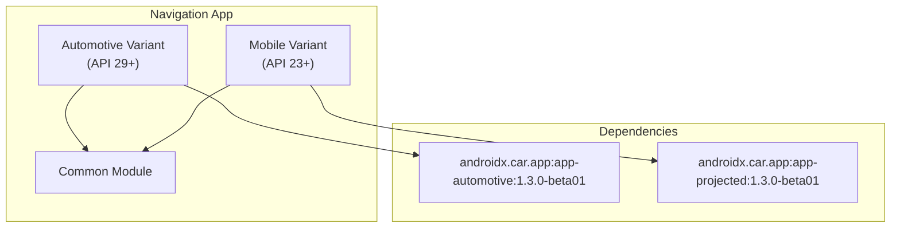
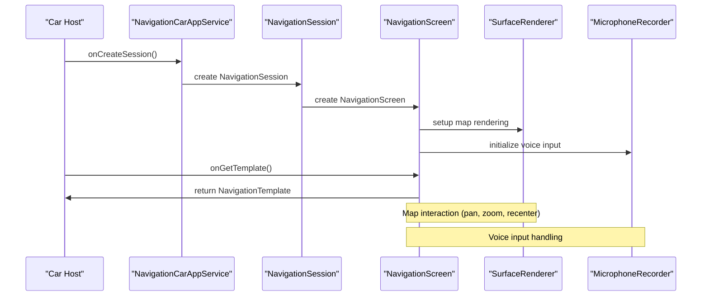
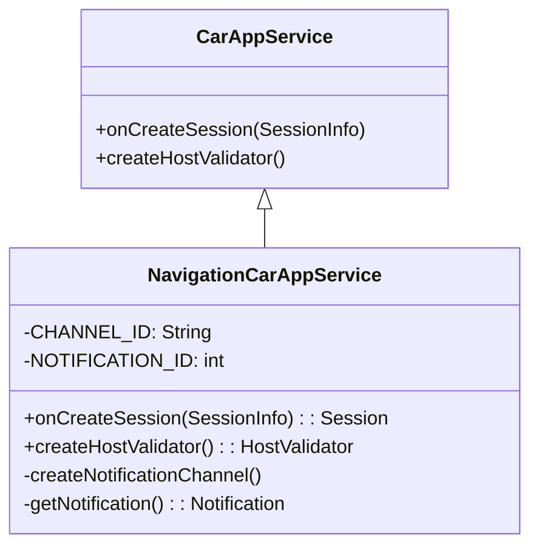
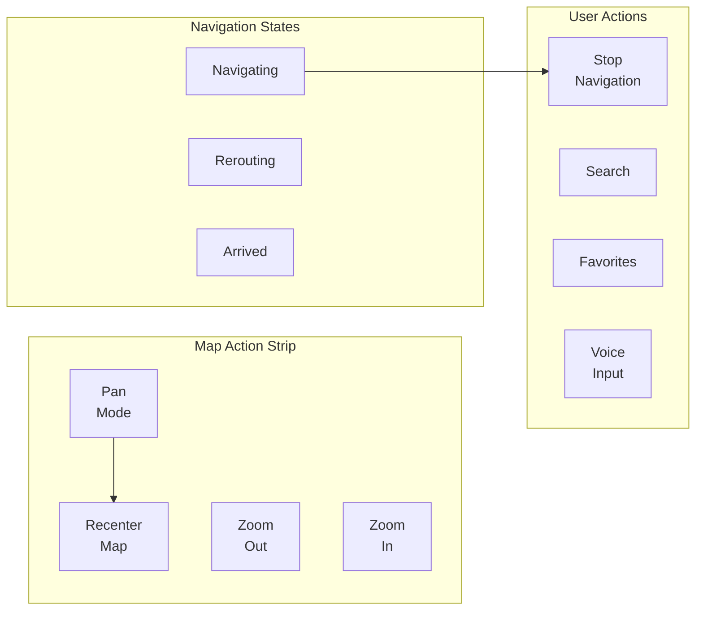
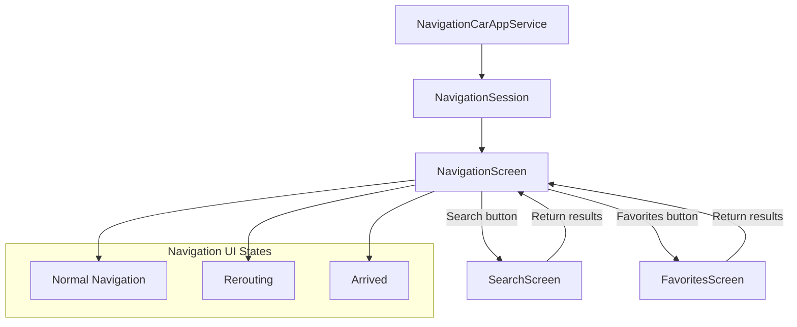

<!-- source: DeepWiki mcp.deepwiki.com · repo android/car-samples · page 3.1 Navigation App · fetched 2026-10-23 -->

# Navigation App

<details>
<summary>Relevant source files</summary>

The following files were used as context for generating this wiki page:

- [car_app_library/navigation/automotive/build.gradle](car_app_library/navigation/automotive/build.gradle)
- [car_app_library/navigation/common/src/main/java/androidx/car/app/sample/navigation/common/car/MicrophoneRecorder.java](car_app_library/navigation/common/src/main/java/androidx/car/app/sample/navigation/common/car/MicrophoneRecorder.java)
- [car_app_library/navigation/common/src/main/java/androidx/car/app/sample/navigation/common/car/NavigationCarAppService.java](car_app_library/navigation/common/src/main/java/androidx/car/app/sample/navigation/common/car/NavigationCarAppService.java)
- [car_app_library/navigation/common/src/main/java/androidx/car/app/sample/navigation/common/car/NavigationScreen.java](car_app_library/navigation/common/src/main/java/androidx/car/app/sample/navigation/common/car/NavigationScreen.java)
- [car_app_library/navigation/common/src/main/res/drawable/ic_add_stop.xml](car_app_library/navigation/common/src/main/res/drawable/ic_add_stop.xml)
- [car_app_library/navigation/mobile/build.gradle](car_app_library/navigation/mobile/build.gradle)
- [car_app_library/navigation/mobile/src/main/AndroidManifest.xml](car_app_library/navigation/mobile/src/main/AndroidManifest.xml)
- [car_app_library/showcase/automotive/build.gradle](car_app_library/showcase/automotive/build.gradle)
- [car_app_library/showcase/common/src/main/java/androidx/car/app/sample/showcase/common/TaskRestrictionDemoScreen.java](car_app_library/showcase/common/src/main/java/androidx/car/app/sample/showcase/common/TaskRestrictionDemoScreen.java)
- [car_app_library/showcase/common/src/main/java/androidx/car/app/sample/showcase/common/templates/ListTemplateDemoScreen.java](car_app_library/showcase/common/src/main/java/androidx/car/app/sample/showcase/common/templates/ListTemplateDemoScreen.java)
- [car_app_library/showcase/common/src/main/res/values-af/strings.xml](car_app_library/showcase/common/src/main/res/values-af/strings.xml)
- [car_app_library/showcase/common/src/main/res/values-am/strings.xml](car_app_library/showcase/common/src/main/res/values-am/strings.xml)
- [car_app_library/showcase/common/src/main/res/values-ar/strings.xml](car_app_library/showcase/common/src/main/res/values-ar/strings.xml)
- [car_app_library/showcase/common/src/main/res/values-as/strings.xml](car_app_library/showcase/common/src/main/res/values-as/strings.xml)
- [car_app_library/showcase/common/src/main/res/values-az/strings.xml](car_app_library/showcase/common/src/main/res/values-az/strings.xml)
- [car_app_library/showcase/common/src/main/res/values-b+sr+Latn/strings.xml](car_app_library/showcase/common/src/main/res/values-b+sr+Latn/strings.xml)
- [car_app_library/showcase/common/src/main/res/values-be/strings.xml](car_app_library/showcase/common/src/main/res/values-be/strings.xml)
- [car_app_library/showcase/common/src/main/res/values-bg/strings.xml](car_app_library/showcase/common/src/main/res/values-bg/strings.xml)
- [car_app_library/showcase/mobile/build.gradle](car_app_library/showcase/mobile/build.gradle)

</details>


## Purpose and Scope

The Navigation App is a sample application that demonstrates how to implement a navigation experience for Android Automotive OS and Android Auto. It showcases proper usage of the AndroidX Car App Library's navigation templates, surface rendering for maps, turn-by-turn directions, and other navigation-specific features. This document covers the architecture, components, and functionality of the Navigation App within the car-samples repository.

## Architecture Overview

The Navigation App follows the standard module structure seen across the car-samples repository, with separate implementations for Automotive OS and mobile devices, plus shared common code.

### Module Structure Diagram



Sources: [car_app_library/navigation/automotive/build.gradle:17-52](), [car_app_library/navigation/mobile/build.gradle:17-52]()

### Build Configuration

The app has separate build configurations for each variant:

| Variant | Min SDK | Target SDK | Main Dependency | Application ID |
|---------|---------|------------|-----------------|----------------|
| Automotive | 29 | 33 | androidx.car.app:app-automotive | androidx.car.app.sample.navigation |
| Mobile | 23 | 33 | androidx.car.app:app-projected | androidx.car.app.sample.navigation |

Sources: [car_app_library/navigation/automotive/build.gradle:19-51](), [car_app_library/navigation/mobile/build.gradle:19-51]()

## Core Components

The Navigation App consists of several key components that work together to provide the navigation experience.

### Component Relationship Diagram



Sources: [car_app_library/navigation/common/src/main/java/androidx/car/app/sample/navigation/common/car/NavigationCarAppService.java:43-122](), [car_app_library/navigation/common/src/main/java/androidx/car/app/sample/navigation/common/car/NavigationScreen.java:45-343]()

### NavigationCarAppService

`NavigationCarAppService` is the entry point for the app and extends `CarAppService` from the AndroidX Car App Library. Key responsibilities include:

- Creating and managing the navigation session
- Running as a foreground service for location access
- Handling host validation
- Managing notification channel



Sources: [car_app_library/navigation/common/src/main/java/androidx/car/app/sample/navigation/common/car/NavigationCarAppService.java:43-122]()

### NavigationScreen

`NavigationScreen` is the main UI component that presents navigation information using the `NavigationTemplate`. It handles:

- Displaying the map via SurfaceRenderer
- Showing turn-by-turn directions and distance
- Managing navigation state (navigating, rerouting, arrived)
- Handling user interactions with map controls
- Integration with voice input via MicrophoneRecorder

Sources: [car_app_library/navigation/common/src/main/java/androidx/car/app/sample/navigation/common/car/NavigationScreen.java:45-343]()

## Navigation Features

### Navigation UI Components

The app demonstrates a comprehensive navigation interface using the `NavigationTemplate` with the following components:

- Map rendering with pan and zoom controls
- Turn-by-turn directions with maneuvers
- Step remaining distance indicators
- Destination travel estimates
- Junction images for complex intersections
- Lane guidance
- Action strip with navigation-specific actions

Sources: [car_app_library/navigation/common/src/main/java/androidx/car/app/sample/navigation/common/car/NavigationScreen.java:133-298]()

### Map Controls Diagram



Sources: [car_app_library/navigation/common/src/main/java/androidx/car/app/sample/navigation/common/car/NavigationScreen.java:196-248]()

### Voice Input

The app demonstrates voice input capabilities through the `MicrophoneRecorder` class:

- Requesting microphone permissions
- Recording audio through `CarAudioRecord`
- Storing recordings as WAV files
- Playback of recorded audio
- Proper audio focus management

Sources: [car_app_library/navigation/common/src/main/java/androidx/car/app/sample/navigation/common/car/MicrophoneRecorder.java:55-255]()

## Android Manifest Configuration

The app declares important configurations in its manifest:

### Required Permissions

```
- ACCESS_FINE_LOCATION
- ACCESS_COARSE_LOCATION
- NAVIGATION_TEMPLATES
- ACCESS_SURFACE
- FOREGROUND_SERVICE
- RECORD_AUDIO
```

### Service Declarations

The app registers two main services:

1. **NavigationCarAppService**
   - Exported to be accessible to the car host
   - Declared as a navigation category service
   - Handles geo URI navigation intents

2. **NavigationService**
   - Handles the actual navigation processing
   - Runs as a foreground service

Sources: [car_app_library/navigation/mobile/src/main/AndroidManifest.xml:22-73]()

## UI Flow

The Navigation App demonstrates several screens and UI flows:



Sources: [car_app_library/navigation/common/src/main/java/androidx/car/app/sample/navigation/common/car/NavigationScreen.java:308-342]()

## Implementation Notes

### Foreground Service

The app runs as a foreground service to ensure location access works properly, with a persistent notification to indicate the app is running.

```java
// NavigationCarAppService.java
startForeground(NOTIFICATION_ID, getNotification());
```

Sources: [car_app_library/navigation/common/src/main/java/androidx/car/app/sample/navigation/common/car/NavigationCarAppService.java:59-73]()

### Multi-Platform Support

The Navigation App is structured to work on both Android Automotive OS and Android Auto with minimal code duplication. The common module contains most of the functionality, with platform-specific implementations in the automotive and mobile modules.

Sources: [car_app_library/navigation/automotive/build.gradle:17-52](), [car_app_library/navigation/mobile/build.gradle:17-52]()

## Summary

The Navigation App demonstrates a complete implementation of a navigation experience for Android Automotive OS and Android Auto using the AndroidX Car App Library. It showcases map rendering, turn-by-turn directions, voice input, and other features essential for a navigation app in the car environment, following the best practices for automotive app development.

---

