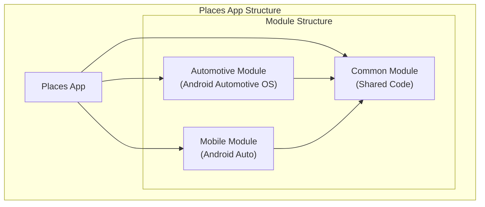
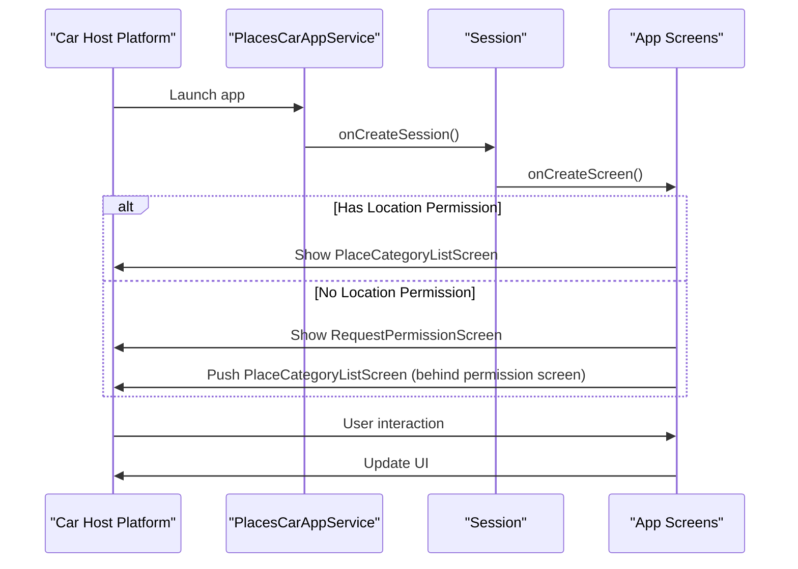
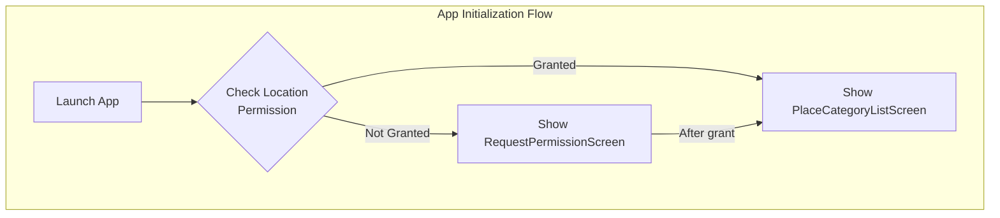
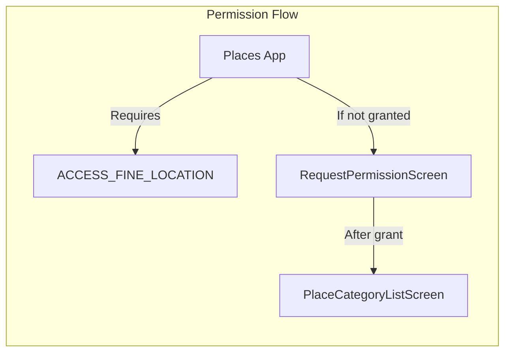

<!-- source: DeepWiki mcp.deepwiki.com · repo android/car-samples · page 3.2 Places App · fetched 2026-10-23 -->

# Places App

<details>
<summary>Relevant source files</summary>

The following files were used as context for generating this wiki page:

- [car_app_library/helloworld/automotive/build.gradle](car_app_library/helloworld/automotive/build.gradle)
- [car_app_library/helloworld/common/build.gradle](car_app_library/helloworld/common/build.gradle)
- [car_app_library/helloworld/common/src/main/java/androidx/car/app/sample/helloworld/common/HelloWorldService.java](car_app_library/helloworld/common/src/main/java/androidx/car/app/sample/helloworld/common/HelloWorldService.java)
- [car_app_library/helloworld/common/src/test/java/androidx/car/app/sample/helloworld/common/HelloWorldSessionTest.java](car_app_library/helloworld/common/src/test/java/androidx/car/app/sample/helloworld/common/HelloWorldSessionTest.java)
- [car_app_library/helloworld/mobile/build.gradle](car_app_library/helloworld/mobile/build.gradle)
- [car_app_library/navigation/common/src/main/java/androidx/car/app/sample/navigation/common/car/SurfaceRenderer.java](car_app_library/navigation/common/src/main/java/androidx/car/app/sample/navigation/common/car/SurfaceRenderer.java)
- [car_app_library/places/automotive/build.gradle](car_app_library/places/automotive/build.gradle)
- [car_app_library/places/common/build.gradle](car_app_library/places/common/build.gradle)
- [car_app_library/places/common/src/main/java/androidx/car/app/sample/places/common/PlacesCarAppService.java](car_app_library/places/common/src/main/java/androidx/car/app/sample/places/common/PlacesCarAppService.java)
- [car_app_library/places/mobile/build.gradle](car_app_library/places/mobile/build.gradle)
- [car_app_library/showcase/common/src/main/AndroidManifest.xml](car_app_library/showcase/common/src/main/AndroidManifest.xml)
- [car_app_library/showcase/common/src/main/java/androidx/car/app/sample/showcase/common/ShowcaseService.java](car_app_library/showcase/common/src/main/java/androidx/car/app/sample/showcase/common/ShowcaseService.java)
- [car_app_library/showcase/common/src/main/java/androidx/car/app/sample/showcase/common/common/PlaceInfo.java](car_app_library/showcase/common/src/main/java/androidx/car/app/sample/showcase/common/common/PlaceInfo.java)
- [car_app_library/showcase/common/src/main/java/androidx/car/app/sample/showcase/common/common/SamplePlaces.java](car_app_library/showcase/common/src/main/java/androidx/car/app/sample/showcase/common/common/SamplePlaces.java)
- [car_app_library/showcase/common/src/main/java/androidx/car/app/sample/showcase/common/navigation/routing/ArrivedDemoScreen.java](car_app_library/showcase/common/src/main/java/androidx/car/app/sample/showcase/common/navigation/routing/ArrivedDemoScreen.java)

</details>


## Overview

The Places App is a sample application that demonstrates how to build a location-based application for Android Automotive OS and Android Auto using the AndroidX Car App Library. It provides a complete implementation of browsing, searching, and viewing details of places—similar to a simplified points of interest (POI) finder application.

The app showcases how to use location permissions, display lists of places, and implement place detail screens optimized for the car environment. It serves as a reference for developers building location-based applications for automotive platforms.

Sources:
[car_app_library/places/common/src/main/java/androidx/car/app/sample/places/common/PlacesCarAppService.java:16-72]()

## Architecture

The Places App follows the standard architecture pattern used across all car sample applications, with separate modules for different target platforms while sharing common code.



### Module Details

- **Automotive Module**: Targets Android Automotive OS (API 29+), packaged as a standalone application that runs directly on the vehicle's infotainment system.
- **Mobile Module**: Targets Android mobile devices (API 23+), packaged as a mobile application that projects its UI to the car display via Android Auto.
- **Common Module**: Contains shared code including screens, models, and business logic used by both variants.

Sources:
[car_app_library/places/automotive/build.gradle:16-49]()
[car_app_library/places/mobile/build.gradle:16-49]()
[car_app_library/places/common/build.gradle:16-38]()

## Application Components

The Places App follows the standard structure of Android car apps with the following key components:



### Key Components

1. **PlacesCarAppService**: The main entry point that connects to the car environment
2. **Session**: Manages the app lifecycle and initializes the screens
3. **Screens**: 
   - PlaceCategoryListScreen: Displays categories of places
   - RequestPermissionScreen: Requests location permission if not granted
   - Additional screens for place lists and details

Sources:
[car_app_library/places/common/src/main/java/androidx/car/app/sample/places/common/PlacesCarAppService.java:39-72]()

## Implementation Details

### Core Service Implementation

The `PlacesCarAppService` extends the `CarAppService` class and implements two key methods:

1. `onCreateSession()`: Creates a new Session instance when the app is launched
2. `createHostValidator()`: Validates that the host platform is allowed to connect to the app

When launched, the app checks for location permissions and either shows the main screen or a permission request screen.



Sources:
[car_app_library/places/common/src/main/java/androidx/car/app/sample/places/common/PlacesCarAppService.java:39-72]()

### Place Data Model

The app uses a `PlaceInfo` model to represent location data with the following properties:

- Title
- Address
- Description
- Phone number
- Location (latitude/longitude)
- Marker (visual representation on map)

This model is similar to the one used in the Showcase App's sample places implementation.

Sources:
[car_app_library/showcase/common/src/main/java/androidx/car/app/sample/showcase/common/common/PlaceInfo.java:16-47]()
[car_app_library/showcase/common/src/main/java/androidx/car/app/sample/showcase/common/common/SamplePlaces.java:51-322]()

## UI Components and Templates

The Places App uses several UI templates from the AndroidX Car App Library to display content in a car-optimized format:

| Template Type | Purpose | Usage in Places App |
|---------------|---------|-------------------|
| PlaceListTemplate | Displays lists of places with markers | Main place category lists |
| ItemList | Building block for lists | Used inside templates to show place data |
| Place | Represents a location with a marker | Each location in the list |
| Row | Individual list item | Displays place information |

The app also leverages the `PlaceMarker` component to represent locations visually with different marker types:

1. Icon markers (predefined icons)
2. Image markers (custom images)
3. Text markers (labels with color)

Sources:
[car_app_library/showcase/common/src/main/java/androidx/car/app/sample/showcase/common/common/SamplePlaces.java:97-201]()

## Permissions

The Places App requires location permissions to provide its core functionality:



The app uses the Android permission system to request `ACCESS_FINE_LOCATION` permission from the user. If not granted, it shows a permission request screen before allowing access to the main functionality.

Sources:
[car_app_library/places/common/src/main/java/androidx/car/app/sample/places/common/PlacesCarAppService.java:46-56]()
[car_app_library/showcase/common/src/main/AndroidManifest.xml:20-22]()

## Build Configuration

The Places App is configured with specific build settings for each variant:

### Automotive Variant
- Minimum SDK version: 29 (Android 10)
- Target SDK version: 32
- Uses the `app-automotive` dependency from AndroidX Car App

### Mobile Variant
- Minimum SDK version: 23 (Android 6.0)
- Target SDK version: 32
- Uses the `app-projected` dependency from AndroidX Car App

Both variants implement code shrinking, obfuscation, and optimization for release builds through ProGuard configuration.

Sources:
[car_app_library/places/automotive/build.gradle:19-49]()
[car_app_library/places/mobile/build.gradle:19-49]()
[car_app_library/places/common/build.gradle:19-38]()

## Testing and Deployment

The app can be tested on:

1. Android Automotive OS emulator (for the automotive variant)
2. Desktop Head Unit (DHU) simulator (for the mobile variant)

To deploy the app, you can use Android Studio or Gradle commands:

```
./gradlew :places:automotive:assemble    # Build automotive variant
./gradlew :places:mobile:assemble        # Build mobile variant
```

The Places App shares the same test infrastructure as other car sample apps, with the potential to create unit tests similar to those in the HelloWorld app.

Sources:
[car_app_library/helloworld/common/src/test/java/androidx/car/app/sample/helloworld/common/HelloWorldSessionTest.java:16-67]()

## Summary

The Places App demonstrates a complete implementation of a location-based application for Android Automotive OS and Android Auto. It showcases how to:

1. Request and handle location permissions
2. Display lists of places using car-optimized templates
3. Show place details and markers
4. Structure a car app for both automotive and mobile targets

This sample serves as a practical reference for developers building location-based applications for automotive platforms using the AndroidX Car App Library.

---

