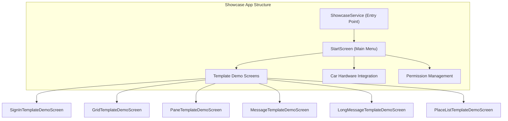
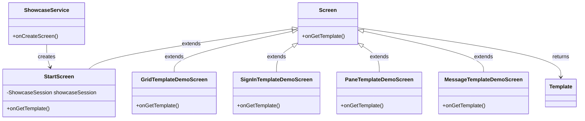
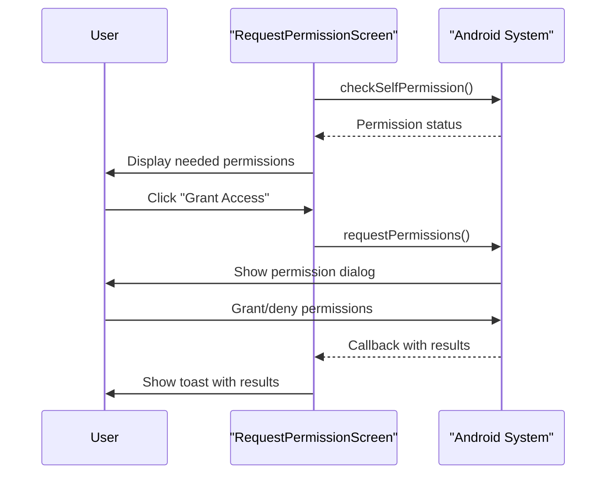

<!-- source: DeepWiki mcp.deepwiki.com · repo android/car-samples · page 3.3 Showcase App · fetched 2026-10-23 -->

# Showcase App

<details>
<summary>Relevant source files</summary>

The following files were used as context for generating this wiki page:

- [car_app_library/navigation/common/build.gradle](car_app_library/navigation/common/build.gradle)
- [car_app_library/showcase/automotive/src/main/AndroidManifest.xml](car_app_library/showcase/automotive/src/main/AndroidManifest.xml)
- [car_app_library/showcase/common/build.gradle](car_app_library/showcase/common/build.gradle)
- [car_app_library/showcase/common/src/main/java/androidx/car/app/sample/showcase/common/StartScreen.java](car_app_library/showcase/common/src/main/java/androidx/car/app/sample/showcase/common/StartScreen.java)
- [car_app_library/showcase/common/src/main/java/androidx/car/app/sample/showcase/common/misc/RequestPermissionScreen.java](car_app_library/showcase/common/src/main/java/androidx/car/app/sample/showcase/common/misc/RequestPermissionScreen.java)
- [car_app_library/showcase/common/src/main/java/androidx/car/app/sample/showcase/common/renderer/CarHardwareRenderer.java](car_app_library/showcase/common/src/main/java/androidx/car/app/sample/showcase/common/renderer/CarHardwareRenderer.java)
- [car_app_library/showcase/common/src/main/java/androidx/car/app/sample/showcase/common/templates/GridTemplateDemoScreen.java](car_app_library/showcase/common/src/main/java/androidx/car/app/sample/showcase/common/templates/GridTemplateDemoScreen.java)
- [car_app_library/showcase/common/src/main/java/androidx/car/app/sample/showcase/common/templates/LongMessageTemplateDemoScreen.java](car_app_library/showcase/common/src/main/java/androidx/car/app/sample/showcase/common/templates/LongMessageTemplateDemoScreen.java)
- [car_app_library/showcase/common/src/main/java/androidx/car/app/sample/showcase/common/templates/MessageTemplateDemoScreen.java](car_app_library/showcase/common/src/main/java/androidx/car/app/sample/showcase/common/templates/MessageTemplateDemoScreen.java)
- [car_app_library/showcase/common/src/main/java/androidx/car/app/sample/showcase/common/templates/PaneTemplateDemoScreen.java](car_app_library/showcase/common/src/main/java/androidx/car/app/sample/showcase/common/templates/PaneTemplateDemoScreen.java)
- [car_app_library/showcase/common/src/main/java/androidx/car/app/sample/showcase/common/templates/PlaceListTemplateBrowseDemoScreen.java](car_app_library/showcase/common/src/main/java/androidx/car/app/sample/showcase/common/templates/PlaceListTemplateBrowseDemoScreen.java)
- [car_app_library/showcase/common/src/main/java/androidx/car/app/sample/showcase/common/templates/SignInTemplateDemoScreen.java](car_app_library/showcase/common/src/main/java/androidx/car/app/sample/showcase/common/templates/SignInTemplateDemoScreen.java)

</details>


The Showcase App is a comprehensive demonstration application in the Android Car Samples repository. It exemplifies the various UI templates, features, and capabilities of the AndroidX Car App Library, serving as a reference implementation for developers building applications for Android Auto and Android Automotive OS.

This page documents the architecture, components, and key features of the Showcase App. For information about other sample applications in the repository, see [Navigation App](#3.1), [Places App](#3.2), or [HelloWorld App](#3.4).

## Overview

The Showcase App demonstrates a wide range of UI templates, car hardware integration capabilities, and user interaction patterns available in the AndroidX Car App Library. It follows the standard project structure of Car App Library samples with separate modules for Automotive OS, mobile platforms, and shared code.



Sources: [car_app_library/showcase/common/src/main/java/androidx/car/app/sample/showcase/common/StartScreen.java:15-129](), [car_app_library/showcase/automotive/src/main/AndroidManifest.xml:60-134]()

## Project Structure

The Showcase App follows the standard three-module architecture used across all samples in the repository:

1. **Common module**: Contains shared code used by both the Automotive and mobile variants
2. **Automotive variant**: Specifically built to run natively on Android Automotive OS
3. **Mobile variant**: Built to run on mobile phones and project to the car display via Android Auto

### Dependencies

The common module has the following core dependencies:

```
dependencies {
    implementation "androidx.core:core:1.6.0-alpha01"
    implementation "androidx.car.app:app:1.3.0-beta01"
    implementation "androidx.annotation:annotation-experimental:1.0.0"
}
```

Sources: [car_app_library/showcase/common/build.gradle:36-40]()

### Manifest Configuration

The Automotive variant's manifest includes specific permissions and features required for car integration:

- Standard permissions: `INTERNET`, `ACCESS_NETWORK_STATE`, `FOREGROUND_SERVICE`
- Car-specific permissions: `MAP_TEMPLATES`, `NAVIGATION_TEMPLATES`, `ACCESS_SURFACE`
- Car hardware permissions: `ACCESS_FINE_LOCATION`, `ACCESS_COARSE_LOCATION`, `CAR_SPEED`, etc.

It also specifies automotive-specific features like `android.hardware.type.automotive` and `android.software.car.templates_host`.

Sources: [car_app_library/showcase/automotive/src/main/AndroidManifest.xml:23-58]()

## Application Architecture



Sources: [car_app_library/showcase/common/src/main/java/androidx/car/app/sample/showcase/common/StartScreen.java:15-129](), [car_app_library/showcase/common/src/main/java/androidx/car/app/sample/showcase/common/templates/GridTemplateDemoScreen.java:16-267](), [car_app_library/showcase/common/src/main/java/androidx/car/app/sample/showcase/common/templates/SignInTemplateDemoScreen.java:16-356]()

The Showcase App follows the standard Android Car App architecture pattern:

1. `ShowcaseService` serves as the entry point that connects to the car environment
2. `StartScreen` provides the main menu with options to explore different templates and features
3. Various demo screens (e.g., `GridTemplateDemoScreen`, `SignInTemplateDemoScreen`) demonstrate specific UI templates
4. Each screen implements the `onGetTemplate()` method to provide the appropriate UI template

## Template Demonstrations

The Showcase App provides demonstrations of all standard car app templates. These templates are designed to provide consistent, driver-optimized UI patterns while adhering to safety guidelines.

### Menu Structure

The StartScreen presents a list of options for exploring different aspects of the app:

- Selectable Lists Demo
- Task Restriction Demo
- Navigation Demos
- Template Demos
- Text and Icons Demos
- Miscellaneous Demos

Sources: [car_app_library/showcase/common/src/main/java/androidx/car/app/sample/showcase/common/StartScreen.java:47-128]()

### Key Template Demonstrations

The app showcases the following UI templates:

#### SignInTemplate

Demonstrates different sign-in flows:
- Username/password input
- PIN-based signin
- Provider-based signin (e.g., Google)
- QR code signin

```mermaid
graph LR
    subgraph "SignInTemplateDemoScreen"
        UsernameState["Username Input State"]
        PasswordState["Password Input State"]
        PinState["PIN Sign-in State"]
        ProviderState["Provider Sign-in State"]
        QRCodeState["QR Code Sign-in State"]
        SignedInState["Signed In State"]
    end
    
    UsernameState --> PasswordState
    UsernameState --> PinState
    UsernameState --> ProviderState
    UsernameState --> QRCodeState
    PasswordState --> SignedInState
    PinState --> SignedInState
    ProviderState --> SignedInState
    QRCodeState --> SignedInState
    SignedInState --> UsernameState : "Sign Out"
```

Sources: [car_app_library/showcase/common/src/main/java/androidx/car/app/sample/showcase/common/templates/SignInTemplateDemoScreen.java:16-356]()

#### GridTemplate

Displays a grid of items with different states and configurations:
- Non-actionable items
- Clickable items
- Items with toggles
- Items with loading states
- Items with different image types (icons, large images)

The implementation demonstrates handling item limits based on car constraints and managing different item states.

Sources: [car_app_library/showcase/common/src/main/java/androidx/car/app/sample/showcase/common/templates/GridTemplateDemoScreen.java:16-267]()

#### PaneTemplate

Shows a details screen with:
- Multiple rows of information
- Large image
- Action buttons
- Custom action strip

The demo illustrates how to create rich detail views while adhering to car UI constraints.

Sources: [car_app_library/showcase/common/src/main/java/androidx/car/app/sample/showcase/common/templates/PaneTemplateDemoScreen.java:16-166]()

#### MessageTemplate & LongMessageTemplate

Demonstrates displaying messages with:
- Different action buttons
- Icons
- Primary and secondary actions
- Action strips

The screens show how to handle error scenarios and present information to users.

Sources: [car_app_library/showcase/common/src/main/java/androidx/car/app/sample/showcase/common/templates/MessageTemplateDemoScreen.java:16-100](), [car_app_library/showcase/common/src/main/java/androidx/car/app/sample/showcase/common/templates/LongMessageTemplateDemoScreen.java:16-96]()

#### PlaceListTemplate

Shows a map interface with:
- List of places
- Current location integration
- Place anchoring
- Navigation between browse and detail views

The implementation demonstrates location permission handling and proper location updates.

Sources: [car_app_library/showcase/common/src/main/java/androidx/car/app/sample/showcase/common/templates/PlaceListTemplateBrowseDemoScreen.java:16-129]()

## Car Hardware Integration

The Showcase App demonstrates integration with car hardware through the `CarHardwareRenderer` class, which accesses and displays various car sensor and state information.

```mermaid
flowchart TD
    subgraph "Car Hardware Integration"
        CarHardwareRenderer["CarHardwareRenderer"]
        CarHardwareManager["CarHardwareManager"]
        CarInfo["CarInfo"]
        CarSensors["CarSensors"]
    end
    
    subgraph "Hardware Data Types"
        TollCard["TollCard"]
        EnergyLevel["EnergyLevel"]
        Speed["Speed"]
        Mileage["Mileage"]
        EvStatus["EvStatus"]
        Accelerometer["Accelerometer"]
        Gyroscope["Gyroscope"]
        Compass["Compass"]
        CarLocation["CarHardwareLocation"]
    end
    
    CarHardwareRenderer --> CarHardwareManager : "accesses"
    CarHardwareManager --> CarInfo : "provides"
    CarHardwareManager --> CarSensors : "provides"
    
    CarInfo --> TollCard : "supplies"
    CarInfo --> EnergyLevel : "supplies"
    CarInfo --> Speed : "supplies"
    CarInfo --> Mileage : "supplies"
    CarInfo --> EvStatus : "supplies"
    
    CarSensors --> Accelerometer : "supplies"
    CarSensors --> Gyroscope : "supplies"
    CarSensors --> Compass : "supplies"
    CarSensors --> CarLocation : "supplies"
```

Sources: [car_app_library/showcase/common/src/main/java/androidx/car/app/sample/showcase/common/renderer/CarHardwareRenderer.java:16-549]()

### Hardware Data Types

The renderer accesses and displays the following car data:

| Car Data Type | Source | Information Displayed |
|---------------|--------|----------------------|
| TollCard | CarInfo | Card state |
| EnergyLevel | CarInfo | Energy is low, range, fuel percent, battery percent |
| Speed | CarInfo | Display speed, raw speed, unit |
| Mileage | CarInfo | Odometer, distance unit |
| EvStatus | CarInfo | Charge port connected, charge port open |
| Accelerometer | CarSensors | Force values |
| Gyroscope | CarSensors | Rotation values |
| Compass | CarSensors | Orientation values |
| CarHardwareLocation | CarSensors | Location data |

The renderer handles permission checks for each data type and gracefully displays error messages when permissions are missing.

Sources: [car_app_library/showcase/common/src/main/java/androidx/car/app/sample/showcase/common/renderer/CarHardwareRenderer.java:55-540]()

## Permission Management

The Showcase App demonstrates proper permission handling through the `RequestPermissionScreen` class, which:

1. Scans for all required permissions in the manifest
2. Checks which permissions have not been granted
3. Provides a UI for requesting those permissions
4. Handles special cases like location permissions



The screen also handles special cases like enabling location services on the device when needed, with appropriate UI flows for both Android Auto and Android Automotive OS environments.

Sources: [car_app_library/showcase/common/src/main/java/androidx/car/app/sample/showcase/common/misc/RequestPermissionScreen.java:16-194]()

## Summary

The Showcase App serves as a comprehensive reference implementation for car app development, demonstrating:

1. Proper use of all standard car UI templates
2. Integration with car hardware sensors and data
3. Appropriate permission handling
4. Adaptability to different car display constraints
5. Navigation between screens and state management
6. Handling different user interaction patterns safely

By exploring the different demos within the app, developers can understand how to implement these patterns in their own applications for both Android Auto and Android Automotive OS platforms.

---

