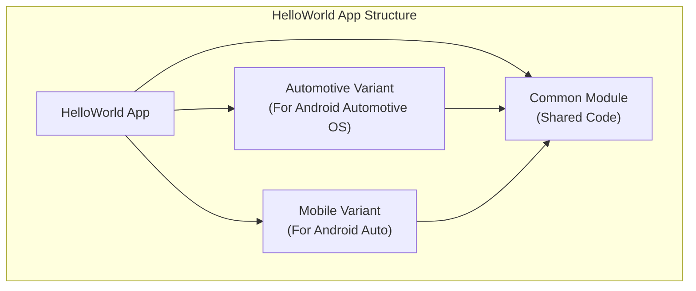
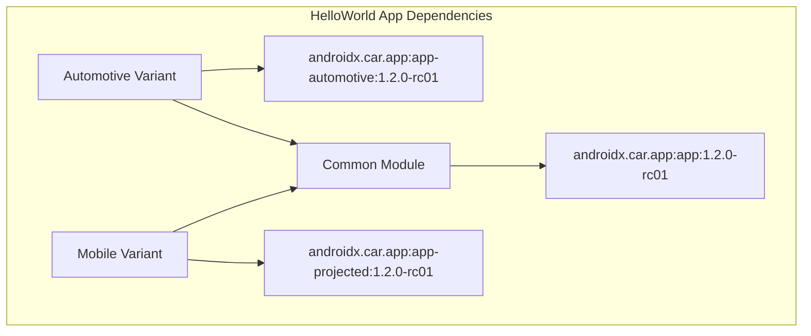
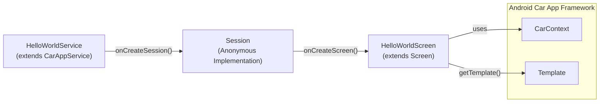
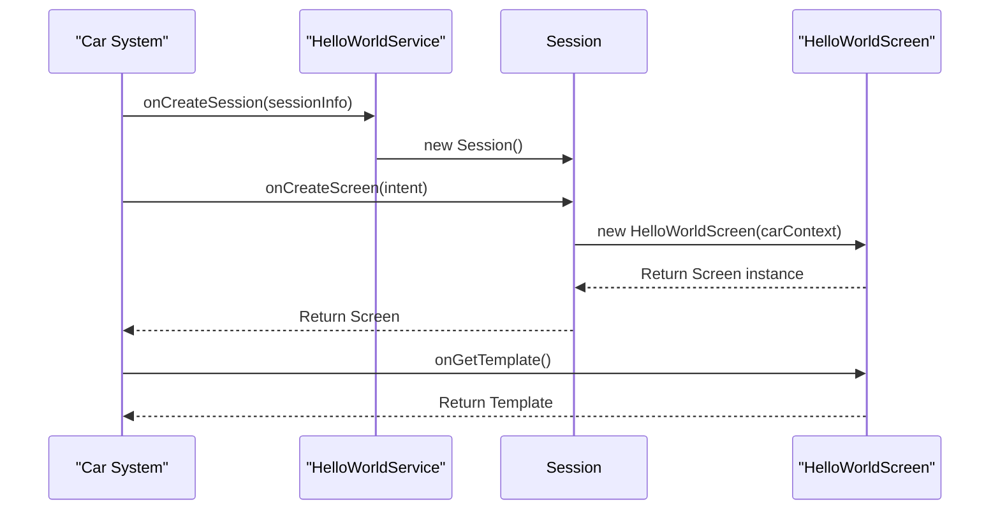

<!-- source: DeepWiki mcp.deepwiki.com · repo android/car-samples · page 3.4 HelloWorld App · fetched 2026-10-23 -->

# HelloWorld App

<details>
<summary>Relevant source files</summary>

The following files were used as context for generating this wiki page:

- [car_app_library/helloworld/automotive/build.gradle](car_app_library/helloworld/automotive/build.gradle)
- [car_app_library/helloworld/common/build.gradle](car_app_library/helloworld/common/build.gradle)
- [car_app_library/helloworld/common/src/main/java/androidx/car/app/sample/helloworld/common/HelloWorldService.java](car_app_library/helloworld/common/src/main/java/androidx/car/app/sample/helloworld/common/HelloWorldService.java)
- [car_app_library/helloworld/common/src/test/java/androidx/car/app/sample/helloworld/common/HelloWorldSessionTest.java](car_app_library/helloworld/common/src/test/java/androidx/car/app/sample/helloworld/common/HelloWorldSessionTest.java)
- [car_app_library/helloworld/mobile/build.gradle](car_app_library/helloworld/mobile/build.gradle)
- [car_app_library/places/automotive/build.gradle](car_app_library/places/automotive/build.gradle)
- [car_app_library/places/common/build.gradle](car_app_library/places/common/build.gradle)
- [car_app_library/places/common/src/main/java/androidx/car/app/sample/places/common/PlacesCarAppService.java](car_app_library/places/common/src/main/java/androidx/car/app/sample/places/common/PlacesCarAppService.java)
- [car_app_library/places/mobile/build.gradle](car_app_library/places/mobile/build.gradle)
- [car_app_library/showcase/common/src/main/java/androidx/car/app/sample/showcase/common/ShowcaseService.java](car_app_library/showcase/common/src/main/java/androidx/car/app/sample/showcase/common/ShowcaseService.java)

</details>


This document provides a comprehensive overview of the HelloWorld sample application included in the Android Car Samples repository. This app serves as the simplest possible example of a functional car app built with the Android for Cars App Library.

For more complex sample applications, see [Navigation App](#3.1), [Places App](#3.2), and [Showcase App](#3.3).

## Purpose and Overview

The HelloWorld App demonstrates the minimal implementation required to create a functional Android car app. It serves as an ideal starting point for developers new to car app development, illustrating the essential components and architecture while avoiding the complexity of more feature-rich samples.

Key features demonstrated:
- Basic car app structure and lifecycle
- Minimal UI implementation
- Multi-platform targeting (Android Auto and Android Automotive OS)



Sources: [car_app_library/helloworld/automotive/build.gradle](), [car_app_library/helloworld/mobile/build.gradle](), [car_app_library/helloworld/common/build.gradle]()

## Application Structure

The HelloWorld App follows the common pattern used across all sample applications in the repository, consisting of three modules:

| Module | Purpose | Target Platform | Min SDK |
|--------|---------|-----------------|---------|
| Automotive | Variant that runs directly on Android Automotive OS | Android Automotive OS | API 29+ |
| Mobile | Variant that runs on phones and projects to car displays | Android Mobile | API 23+ |
| Common | Shared functionality used by both variants | - | API 23+ |

### Module Dependencies

The Automotive variant uses the `androidx.car.app:app-automotive` library, while the Mobile variant uses the `androidx.car.app:app-projected` library. Both variants depend on the Common module, which uses the base `androidx.car.app:app` library.



Sources: [car_app_library/helloworld/automotive/build.gradle:47-50](), [car_app_library/helloworld/mobile/build.gradle:47-50](), [car_app_library/helloworld/common/build.gradle:46-48]()

## Implementation Details

### Core Components

The HelloWorld App consists of two primary components:

1. **HelloWorldService** - The entry point extending `CarAppService`
2. **HelloWorldScreen** - A simple screen implementation that displays a basic UI



Sources: [car_app_library/helloworld/common/src/main/java/androidx/car/app/sample/helloworld/common/HelloWorldService.java]()

### HelloWorldService

The `HelloWorldService` class serves as the main entry point for the application. It extends `CarAppService` and implements two key methods:

1. **onCreateSession()** - Creates and returns a new Session object
2. **createHostValidator()** - Creates a validator to determine which host platforms can connect to the app



Sources: [car_app_library/helloworld/common/src/main/java/androidx/car/app/sample/helloworld/common/HelloWorldService.java:42-52]()

### Host Validation

The HelloWorld App implements host validation to control which platforms can connect to it:

- In debug builds, it allows all hosts to connect using `HostValidator.ALLOW_ALL_HOSTS_VALIDATOR`
- In release builds, it allows only hosts defined in the `hosts_allowlist_sample` resource array

This security measure ensures the app can only be used by authorized car systems.

Sources: [car_app_library/helloworld/common/src/main/java/androidx/car/app/sample/helloworld/common/HelloWorldService.java:54-64]()

## Testing

The HelloWorld App includes a test class `HelloWorldSessionTest` that demonstrates how to test car app components using the Car App Testing Library. The test validates that the Session properly creates and returns a HelloWorldScreen instance.

Key test components:
- `TestCarContext` - A test implementation of CarContext
- `SessionController` - Controls the test Session lifecycle
- `TestScreenManager` - Allows inspection of Screens pushed by the Session

Sources: [car_app_library/helloworld/common/src/test/java/androidx/car/app/sample/helloworld/common/HelloWorldSessionTest.java]()

## Build and Run Instructions

### Building the App

The HelloWorld App can be built using Gradle either through Android Studio or the command line:

For the Automotive variant:
```
./gradlew :helloworld:automotive:assemble
```

For the Mobile variant:
```
./gradlew :helloworld:mobile:assemble
```

### Running the App

#### For Android Automotive OS
1. Install the Automotive variant APK on an Android Automotive OS emulator or device
2. Launch the app from the car's app launcher

#### For Android Auto
1. Install the Mobile variant APK on an Android mobile device
2. Connect the device to the Desktop Head Unit (DHU) or a compatible head unit
3. Launch Android Auto and find the app in the launcher

## Key Learning Points

The HelloWorld App demonstrates several important concepts for car app development:

1. **Module Structure** - Organizing code into automotive, mobile, and common modules for maximum code reuse
2. **Service Implementation** - Creating a CarAppService as the entry point to your app
3. **Minimal UI** - Implementing a simple Screen with a basic Template
4. **Host Validation** - Securing your app by controlling which hosts can connect to it

This sample serves as an excellent starting point for developers looking to create their first Android car app with a clean, minimal implementation.

Sources: [car_app_library/helloworld/automotive/build.gradle](), [car_app_library/helloworld/mobile/build.gradle](), [car_app_library/helloworld/common/build.gradle](), [car_app_library/helloworld/common/src/main/java/androidx/car/app/sample/helloworld/common/HelloWorldService.java]()

---

