<!-- source: DeepWiki mcp.deepwiki.com · repo android/car-samples · page 4 UI Components and Templates · fetched 2026-10-23 -->

# UI Components and Templates

<details>
<summary>Relevant source files</summary>

The following files were used as context for generating this wiki page:

- [car_app_library/navigation/common/src/main/java/androidx/car/app/sample/navigation/common/car/NavigationScreen.java](car_app_library/navigation/common/src/main/java/androidx/car/app/sample/navigation/common/car/NavigationScreen.java)
- [car_app_library/navigation/common/src/main/res/drawable/ic_add_stop.xml](car_app_library/navigation/common/src/main/res/drawable/ic_add_stop.xml)
- [car_app_library/showcase/common/src/main/java/androidx/car/app/sample/showcase/common/templates/GridTemplateDemoScreen.java](car_app_library/showcase/common/src/main/java/androidx/car/app/sample/showcase/common/templates/GridTemplateDemoScreen.java)
- [car_app_library/showcase/common/src/main/java/androidx/car/app/sample/showcase/common/templates/LongMessageTemplateDemoScreen.java](car_app_library/showcase/common/src/main/java/androidx/car/app/sample/showcase/common/templates/LongMessageTemplateDemoScreen.java)
- [car_app_library/showcase/common/src/main/java/androidx/car/app/sample/showcase/common/templates/MessageTemplateDemoScreen.java](car_app_library/showcase/common/src/main/java/androidx/car/app/sample/showcase/common/templates/MessageTemplateDemoScreen.java)
- [car_app_library/showcase/common/src/main/java/androidx/car/app/sample/showcase/common/templates/PaneTemplateDemoScreen.java](car_app_library/showcase/common/src/main/java/androidx/car/app/sample/showcase/common/templates/PaneTemplateDemoScreen.java)
- [car_app_library/showcase/common/src/main/java/androidx/car/app/sample/showcase/common/templates/PlaceListTemplateBrowseDemoScreen.java](car_app_library/showcase/common/src/main/java/androidx/car/app/sample/showcase/common/templates/PlaceListTemplateBrowseDemoScreen.java)
- [car_app_library/showcase/common/src/main/java/androidx/car/app/sample/showcase/common/templates/SignInTemplateDemoScreen.java](car_app_library/showcase/common/src/main/java/androidx/car/app/sample/showcase/common/templates/SignInTemplateDemoScreen.java)

</details>


This page documents the UI components and templates available in the Android Car Samples repository, focusing on the pre-defined UI patterns optimized for driving safety. For information about the core app components and lifecycle, see [Core App Components](#2.3). For details on surface rendering for custom UIs, see [Surface Rendering](#4.2).

## Template Architecture Overview

Templates are the fundamental UI building blocks in Android car apps, providing standardized, driver-optimized interfaces. The AndroidX Car App library offers various template types, each with specific use cases for displaying information safely while driving.

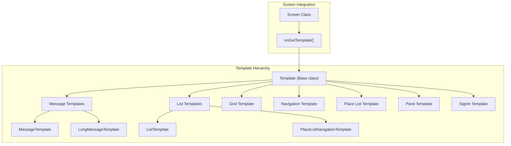

Sources: [car_app_library/showcase/common/src/main/java/androidx/car/app/sample/showcase/common/templates/MessageTemplateDemoScreen.java:44-99](), [car_app_library/showcase/common/src/main/java/androidx/car/app/sample/showcase/common/templates/SignInTemplateDemoScreen.java:109-135]()

## Screen and Template Integration

Car app UIs are built using a specific architecture where each screen must provide a template through the `onGetTemplate()` method.

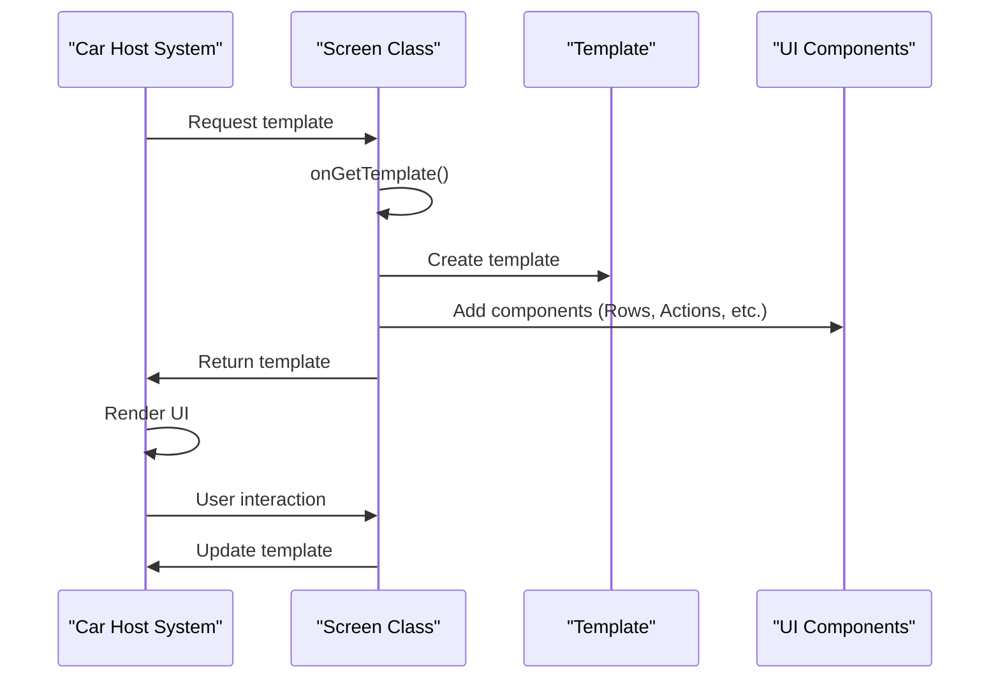

Sources: [car_app_library/navigation/common/src/main/java/androidx/car/app/sample/navigation/common/car/NavigationScreen.java:133-298](), [car_app_library/showcase/common/src/main/java/androidx/car/app/sample/showcase/common/templates/GridTemplateDemoScreen.java:209-246]()

## Common Template Components

All templates share common building blocks that can be combined to create the UI.

### Actions and ActionStrips

Actions represent interactive elements that users can tap, while ActionStrips are containers for these actions displayed at the bottom of a template.

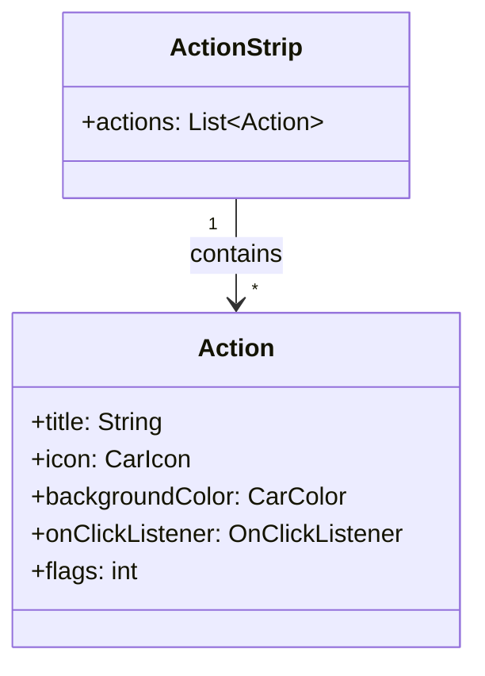

Example of creating an ActionStrip:

```
ActionStrip.Builder actionStripBuilder = new ActionStrip.Builder();
actionStripBuilder.addAction(
        new Action.Builder()
                .setTitle("Search")
                .setIcon(new CarIcon.Builder(IconCompat.createWithResource(
                        getCarContext(), R.drawable.ic_search_black36dp))
                        .build())
                .setOnClickListener(this::openSearch)
                .build());
```

Sources: [car_app_library/navigation/common/src/main/java/androidx/car/app/sample/navigation/common/car/NavigationScreen.java:143-196](), [car_app_library/showcase/common/src/main/java/androidx/car/app/sample/showcase/common/templates/MessageTemplateDemoScreen.java:60-97]()

### Rows and ItemLists

Rows are horizontal containers for text and images that can be grouped into ItemLists for use in various templates.

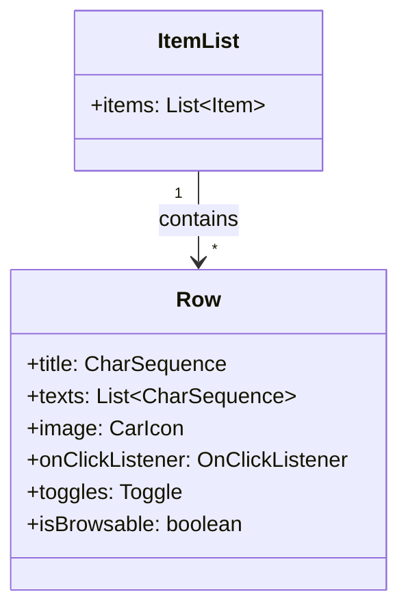

Sources: [car_app_library/showcase/common/src/main/java/androidx/car/app/sample/showcase/common/templates/PaneTemplateDemoScreen.java:76-93]()

## Template Types

The following templates are available in the AndroidX Car App library:

| Template Type | Purpose | Key Features |
|---------------|---------|--------------|
| MessageTemplate | Display simple messages | Title, message, icon, actions |
| LongMessageTemplate | Display longer messages | Scrollable text, actions |
| ListTemplate | Display lists of items | Multiple sections, header actions |
| GridTemplate | Display grid of items | Images, titles, loading states |
| PaneTemplate | Display detailed information | Image, rows of information, actions |
| SignInTemplate | Facilitate user sign-in | Multiple sign-in methods, validation |
| NavigationTemplate | Show navigation information | Map, routing, steps, travel estimates |
| PlaceListTemplate | Display places on a map | Place markers, browse locations |

Sources: [car_app_library/showcase/common/src/main/java/androidx/car/app/sample/showcase/common/templates/SignInTemplateDemoScreen.java:109-135](), [car_app_library/navigation/common/src/main/java/androidx/car/app/sample/navigation/common/car/NavigationScreen.java:133-298]()

### Message Templates

MessageTemplate and LongMessageTemplate are designed to show information or alerts to users.

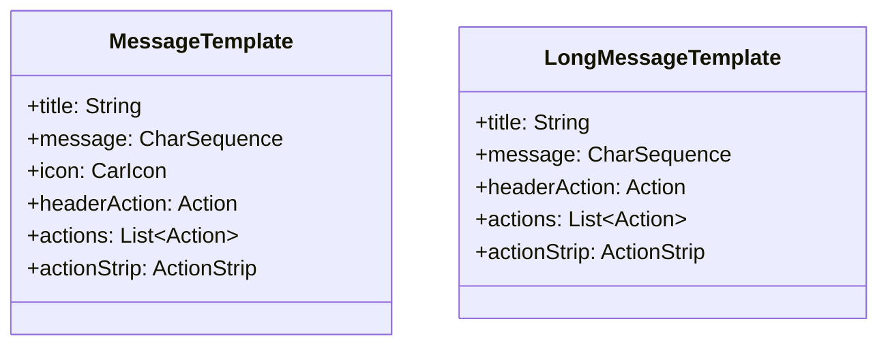

Example of creating a MessageTemplate:

```java
return new MessageTemplate.Builder(
        getCarContext().getString(R.string.msg_template_demo_text))
        .setTitle(getCarContext().getString(R.string.msg_template_demo_title))
        .setIcon(new CarIcon.Builder(IconCompat.createWithResource(
                getCarContext(), R.drawable.ic_emoji_food_beverage_white_48dp))
                .setTint(CarColor.GREEN)
                .build())
        .setHeaderAction(BACK)
        .addAction(primaryActionBuilder.build())
        .setActionStrip(new ActionStrip.Builder()
                .addAction(settings)
                .build())
        .build();
```

Sources: [car_app_library/showcase/common/src/main/java/androidx/car/app/sample/showcase/common/templates/MessageTemplateDemoScreen.java:44-99](), [car_app_library/showcase/common/src/main/java/androidx/car/app/sample/showcase/common/templates/LongMessageTemplateDemoScreen.java:44-95]()

### SignIn Template

SignInTemplate facilitates user authentication with several sign-in methods:

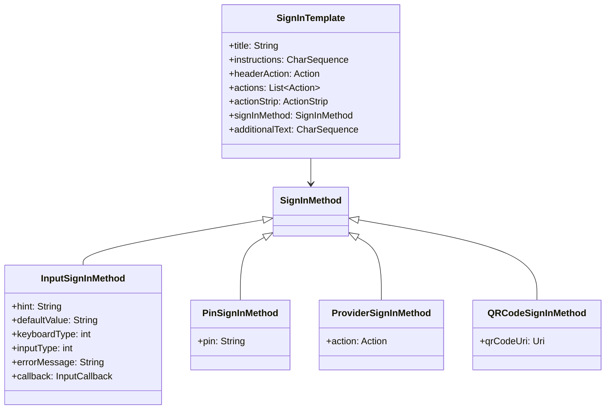

The SignInTemplate supports four different sign-in methods:

1. **InputSignInMethod**: For text input (username/password)
2. **PinSignInMethod**: For PIN-based authentication
3. **ProviderSignInMethod**: For third-party providers (like Google)
4. **QRCodeSignInMethod**: For QR code scanning

Sources: [car_app_library/showcase/common/src/main/java/androidx/car/app/sample/showcase/common/templates/SignInTemplateDemoScreen.java:136-354]()

### Navigation Template

The NavigationTemplate is used for turn-by-turn navigation applications:

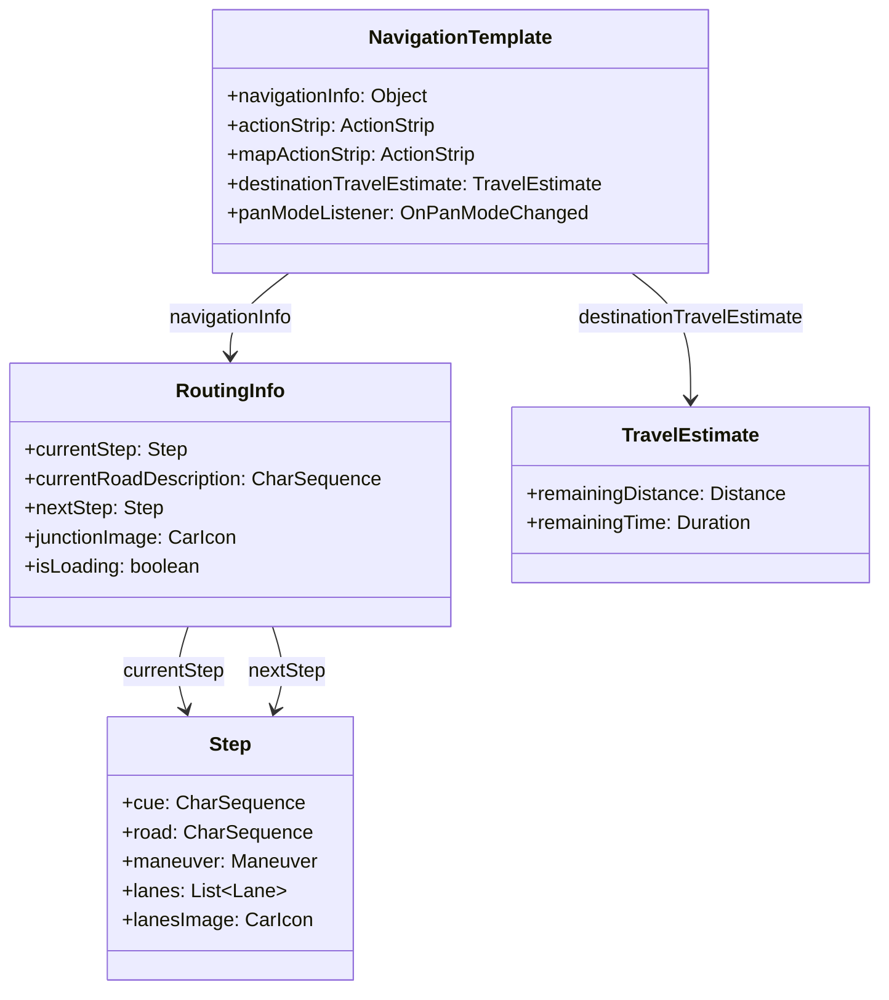

Example of configuring a NavigationTemplate:

```java
NavigationTemplate.Builder builder = new NavigationTemplate.Builder();
builder.setBackgroundColor(CarColor.SECONDARY);
builder.setActionStrip(actionStripBuilder.build());
builder.setMapActionStrip(mapActionStripBuilder.build());
builder.setDestinationTravelEstimate(destinationTravelEstimate);
builder.setNavigationInfo(routingInfoBuilder.build());
return builder.build();
```

Sources: [car_app_library/navigation/common/src/main/java/androidx/car/app/sample/navigation/common/car/NavigationScreen.java:133-298]()

### Grid Template

The GridTemplate displays a grid of items, each with an image, title, and optional text:

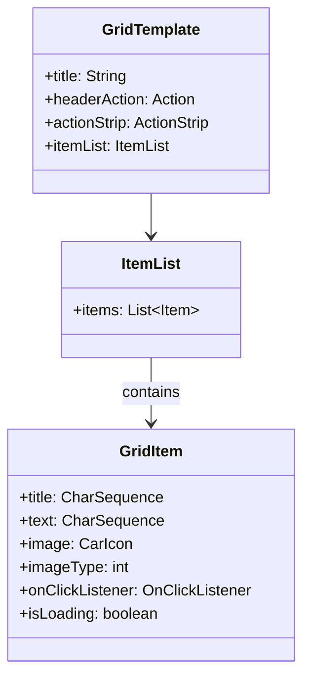

The GridTemplate can adjust its content based on car constraints to ensure a safe driving experience:

```java
// Adjust the item limit according to the car constrains
if (getCarContext().getCarAppApiLevel() > CarAppApiLevels.LEVEL_1) {
    itemLimit = Math.min(MAX_GRID_ITEMS,
            getCarContext().getCarService(ConstraintManager.class).getContentLimit(
                    ConstraintManager.CONTENT_LIMIT_TYPE_GRID));
}
```

Sources: [car_app_library/showcase/common/src/main/java/androidx/car/app/sample/showcase/common/templates/GridTemplateDemoScreen.java:89-206](), [car_app_library/showcase/common/src/main/java/androidx/car/app/sample/showcase/common/templates/GridTemplateDemoScreen.java:209-246]()

### Pane Template

The PaneTemplate displays detailed information using a large image and rows of data:

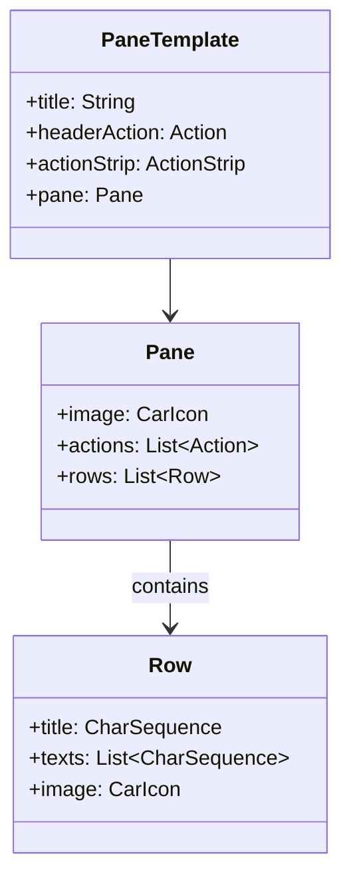

The PaneTemplate is useful for showing detailed information about a single item:

```java
Pane.Builder paneBuilder = new Pane.Builder();
// Add rows of information
for (int i = 0; i < listLimit; i++) {
    paneBuilder.addRow(createRow(i));
}
// Set a large image
paneBuilder.setImage(new CarIcon.Builder(image).build());
// Add actions
paneBuilder.addAction(primaryAction);
paneBuilder.addAction(secondaryAction);

return new PaneTemplate.Builder(paneBuilder.build())
        .setHeaderAction(Action.BACK)
        .setTitle("Details")
        .build();
```

Sources: [car_app_library/showcase/common/src/main/java/androidx/car/app/sample/showcase/common/templates/PaneTemplateDemoScreen.java:76-165]()

### PlaceList Template

The PlaceListMapTemplate displays places on a map:

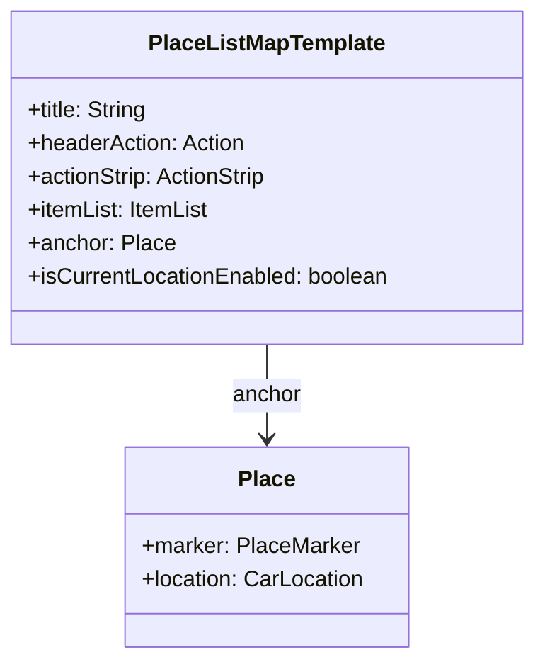

Example of creating a PlaceListMapTemplate:

```java
PlaceListMapTemplate.Builder builder = new PlaceListMapTemplate.Builder()
        .setItemList(new ItemList.Builder()
                .addItem(new Row.Builder()
                        .setTitle("Browse Places")
                        .setBrowsable(true)
                        .setOnClickListener(() -> navigateToBrowsePlaces())
                        .build())
                .build())
        .setTitle("Places")
        .setHeaderAction(Action.BACK)
        .setCurrentLocationEnabled(hasLocationPermission);

if (currentLocation != null) {
    builder.setAnchor(new Place.Builder(CarLocation.create(currentLocation)).build());
}

return builder.build();
```

Sources: [car_app_library/showcase/common/src/main/java/androidx/car/app/sample/showcase/common/templates/PlaceListTemplateBrowseDemoScreen.java:106-128]()

## Template Usage Flow

The following diagram illustrates the typical usage flow of templates within a car app:

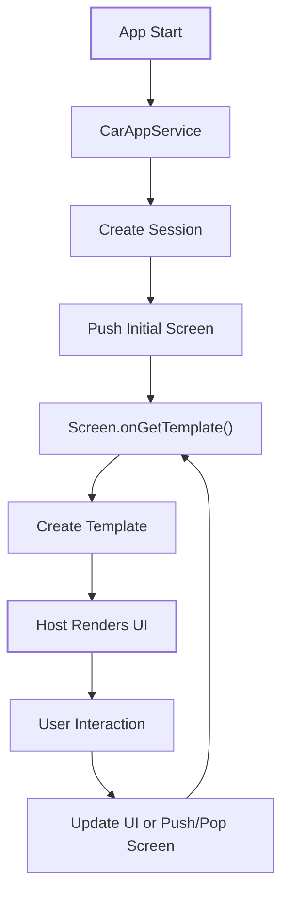

Sources: [car_app_library/showcase/common/src/main/java/androidx/car/app/sample/showcase/common/templates/SignInTemplateDemoScreen.java:61-107](), [car_app_library/navigation/common/src/main/java/androidx/car/app/sample/navigation/common/car/NavigationScreen.java:96-106]()

## Best Practices for Template Usage

1. **Safety First**: Templates are designed for driving safety. Use the standard templates rather than custom UIs whenever possible.

2. **Responsive Design**: Use the ConstraintManager to adapt your UI to different car displays:

   ```java
   int contentLimit = getCarContext().getCarService(ConstraintManager.class)
           .getContentLimit(ConstraintManager.CONTENT_LIMIT_TYPE_LIST);
   ```

3. **Platform Compatibility**: Check the car app API level before using newer features:

   ```java
   if (getCarContext().getCarAppApiLevel() >= CarAppApiLevels.LEVEL_4) {
       actionBuilder.setFlags(FLAG_PRIMARY);
   }
   ```

4. **Consistent Navigation**: Maintain a consistent navigation model with back actions and screen flow.

5. **Error Handling**: Display appropriate error messages and validation feedback using templates.

6. **Loading States**: Show loading indicators when content is being fetched or processed.

Sources: [car_app_library/showcase/common/src/main/java/androidx/car/app/sample/showcase/common/templates/GridTemplateDemoScreen.java:212-219](), [car_app_library/showcase/common/src/main/java/androidx/car/app/sample/showcase/common/templates/MessageTemplateDemoScreen.java:56-58](), [car_app_library/showcase/common/src/main/java/androidx/car/app/sample/showcase/common/templates/SignInTemplateDemoScreen.java:112-119]()

## Template Constraints and Limitations

Templates have specific constraints to ensure driving safety:

| Constraint Type | Description | Access Method |
|-----------------|-------------|---------------|
| Content Limit (List) | Maximum number of items in a list | `ConstraintManager.CONTENT_LIMIT_TYPE_LIST` |
| Content Limit (Grid) | Maximum number of items in a grid | `ConstraintManager.CONTENT_LIMIT_TYPE_GRID` |
| Content Limit (Pane) | Maximum number of rows in a pane | `ConstraintManager.CONTENT_LIMIT_TYPE_PANE` |
| Text Length | Maximum length of text in various components | Automatically enforced |
| Image Size | Maximum size of images | Automatically enforced |

Sources: [car_app_library/showcase/common/src/main/java/androidx/car/app/sample/showcase/common/templates/GridTemplateDemoScreen.java:212-219](), [car_app_library/showcase/common/src/main/java/androidx/car/app/sample/showcase/common/templates/PaneTemplateDemoScreen.java:102-106]()

---

