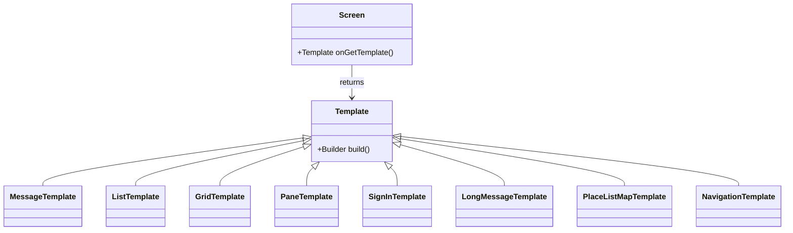
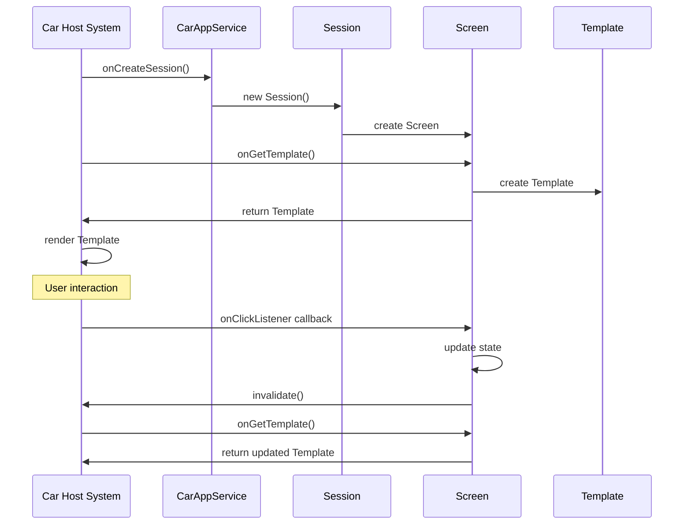
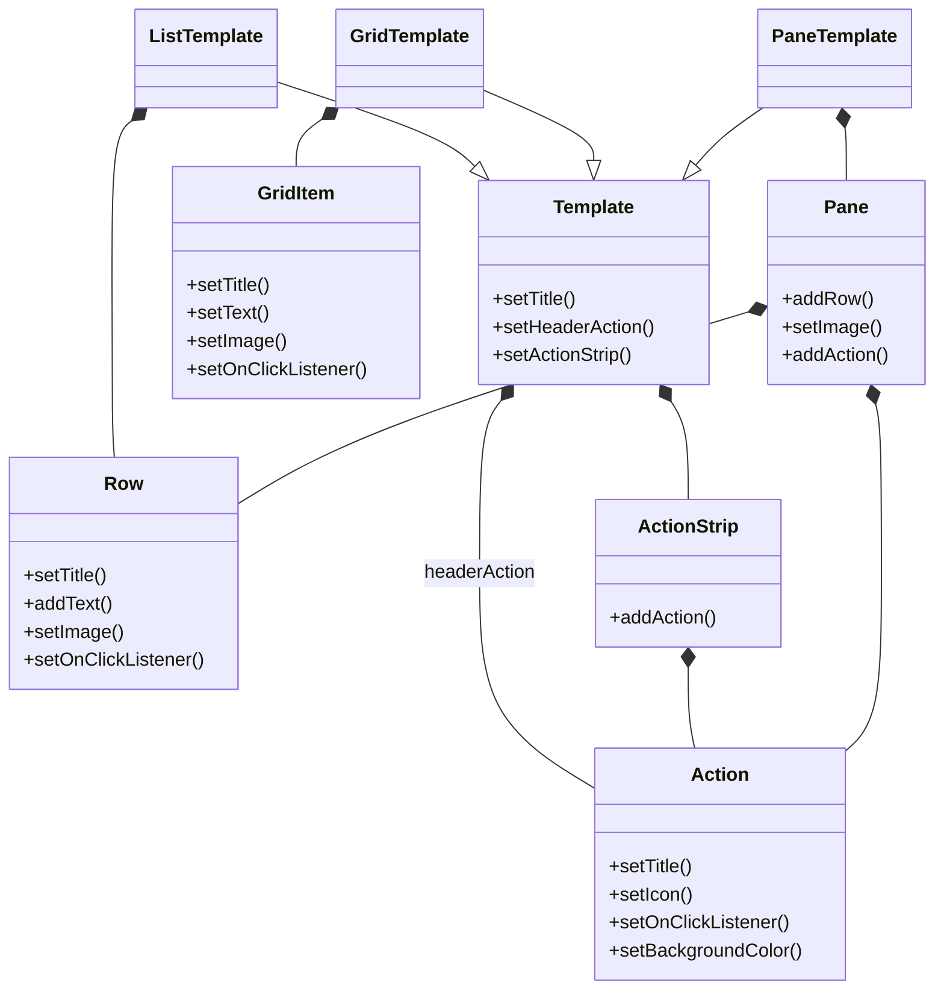
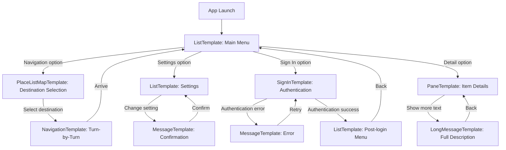

<!-- source: DeepWiki mcp.deepwiki.com · repo android/car-samples · page 4.1 Template Types · fetched 2026-10-23 -->

# Template Types

<details>
<summary>Relevant source files</summary>

The following files were used as context for generating this wiki page:

- [car_app_library/navigation/common/src/main/java/androidx/car/app/sample/navigation/common/car/NavigationCarAppService.java](car_app_library/navigation/common/src/main/java/androidx/car/app/sample/navigation/common/car/NavigationCarAppService.java)
- [car_app_library/navigation/mobile/src/main/AndroidManifest.xml](car_app_library/navigation/mobile/src/main/AndroidManifest.xml)
- [car_app_library/showcase/common/src/main/java/androidx/car/app/sample/showcase/common/templates/GridTemplateDemoScreen.java](car_app_library/showcase/common/src/main/java/androidx/car/app/sample/showcase/common/templates/GridTemplateDemoScreen.java)
- [car_app_library/showcase/common/src/main/java/androidx/car/app/sample/showcase/common/templates/ListTemplateDemoScreen.java](car_app_library/showcase/common/src/main/java/androidx/car/app/sample/showcase/common/templates/ListTemplateDemoScreen.java)
- [car_app_library/showcase/common/src/main/java/androidx/car/app/sample/showcase/common/templates/LongMessageTemplateDemoScreen.java](car_app_library/showcase/common/src/main/java/androidx/car/app/sample/showcase/common/templates/LongMessageTemplateDemoScreen.java)
- [car_app_library/showcase/common/src/main/java/androidx/car/app/sample/showcase/common/templates/MessageTemplateDemoScreen.java](car_app_library/showcase/common/src/main/java/androidx/car/app/sample/showcase/common/templates/MessageTemplateDemoScreen.java)
- [car_app_library/showcase/common/src/main/java/androidx/car/app/sample/showcase/common/templates/PaneTemplateDemoScreen.java](car_app_library/showcase/common/src/main/java/androidx/car/app/sample/showcase/common/templates/PaneTemplateDemoScreen.java)
- [car_app_library/showcase/common/src/main/java/androidx/car/app/sample/showcase/common/templates/PlaceListTemplateBrowseDemoScreen.java](car_app_library/showcase/common/src/main/java/androidx/car/app/sample/showcase/common/templates/PlaceListTemplateBrowseDemoScreen.java)
- [car_app_library/showcase/common/src/main/java/androidx/car/app/sample/showcase/common/templates/SignInTemplateDemoScreen.java](car_app_library/showcase/common/src/main/java/androidx/car/app/sample/showcase/common/templates/SignInTemplateDemoScreen.java)

</details>


This document provides an overview of the template system in the Android Car App Library. Templates are the primary UI building blocks for Android car apps, providing a consistent, driver-safe interface across different car displays.

Templates are pre-defined UI patterns optimized for driver safety and minimal distraction while meeting Android Auto and Android Automotive OS design guidelines. Instead of composing traditional Android views, car apps create template objects with the content they wish to display.

## Template Architecture Overview

Templates in the car app library follow a hierarchical structure that separates UI definition from content.



Sources:
[car_app_library/showcase/common/src/main/java/androidx/car/app/sample/showcase/common/templates/ListTemplateDemoScreen.java:41-124]()
[car_app_library/showcase/common/src/main/java/androidx/car/app/sample/showcase/common/templates/SignInTemplateDemoScreen.java:45-107]()
[car_app_library/navigation/common/src/main/java/androidx/car/app/sample/navigation/common/car/NavigationCarAppService.java:37-97]()

## Template Lifecycle

Templates are created and returned by the `onGetTemplate()` method in a `Screen` class. The car host system then renders the template according to the car's hardware capabilities and design guidelines.



Sources:
[car_app_library/navigation/common/src/main/java/androidx/car/app/sample/navigation/common/car/NavigationCarAppService.java:59-84]()
[car_app_library/showcase/common/src/main/java/androidx/car/app/sample/showcase/common/templates/ListTemplateDemoScreen.java:53-123]()

## Template Types

### 1. ListTemplate

A template for displaying lists of items in a scrollable container.

**Key characteristics:**
- Displays a scrollable list of rows
- Supports actions in the header and action strip
- Commonly used for menus and selection interfaces

**Example usage:**
```
ListTemplate.Builder()
    .setSingleList(listBuilder.build())
    .setTitle("List Template Demo")
    .setHeaderAction(Action.BACK)
    .setActionStrip(actionStrip)
    .build()
```

Sources:
[car_app_library/showcase/common/src/main/java/androidx/car/app/sample/showcase/common/templates/ListTemplateDemoScreen.java:111-121]()

### 2. GridTemplate

A template that displays items in a scrollable grid.

**Key characteristics:**
- Displays items in a grid format
- Supports icons, images, and text
- Can handle loading states for items
- Good for displaying a collection of selectable items

**Example usage:**
```
GridTemplate.Builder()
    .setHeaderAction(Action.APP_ICON)
    .setSingleList(gridItemListBuilder.build())
    .setTitle("Grid Template Demo")
    .setActionStrip(actionStrip)
    .setHeaderAction(BACK)
    .build()
```

Sources:
[car_app_library/showcase/common/src/main/java/androidx/car/app/sample/showcase/common/templates/GridTemplateDemoScreen.java:236-245]()

### 3. PaneTemplate

A template for displaying detailed information about a single item.

**Key characteristics:**
- Shows detailed information in a scrollable pane
- Can include an image, rows of information, and actions
- Used for detail views of items selected from lists or grids

**Example usage:**
```
PaneTemplate.Builder(paneBuilder.build())
    .setHeaderAction(Action.BACK)
    .setActionStrip(actionStrip)
    .setTitle("Pane Template Demo")
    .build()
```

Sources:
[car_app_library/showcase/common/src/main/java/androidx/car/app/sample/showcase/common/templates/PaneTemplateDemoScreen.java:143-164]()

### 4. MessageTemplate

A template for displaying a simple message to the user.

**Key characteristics:**
- Displays a title, message text, and optional icon
- Supports action buttons
- Used for notifications, confirmations, or error messages

**Example usage:**
```
MessageTemplate.Builder(messageText)
    .setTitle("Message Title")
    .setIcon(carIcon)
    .setHeaderAction(BACK)
    .addAction(primaryAction)
    .setActionStrip(actionStrip)
    .build()
```

Sources:
[car_app_library/showcase/common/src/main/java/androidx/car/app/sample/showcase/common/templates/MessageTemplateDemoScreen.java:72-98]()

### 5. LongMessageTemplate

A template for displaying longer messages that may require scrolling.

**Key characteristics:**
- Similar to MessageTemplate but optimized for longer content
- Available in API level 2 and higher
- Useful for terms of service, privacy policies, etc.

**Example usage:**
```
LongMessageTemplate.Builder(longMessageText)
    .setTitle("Long Message Demo")
    .setHeaderAction(BACK)
    .addAction(primaryAction)
    .setActionStrip(actionStrip)
    .build()
```

Sources:
[car_app_library/showcase/common/src/main/java/androidx/car/app/sample/showcase/common/templates/LongMessageTemplateDemoScreen.java:70-94]()

### 6. SignInTemplate

A template for user authentication.

**Key characteristics:**
- Supports different sign-in methods:
  - Input-based (username/password)
  - PIN-based
  - Provider-based (e.g., Google Sign-In)
  - QR code-based (API level 4+)
- Available in API level 2 and higher

**Example usage:**
```
SignInTemplate.Builder(signInMethod)
    .addAction(providerSignInAction)
    .setTitle("Sign In")
    .setInstructions("Enter your credentials")
    .setHeaderAction(Action.BACK)
    .setAdditionalText(additionalText)
    .build()
```

Sources:
[car_app_library/showcase/common/src/main/java/androidx/car/app/sample/showcase/common/templates/SignInTemplateDemoScreen.java:178-186]()
[car_app_library/showcase/common/src/main/java/androidx/car/app/sample/showcase/common/templates/SignInTemplateDemoScreen.java:258-263]()

### 7. PlaceListMapTemplate

A template that displays a map along with a list of places.

**Key characteristics:**
- Shows a map with place markers
- Includes a list of places that can be selected
- Can center the map on the current location
- Used for navigation apps and location-based services

**Example usage:**
```
PlaceListMapTemplate.Builder()
    .setItemList(itemList)
    .setTitle("Places")
    .setHeaderAction(Action.BACK)
    .setCurrentLocationEnabled(true)
    .build()
```

Sources:
[car_app_library/showcase/common/src/main/java/androidx/car/app/sample/showcase/common/templates/PlaceListTemplateBrowseDemoScreen.java:109-127]()

### 8. NavigationTemplate

A template specifically designed for turn-by-turn navigation.

**Key characteristics:**
- Displays navigation instructions, maps, and routing information
- Supports trip progress indicators
- Includes lane guidance, junction views, etc.
- Requires the `NAVIGATION_TEMPLATES` permission

**Example usage:**
```
NavigationTemplate.Builder()
    .setNavigationInfo(navigationInfo)
    .setDestinationTravelEstimate(travelEstimate)
    .setActionStrip(actionStrip)
    .build()
```

Sources:
[car_app_library/navigation/mobile/src/main/AndroidManifest.xml:27-29]()
[car_app_library/navigation/common/src/main/java/androidx/car/app/sample/navigation/common/car/NavigationCarAppService.java:37-42]()

## Template Components and Common Patterns

Templates are composed of several reusable UI components with consistent patterns across different template types.



Sources:
[car_app_library/showcase/common/src/main/java/androidx/car/app/sample/showcase/common/templates/ListTemplateDemoScreen.java:111-121]()
[car_app_library/showcase/common/src/main/java/androidx/car/app/sample/showcase/common/templates/GridTemplateDemoScreen.java:54-246]()
[car_app_library/showcase/common/src/main/java/androidx/car/app/sample/showcase/common/templates/PaneTemplateDemoScreen.java:108-164]()

### Common Template Components

1. **Actions**: Buttons that trigger callbacks when tapped
   - Can be primary or secondary actions
   - Can include icons and colored backgrounds
   - Can be placed in the header or action strip

2. **ActionStrip**: A container for action buttons displayed at the bottom of templates

3. **Rows**: List items with title, optional text lines, and optional images

4. **GridItems**: Grid cells with image, title, and optional text

5. **Pane**: A scrollable container for detailed information

## Template Constraints and Best Practices

Templates are designed with driver safety in mind and have built-in constraints:

1. **Content Limits**: There are limits on the number of items that can be displayed:
   ```java
   int listLimit = getCarContext().getCarService(ConstraintManager.class)
       .getContentLimit(ConstraintManager.CONTENT_LIMIT_TYPE_LIST);
   ```

2. **Parked-Only Actions**: Some actions should only be available when the car is parked:
   ```java
   .setOnClickListener(ParkedOnlyOnClickListener.create(() -> {...}))
   ```

3. **API Level Compatibility**: Some templates and features are only available in newer API levels:
   ```java
   if (getCarContext().getCarAppApiLevel() >= CarAppApiLevels.LEVEL_2) {
       // Use SignInTemplate or other API level 2+ features
   }
   ```

4. **Templates for Different Modes**:
   - Standard templates work in both driving and parked modes
   - Some interactions are restricted while driving

Sources:
[car_app_library/showcase/common/src/main/java/androidx/car/app/sample/showcase/common/templates/ListTemplateDemoScreen.java:66-71]()
[car_app_library/showcase/common/src/main/java/androidx/car/app/sample/showcase/common/templates/SignInTemplateDemoScreen.java:58-62]()
[car_app_library/showcase/common/src/main/java/androidx/car/app/sample/showcase/common/templates/SignInTemplateDemoScreen.java:112-116]()

## Template Selection Guidelines

| Template Type | Best Used For | Key Constraints |
|---------------|---------------|-----------------|
| ListTemplate | Menus, choices, settings | Limited number of rows |
| GridTemplate | Visual item selection | Limited number of items |
| PaneTemplate | Detailed information about one item | Limited content density |
| MessageTemplate | Short notifications, errors | Limited text length |
| LongMessageTemplate | Terms of service, detailed instructions | Requires API level 2+ |
| SignInTemplate | User authentication | Requires API level 2+, limited to supported sign-in methods |
| PlaceListMapTemplate | Location selection, POI browsing | Requires location permissions |
| NavigationTemplate | Turn-by-turn navigation | Requires navigation permission |

Sources:
[car_app_library/showcase/common/src/main/java/androidx/car/app/sample/showcase/common/templates/ListTemplateDemoScreen.java:66-71]()
[car_app_library/showcase/common/src/main/java/androidx/car/app/sample/showcase/common/templates/SignInTemplateDemoScreen.java:112-116]()
[car_app_library/navigation/mobile/src/main/AndroidManifest.xml:27-29]()

## Template Selection Flow

The template system is designed to allow users to navigate through different screens and actions while maintaining driver safety.



Sources:
[car_app_library/showcase/common/src/main/java/androidx/car/app/sample/showcase/common/templates/PlaceListTemplateBrowseDemoScreen.java:114-117]()
[car_app_library/showcase/common/src/main/java/androidx/car/app/sample/showcase/common/templates/SignInTemplateDemoScreen.java:178-186]()
[car_app_library/showcase/common/src/main/java/androidx/car/app/sample/showcase/common/templates/SignInTemplateDemoScreen.java:332-336]()

## Conclusion

Templates are the fundamental UI components for Android car apps, designed to provide a consistent, distraction-minimized interface across different car displays. By using the appropriate templates for different use cases and following the platform constraints, developers can create car apps that are both user-friendly and safe for driving.

For information about surface rendering for maps and custom UI elements, see [Surface Rendering](#4.2).

For details on handling permissions in car apps, see [Permission Management](#4.3).

---

