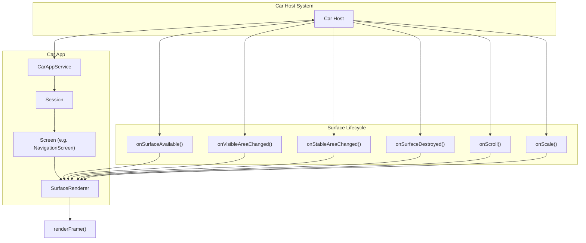
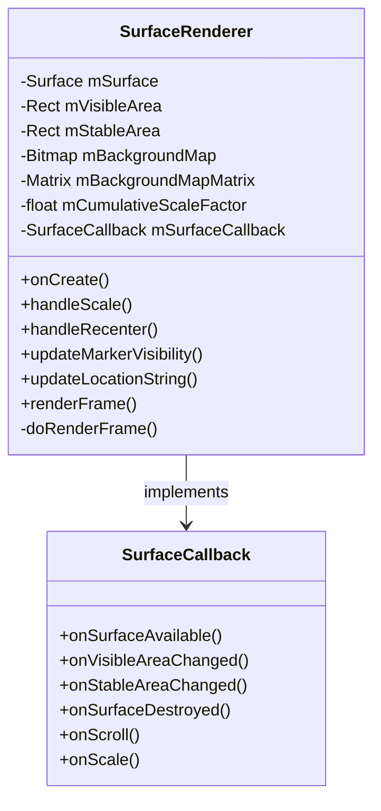
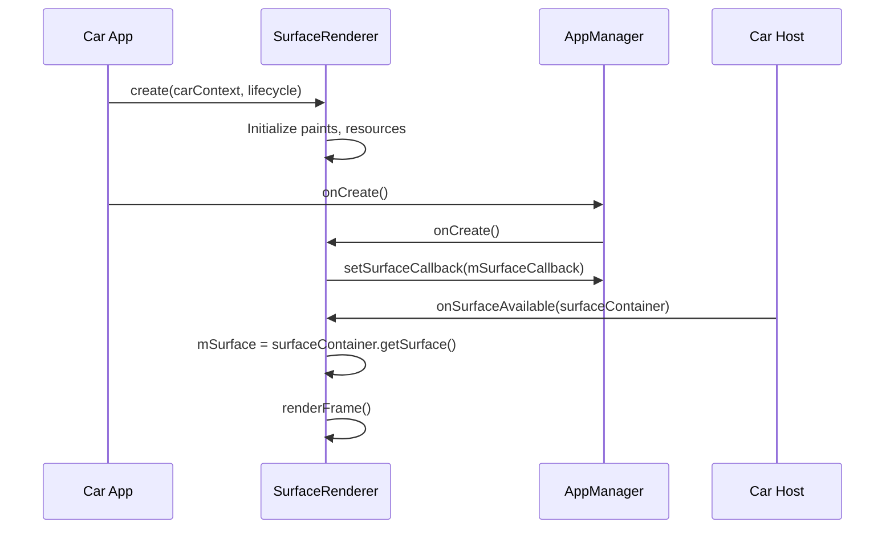
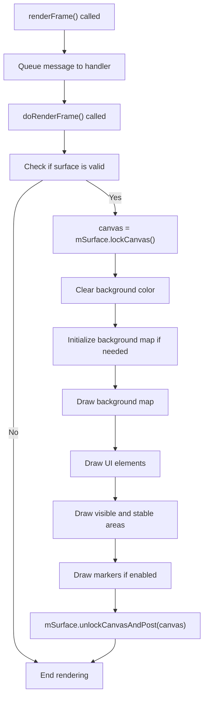
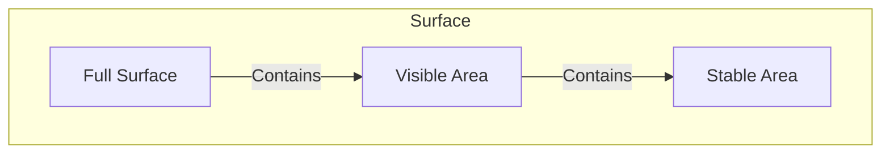
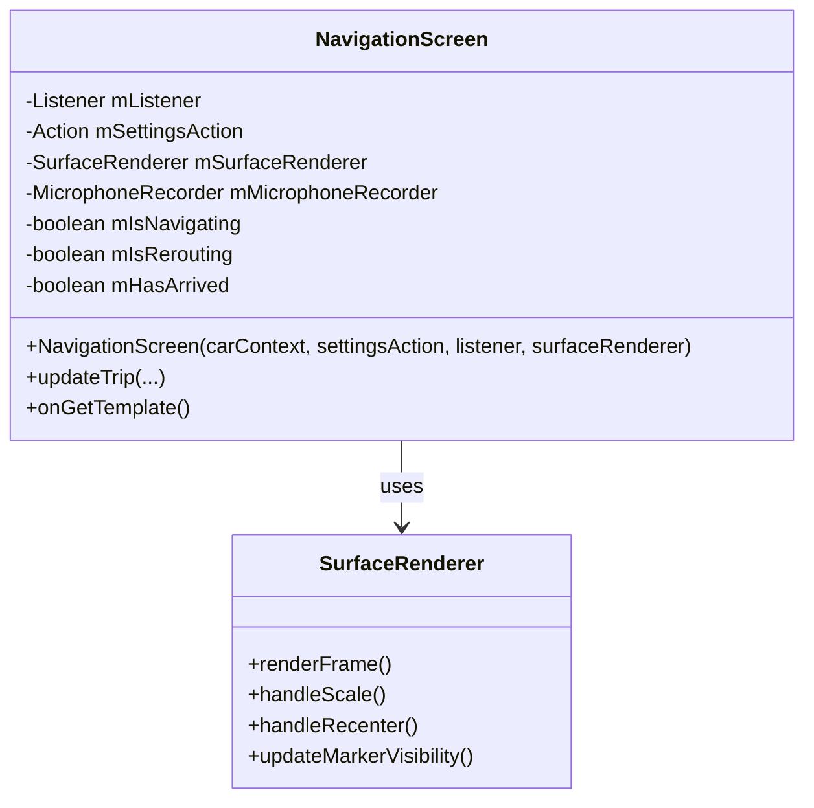

<!-- source: DeepWiki mcp.deepwiki.com · repo android/car-samples · page 4.2 Surface Rendering · fetched 2026-10-23 -->

# Surface Rendering

<details>
<summary>Relevant source files</summary>

The following files were used as context for generating this wiki page:

- [car_app_library/navigation/common/src/main/java/androidx/car/app/sample/navigation/common/car/NavigationScreen.java](car_app_library/navigation/common/src/main/java/androidx/car/app/sample/navigation/common/car/NavigationScreen.java)
- [car_app_library/navigation/common/src/main/java/androidx/car/app/sample/navigation/common/car/SurfaceRenderer.java](car_app_library/navigation/common/src/main/java/androidx/car/app/sample/navigation/common/car/SurfaceRenderer.java)
- [car_app_library/navigation/common/src/main/res/drawable/ic_add_stop.xml](car_app_library/navigation/common/src/main/res/drawable/ic_add_stop.xml)
- [car_app_library/showcase/common/src/main/AndroidManifest.xml](car_app_library/showcase/common/src/main/AndroidManifest.xml)
- [car_app_library/showcase/common/src/main/java/androidx/car/app/sample/showcase/common/common/PlaceInfo.java](car_app_library/showcase/common/src/main/java/androidx/car/app/sample/showcase/common/common/PlaceInfo.java)
- [car_app_library/showcase/common/src/main/java/androidx/car/app/sample/showcase/common/common/SamplePlaces.java](car_app_library/showcase/common/src/main/java/androidx/car/app/sample/showcase/common/common/SamplePlaces.java)
- [car_app_library/showcase/common/src/main/java/androidx/car/app/sample/showcase/common/navigation/routing/ArrivedDemoScreen.java](car_app_library/showcase/common/src/main/java/androidx/car/app/sample/showcase/common/navigation/routing/ArrivedDemoScreen.java)

</details>


## Overview

Surface rendering in Android Car apps provides a mechanism for rendering custom graphics on surfaces provided by the car host system. This is primarily used for navigation applications that need to display maps, routes, and markers, but can also be used for any custom UI rendering. This page covers the implementation and usage of surface rendering in the car-samples repository, focusing on the `SurfaceRenderer` class and its interaction with car app components.

For information about UI templates and their usage, see [Template Types](#4.1).

## Architecture

Surface rendering in car apps follows a distinct lifecycle and interacts with several key components. The diagram below illustrates the core architecture and interaction flow:



Sources: [car_app_library/navigation/common/src/main/java/androidx/car/app/sample/navigation/common/car/SurfaceRenderer.java:47-406](), [car_app_library/navigation/common/src/main/java/androidx/car/app/sample/navigation/common/car/NavigationScreen.java:45-343]()

## SurfaceRenderer Class

The `SurfaceRenderer` class is responsible for rendering content on a surface provided by the car host. It handles the surface lifecycle, user interactions, and drawing operations.

### Core Components



Sources: [car_app_library/navigation/common/src/main/java/androidx/car/app/sample/navigation/common/car/SurfaceRenderer.java:48-189]()

### Initialization and Lifecycle

The `SurfaceRenderer` class is created with a `CarContext` and a `Lifecycle`, and registers itself as a surface callback through the `AppManager`:



Sources: [car_app_library/navigation/common/src/main/java/androidx/car/app/sample/navigation/common/car/SurfaceRenderer.java:189-219]()

## Surface Rendering Process

The rendering process involves several key steps, from obtaining the surface to drawing on a canvas:



Sources: [car_app_library/navigation/common/src/main/java/androidx/car/app/sample/navigation/common/car/SurfaceRenderer.java:275-406]()

## Surface Areas and Insets

When rendering on a car display, there are two important areas to consider:

1. **Visible Area**: The area of the screen that is fully visible to the user.
2. **Stable Area**: The area of the screen that is guaranteed to be visible and won't be obscured by system UI elements.



The `SurfaceRenderer` draws these areas on the canvas for debugging purposes, showing their bounds with rectangles and cross-hairs:

Sources: [car_app_library/navigation/common/src/main/java/androidx/car/app/sample/navigation/common/car/SurfaceRenderer.java:321-375]()

## User Interaction Handling

The `SurfaceRenderer` supports two main user interactions: scrolling (panning) and scaling (zooming). These interactions are handled by the `SurfaceCallback` implementation.

### Scroll Handling

When a user scrolls, the `onScroll` callback is invoked with the distance moved:

Sources: [car_app_library/navigation/common/src/main/java/androidx/car/app/sample/navigation/common/car/SurfaceRenderer.java:156-171]()

### Scale Handling

Scaling is handled by the `handleScale` method:

Sources: [car_app_library/navigation/common/src/main/java/androidx/car/app/sample/navigation/common/car/SurfaceRenderer.java:227-252]()

### Map Centering

The `handleRecenter` method resets the map to its initial state:

Sources: [car_app_library/navigation/common/src/main/java/androidx/car/app/sample/navigation/common/car/SurfaceRenderer.java:254-259]()

## Integration with Navigation Screens

The `NavigationScreen` class uses a `SurfaceRenderer` to display maps and navigation information:



In the `onGetTemplate` method of `NavigationScreen`, map actions are added to control the `SurfaceRenderer`:

Sources: [car_app_library/navigation/common/src/main/java/androidx/car/app/sample/navigation/common/car/NavigationScreen.java:97-246]()

## Marker Rendering

The `SurfaceRenderer` can also display markers on the map, which are used to indicate places of interest. Markers can be configured with different appearances:

1. **Icon Markers**: Display an icon at a specific location
2. **Text Markers**: Display text at a specific location
3. **Color Markers**: Display a colored marker at a specific location

Sources: [car_app_library/showcase/common/src/main/java/androidx/car/app/sample/showcase/common/common/SamplePlaces.java:83-240](), [car_app_library/showcase/common/src/main/java/androidx/car/app/sample/showcase/common/common/PlaceInfo.java:25-46]()

## Practical Example

In the navigation sample, the `NavigationScreen` creates a template with map action buttons that interact with the `SurfaceRenderer`:

1. **Pan Button**: Enters pan mode, allowing the user to scroll the map
2. **Recenter Button**: Calls `handleRecenter()` to center the map
3. **Zoom Out Button**: Calls `handleScale()` with a scale factor of 0.9
4. **Zoom In Button**: Calls `handleScale()` with a scale factor of 1.1

Sources: [car_app_library/navigation/common/src/main/java/androidx/car/app/sample/navigation/common/car/NavigationScreen.java:197-248]()

## Best Practices

When implementing surface rendering in car apps, consider the following best practices:

1. **Respect visible and stable areas**: Ensure critical UI elements are within the stable area
2. **Optimize rendering**: Minimize work in the `doRenderFrame()` method to maintain smooth performance
3. **Handle lifecycle events**: Release resources when the surface is destroyed
4. **Support user interactions**: Implement intuitive pan and zoom behaviors
5. **Provide feedback**: Update the UI when pan mode is entered/exited

## Performance Considerations

Surface rendering should be optimized for performance, especially in navigation apps where smooth rendering is critical:

1. **Limit rendering frequency**: Use the handler to queue render messages rather than rendering directly
2. **Avoid object allocation**: Reuse objects like `Matrix` and `Paint` instances
3. **Clip to visible area**: Only render what's visible to save CPU/GPU resources
4. **Use hardware acceleration**: Take advantage of hardware-accelerated rendering when available

Sources: [car_app_library/navigation/common/src/main/java/androidx/car/app/sample/navigation/common/car/SurfaceRenderer.java:275-406]()

## Permissions Required

For location-based features in map rendering, the app needs to request appropriate location permissions:

```xml
<uses-permission android:name="android.permission.ACCESS_FINE_LOCATION"/>
<uses-permission android:name="android.permission.ACCESS_COARSE_LOCATION"/>
```

Sources: [car_app_library/showcase/common/src/main/AndroidManifest.xml:20-22]()

---

