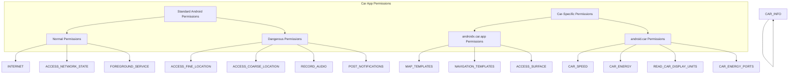
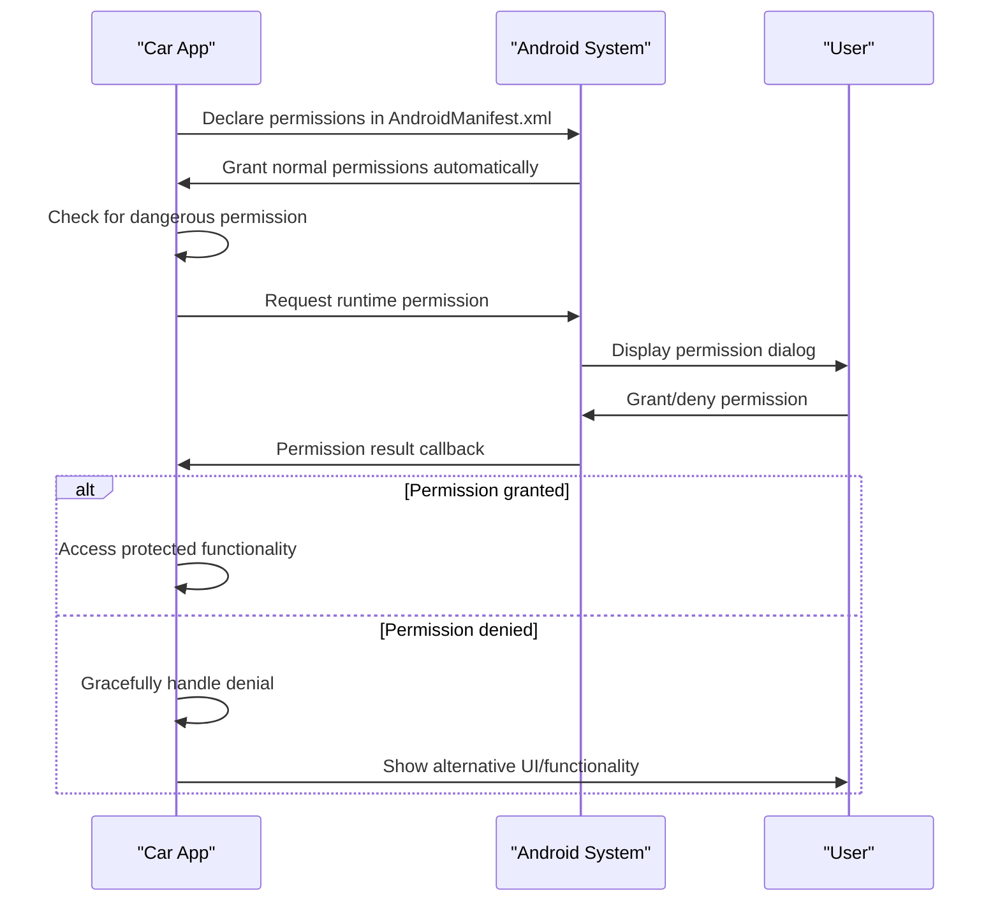
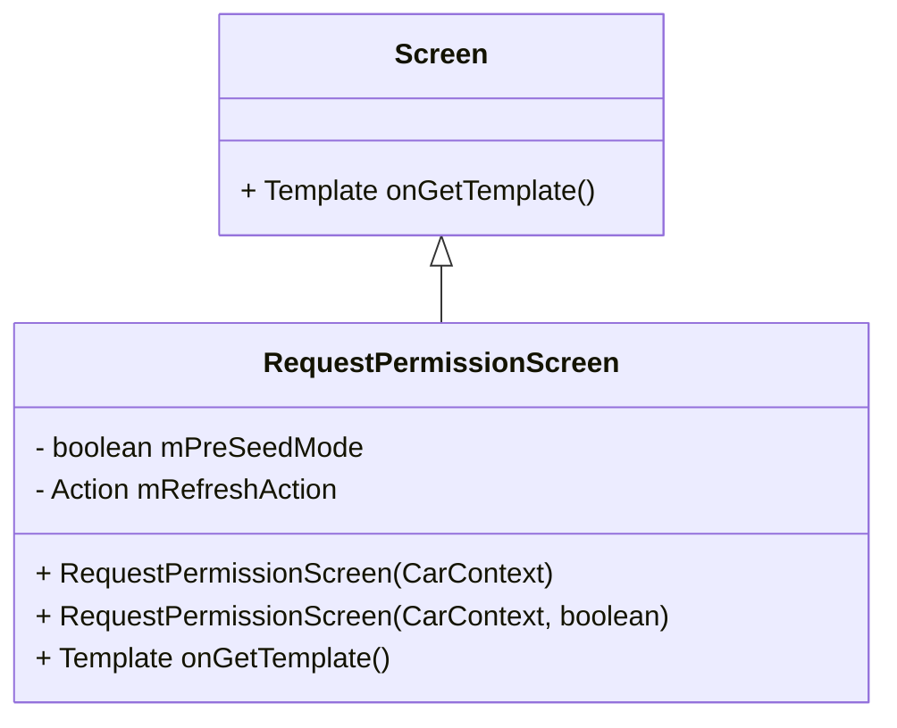
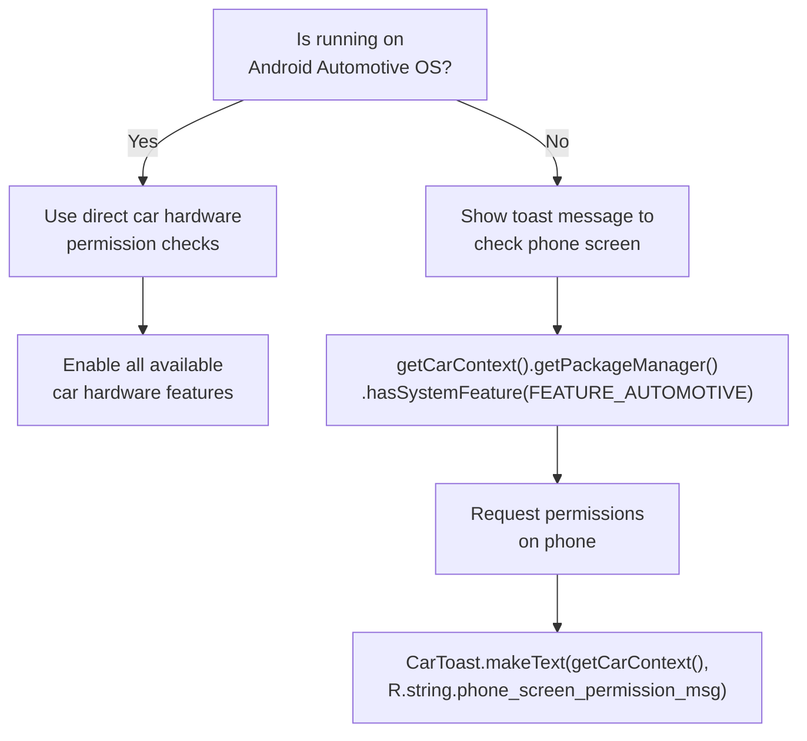

<!-- source: DeepWiki mcp.deepwiki.com · repo android/car-samples · page 4.3 Permission Management · fetched 2026-10-23 -->

# Permission Management

<details>
<summary>Relevant source files</summary>

The following files were used as context for generating this wiki page:

- [car_app_library/navigation/common/src/main/AndroidManifest.xml](car_app_library/navigation/common/src/main/AndroidManifest.xml)
- [car_app_library/showcase/automotive/src/main/AndroidManifest.xml](car_app_library/showcase/automotive/src/main/AndroidManifest.xml)
- [car_app_library/showcase/common/src/main/java/androidx/car/app/sample/showcase/common/StartScreen.java](car_app_library/showcase/common/src/main/java/androidx/car/app/sample/showcase/common/StartScreen.java)
- [car_app_library/showcase/common/src/main/java/androidx/car/app/sample/showcase/common/misc/RequestPermissionScreen.java](car_app_library/showcase/common/src/main/java/androidx/car/app/sample/showcase/common/misc/RequestPermissionScreen.java)
- [car_app_library/showcase/common/src/main/java/androidx/car/app/sample/showcase/common/renderer/CarHardwareRenderer.java](car_app_library/showcase/common/src/main/java/androidx/car/app/sample/showcase/common/renderer/CarHardwareRenderer.java)
- [car_app_library/showcase/common/src/main/res/values-ky/strings.xml](car_app_library/showcase/common/src/main/res/values-ky/strings.xml)
- [car_app_library/showcase/common/src/main/res/values-or/strings.xml](car_app_library/showcase/common/src/main/res/values-or/strings.xml)

</details>


This document explains how permissions are managed in Android car apps, focusing on both standard Android permissions and car-specific permissions. It covers how to declare permissions in the manifest, request permissions at runtime, and handle permission denials gracefully.

For general information about Android's permission system, refer to the Android developer documentation. For specific information about building and running car apps, see [Building and Running](#5.1).

## Permission Types in Car Apps

Android car apps require various types of permissions, which can be categorized as follows:



Sources: [car_app_library/showcase/automotive/src/main/AndroidManifest.xml:23-41](), [car_app_library/navigation/common/src/main/AndroidManifest.xml:19-21]()

### Standard Android Permissions

These are the same permissions used by regular Android apps and include:

- **Normal permissions**: Automatically granted, minimal risk to user privacy
  - `INTERNET`: Network access
  - `ACCESS_NETWORK_STATE`: Network connectivity information
  - `FOREGROUND_SERVICE`: Allow app to run foreground services

- **Dangerous permissions**: Require explicit user approval at runtime
  - `ACCESS_FINE_LOCATION`, `ACCESS_COARSE_LOCATION`: Location access
  - `RECORD_AUDIO`: Microphone access
  - `POST_NOTIFICATIONS`: Permission to post notifications

### Car-Specific Permissions

These are permissions specific to car app functionality:

- **AndroidX Car App permissions**: Control access to car UI templates and features
  - `androidx.car.app.MAP_TEMPLATES`: Use map templates
  - `androidx.car.app.NAVIGATION_TEMPLATES`: Use navigation templates
  - `androidx.car.app.ACCESS_SURFACE`: Draw on a surface in the car display

- **Android Car permissions**: Access to car hardware and sensors
  - `android.car.permission.CAR_SPEED`: Vehicle speed data
  - `android.car.permission.CAR_INFO`: Vehicle information
  - `android.car.permission.CAR_ENERGY`: Energy/fuel levels
  - `android.car.permission.READ_CAR_DISPLAY_UNITS`: Vehicle display units
  - `android.car.permission.CAR_ENERGY_PORTS`: EV charging port status

Sources: [car_app_library/showcase/automotive/src/main/AndroidManifest.xml:23-41]()

## Declaring Permissions in the Manifest

All required permissions must be declared in the app's `AndroidManifest.xml` file:

```
<uses-permission android:name="android.permission.INTERNET"/>
<uses-permission android:name="android.permission.ACCESS_FINE_LOCATION"/>
<uses-permission android:name="androidx.car.app.MAP_TEMPLATES"/>
<uses-permission android:name="android.car.permission.CAR_SPEED"/>
```

To differentiate between automotive-specific apps and those that can run on mobile, you can use feature declarations:

```
<uses-feature
    android:name="android.hardware.type.automotive"
    android:required="true" />
```

Sources: [car_app_library/showcase/automotive/src/main/AndroidManifest.xml:23-58]()

## Permission Request Workflow

The following diagram illustrates the permission request workflow in car apps:



Sources: [car_app_library/showcase/common/src/main/java/androidx/car/app/sample/showcase/common/misc/RequestPermissionScreen.java:56-194]()

## Implementing Runtime Permission Requests

The `RequestPermissionScreen` class in the showcase app demonstrates how to request permissions at runtime:



The implementation follows these steps:

1. **Check current permission status**:
   ```java
   try {
       CarAppPermission.checkHasPermission(getCarContext(), declaredPermission);
   } catch (SecurityException e) {
       permissions.add(declaredPermission);
   }
   ```

2. **Request permissions** when user taps the grant access button:
   ```java
   getCarContext().requestPermissions(
           permissions,
           (approved, rejected) -> {
               CarToast.makeText(
                       getCarContext(),
                       String.format("Approved: %s Rejected: %s", approved, rejected),
                       CarToast.LENGTH_LONG).show();
           });
   ```

3. **Handle special cases** like location services being disabled:
   ```java
   LocationManager locationManager =
           (LocationManager) getCarContext().getSystemService(Context.LOCATION_SERVICE);
   if (!LocationManagerCompat.isLocationEnabled(locationManager)) {
       // Show special message and action button
   }
   ```

4. **Refresh the UI** after permission changes:
   ```java
   private final Action mRefreshAction = new Action.Builder()
           .setTitle(getCarContext().getString(R.string.refresh_action_title))
           .setBackgroundColor(CarColor.BLUE)
           .setOnClickListener(this::invalidate)
           .build();
   ```

Sources: [car_app_library/showcase/common/src/main/java/androidx/car/app/sample/showcase/common/misc/RequestPermissionScreen.java:80-193]()

## Handling Permission Denials

When permissions are denied, apps should gracefully degrade functionality. The code shows several patterns for handling permission denials:

### 1. Try-Catch Pattern for Hardware Access

The `CarHardwareRenderer` class demonstrates the pattern of attempting to access hardware features and catching `SecurityException` if permission is denied:

```java
try {
    carInfo.addTollListener(mCarHardwareExecutor, mTollListener);
    mHasTollCardPermission = true;
} catch (SecurityException e) {
    mHasTollCardPermission = false;
}
```

This pattern is applied consistently throughout the code for each hardware feature, allowing the app to track which permissions are available.

### 2. Conditional UI Based on Permissions

The UI adapts based on available permissions:

```java
if (!mHasTollCardPermission) {
    info.append(mCarContext.getString(R.string.no_toll_card_permission));
} else if (mTollCard == null) {
    info.append(mCarContext.getString(R.string.fetch_toll_info));
} else {
    // Show toll card data
}
```

Sources: [car_app_library/showcase/common/src/main/java/androidx/car/app/sample/showcase/common/renderer/CarHardwareRenderer.java:179-259](), [car_app_library/showcase/common/src/main/java/androidx/car/app/sample/showcase/common/renderer/CarHardwareRenderer.java:370-379]()

## Car Hardware Permissions Matrix

The following table shows various car hardware features and their associated permissions:

| Hardware Feature | Permission | String Resource for Denial |
|------------------|------------|----------------------------|
| Toll Card | android.car.permission.* | R.string.no_toll_card_permission |
| Energy Level | android.car.permission.CAR_ENERGY | R.string.no_energy_level_permission |
| Speed | android.car.permission.CAR_SPEED | R.string.no_speed_permission |
| Mileage | android.car.permission.* | R.string.no_mileage_permission |
| EV Status | android.car.permission.CAR_ENERGY_PORTS | R.string.no_ev_status_permission |
| Accelerometer | Sensor permission | R.string.no_accelerometer_permission |
| Gyroscope | Sensor permission | R.string.no_gyroscope_permission |
| Compass | Sensor permission | R.string.no_compass_permission |
| Car Location | ACCESS_FINE_LOCATION | R.string.no_car_hardware_location |

Sources: [car_app_library/showcase/common/src/main/java/androidx/car/app/sample/showcase/common/renderer/CarHardwareRenderer.java:178-516]()

## Platform-Specific Permission Considerations

Car apps need to handle permissions differently depending on whether they're running on Android Automotive OS or a mobile device projecting to Android Auto:



The code checks the platform using:

```java
if (!getCarContext().getPackageManager().hasSystemFeature(FEATURE_AUTOMOTIVE)) {
    CarToast.makeText(getCarContext(),
            getCarContext().getString(R.string.phone_screen_permission_msg),
            CarToast.LENGTH_LONG).show();
}
```

For automotive-specific features like EV status, the code specifically checks if it's running on Android Automotive OS:

```java
if (mCarContext.getPackageManager().hasSystemFeature(FEATURE_AUTOMOTIVE)) {
    try {
        carInfo.addEvStatusListener(mCarHardwareExecutor, mEvStatusListener);
        mHasEvStatusPermission = true;
    } catch (SecurityException e) {
        mHasEvStatusPermission = false;
    }
}
```

Sources: [car_app_library/showcase/common/src/main/java/androidx/car/app/sample/showcase/common/misc/RequestPermissionScreen.java:143-148](), [car_app_library/showcase/common/src/main/java/androidx/car/app/sample/showcase/common/renderer/CarHardwareRenderer.java:211-220]()

## Best Practices for Permission Management

Based on the implementation in the showcase app, here are best practices for managing permissions in car apps:

1. **Clearly communicate to users why permissions are needed**
   - Use clear string resources explaining the purpose of each permission
   - The `LongMessageTemplate` is used to display detailed permission messages

2. **Provide easy ways to manage permissions**
   - Offer refresh button to check permission status
   - Show clear status messages for each permission

3. **Handle permission denials gracefully**
   - Check each permission individually using try-catch blocks
   - Maintain state flags for each permission (`mHasTollCardPermission`, etc.)
   - Provide appropriate fallback UI when permissions are denied

4. **Consider platform differences**
   - Check if running on Automotive OS or mobile device
   - Adjust UI and messaging accordingly

5. **Bundle related permission requests when possible**
   - Request multiple permissions in a single call when they're related:
     ```java
     getCarContext().requestPermissions(permissions, callback);
     ```

Sources: [car_app_library/showcase/common/src/main/java/androidx/car/app/sample/showcase/common/misc/RequestPermissionScreen.java:135-148]()

## Conclusion

Proper permission management is crucial for car apps to function correctly while respecting user privacy. By following the patterns demonstrated in the showcase app, developers can implement robust permission handling that works across different car platforms.

Remember that car apps may need both standard Android permissions and car-specific permissions, and the request flow differs between permissions declared in the manifest and those requested at runtime.

---

