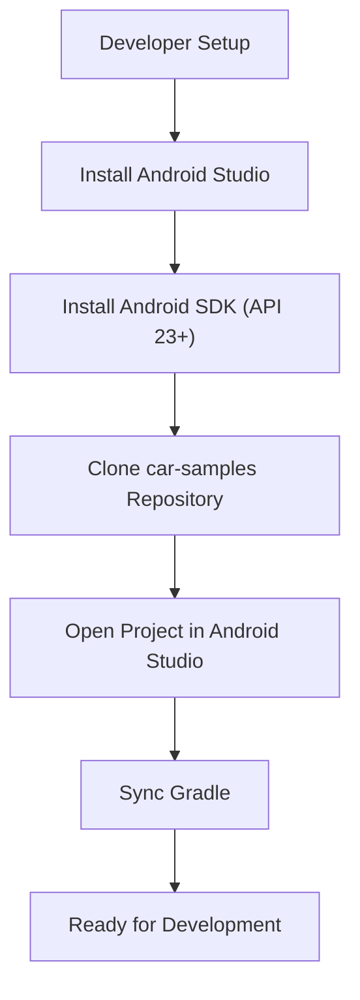
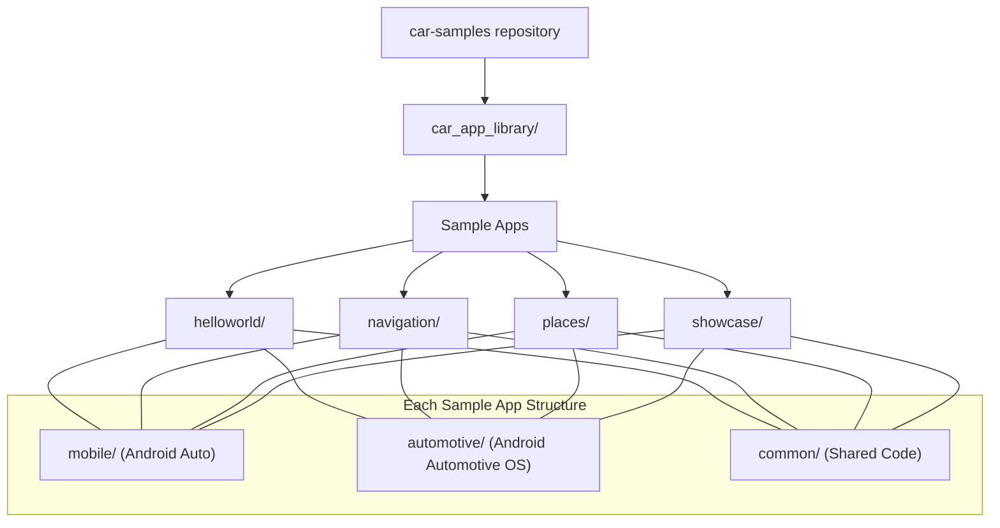
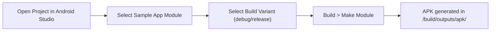
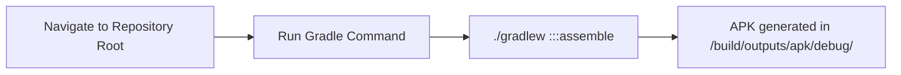
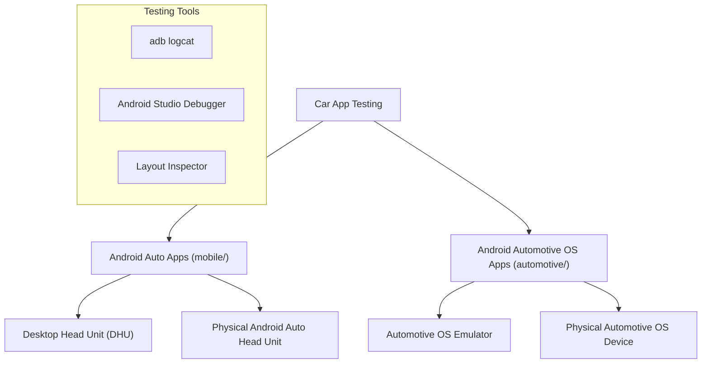
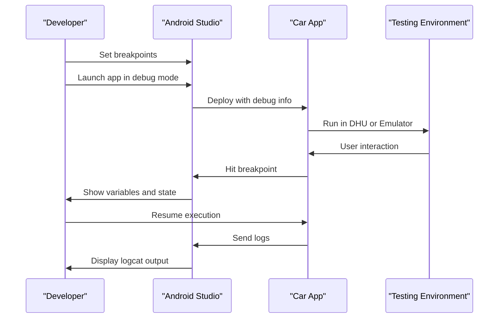
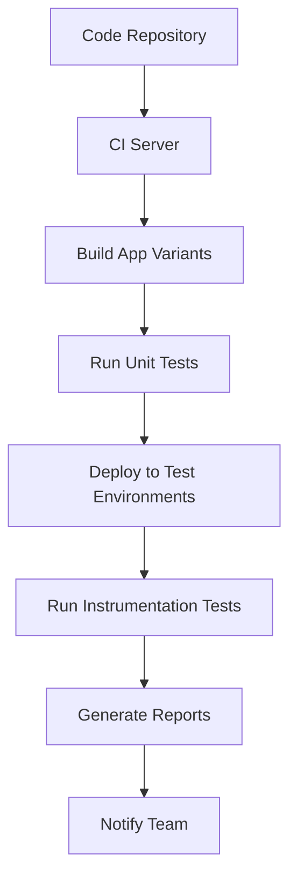

<!-- source: DeepWiki mcp.deepwiki.com · repo android/car-samples · page 5 Development and Testing · fetched 2026-10-23 -->

# Development and Testing

<details>
<summary>Relevant source files</summary>

The following files were used as context for generating this wiki page:

- [README.md](README.md)
- [car_app_library/README.md](car_app_library/README.md)
- [car_app_library/build.gradle](car_app_library/build.gradle)

</details>


This page provides a comprehensive guide to developing and testing Android car applications using the car-samples repository. It covers setting up your development environment, understanding the build process, and testing your applications on different car platforms. For specific instructions on building and running the sample apps, see [Building and Running](#5.1). For information about platform-specific differences, see [Platform-Specific Considerations](#5.2).

## Development Environment Setup

Before you begin developing car applications, you need to set up your development environment with the right tools and dependencies.

### Prerequisites

- Android Studio (Latest stable version recommended)
- Android SDK with minimum API level 23 (Android 6.0)
- For Automotive OS development: Android Studio 4.2 or higher
- Git for cloning the repository



Sources: [car_app_library/README.md:6-8]()

## Project Structure and Build Configuration

The car-samples repository is organized to support multiple app variants targeting different car platforms. Understanding this structure is essential for effective development.



Each sample app follows a consistent modular structure:
- `mobile/`: Contains code specific to the Android Auto implementation (runs on phones)
- `automotive/`: Contains code specific to the Android Automotive OS implementation (runs in the car)
- `common/`: Contains shared code used by both variants

Sources: [car_app_library/README.md:12-22](), [README.md:4-12]()

## Build Process

The repository uses Gradle for building applications. You can build apps either through Android Studio or using the command line.

### Building with Android Studio



1. Open the project in Android Studio
2. Select the desired sample app and platform in the Project Structure panel
3. Go to `Build > Make Module 'androidx.car.app.app-samples.<sample_app>.<platform>'`
4. The APK will be generated in `<sample_app>/<platform>/build/outputs/apk/`

### Building from Command Line



Example commands:
```bash
./gradlew :showcase:mobile:assemble
./gradlew :showcase:automotive:assemble
```

Sources: [car_app_library/README.md:10-45](), [car_app_library/build.gradle:17-46]()

## Testing Environments

Android car applications can be tested in different environments depending on the target platform.



### Testing Android Auto Apps (mobile/)

Android Auto apps can be tested using:

1. **Desktop Head Unit (DHU)**: A simulator that runs on your development machine
   - Enable Developer Settings on your Android device
   - Enable Unknown Sources in Android Auto
   - Connect your device to the development machine
   - Launch the DHU from Android Studio

2. **Physical Android Auto Head Unit**: Testing on actual car hardware
   - Install the app on your Android phone
   - Connect your phone to a car with Android Auto support

### Testing Android Automotive OS Apps (automotive/)

Automotive OS apps can be tested using:

1. **Automotive OS Emulator**: A virtual Android Automotive OS device
   - Set up the Automotive OS system image in Android Studio
   - Create and start an Automotive OS virtual device

2. **Physical Automotive OS Device**: Testing on actual Automotive OS hardware
   - Install the app directly on the Automotive OS device

Sources: [car_app_library/README.md:67-92]()

## Development Workflow

The following diagram shows the typical development workflow for Android car applications:

```mermaid
flowchart TD
    A["Write/Modify Code"] --> B["Build App"]
    B --> C["Deploy to Testing Environment"]
    C --> D["Test App"]
    D --> E["Debug Issues"]
    E -->|"Issues Found"| A
    D -->|"No Issues"| F["Ready for Release"]
    
    subgraph "Implementation Details"
        G["Implement CarAppService"]
        H["Create Screens & Templates"]
        I["Handle Navigation & States"]
        J["Implement Platform-Specific Features"]
    end
    
    A --- G
    A --- H
    A --- I
    A --- J
```



### Key Development Components

When developing car apps, you'll work primarily with these components:

| Component | Purpose | Key Classes |
|-----------|---------|-------------|
| Service | Entry point for the car app | `CarAppService` |
| Session | Manages app state and lifecycle | `Session`, `Screen` |
| UI | User interface shown in the car | Templates (e.g., `ListTemplate`, `NavigationTemplate`) |
| Navigation | Map rendering and routing | `NavigationManager`, `SurfaceRenderer` |

Sources: [car_app_library/README.md:23-33]()

## Debugging Techniques



### Common Debugging Approaches:

1. **Android Studio Debugger**:
   - Set breakpoints in your code
   - Inspect variables and app state at runtime
   - Step through code execution

2. **Logging**:
   - Use `Log.d()`, `Log.i()`, etc. for debug information
   - View logs via `adb logcat` or the Logcat panel in Android Studio

3. **Layout Inspector**:
   - Examine UI elements and hierarchy
   - Useful for diagnosing template rendering issues

Sources: [car_app_library/README.md:34-65]()

## Testing Checklist

Before submitting or releasing your car app, use this checklist to ensure you've thoroughly tested it:

| Test Area | What to Check | Platform |
|-----------|---------------|----------|
| Installation | App installs correctly | Both |
| Launch | App launches without errors | Both |
| UI Rendering | Templates display correctly | Both |
| User Interaction | App responds to input properly | Both |
| Navigation | Maps render correctly (for nav apps) | Both |
| Background Service | Service continues running when expected | Both |
| Different Screen Sizes | UI adapts to various head unit displays | Both |
| Permissions | Permission requests work properly | Both |
| Platform Integration | App integrates with Android Auto/Automotive OS APIs | Specific |
| Error Handling | App handles errors gracefully | Both |

Sources: [car_app_library/README.md:67-92]()

## Troubleshooting Common Issues

| Issue | Possible Cause | Solution |
|-------|---------------|----------|
| App doesn't appear in Android Auto | Missing AUTO_APP_LIBRARY feature | Add correct manifest entries |
| App crashes on launch | Service component not registered | Check AndroidManifest.xml |
| Templates don't render | Incorrect template usage | Review template restrictions |
| Navigation doesn't work | Missing permissions | Add location permissions |
| Build fails | SDK location not found | Configure local.properties |
| DHU connection issues | USB debugging not enabled | Check developer options |

Sources: [car_app_library/README.md:47-65]()

## Continuous Integration and Testing

For teams working on car applications, implementing a continuous integration (CI) pipeline can help maintain code quality:



Recommended CI practices:
- Automate builds for both mobile and automotive variants
- Run unit tests for common module code
- Deploy to emulators for automated UI testing
- Test on various screen sizes and configurations

Sources: [car_app_library/build.gradle:32-42]()

## Next Steps

After setting up your development environment and understanding the testing process, refer to:
- [Building and Running](#5.1) for detailed instructions on building and running specific sample apps
- [Platform-Specific Considerations](#5.2) to understand the differences between developing for Android Auto vs. Android Automotive OS

---

