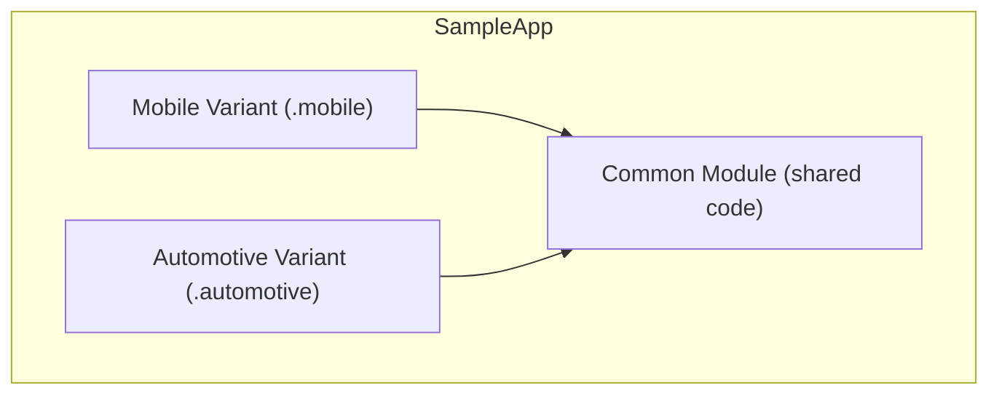
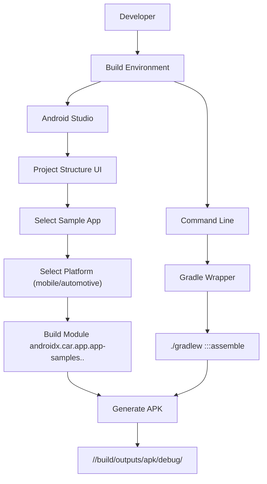
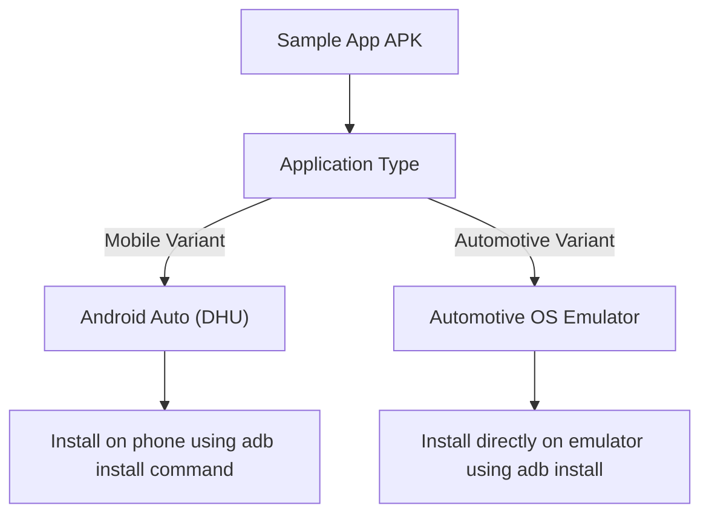
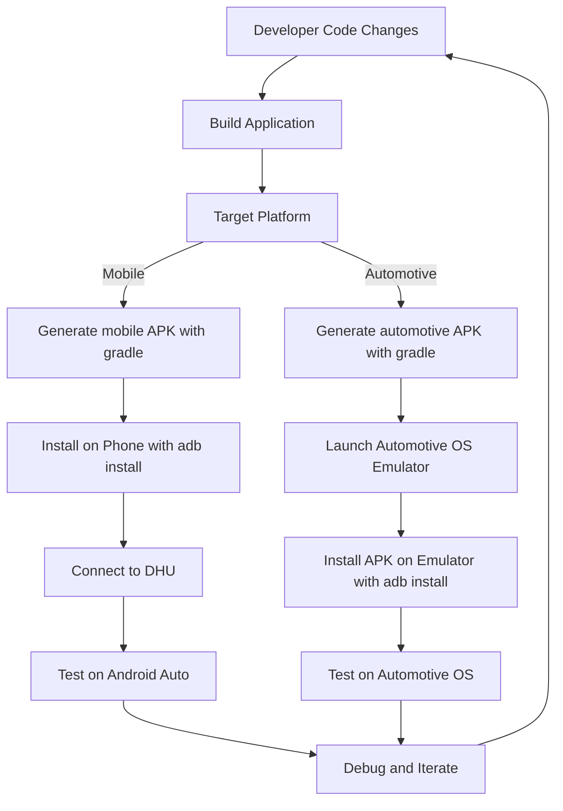

<!-- source: DeepWiki mcp.deepwiki.com · repo android/car-samples · page 5.1 Building and Running · fetched 2026-10-23 -->

# Building and Running

<details>
<summary>Relevant source files</summary>

The following files were used as context for generating this wiki page:

- [README.md](README.md)
- [car_app_library/README.md](car_app_library/README.md)
- [car_app_library/build.gradle](car_app_library/build.gradle)

</details>


This page provides detailed instructions for building and running the Android car sample applications in the car-samples repository. It covers building using both Android Studio and command line approaches, and explains how to run applications on both Android Auto and Android Automotive OS platforms.

For information about platform-specific development considerations, see [Platform-Specific Considerations](#5.2).

## Prerequisites

Before building the sample applications, ensure you have the following:

- Android Studio
- Android SDK (API level 23 or higher)
- For Android Auto testing: Desktop Head Unit (DHU)
- For Automotive OS testing: Automotive OS Emulator (Android Studio 4.2 or higher)

Sources: [car_app_library/README.md:7-9]()

## Sample Applications Structure

Each sample application in the repository follows a consistent modular structure, with variants for different car platforms:

| Variant | Target Platform | Purpose |
|---------|-----------------|---------|
| mobile | Android Mobile (API 23+) | For running on phones and projecting to Android Auto |
| automotive | Android Automotive OS (API 29+) | For running directly on Android Automotive OS |

#### Sample Application Module Organization



Sources: [car_app_library/README.md:10-19]()

## Build Process Overview

The general build process for the sample applications is illustrated below:

#### Build Process Workflow



Sources: [car_app_library/README.md:10-22](), [car_app_library/README.md:34-45]()

## Building with Android Studio

To build sample applications using Android Studio:

1. Open the project in Android Studio:
   - File -> Open -> Select the car-samples directory

2. Navigate to the desired sample in the Project Structure UI:
   - For example, select `helloworld/mobile` for the mobile variant of the HelloWorld app

3. Build the module:
   - Build -> Make Module 'androidx.car.app.app-samples.<sample_app>.<platform>'
   - For example: `Build -> Make Module 'androidx.car.app.app-samples.helloworld.mobile'`

4. The APK will be generated in:
   - `<sample_app>/<platform>/build/outputs/apk/debug/`

Sources: [car_app_library/README.md:10-22]()

## Building from Command Line

To build sample applications using the command line:

1. Open a terminal in the project root directory

2. Run the Gradle wrapper with the appropriate target:
   ```bash
   ./gradlew :<sample_app>:<platform>:assemble
   ```
   
   For example:
   ```bash
   ./gradlew :showcase:mobile:assemble
   ./gradlew :showcase:automotive:assemble
   ```

3. The APK will be generated in:
   - `<sample_app>/<platform>/build/outputs/apk/debug/`

Sources: [car_app_library/README.md:34-45]()

### Troubleshooting Command Line Builds

If you encounter the following error:
```
SDK location not found. Define location with an ANDROID_SDK_ROOT environment variable or by setting the sdk.dir path in your projects local properties file at <project_path>/local.properties
```

Create a `local.properties` file in the project directory with the following content:
```
sdk.dir = <your android sdk directory path>
```

Sources: [car_app_library/README.md:47-59]()

## Running Sample Applications

The method for running sample applications depends on their target platform:

#### Deployment Process



Sources: [car_app_library/README.md:62-65]()

### Running Mobile Apps (Android Auto)

To run mobile variant apps on Android Auto:

1. Install the APK on an Android phone:
   ```bash
   adb install <path_to_sample_app_apk>
   ```

2. Set up the Desktop Head Unit (DHU):
   - Enable Android Developer Settings on your phone
   - Enable "Unknown Sources" in Android Auto settings
   - For Android Q+: Access through Settings -> Apps & Notifications -> See all apps -> Android Auto -> Advanced -> Additional settings in the app

3. Launch the DHU from Android Studio:
   - Tools -> SDK Manager -> SDK Tools tab -> Select "Android Auto Desktop Head Unit emulator"
   - Tools -> Android Auto -> Start Head Unit Server

4. Connect your phone to the computer and authorize the debugging connection
5. The app should appear in the Android Auto interface on the DHU

Sources: [car_app_library/README.md:67-77]()

### Running Automotive Apps (Automotive OS)

To run automotive variant apps on Android Automotive OS:

1. Set up the Automotive OS emulator (requires Android Studio 4.2+):
   - Tools -> AVD Manager -> Create Virtual Device
   - Select an "Automotive" hardware profile
   - Select a system image with Android Automotive OS

2. Launch the Automotive OS emulator

3. Install the APK on the emulator:
   ```bash
   adb install <path_to_sample_app_apk>
   ```

4. The app should appear in the Automotive OS launcher

Sources: [car_app_library/README.md:79-86]()

## Available Sample Applications

The following sample applications are available in the repository:

| Application | Description | Mobile Variant | Automotive Variant |
|-------------|-------------|----------------|-------------------|
| HelloWorld | Simple "Hello World" app | ✓ | ✓ |
| Showcase | Demonstrates various templates and features | ✓ | ✓ |
| Navigation | Demonstrates navigation features | ✓ | ✓ |
| Places | Demonstrates location-based features | ✓ | ✓ |

Sources: [README.md:4-10]()

## Development Workflow

The complete workflow from development to deployment can be visualized as:

#### Development to Deployment Workflow



Sources: [car_app_library/README.md:10-86]()

---

