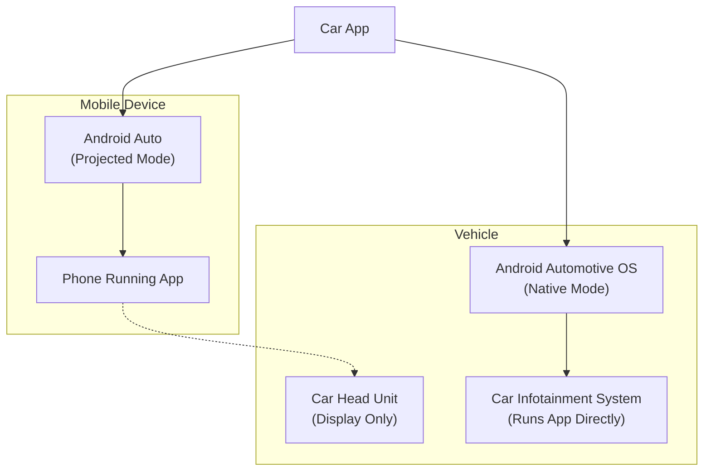
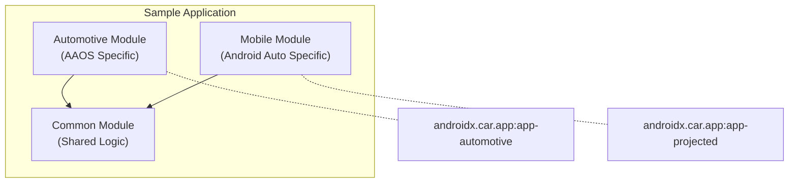
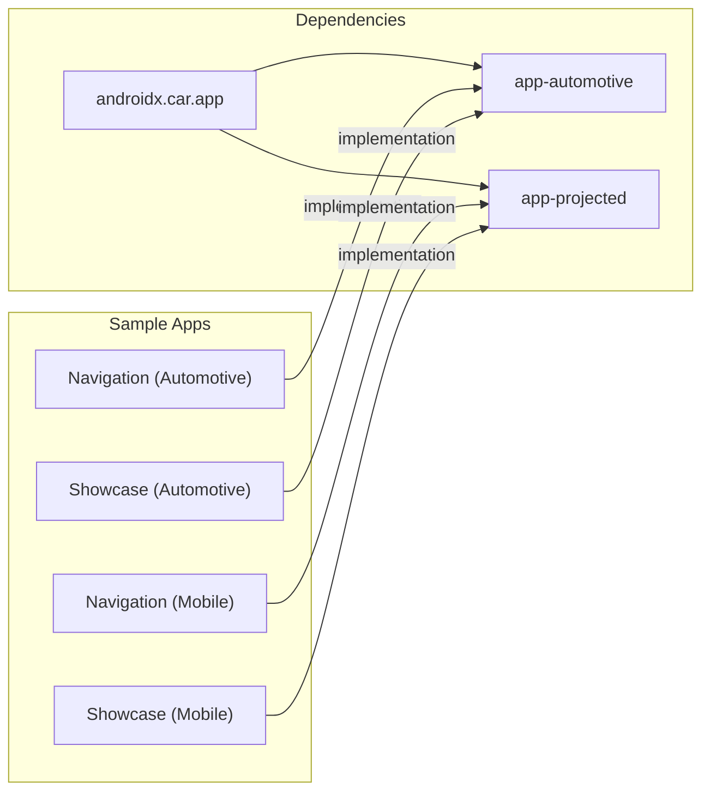
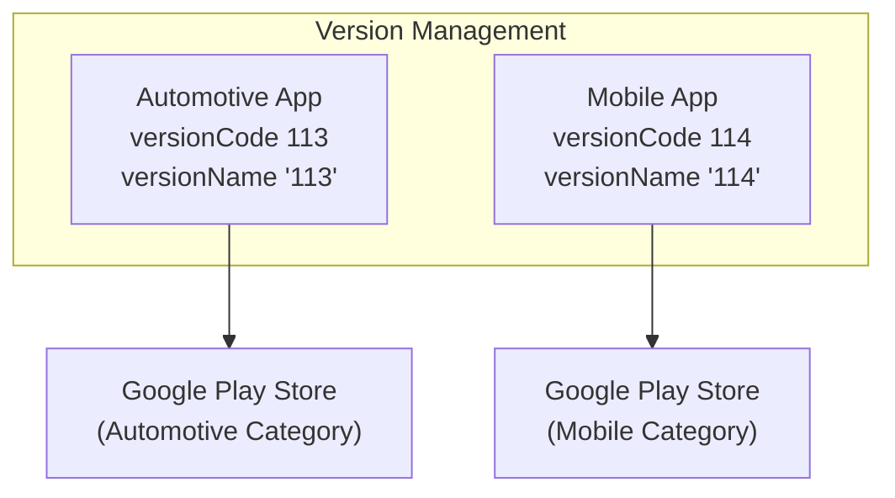
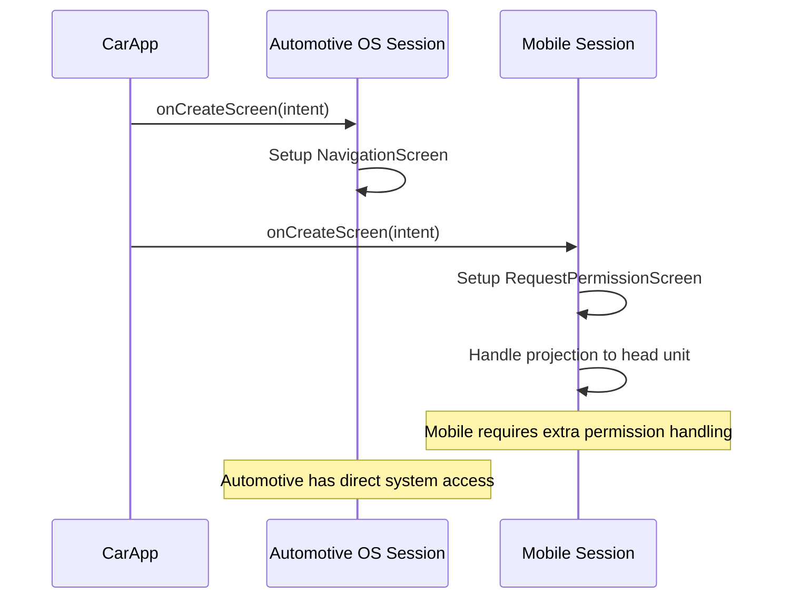

<!-- source: DeepWiki mcp.deepwiki.com · repo android/car-samples · page 5.2 Platform-Specific Considerations · fetched 2026-10-23 -->

# Platform-Specific Considerations

<details>
<summary>Relevant source files</summary>

The following files were used as context for generating this wiki page:

- [car_app_library/helloworld/automotive/build.gradle](car_app_library/helloworld/automotive/build.gradle)
- [car_app_library/helloworld/mobile/build.gradle](car_app_library/helloworld/mobile/build.gradle)
- [car_app_library/navigation/automotive/build.gradle](car_app_library/navigation/automotive/build.gradle)
- [car_app_library/navigation/automotive/src/main/AndroidManifest.xml](car_app_library/navigation/automotive/src/main/AndroidManifest.xml)
- [car_app_library/navigation/common/src/main/java/androidx/car/app/sample/navigation/common/car/NavigationSession.java](car_app_library/navigation/common/src/main/java/androidx/car/app/sample/navigation/common/car/NavigationSession.java)
- [car_app_library/navigation/mobile/build.gradle](car_app_library/navigation/mobile/build.gradle)
- [car_app_library/places/automotive/build.gradle](car_app_library/places/automotive/build.gradle)
- [car_app_library/places/mobile/build.gradle](car_app_library/places/mobile/build.gradle)
- [car_app_library/showcase/automotive/build.gradle](car_app_library/showcase/automotive/build.gradle)
- [car_app_library/showcase/mobile/build.gradle](car_app_library/showcase/mobile/build.gradle)

</details>


This document outlines the key differences and considerations when developing applications for Android Auto versus Android Automotive OS using the car-samples repository. It covers architectural differences, configuration requirements, and implementation details that developers need to understand when targeting both platforms. For information on building and running these applications, see [Building and Running](#5.1).

## 1. Platform Overview

Android car applications can target two distinct platforms, each with different characteristics and requirements:



**Android Auto (Projected)**: Applications run on a mobile device and project their interface to the car's head unit.  
**Android Automotive OS (Native)**: Applications run directly on the car's infotainment system.

Sources: [car_app_library/navigation/mobile/build.gradle:18-50](), [car_app_library/navigation/automotive/build.gradle:18-50]()

## 2. Project Structure and Organization

The sample applications follow a consistent three-module pattern to support both platforms:



This structure allows for maximum code reuse while accommodating platform-specific implementations where necessary.

Sources: [car_app_library/navigation/automotive/build.gradle:48-52](), [car_app_library/navigation/mobile/build.gradle:48-52](), [car_app_library/showcase/automotive/build.gradle:48-53](), [car_app_library/showcase/mobile/build.gradle:48-53]()

## 3. SDK Version Requirements

Each platform has different minimum SDK requirements:

| Platform | Minimum SDK | Target SDK | Notes |
|----------|------------|------------|-------|
| Android Auto (Mobile) | 23 (Marshmallow) | 32-33 | Runs on mobile devices |
| Android Automotive OS | 29 (Android 10) | 32-33 | Runs directly on the car infotainment system |

These SDK requirements reflect the actual deployment environments - Android Auto support extends to older phones, while Android Automotive OS is only available on newer vehicles.

Sources: [car_app_library/navigation/automotive/build.gradle:21-25](), [car_app_library/navigation/mobile/build.gradle:21-25](), [car_app_library/showcase/automotive/build.gradle:21-25](), [car_app_library/showcase/mobile/build.gradle:21-25]()

## 4. Library Dependencies

The platform variants use different car app libraries:



Key implementation differences:
- Automotive variants: `implementation "androidx.car.app:app-automotive:1.3.0-beta01"`
- Mobile variants: `implementation "androidx.car.app:app-projected:1.3.0-beta01"`

While both libraries provide similar APIs, the implementations accommodate the different deployment environments.

Sources: [car_app_library/navigation/automotive/build.gradle:50](), [car_app_library/navigation/mobile/build.gradle:50](), [car_app_library/showcase/automotive/build.gradle:52](), [car_app_library/showcase/mobile/build.gradle:52]()

## 5. Manifest Configuration Differences

The Android manifest requires different configurations for each platform:

### 5.1 Automotive OS-Specific Manifest Elements

```xml
<!-- Required features for Automotive OS apps -->
<uses-feature
    android:name="android.hardware.type.automotive"
    android:required="true" />
<uses-feature
    android:name="android.software.car.templates_host"
    android:required="true" />
```

Automotive variants must declare automotive-specific features and may have additional metadata elements.

### 5.2 Platform-Specific Permissions

| Permission | Android Auto | Android Automotive OS | Purpose |
|------------|-------------|---------------------|---------|
| NAVIGATION_TEMPLATES | ✓ | ✓ | Access to navigation templates |
| ACCESS_SURFACE | ✓ | ✓ | For rendering custom surfaces |
| FOREGROUND_SERVICE | ✓ | ✓ | Run foreground services |
| android.hardware.type.automotive | ✗ | ✓ | Required for Automotive OS |

Sources: [car_app_library/navigation/automotive/src/main/AndroidManifest.xml:22-46]()

## 6. Version Management

Both platform variants should maintain different version codes to enable independent publication:



The build.gradle files contain comments to:
- Ensure versionCode values differ between variants
- Increment versionCode for both variants when publishing updates

Sources: [car_app_library/navigation/automotive/build.gradle:26-29](), [car_app_library/navigation/mobile/build.gradle:26-29](), [car_app_library/showcase/automotive/build.gradle:26-29](), [car_app_library/showcase/mobile/build.gradle:26-29]()

## 7. Session Lifecycle Differences

The `Session` class handles different lifecycle events depending on the platform:



In the Navigation sample app, the `NavigationSession` class handles platform-specific behaviors for both variants through a shared implementation, with certain operations that behave differently based on the underlying platform.

Sources: [car_app_library/navigation/common/src/main/java/androidx/car/app/sample/navigation/common/car/NavigationSession.java:60-331]()

## 8. Testing and Deployment Differences

The testing environments differ significantly between platforms:

| Feature | Android Auto | Android Automotive OS |
|---------|-------------|---------------------|
| Testing Environment | Desktop Head Unit (DHU) simulator | Automotive OS Emulator |
| Installation Method | Install on phone, connect to DHU | Direct install on emulator/device |
| Hardware Requirements | USB connection to development machine | None for emulator testing |
| API Verification | Limited to Android Auto capabilities | Full vehicle capability testing |

For the most comprehensive testing, applications should be tested on both platforms to ensure compatibility and proper functionality.

## 9. Performance Considerations

Performance characteristics differ between platforms:

| Consideration | Android Auto | Android Automotive OS |
|---------------|-------------|---------------------|
| CPU Resources | Limited by phone hardware | Limited by vehicle hardware |
| Memory | Shared with other phone apps | Dedicated car system resources |
| Network | Depends on phone connection | Vehicle's built-in connection |
| Power | Affects phone battery | Connected to vehicle power |

Optimize applications for both environments, keeping in mind that the performance profile can vary significantly between a high-end phone and a vehicle's embedded system.

## 10. Summary

Developing for both Android Auto and Android Automotive OS requires understanding the platform-specific considerations outlined above. The car-samples repository demonstrates best practices for supporting both platforms while maximizing code reuse through a common module architecture.

Key recommendations:
1. Maintain the three-module structure (common, mobile, automotive)
2. Use appropriate platform-specific dependencies
3. Configure manifests correctly for each platform
4. Manage version codes independently
5. Test thoroughly on both platforms

By following these guidelines, developers can create car applications that work seamlessly across both Android Auto and Android Automotive OS.