# Page: Overview

# Overview

<details>
<summary>Relevant source files</summary>

The following files were used as context for generating this wiki page:

- [README.md](README.md)
- [car_app_library/README.md](car_app_library/README.md)
- [car_app_library/build.gradle](car_app_library/build.gradle)

</details>


This document provides an introduction to the Android Car Samples repository, which contains sample applications demonstrating how to build apps for Android Auto and Android Automotive OS. This repository serves as a practical reference for developers looking to create automotive applications using the Android platform.

For detailed information about the architectural patterns and design principles, see [Architecture and Design](#2). For specific details about individual sample applications, see [Sample Applications](#3).

## Repository Purpose

The car-samples repository demonstrates implementation patterns for automotive applications targeting two distinct environments:

1. **Android Auto**: Apps running on a mobile device and projecting their UI to the vehicle's display
2. **Android Automotive OS**: Apps running directly on the vehicle's infotainment system

The repository provides working examples of navigation, parking, charging, and other automotive applications using the Car App Library and related Android automotive APIs.

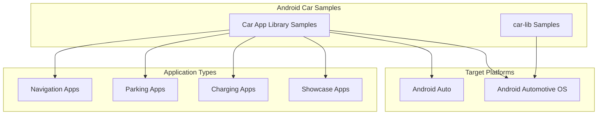

Sources: [README.md:1-13]()

## Repository Structure

The repository is organized into distinct sections based on the target platforms and integration libraries:

- **Car App Library**: The primary section containing sample applications that can run on both Android Auto and Android Automotive OS
- **car-lib**: Samples specifically targeting Android Automotive OS

The Car App Library samples follow a consistent structure that enables code sharing between platforms while accommodating platform-specific requirements.

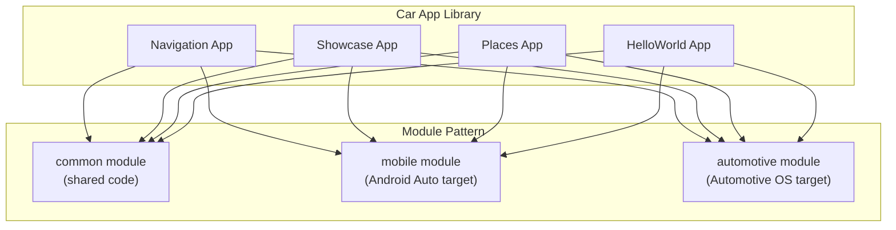

Sources: [car_app_library/README.md:1-4](), [README.md:7-11]()

## Sample Applications

The repository includes four primary sample applications in the Car App Library section:

| Sample App | Description | Key Demonstrations |
|------------|-------------|-------------------|
| Navigation | Navigation app example | Map rendering, route guidance, trip planning |
| Showcase | Comprehensive feature showcase | Various UI templates, car app capabilities |
| Places | Location-based services | Location search, place details, favorites |
| HelloWorld | Minimal starter example | Basic app structure and setup |

Each sample app is designed to demonstrate specific aspects of automotive app development while following the common/mobile/automotive module pattern.

Sources: [car_app_library/README.md:1-4]()

## Platform Architecture 

The Car App Library enables developers to build apps that can work across both Android Auto and Android Automotive OS environments. This cross-platform capability is achieved through a modular architecture:

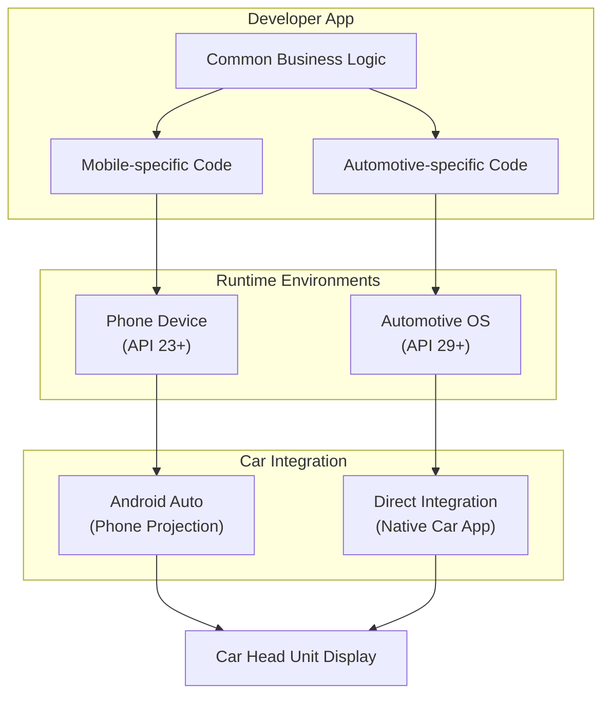

Sources: [car_app_library/README.md:67-92]()

## Car App Architecture

Car apps follow a specific architecture pattern centered around templates and services:

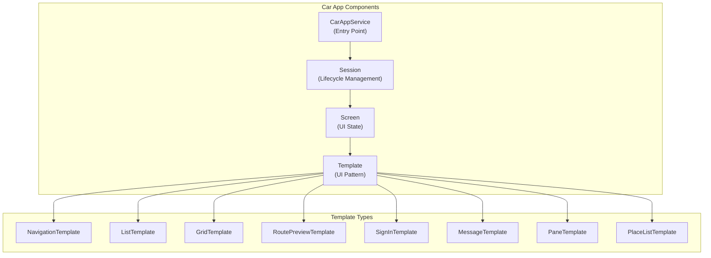

This architecture ensures that car apps comply with driver distraction guidelines by using standardized UI components optimized for the automotive environment.

Sources: [car_app_library/README.md:1-4]()

## Building and Running

The samples can be built and run using either Android Studio or the command line:

### Android Studio
1. Open the project in Android Studio
2. Select a sample app module (e.g., `helloworld/mobile`)
3. Build the module using Build → Make Module
4. Run the app on a device or emulator

### Command Line
1. Use the Gradle wrapper to assemble the APK:
   ```
   ./gradlew :<sample_app>:<platform>:assemble
   ```
2. Install the APK using ADB:
   ```
   adb install <path_to_sample_app_apk>
   ```

### Testing Environments
- **Mobile apps**: Test using the Desktop Head Unit (DHU) simulator
- **Automotive apps**: Test using the Automotive OS Emulator

Sources: [car_app_library/README.md:10-92](), [car_app_library/build.gradle:17-46]()

## Prerequisites

To work with the samples in this repository, you need:

- Android 6.0 SDK (API level 23) or newer
- Android Studio
- For automotive testing: Android Studio 4.2+ with Automotive OS emulator images

Sources: [car_app_library/README.md:6-9](), [car_app_library/README.md:79-86]()

This overview provides a foundation for understanding the car-samples repository. The following sections in this wiki provide more detailed information about the architecture, sample applications, and development considerations.

---

# Page: Architecture and Design

# Architecture and Design

<details>
<summary>Relevant source files</summary>

The following files were used as context for generating this wiki page:

- [car_app_library/gradle.properties](car_app_library/gradle.properties)
- [car_app_library/helloworld/automotive/build.gradle](car_app_library/helloworld/automotive/build.gradle)
- [car_app_library/helloworld/mobile/build.gradle](car_app_library/helloworld/mobile/build.gradle)
- [car_app_library/navigation/automotive/build.gradle](car_app_library/navigation/automotive/build.gradle)
- [car_app_library/navigation/common/build.gradle](car_app_library/navigation/common/build.gradle)
- [car_app_library/navigation/mobile/build.gradle](car_app_library/navigation/mobile/build.gradle)
- [car_app_library/places/automotive/build.gradle](car_app_library/places/automotive/build.gradle)
- [car_app_library/places/mobile/build.gradle](car_app_library/places/mobile/build.gradle)
- [car_app_library/showcase/automotive/build.gradle](car_app_library/showcase/automotive/build.gradle)
- [car_app_library/showcase/common/build.gradle](car_app_library/showcase/common/build.gradle)
- [car_app_library/showcase/mobile/build.gradle](car_app_library/showcase/mobile/build.gradle)

</details>


This document outlines the high-level architecture of the Android car apps in the car-samples repository. It explains the structural organization, design patterns, and core components that form the foundation of these applications.

For detailed information about build system configuration, see [Build System](#2.2). For an in-depth explanation of core components, refer to [Core App Components](#2.3).

## Repository Organization

The car-samples repository is organized around four primary sample applications, each demonstrating different aspects of car app development:

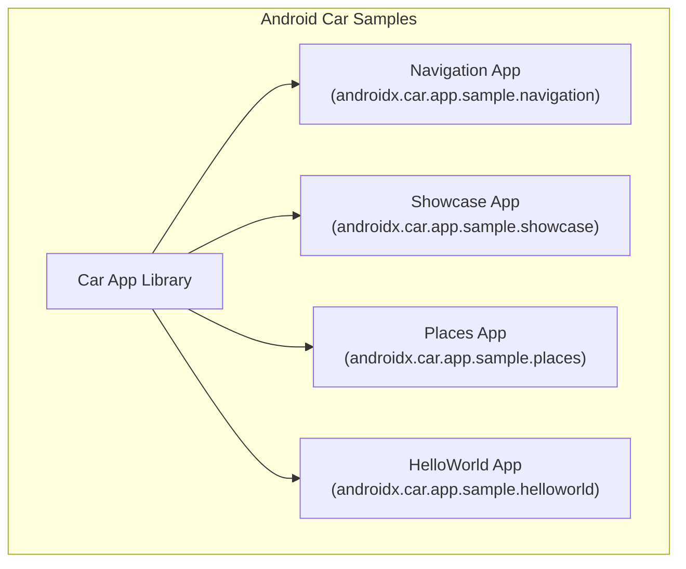

Sources:
- [car_app_library/navigation/automotive/build.gradle:23]()
- [car_app_library/showcase/automotive/build.gradle:23]()
- [car_app_library/places/automotive/build.gradle:22]()
- [car_app_library/helloworld/automotive/build.gradle:23]()

## Modular Application Architecture

Each sample application follows a consistent three-module design pattern that enables cross-platform development:

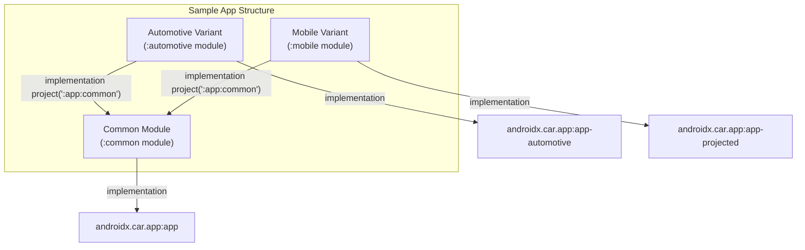

Sources:
- [car_app_library/navigation/automotive/build.gradle:50-51]()
- [car_app_library/navigation/mobile/build.gradle:50-51]()
- [car_app_library/navigation/common/build.gradle:39]()
- [car_app_library/showcase/automotive/build.gradle:52-53]()
- [car_app_library/showcase/mobile/build.gradle:52-53]()
- [car_app_library/showcase/common/build.gradle:38]()

### Module Responsibilities

| Module | Purpose | Key Dependencies |
|--------|---------|------------------|
| Common | Shared business logic and UI | androidx.car.app:app |
| Automotive | Android Automotive OS entry point | androidx.car.app:app-automotive |
| Mobile | Android Auto projection entry point | androidx.car.app:app-projected |

This architecture enables code sharing between variants while allowing platform-specific implementations when necessary.

## Platform Targeting

The sample applications target two distinct platforms with different SDK requirements:

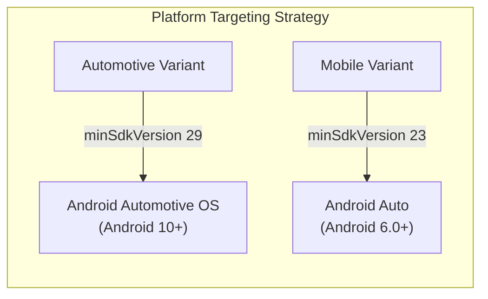

| Variant | Target Platform | Min SDK | Target SDK | Version Code Strategy |
|---------|----------------|---------|------------|------------------------|
| Automotive | Android Automotive OS | 29 | 33 | Unique (e.g., 113) |
| Mobile | Android Auto | 23 | 33 | Unique (e.g., 114) |

The version codes for automotive and mobile variants are deliberately different to enable publishing both to the Play Store as separate applications.

Sources:
- [car_app_library/navigation/automotive/build.gradle:24-29]()
- [car_app_library/navigation/mobile/build.gradle:24-29]()
- [car_app_library/showcase/automotive/build.gradle:24-29]()
- [car_app_library/showcase/mobile/build.gradle:24-29]()

## Core Component Architecture

Android car apps follow a specific architectural pattern defined by the AndroidX Car App library:

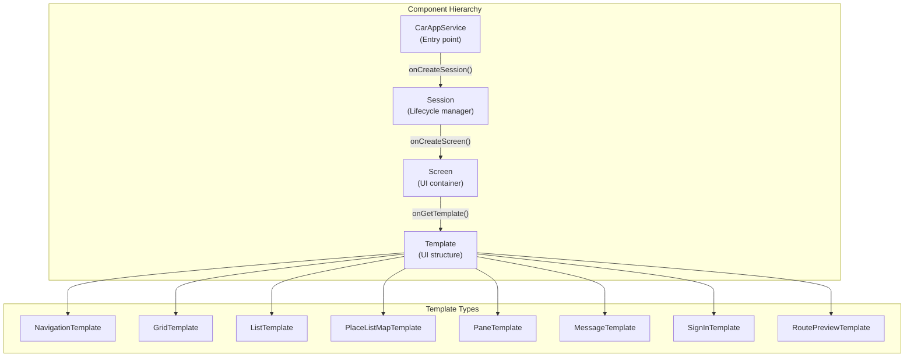

Sources:
- [car_app_library/navigation/common/build.gradle:39]()
- [car_app_library/showcase/common/build.gradle:38]()

### Component Interaction Flow

The following sequence diagram illustrates the typical interaction flow between components:

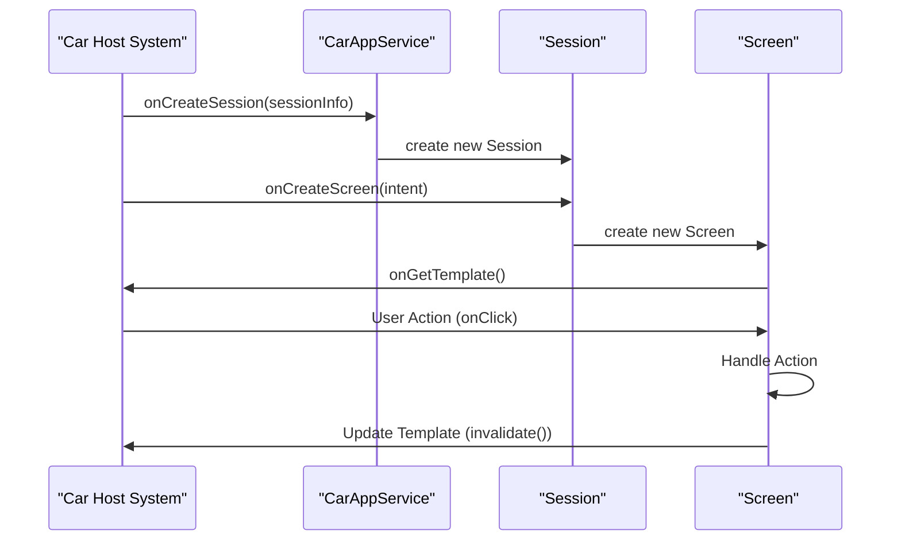

This architecture enforces several key principles:

1. **Service-based entry point**: All car apps must provide a `CarAppService` implementation
2. **Stateful sessions**: The `Session` maintains app state across screen transitions
3. **Template-driven UI**: UI elements are limited to predefined templates for driver safety
4. **Limited customization**: UI customization is restricted to ensure consistency
5. **Surface rendering**: For specialized needs like maps, a separate `SurfaceRenderer` API is available

## Build Configuration

The sample applications use a consistent Gradle configuration across all modules:

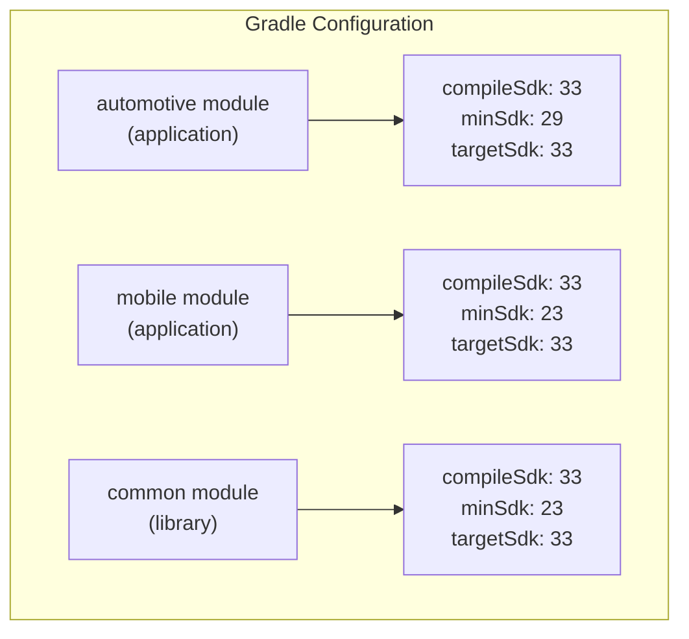

Key build settings include:
- Java 8 compatibility for all modules
- ProGuard optimization for release builds
- AndroidX library support enabled
- Disabled unused Android features for efficiency

Sources:
- [car_app_library/navigation/automotive/build.gradle:19-46]()
- [car_app_library/navigation/mobile/build.gradle:19-46]()
- [car_app_library/navigation/common/build.gradle:17-32]()
- [car_app_library/showcase/automotive/build.gradle:19-48]()
- [car_app_library/showcase/mobile/build.gradle:19-48]()
- [car_app_library/showcase/common/build.gradle:17-33]()
- [car_app_library/gradle.properties:27-33]()

## Dependencies

The sample applications rely on a specific set of AndroidX Car App libraries:

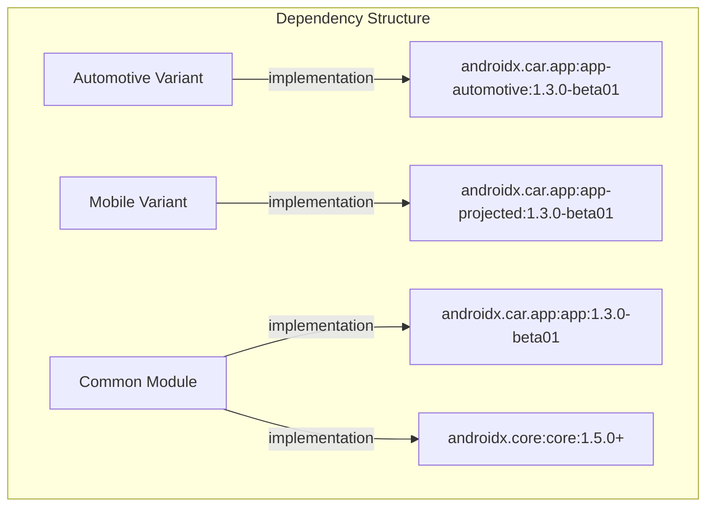

This dependency structure ensures that:
1. Each module uses the appropriate car app library variant
2. The common module uses only APIs available to both platforms
3. Version consistency is maintained across modules

Sources:
- [car_app_library/navigation/automotive/build.gradle:50]()
- [car_app_library/navigation/mobile/build.gradle:50]()
- [car_app_library/navigation/common/build.gradle:37-39]()
- [car_app_library/showcase/automotive/build.gradle:52]()
- [car_app_library/showcase/mobile/build.gradle:52]()
- [car_app_library/showcase/common/build.gradle:37-38]()

## Summary

The architecture of Android car apps in the car-samples repository demonstrates a modular design approach that enables:

1. **Cross-platform compatibility**: Supporting both Android Automotive OS and Android Auto
2. **Code reuse**: Sharing business logic and UI templates between platforms
3. **Safety compliance**: Using standardized templates that adhere to driver distraction guidelines
4. **Consistent structure**: Following a common architectural pattern across all sample apps

This architecture allows developers to create car apps that work seamlessly across different car environments while maintaining a consistent user experience and adhering to driver safety guidelines.

---

# Page: Application Structure

# Application Structure

<details>
<summary>Relevant source files</summary>

The following files were used as context for generating this wiki page:

- [car_app_library/helloworld/automotive/build.gradle](car_app_library/helloworld/automotive/build.gradle)
- [car_app_library/helloworld/common/build.gradle](car_app_library/helloworld/common/build.gradle)
- [car_app_library/helloworld/mobile/build.gradle](car_app_library/helloworld/mobile/build.gradle)
- [car_app_library/navigation/automotive/build.gradle](car_app_library/navigation/automotive/build.gradle)
- [car_app_library/navigation/common/build.gradle](car_app_library/navigation/common/build.gradle)
- [car_app_library/navigation/mobile/build.gradle](car_app_library/navigation/mobile/build.gradle)
- [car_app_library/places/automotive/build.gradle](car_app_library/places/automotive/build.gradle)
- [car_app_library/places/common/build.gradle](car_app_library/places/common/build.gradle)
- [car_app_library/places/mobile/build.gradle](car_app_library/places/mobile/build.gradle)
- [car_app_library/showcase/automotive/build.gradle](car_app_library/showcase/automotive/build.gradle)
- [car_app_library/showcase/common/build.gradle](car_app_library/showcase/common/build.gradle)
- [car_app_library/showcase/mobile/build.gradle](car_app_library/showcase/mobile/build.gradle)

</details>


This page documents the module architecture and organizational patterns used across the sample applications in the Android Car Samples repository. It details how each application is structured to target both Android Automotive OS and Android Auto platforms while maximizing code reuse.

For information about how the build system is configured to support this structure, see [Build System](#2.2).

## Module Pattern

Each sample application in the repository follows a consistent three-module architecture pattern designed to separate platform-specific code from shared functionality.

### Three-Module Architecture

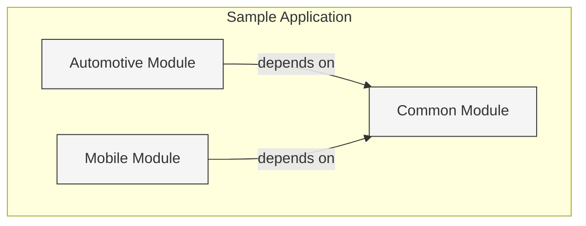

Sources: [car_app_library/showcase/automotive/build.gradle:52-53](), [car_app_library/showcase/mobile/build.gradle:52-53](), [car_app_library/navigation/automotive/build.gradle:51-52](), [car_app_library/navigation/mobile/build.gradle:51-52]()

The three-module architecture consists of:

1. **Common Module**: Library module containing shared code and resources used by both platform variants
2. **Automotive Module**: Application module targeting Android Automotive OS
3. **Mobile Module**: Application module targeting Android mobile devices (for use with Android Auto)

This pattern enables high code reuse while allowing for platform-specific optimizations and implementations where necessary.

## Module Characteristics

Each module type has distinct characteristics defined in their respective build configurations:

| Module Type | Plugin | Min SDK | Target Type | AndroidX Car Dependency |
|-------------|--------|---------|-------------|-------------------------|
| Common | com.android.library | 23 | Both platforms | androidx.car.app:app |
| Automotive | com.android.application | 29 | Android Automotive OS | androidx.car.app:app-automotive |
| Mobile | com.android.application | 23 | Android Mobile (Auto) | androidx.car.app:app-projected |

Sources: [car_app_library/navigation/common/build.gradle:17-39](), [car_app_library/navigation/automotive/build.gradle:17-24](), [car_app_library/navigation/mobile/build.gradle:17-25]()

### Common Module

The common module is implemented as an Android library that contains the core business logic, UI templates, and shared resources. It uses the base Car App library dependency:

```
implementation "androidx.car.app:app:1.3.0-beta01"
```

Key characteristics:
- Uses the `com.android.library` plugin
- Has a minimum SDK version of 23 to be compatible with both platforms
- Contains shared UI templates, models, and utility classes

Sources: [car_app_library/showcase/common/build.gradle:17-38](), [car_app_library/navigation/common/build.gradle:17-39]()

### Automotive Module

The automotive module is an application specifically targeting Android Automotive OS:

```
implementation "androidx.car.app:app-automotive:1.3.0-beta01"
implementation project(":navigation:common")
```

Key characteristics:
- Uses the `com.android.application` plugin
- Has a minimum SDK version of 29 (Android 10), required for Automotive OS
- Contains automotive-specific implementations and configurations
- Depends on the common module

Sources: [car_app_library/navigation/automotive/build.gradle:17-52](), [car_app_library/showcase/automotive/build.gradle:17-53]()

### Mobile Module

The mobile module is an application targeting mobile devices that connect to cars via Android Auto:

```
implementation "androidx.car.app:app-projected:1.3.0-beta01"
implementation project(":navigation:common")
```

Key characteristics:
- Uses the `com.android.application` plugin
- Has a minimum SDK version of 23 (Android 6.0)
- Contains mobile-specific implementations and projection configurations
- Depends on the common module

Sources: [car_app_library/navigation/mobile/build.gradle:17-52](), [car_app_library/showcase/mobile/build.gradle:17-53]()

## Application Structure Diagram

The following diagram illustrates how a typical sample application in the repository is structured, including the file organization and key components:

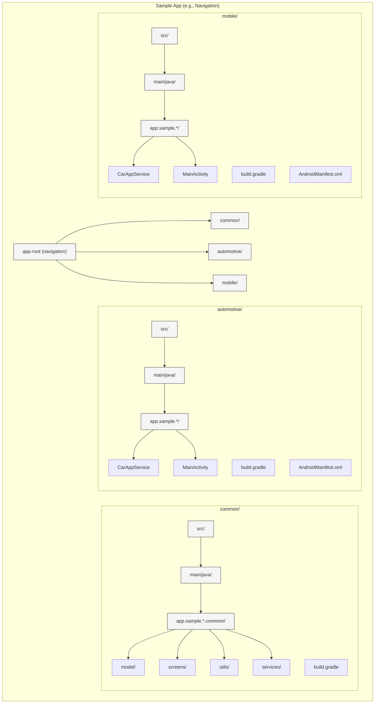

Sources: [car_app_library/navigation/common/build.gradle](), [car_app_library/navigation/automotive/build.gradle](), [car_app_library/navigation/mobile/build.gradle]()

## Dependency Structure

The following diagram illustrates the dependency relationships between modules and external libraries:

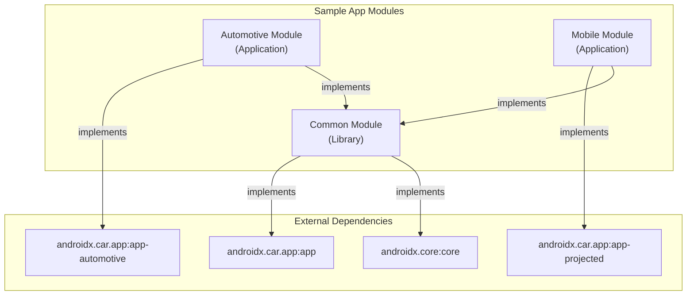

Sources: [car_app_library/showcase/common/build.gradle:36-39](), [car_app_library/showcase/automotive/build.gradle:51-53](), [car_app_library/showcase/mobile/build.gradle:51-53]()

Key dependencies:
- **Common module**: Depends on the base car app library (`androidx.car.app:app`)
- **Automotive module**: Depends on the common module and the automotive-specific car app library (`androidx.car.app:app-automotive`)
- **Mobile module**: Depends on the common module and the projected car app library (`androidx.car.app:app-projected`)

## Sample Applications

All four sample applications in the repository follow this module pattern:

| Application | Purpose | Common Module | Automotive Module | Mobile Module |
|-------------|---------|---------------|------------------|---------------|
| Navigation | Demonstrates navigation features | navigation/common | navigation/automotive | navigation/mobile |
| Showcase | Demonstrates variety of templates | showcase/common | showcase/automotive | showcase/mobile |
| Places | Demonstrates place search and list | places/common | places/automotive | places/mobile |
| HelloWorld | Minimal example app | helloworld/common | helloworld/automotive | helloworld/mobile |

Sources: [car_app_library/navigation/common/build.gradle](), [car_app_library/showcase/common/build.gradle](), [car_app_library/places/common/build.gradle](), [car_app_library/helloworld/common/build.gradle]()

## Version Management

The sample applications maintain separate version codes between the automotive and mobile variants:

```
// Increment this to generate signed builds for uploading to Playstore
// Make sure this is different from the navigation-automotive version
versionCode 114  // Mobile version
versionCode 113  // Automotive version
```

This separation is necessary because:
1. The application variants may have different release cycles
2. Each variant requires its own Play Store listings
3. Different version codes help prevent confusion during development and deployment

Sources: [car_app_library/navigation/automotive/build.gradle:23-29](), [car_app_library/navigation/mobile/build.gradle:23-29]()

## Implementation Considerations

When developing applications using this structure, consider the following:

1. **Code Sharing**: Place as much code as possible in the common module to maximize reuse
2. **Platform Detection**: When platform-specific behavior is needed, use capability detection instead of direct platform checks
3. **Resource Optimization**: Include platform-specific resources in the respective module
4. **Module Boundaries**: Keep module interfaces clean and well-defined to minimize coupling

The next page [Core App Components](#2.3) covers the key components that form the foundation of car apps built using this structure.

---

# Page: Build System

# Build System

<details>
<summary>Relevant source files</summary>

The following files were used as context for generating this wiki page:

- [car_app_library/README.md](car_app_library/README.md)
- [car_app_library/build.gradle](car_app_library/build.gradle)
- [car_app_library/gradle.properties](car_app_library/gradle.properties)
- [car_app_library/navigation/automotive/build.gradle](car_app_library/navigation/automotive/build.gradle)
- [car_app_library/navigation/mobile/build.gradle](car_app_library/navigation/mobile/build.gradle)
- [car_app_library/showcase/automotive/build.gradle](car_app_library/showcase/automotive/build.gradle)
- [car_app_library/showcase/mobile/build.gradle](car_app_library/showcase/mobile/build.gradle)

</details>


## Purpose and Scope

This document describes the Gradle build system configuration used in the Android Car Samples repository. It covers the build file structure, module organization, platform variants, dependency management, and build process for both command-line and Android Studio environments. For information about running the built applications, see [Development and Testing](#5).

## Build System Overview

The car-samples repository uses Gradle as its build system with a structured module hierarchy designed to support both Android Automotive OS and Android Auto (mobile) variants of each sample application.

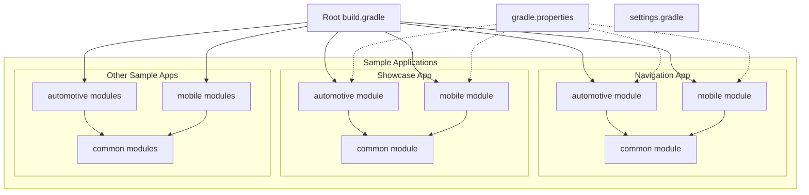

Sources: [car_app_library/build.gradle](), [car_app_library/gradle.properties]()

## Module Structure

Each sample application in the car-samples repository follows a consistent three-module structure:

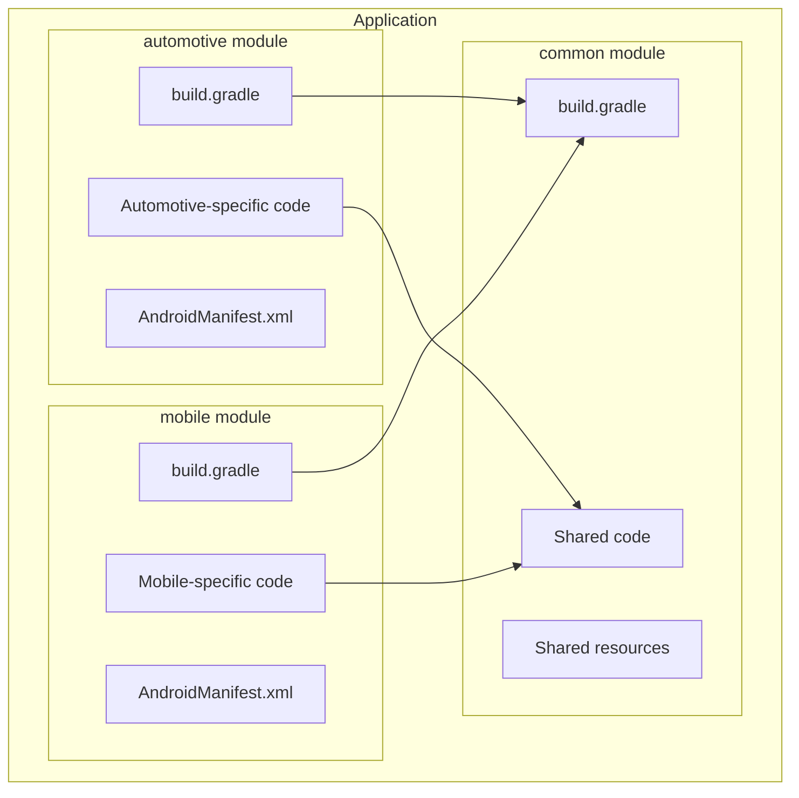

Sources: [car_app_library/navigation/automotive/build.gradle](), [car_app_library/navigation/mobile/build.gradle]()

### Module Dependencies

Both the automotive and mobile modules depend on their respective Car App Library variants and the common module:

| Module Type | Car App Library Dependency | Other Dependencies |
|-------------|----------------------------|-------------------|
| Automotive | `androidx.car.app:app-automotive` | common module |
| Mobile | `androidx.car.app:app-projected` | common module |

Sources: [car_app_library/navigation/automotive/build.gradle:50-52](), [car_app_library/navigation/mobile/build.gradle:50-52]()

## Platform Variant Configurations

The build system maintains separate configurations for automotive and mobile variants through their respective build.gradle files. Here are the key differences:

| Configuration | Automotive Variant | Mobile Variant |
|---------------|-------------------|---------------|
| Min SDK | 29 (Android 10) | 23 (Android 6.0) |
| Target SDK | 33 | 33 |
| Library Dependency | androidx.car.app:app-automotive | androidx.car.app:app-projected |
| Version Code | Usually odd (e.g., 113) | Usually even (e.g., 114) |

Sources: [car_app_library/navigation/automotive/build.gradle:22-29](), [car_app_library/navigation/mobile/build.gradle:22-29](), [car_app_library/showcase/automotive/build.gradle:22-29](), [car_app_library/showcase/mobile/build.gradle:22-29]()

## Root Build Configuration

The root build.gradle file configures the build environment, including:

1. Repository sources (Google, JCenter, and Maven Central)
2. Gradle version (7.0.4)
3. Global Java compiler options

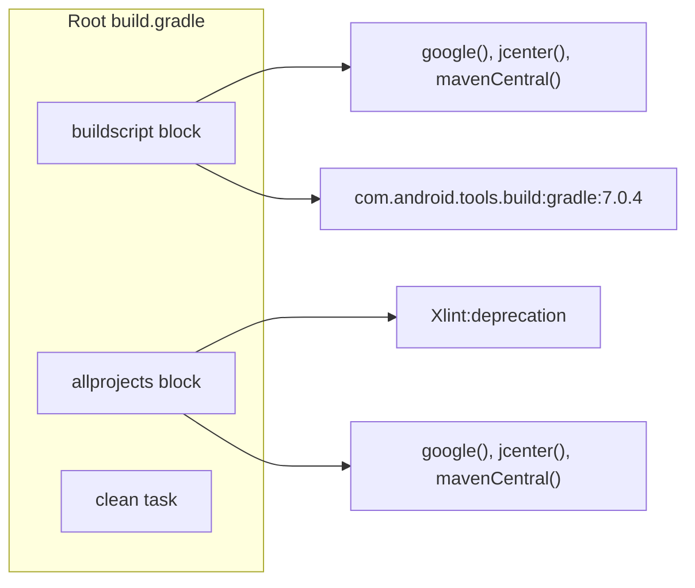

Sources: [car_app_library/build.gradle:17-46]()

## Gradle Properties

The gradle.properties file configures several important build behaviors:

1. Enabling AndroidX
2. Disabling unused Android features (AIDL, BuildConfig, RenderScript, etc.)

Sources: [car_app_library/gradle.properties:27-33]()

## Application Module Configuration

Each application module (automotive and mobile) defines its specific Android application configuration:

### Common Configuration Elements

1. **Application ID** - Package name for the application (same for both variants)
2. **Target SDK** - API level 33 for both variants
3. **Compilation Options** - Java 8 compatibility
4. **Release Configuration** - Code shrinking and optimization

### Example Module Configuration

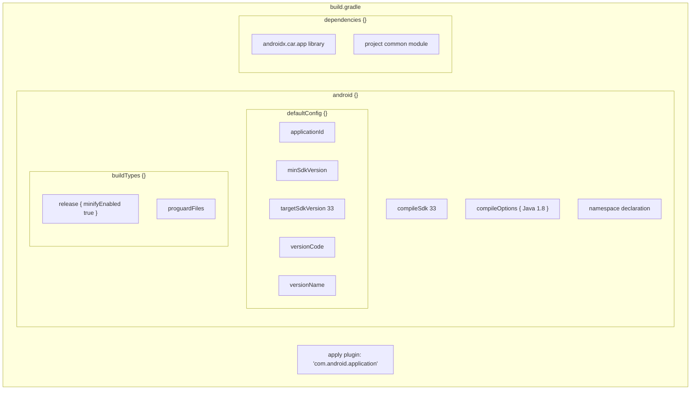

Sources: [car_app_library/navigation/automotive/build.gradle:19-52](), [car_app_library/showcase/mobile/build.gradle:19-54]()

## Build Process

The build process generates different APKs for the automotive and mobile variants:

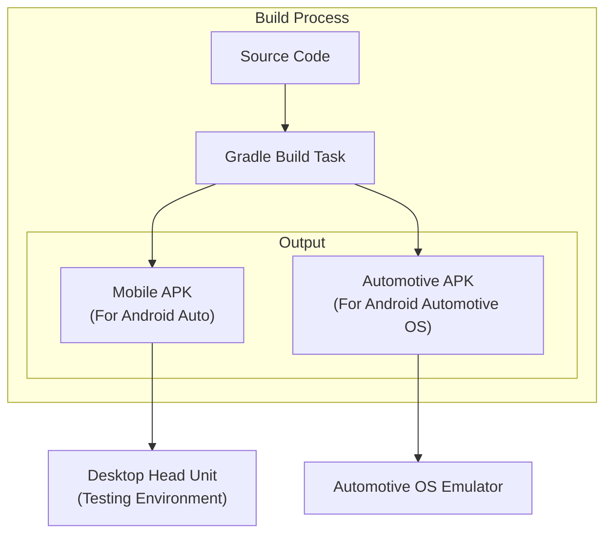

Sources: [car_app_library/README.md:10-66](), [car_app_library/README.md:67-92]()

## Building Applications

### Command Line Building

To build sample applications from the command line:

```
./gradlew :<sample_app>:<platform>:assemble
```

Examples:
- `./gradlew :showcase:mobile:assemble` - Builds the mobile variant of Showcase app
- `./gradlew :navigation:automotive:assemble` - Builds the automotive variant of Navigation app

The generated APKs will be located at `<sample_app>/<platform>/build/outputs/apk/debug/`.

Sources: [car_app_library/README.md:34-65]()

### Android Studio Building

To build from Android Studio:

1. Open the project in Android Studio
2. Select a module (e.g., `navigation/mobile`)
3. Use Build > Make Module to generate the APK

Sources: [car_app_library/README.md:10-33]()

## Module Dependencies Hierarchy

The project's build system establishes dependencies between modules and external libraries:

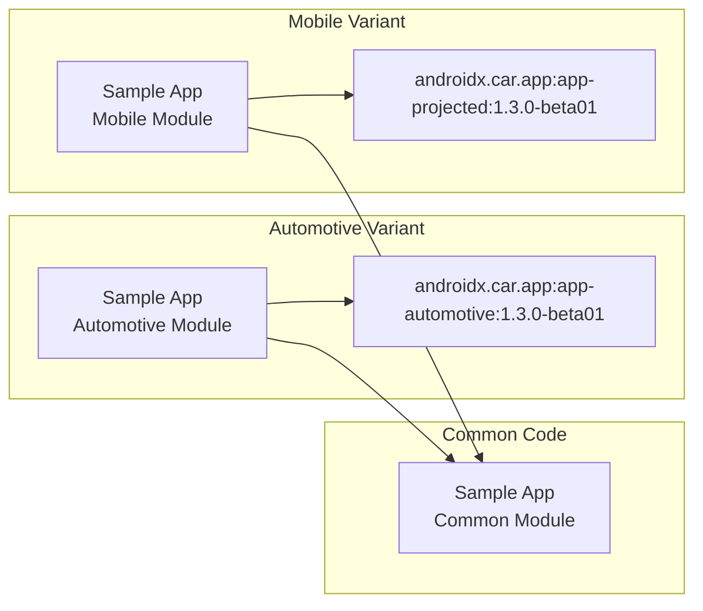

Sources: [car_app_library/navigation/automotive/build.gradle:49-52](), [car_app_library/navigation/mobile/build.gradle:49-52](), [car_app_library/showcase/automotive/build.gradle:51-54](), [car_app_library/showcase/mobile/build.gradle:51-54]()

## Version Management

The build system maintains separate version codes and names for automotive and mobile variants to allow independent publishing to the Play Store:

- Automotive variants typically use odd version codes (e.g., 113)
- Mobile variants typically use even version codes (e.g., 114)

This separation allows for independent update cycles while maintaining a consistent application ID.

Sources: [car_app_library/navigation/automotive/build.gradle:26-29](), [car_app_library/navigation/mobile/build.gradle:26-29](), [car_app_library/showcase/automotive/build.gradle:26-29](), [car_app_library/showcase/mobile/build.gradle:26-29]()

---

# Page: Core App Components

# Core App Components

<details>
<summary>Relevant source files</summary>

The following files were used as context for generating this wiki page:

- [car_app_library/helloworld/common/src/main/java/androidx/car/app/sample/helloworld/common/HelloWorldService.java](car_app_library/helloworld/common/src/main/java/androidx/car/app/sample/helloworld/common/HelloWorldService.java)
- [car_app_library/helloworld/common/src/test/java/androidx/car/app/sample/helloworld/common/HelloWorldSessionTest.java](car_app_library/helloworld/common/src/test/java/androidx/car/app/sample/helloworld/common/HelloWorldSessionTest.java)
- [car_app_library/navigation/automotive/src/main/AndroidManifest.xml](car_app_library/navigation/automotive/src/main/AndroidManifest.xml)
- [car_app_library/navigation/common/src/main/java/androidx/car/app/sample/navigation/common/car/NavigationCarAppService.java](car_app_library/navigation/common/src/main/java/androidx/car/app/sample/navigation/common/car/NavigationCarAppService.java)
- [car_app_library/navigation/common/src/main/java/androidx/car/app/sample/navigation/common/car/NavigationSession.java](car_app_library/navigation/common/src/main/java/androidx/car/app/sample/navigation/common/car/NavigationSession.java)
- [car_app_library/navigation/mobile/src/main/AndroidManifest.xml](car_app_library/navigation/mobile/src/main/AndroidManifest.xml)
- [car_app_library/places/common/src/main/java/androidx/car/app/sample/places/common/PlacesCarAppService.java](car_app_library/places/common/src/main/java/androidx/car/app/sample/places/common/PlacesCarAppService.java)
- [car_app_library/showcase/common/src/main/java/androidx/car/app/sample/showcase/common/ShowcaseService.java](car_app_library/showcase/common/src/main/java/androidx/car/app/sample/showcase/common/ShowcaseService.java)
- [car_app_library/showcase/common/src/main/java/androidx/car/app/sample/showcase/common/templates/ListTemplateDemoScreen.java](car_app_library/showcase/common/src/main/java/androidx/car/app/sample/showcase/common/templates/ListTemplateDemoScreen.java)

</details>


This page describes the core architectural components that form the foundation of Android car apps: `CarAppService`, `Session`, and `Screen`. Understanding these components and their lifecycles is essential for developing robust car applications. For information about UI templates that are used within screens, see [UI Components and Templates](#4).

## 1. Core Component Overview

Android car apps follow a specific component architecture designed for automotive environments. These components provide the structure, state management, and UI capabilities needed for distraction-optimized automotive experiences.

```mermaid
graph TD
    subgraph "Core Components"
        A["CarAppService"] --> B["Session"]
        B --> C["Screen"]
        C --> D["Template"]
    end
    
    subgraph "Responsibilities"
        A1["Entry point connecting to car environment"]
        B1["Lifecycle and state management"]
        C1["UI container and user interaction"]
        D1["Standardized UI patterns"]
    end
    
    A --- A1
    B --- B1
    C --- C1
    D --- D1
```

Sources:
- [car_app_library/navigation/common/src/main/java/androidx/car/app/sample/navigation/common/car/NavigationCarAppService.java:36-43]()
- [car_app_library/navigation/common/src/main/java/androidx/car/app/sample/navigation/common/car/NavigationSession.java:60-62]()
- [car_app_library/showcase/common/src/main/java/androidx/car/app/sample/showcase/common/templates/ListTemplateDemoScreen.java:42-44]()

## 2. CarAppService

`CarAppService` is the main interface between your app and the car host environment. It serves as the entry point for your car app and is responsible for creating sessions, validating hosts, and managing service lifecycle.

### 2.1 Implementation and Configuration

To create a car app, you must implement a service that extends `CarAppService` and register it in your Android manifest with the appropriate intent filter.

```mermaid
classDiagram
    class CarAppService {
        +onCreateSession(sessionInfo): Session
        +createHostValidator(): HostValidator
    }
    
    class NavigationCarAppService {
        +onCreateSession(sessionInfo): Session
        +createHostValidator(): HostValidator
        -createNotificationChannel()
        -getNotification(): Notification
    }
    
    class ShowcaseService {
        +onCreateSession(sessionInfo): Session
        +createHostValidator(): HostValidator
    }
    
    class HelloWorldService {
        +onCreateSession(sessionInfo): Session
        +createHostValidator(): HostValidator
    }
    
    CarAppService <|-- NavigationCarAppService
    CarAppService <|-- ShowcaseService
    CarAppService <|-- HelloWorldService
```

Sources:
- [car_app_library/navigation/common/src/main/java/androidx/car/app/sample/navigation/common/car/NavigationCarAppService.java:43-123]()
- [car_app_library/showcase/common/src/main/java/androidx/car/app/sample/showcase/common/ShowcaseService.java:35-70]()
- [car_app_library/helloworld/common/src/main/java/androidx/car/app/sample/helloworld/common/HelloWorldService.java:36-65]()

### 2.2 Service Registration in Manifest

The service must be properly declared in your AndroidManifest.xml file with the appropriate intent filter to be discoverable by the car host.

```xml
<service
    android:name="androidx.car.app.sample.navigation.common.car.NavigationCarAppService"
    android:foregroundServiceType="location"
    android:exported="true">
    <intent-filter>
        <action android:name="androidx.car.app.CarAppService" />
        <category android:name="androidx.car.app.category.NAVIGATION"/>
    </intent-filter>
</service>
```

Key aspects of the manifest registration:
- Service must be `exported="true"` to be accessible to the car host
- Must include intent filter with `androidx.car.app.CarAppService` action
- Appropriate categories (e.g., NAVIGATION) must be specified
- For services that use location, specify `foregroundServiceType="location"`

Sources:
- [car_app_library/navigation/automotive/src/main/AndroidManifest.xml:62-72]()
- [car_app_library/navigation/mobile/src/main/AndroidManifest.xml:53-68]()

### 2.3 Host Validation

Car apps need to validate the host trying to connect to ensure security. The `createHostValidator()` method provides this validation mechanism.

```java
@NonNull
@Override
public HostValidator createHostValidator() {
    if ((getApplicationInfo().flags & ApplicationInfo.FLAG_DEBUGGABLE) != 0) {
        return HostValidator.ALLOW_ALL_HOSTS_VALIDATOR;
    } else {
        return new HostValidator.Builder(getApplicationContext())
                .addAllowedHosts(androidx.car.app.R.array.hosts_allowlist_sample)
                .build();
    }
}
```

This pattern is consistently used across different service implementations to ensure that only authorized hosts can connect to the app, while allowing more permissive validation during development.

Sources:
- [car_app_library/navigation/common/src/main/java/androidx/car/app/sample/navigation/common/car/NavigationCarAppService.java:87-97]()
- [car_app_library/helloworld/common/src/main/java/androidx/car/app/sample/helloworld/common/HelloWorldService.java:54-64]()

## 3. Session

The `Session` class manages the lifecycle and state of your car app. It handles the creation of screens, processes intents, and maintains state across screens.

### 3.1 Session Creation and Lifecycle

When the car host connects to your service, the system calls `onCreateSession()` to create a new Session instance. The session then handles various lifecycle events in coordination with Android's lifecycle components.

```mermaid
sequenceDiagram
    participant CarHost as "Car Host"
    participant Service as "CarAppService"
    participant Session
    participant Screen
    
    CarHost->>Service: Connect to service
    Service->>Service: onCreateSession(sessionInfo)
    Service->>Session: create new Session
    Session->>Session: Initialize
    Session->>Session: Lifecycle.onCreate()
    CarHost->>Session: Intent received
    Session->>Session: onCreateScreen(intent)
    Session->>Screen: create new Screen
    Session->>CarHost: Return Screen
    
    Note over Session: Session Lifecycle
    CarHost->>Session: onStart()
    CarHost->>Session: onResume()
    CarHost->>Session: onPause()
    CarHost->>Session: onStop()
    CarHost->>Session: onDestroy()
```

Sources:
- [car_app_library/navigation/common/src/main/java/androidx/car/app/sample/navigation/common/car/NavigationCarAppService.java:58-85]()
- [car_app_library/navigation/common/src/main/java/androidx/car/app/sample/navigation/common/car/NavigationSession.java:132-176]()
- [car_app_library/helloworld/common/src/test/java/androidx/car/app/sample/helloworld/common/HelloWorldSessionTest.java:52-64]()

### 3.2 Screen Creation and Intent Handling

A key responsibility of the Session is to create the initial Screen of your app and handle new intents received from the car host.

```mermaid
flowchart TD
    A["Session.onCreateScreen(intent)"] --> B{"Check permissions?"}
    B -->|"Has permissions"| C["Create main screen"]
    B -->|"Needs permissions"| D["Create permission request screen"]
    D --> E["Push main screen to backstack"]
    
    F["Session.onNewIntent(intent)"] --> G{"Process intent\ntype"}
    G -->|"Navigate intent"| H["Handle navigation"]
    G -->|"Deep link"| I["Process deep link"]
    G -->|"Other"| J["Custom handling"]
```

Sources:
- [car_app_library/places/common/src/main/java/androidx/car/app/sample/places/common/PlacesCarAppService.java:44-58]()
- [car_app_library/navigation/common/src/main/java/androidx/car/app/sample/navigation/common/car/NavigationSession.java:185-233]()
- [car_app_library/navigation/common/src/main/java/androidx/car/app/sample/navigation/common/car/NavigationSession.java:234-281]()

### 3.3 Session Implementation Patterns

There are two common patterns for implementing Session:

1. **Anonymous inner class** - Simple apps often define Session as an anonymous class within `onCreateSession()`

```java
@Override
@NonNull
public Session onCreateSession(@NonNull SessionInfo sessionInfo) {
    return new Session() {
        @Override
        @NonNull
        public Screen onCreateScreen(@NonNull Intent intent) {
            return new HelloWorldScreen(getCarContext());
        }
    };
}
```

2. **Dedicated class** - More complex apps define a separate Session class that extends the base Session class

```java
@Override
@NonNull
public Session onCreateSession(@NonNull SessionInfo sessionInfo) {
    createNotificationChannel();
    startForeground(NOTIFICATION_ID, getNotification());
    NavigationSession session = new NavigationSession(sessionInfo);
    session.getLifecycle()
            .addObserver(
                    new DefaultLifecycleObserver() {
                        @Override
                        public void onDestroy(@NonNull LifecycleOwner owner) {
                            stopForeground(true);
                        }
                    });
    return session;
}
```

Sources:
- [car_app_library/helloworld/common/src/main/java/androidx/car/app/sample/helloworld/common/HelloWorldService.java:42-52]()
- [car_app_library/places/common/src/main/java/androidx/car/app/sample/places/common/PlacesCarAppService.java:40-59]()
- [car_app_library/navigation/common/src/main/java/androidx/car/app/sample/navigation/common/car/NavigationCarAppService.java:58-85]()

## 4. Screen

The `Screen` class represents a single screen in your car app's UI. It's responsible for providing templates to the car host, handling user interactions, and managing screen-specific state.

### 4.1 Screen Structure and Lifecycle

Screens are created by the Session and follow the Android lifecycle. Each screen is responsible for providing a Template that defines its UI.

```mermaid
classDiagram
    class Screen {
        +onGetTemplate(): Template
        +getLifecycle(): Lifecycle
        +getCarContext(): CarContext
        +setResult(result)
        +finish()
    }
    
    class ListTemplateDemoScreen {
        +onGetTemplate(): Template
        -onClick(String): void
    }
    
    class NavigationScreen {
        +onGetTemplate(): Template
        +updateTrip(...)
    }
    
    Screen <|-- ListTemplateDemoScreen
    Screen <|-- NavigationScreen
    
    class DefaultLifecycleObserver {
        +onCreate()
        +onStart()
        +onResume()
        +onPause()
        +onStop()
        +onDestroy()
    }
    
    DefaultLifecycleObserver <.. ListTemplateDemoScreen: implements
```

Sources:
- [car_app_library/showcase/common/src/main/java/androidx/car/app/sample/showcase/common/templates/ListTemplateDemoScreen.java:43-52]()
- [car_app_library/navigation/common/src/main/java/androidx/car/app/sample/navigation/common/car/NavigationSession.java:204-208]()

### 4.2 Template Creation

The primary responsibility of a Screen is to provide a Template through its `onGetTemplate()` method. Templates are predefined UI structures that adhere to driver distraction guidelines.

```mermaid
flowchart TD
    A["Screen.onGetTemplate()"] --> B["Create Template Builder"]
    B --> C["Configure Template properties"]
    C --> D["Add content (lists, rows, actions)"]
    D --> E["Build Template"]
    E --> F["Return Template to car host"]
```

Example from `ListTemplateDemoScreen`:

```java
@NonNull
@Override
public Template onGetTemplate() {
    ItemList.Builder listBuilder = new ItemList.Builder();
    // Add items to the list...
    
    return new ListTemplate.Builder()
            .setSingleList(listBuilder.build())
            .setTitle("List Template Demo")
            .setHeaderAction(BACK)
            .setActionStrip(
                    new ActionStrip.Builder()
                            .addAction(settings)
                            .build())
            .build();
}
```

Sources:
- [car_app_library/showcase/common/src/main/java/androidx/car/app/sample/showcase/common/templates/ListTemplateDemoScreen.java:52-120]()

### 4.3 Screen Navigation and Management

The car app framework provides a `ScreenManager` for navigating between screens. Common operations include:
- Pushing a new screen onto the stack
- Popping the current screen
- Replacing the current screen
- Returning to the root screen

```mermaid
sequenceDiagram
    participant CurrentScreen
    participant ScreenManager
    participant NewScreen
    
    CurrentScreen->>ScreenManager: push(newScreen)
    ScreenManager->>NewScreen: onGetTemplate()
    NewScreen-->>ScreenManager: Return Template
    
    Note over CurrentScreen, NewScreen: User action to go back
    ScreenManager->>CurrentScreen: pop()
    ScreenManager->>CurrentScreen: onGetTemplate()
    CurrentScreen-->>ScreenManager: Return Template
```

Sources:
- [car_app_library/navigation/common/src/main/java/androidx/car/app/sample/navigation/common/car/NavigationSession.java:227-229]()
- [car_app_library/places/common/src/main/java/androidx/car/app/sample/places/common/PlacesCarAppService.java:53-56]()

## 5. Component Integration Workflow

The following diagram illustrates how the core components work together in a complete car app lifecycle.

```mermaid
sequenceDiagram
    participant Host as "Car Host"
    participant Service as "CarAppService"
    participant Session
    participant ScreenManager
    participant Screen
    
    Host->>Service: Connect to service
    Service->>Session: onCreateSession()
    Session->>Session: Initialize
    Host->>Session: Start with Intent
    Session->>Screen: onCreateScreen(intent)
    Session->>ScreenManager: push(screen)
    ScreenManager->>Screen: onGetTemplate()
    Screen-->>Host: Return Template
    
    Note over Host, Screen: User Interaction
    Host->>Screen: User Action (e.g., click)
    Screen->>ScreenManager: push(newScreen)
    ScreenManager->>Screen: New Screen.onGetTemplate()
    Screen-->>Host: Return New Template
    
    Note over Host, Service: Lifecycle Events
    Host->>Session: onPause()
    Host->>Session: onStop()
    Host->>Session: onDestroy()
    Session->>Service: Notify Destruction
    Service->>Service: stopForeground()
```

Sources:
- [car_app_library/navigation/common/src/main/java/androidx/car/app/sample/navigation/common/car/NavigationCarAppService.java:58-85]()
- [car_app_library/navigation/common/src/main/java/androidx/car/app/sample/navigation/common/car/NavigationSession.java:185-233]()
- [car_app_library/showcase/common/src/main/java/androidx/car/app/sample/showcase/common/templates/ListTemplateDemoScreen.java:43-52]()

## 6. Implementation Checklist

Here's a summary of what you need to implement for the core components of a car app:

| Component | Required Implementations | Manifest Registration |
|-----------|--------------------------|----------------------|
| CarAppService | `onCreateSession()` <br> `createHostValidator()` | `<service>` with intent filter for<br>`androidx.car.app.CarAppService` |
| Session | `onCreateScreen()` <br> Optional: `onNewIntent()` | Not directly registered |
| Screen | `onGetTemplate()` | Not directly registered |

Sources:
- [car_app_library/navigation/automotive/src/main/AndroidManifest.xml:62-72]()
- [car_app_library/navigation/common/src/main/java/androidx/car/app/sample/navigation/common/car/NavigationCarAppService.java:58-97]()
- [car_app_library/helloworld/common/src/main/java/androidx/car/app/sample/helloworld/common/HelloWorldService.java:42-64]()
- [car_app_library/showcase/common/src/main/java/androidx/car/app/sample/showcase/common/templates/ListTemplateDemoScreen.java:52-120]()

---

# Page: Sample Applications

# Sample Applications

<details>
<summary>Relevant source files</summary>

The following files were used as context for generating this wiki page:

- [README.md](README.md)
- [car_app_library/helloworld/automotive/build.gradle](car_app_library/helloworld/automotive/build.gradle)
- [car_app_library/helloworld/mobile/build.gradle](car_app_library/helloworld/mobile/build.gradle)
- [car_app_library/navigation/automotive/build.gradle](car_app_library/navigation/automotive/build.gradle)
- [car_app_library/navigation/mobile/build.gradle](car_app_library/navigation/mobile/build.gradle)
- [car_app_library/places/automotive/build.gradle](car_app_library/places/automotive/build.gradle)
- [car_app_library/places/mobile/build.gradle](car_app_library/places/mobile/build.gradle)
- [car_app_library/showcase/automotive/build.gradle](car_app_library/showcase/automotive/build.gradle)
- [car_app_library/showcase/mobile/build.gradle](car_app_library/showcase/mobile/build.gradle)

</details>


This document provides a technical overview of the sample applications included in the car-samples repository. These applications demonstrate different aspects of Android Auto and Android Automotive OS app development using the Car App Library. For information about the architectural patterns used across these applications, see [Architecture and Design](#2). For build system details, see [Build System](#2.2).

## Sample Applications Overview

The car-samples repository contains four primary sample applications that demonstrate different capabilities and use cases for automotive app development:

```mermaid
graph TD
    subgraph "Car App Library Samples"
        nav["Navigation App"]
        places["Places App"]
        showcase["Showcase App"]
        hello["HelloWorld App"]
    end
    
    subgraph "Target Platforms"
        auto["Android Auto<br>(mobile phones)"]
        aaos["Android Automotive OS<br>(in-vehicle infotainment)"]
    end
    
    nav --> auto
    nav --> aaos
    places --> auto
    places --> aaos
    showcase --> auto
    showcase --> aaos
    hello --> auto
    hello --> aaos
    
    subgraph "Key Dependencies"
        projected["androidx.car.app:app-projected<br>(for mobile apps)"]
        automotive["androidx.car.app:app-automotive<br>(for automotive apps)"]
    end
    
    auto --- projected
    aaos --- automotive
```

Sources: [car_app_library/navigation/automotive/build.gradle](). [car_app_library/navigation/mobile/build.gradle](). [car_app_library/showcase/automotive/build.gradle](). [car_app_library/showcase/mobile/build.gradle](). [car_app_library/places/automotive/build.gradle](). [car_app_library/places/mobile/build.gradle](). [car_app_library/helloworld/automotive/build.gradle](). [car_app_library/helloworld/mobile/build.gradle]().

## Common Structure

Each sample application follows a consistent modular structure with three key components:

```mermaid
graph TD
    subgraph "Sample App"
        common["Common Module<br>Shared functionality"]
        auto["Automotive Variant<br>minSdk 29+<br>app-automotive dependency"]
        mobile["Mobile Variant<br>minSdk 23+<br>app-projected dependency"]
    end
    
    auto --> common
    mobile --> common
    
    subgraph "Implementation"
        carService["CarAppService<br>Entry point"]
        session["Session<br>Lifecycle management"]
        screens["Screens<br>UI components"]
        templates["Templates<br>UI layout patterns"]
    end
    
    common --> carService
    carService --> session
    session --> screens
    screens --> templates
```

Sources: [car_app_library/navigation/automotive/build.gradle:22-26](). [car_app_library/navigation/mobile/build.gradle:22-26](). [car_app_library/showcase/automotive/build.gradle:22-26](). [car_app_library/showcase/mobile/build.gradle:22-26]().

### Variant Configuration

Each sample application includes both automotive and mobile variants with specific configurations:

| Variant | Min SDK | Target SDK | Key Dependency | Purpose |
|---------|---------|------------|----------------|---------|
| Automotive | 29 | 32/33 | androidx.car.app:app-automotive | Runs directly on Android Automotive OS |
| Mobile | 23 | 32/33 | androidx.car.app:app-projected | Runs on mobile device and projects to car display |

Sources: [car_app_library/navigation/automotive/build.gradle:24-25](). [car_app_library/navigation/mobile/build.gradle:24-25](). [car_app_library/showcase/automotive/build.gradle:24-25](). [car_app_library/showcase/mobile/build.gradle:24-25]().

## Navigation App

The Navigation app demonstrates how to implement navigation functionality for automotive environments, including turn-by-turn directions, map rendering, and route planning.

### Key Features
- Map rendering with surface controls
- Turn-by-turn navigation
- Route planning and guidance
- Trip progress monitoring
- Navigation templates demonstration

### Implementation Details
- Uses `NavigationTemplate` for turn-by-turn guidance
- Demonstrates `SurfaceRenderer` for map rendering
- Shows integration with location services
- Illustrates the navigation-specific permissions model

Sources: [car_app_library/navigation/automotive/build.gradle:22-24](). [car_app_library/navigation/mobile/build.gradle:22-24]().

## Places App

The Places app showcases location-based services integration with the car environment, including searching for places, displaying place details, and navigating to destinations.

### Key Features
- Place search functionality
- Place details display
- Integration with mapping services
- Place list browsing
- User favorites management

### Implementation Details
- Demonstrates `PlaceListTemplate` for displaying locations
- Shows integration with location and search APIs
- Illustrates place data management patterns
- Provides example of list-based UI patterns

Sources: [car_app_library/places/automotive/build.gradle:22-23](). [car_app_library/places/mobile/build.gradle:22-23]().

## Showcase App

The Showcase app is the most comprehensive sample, demonstrating the full range of UI templates and car app capabilities across both platforms.

### Key Features
- Comprehensive template demonstrations
- Multiple UI patterns
- Permission handling examples
- Template transitions and navigation
- Car-specific UI adaptations

### Implementation Details
- Demonstrates all available UI templates:
  - GridTemplate
  - ListTemplate
  - PaneTemplate
  - MessageTemplate
  - NavigationTemplate
  - PlaceListTemplate
  - SignInTemplate
- Shows template combinations and transitions
- Illustrates proper lifecycle management
- Provides examples of car-specific input handling

The Showcase app serves as a comprehensive reference for developers looking to understand the full capabilities of the Car App Library.

Sources: [car_app_library/showcase/automotive/build.gradle:22-24](). [car_app_library/showcase/mobile/build.gradle:22-24]().

## HelloWorld App

The HelloWorld app is a minimal implementation demonstrating the basic setup required to create a functional car app. It serves as a starting point for developers new to car app development.

### Key Features
- Minimal implementation
- Basic UI demonstration
- Fundamental app structure
- Core lifecycle management

### Implementation Details
- Simple template usage
- Basic CarAppService implementation
- Demonstrates essential app structure
- Shows minimum viable car app integration

Sources: [car_app_library/helloworld/automotive/build.gradle:22-24](). [car_app_library/helloworld/mobile/build.gradle:22-24]().

## Sample Application Comparison

The following table compares the key features and focus areas of each sample application:

| Feature | Navigation App | Places App | Showcase App | HelloWorld App |
|---------|---------------|------------|--------------|----------------|
| Template Types | Navigation-focused | Place lists | Comprehensive | Basic |
| Map Rendering | ✓ | ✓ | ✓ | ✗ |
| Route Guidance | ✓ | ✓ | Limited | ✗ |
| Search | Limited | ✓ | Limited | ✗ |
| UI Complexity | Medium | Medium | High | Low |
| Permissions Demo | ✓ | ✓ | ✓ | Limited |
| Best For | Navigation apps | Location-based apps | Learning all capabilities | Getting started |

## Application Relationships and Dependencies

```mermaid
graph TD
    subgraph "androidx.car.app API"
        carService["CarAppService"]
        session["Session"]
        screen["Screen"]
        template["Template"]
    end
    
    subgraph "Sample Applications"
        helloApp["HelloWorld App<br>Basic implementation"]
        placesApp["Places App<br>Location search"]
        navApp["Navigation App<br>Route guidance"]
        showcaseApp["Showcase App<br>All templates"]
    end
    
    helloApp --> carService
    helloApp --> session
    helloApp --> screen
    helloApp --> template
    
    placesApp --> carService
    placesApp --> session
    placesApp --> screen
    placesApp --> template
    
    navApp --> carService
    navApp --> session
    navApp --> screen
    navApp --> template
    
    showcaseApp --> carService
    showcaseApp --> session
    showcaseApp --> screen
    showcaseApp --> template
    
    subgraph "Complexity Level"
        basic["Basic<br>HelloWorld"]
        intermediate["Intermediate<br>Places"]
        advanced["Advanced<br>Navigation & Showcase"]
    end
    
    helloApp --- basic
    placesApp --- intermediate
    navApp --- advanced
    showcaseApp --- advanced
```

Sources: [car_app_library/navigation/automotive/build.gradle:50-52](). [car_app_library/showcase/automotive/build.gradle:52-53](). [car_app_library/places/automotive/build.gradle:47-49](). [car_app_library/helloworld/automotive/build.gradle:48-50]().

## Application Selection Guide

When selecting a sample application to reference for your development:

1. For **new developers** - Start with the HelloWorld app to understand basic structure and setup
2. For **location-based services** - Reference the Places app for search and place display patterns
3. For **navigation providers** - Use the Navigation app for route guidance and map rendering examples
4. For **comprehensive reference** - The Showcase app demonstrates all available templates and patterns

Each sample application is designed to work on both Android Auto (via the mobile variant) and Android Automotive OS (via the automotive variant) using a shared common module for business logic and UI definitions.

---

# Page: Navigation App

# Navigation App

<details>
<summary>Relevant source files</summary>

The following files were used as context for generating this wiki page:

- [car_app_library/navigation/automotive/build.gradle](car_app_library/navigation/automotive/build.gradle)
- [car_app_library/navigation/common/src/main/java/androidx/car/app/sample/navigation/common/car/MicrophoneRecorder.java](car_app_library/navigation/common/src/main/java/androidx/car/app/sample/navigation/common/car/MicrophoneRecorder.java)
- [car_app_library/navigation/common/src/main/java/androidx/car/app/sample/navigation/common/car/NavigationCarAppService.java](car_app_library/navigation/common/src/main/java/androidx/car/app/sample/navigation/common/car/NavigationCarAppService.java)
- [car_app_library/navigation/common/src/main/java/androidx/car/app/sample/navigation/common/car/NavigationScreen.java](car_app_library/navigation/common/src/main/java/androidx/car/app/sample/navigation/common/car/NavigationScreen.java)
- [car_app_library/navigation/common/src/main/res/drawable/ic_add_stop.xml](car_app_library/navigation/common/src/main/res/drawable/ic_add_stop.xml)
- [car_app_library/navigation/mobile/build.gradle](car_app_library/navigation/mobile/build.gradle)
- [car_app_library/navigation/mobile/src/main/AndroidManifest.xml](car_app_library/navigation/mobile/src/main/AndroidManifest.xml)
- [car_app_library/showcase/automotive/build.gradle](car_app_library/showcase/automotive/build.gradle)
- [car_app_library/showcase/common/src/main/java/androidx/car/app/sample/showcase/common/TaskRestrictionDemoScreen.java](car_app_library/showcase/common/src/main/java/androidx/car/app/sample/showcase/common/TaskRestrictionDemoScreen.java)
- [car_app_library/showcase/common/src/main/java/androidx/car/app/sample/showcase/common/templates/ListTemplateDemoScreen.java](car_app_library/showcase/common/src/main/java/androidx/car/app/sample/showcase/common/templates/ListTemplateDemoScreen.java)
- [car_app_library/showcase/common/src/main/res/values-af/strings.xml](car_app_library/showcase/common/src/main/res/values-af/strings.xml)
- [car_app_library/showcase/common/src/main/res/values-am/strings.xml](car_app_library/showcase/common/src/main/res/values-am/strings.xml)
- [car_app_library/showcase/common/src/main/res/values-ar/strings.xml](car_app_library/showcase/common/src/main/res/values-ar/strings.xml)
- [car_app_library/showcase/common/src/main/res/values-as/strings.xml](car_app_library/showcase/common/src/main/res/values-as/strings.xml)
- [car_app_library/showcase/common/src/main/res/values-az/strings.xml](car_app_library/showcase/common/src/main/res/values-az/strings.xml)
- [car_app_library/showcase/common/src/main/res/values-b+sr+Latn/strings.xml](car_app_library/showcase/common/src/main/res/values-b+sr+Latn/strings.xml)
- [car_app_library/showcase/common/src/main/res/values-be/strings.xml](car_app_library/showcase/common/src/main/res/values-be/strings.xml)
- [car_app_library/showcase/common/src/main/res/values-bg/strings.xml](car_app_library/showcase/common/src/main/res/values-bg/strings.xml)
- [car_app_library/showcase/mobile/build.gradle](car_app_library/showcase/mobile/build.gradle)

</details>


## Purpose and Scope

The Navigation App is a sample application that demonstrates how to implement a navigation experience for Android Automotive OS and Android Auto. It showcases proper usage of the AndroidX Car App Library's navigation templates, surface rendering for maps, turn-by-turn directions, and other navigation-specific features. This document covers the architecture, components, and functionality of the Navigation App within the car-samples repository.

## Architecture Overview

The Navigation App follows the standard module structure seen across the car-samples repository, with separate implementations for Automotive OS and mobile devices, plus shared common code.

### Module Structure Diagram

```mermaid
graph TD
    subgraph "Navigation App"
        automotive["Automotive Variant\n(API 29+)"]
        mobile["Mobile Variant\n(API 23+)"]
        common["Common Module"]
        
        automotive --> common
        mobile --> common
    end
    
    subgraph "Dependencies"
        auto_lib["androidx.car.app:app-automotive:1.3.0-beta01"]
        mobile_lib["androidx.car.app:app-projected:1.3.0-beta01"]
    end
    
    automotive --> auto_lib
    mobile --> mobile_lib
```

Sources: [car_app_library/navigation/automotive/build.gradle:17-52](), [car_app_library/navigation/mobile/build.gradle:17-52]()

### Build Configuration

The app has separate build configurations for each variant:

| Variant | Min SDK | Target SDK | Main Dependency | Application ID |
|---------|---------|------------|-----------------|----------------|
| Automotive | 29 | 33 | androidx.car.app:app-automotive | androidx.car.app.sample.navigation |
| Mobile | 23 | 33 | androidx.car.app:app-projected | androidx.car.app.sample.navigation |

Sources: [car_app_library/navigation/automotive/build.gradle:19-51](), [car_app_library/navigation/mobile/build.gradle:19-51]()

## Core Components

The Navigation App consists of several key components that work together to provide the navigation experience.

### Component Relationship Diagram

```mermaid
sequenceDiagram
    participant Host as "Car Host"
    participant Service as "NavigationCarAppService"
    participant Session as "NavigationSession"
    participant Screen as "NavigationScreen"
    participant Renderer as "SurfaceRenderer"
    participant MicRecorder as "MicrophoneRecorder"
    
    Host->>Service: onCreateSession()
    Service->>Session: create NavigationSession
    Session->>Screen: create NavigationScreen
    Screen->>Renderer: setup map rendering
    Screen->>MicRecorder: initialize voice input
    
    Host->>Screen: onGetTemplate()
    Screen->>Host: return NavigationTemplate
    
    Note over Screen,Renderer: Map interaction (pan, zoom, recenter)
    Note over Screen,MicRecorder: Voice input handling
```

Sources: [car_app_library/navigation/common/src/main/java/androidx/car/app/sample/navigation/common/car/NavigationCarAppService.java:43-122](), [car_app_library/navigation/common/src/main/java/androidx/car/app/sample/navigation/common/car/NavigationScreen.java:45-343]()

### NavigationCarAppService

`NavigationCarAppService` is the entry point for the app and extends `CarAppService` from the AndroidX Car App Library. Key responsibilities include:

- Creating and managing the navigation session
- Running as a foreground service for location access
- Handling host validation
- Managing notification channel

```mermaid
classDiagram
    class CarAppService {
        +onCreateSession(SessionInfo)
        +createHostValidator()
    }
    class NavigationCarAppService {
        -CHANNEL_ID: String
        -NOTIFICATION_ID: int
        +onCreateSession(SessionInfo): Session
        +createHostValidator(): HostValidator
        -createNotificationChannel()
        -getNotification(): Notification
    }
    
    CarAppService <|-- NavigationCarAppService
```

Sources: [car_app_library/navigation/common/src/main/java/androidx/car/app/sample/navigation/common/car/NavigationCarAppService.java:43-122]()

### NavigationScreen

`NavigationScreen` is the main UI component that presents navigation information using the `NavigationTemplate`. It handles:

- Displaying the map via SurfaceRenderer
- Showing turn-by-turn directions and distance
- Managing navigation state (navigating, rerouting, arrived)
- Handling user interactions with map controls
- Integration with voice input via MicrophoneRecorder

Sources: [car_app_library/navigation/common/src/main/java/androidx/car/app/sample/navigation/common/car/NavigationScreen.java:45-343]()

## Navigation Features

### Navigation UI Components

The app demonstrates a comprehensive navigation interface using the `NavigationTemplate` with the following components:

- Map rendering with pan and zoom controls
- Turn-by-turn directions with maneuvers
- Step remaining distance indicators
- Destination travel estimates
- Junction images for complex intersections
- Lane guidance
- Action strip with navigation-specific actions

Sources: [car_app_library/navigation/common/src/main/java/androidx/car/app/sample/navigation/common/car/NavigationScreen.java:133-298]()

### Map Controls Diagram

```mermaid
graph LR
    subgraph "Map Action Strip"
        pan["Pan\nMode"]
        recenter["Recenter\nMap"]
        zoom_out["Zoom\nOut"]
        zoom_in["Zoom\nIn"]
    end
    
    subgraph "Navigation States"
        navigating["Navigating"]
        rerouting["Rerouting"]
        arrived["Arrived"]
    end
    
    subgraph "User Actions"
        stop["Stop\nNavigation"]
        search["Search"]
        favorites["Favorites"]
        mic["Voice\nInput"]
    end
    
    navigating --> stop
    pan --> recenter
```

Sources: [car_app_library/navigation/common/src/main/java/androidx/car/app/sample/navigation/common/car/NavigationScreen.java:196-248]()

### Voice Input

The app demonstrates voice input capabilities through the `MicrophoneRecorder` class:

- Requesting microphone permissions
- Recording audio through `CarAudioRecord`
- Storing recordings as WAV files
- Playback of recorded audio
- Proper audio focus management

Sources: [car_app_library/navigation/common/src/main/java/androidx/car/app/sample/navigation/common/car/MicrophoneRecorder.java:55-255]()

## Android Manifest Configuration

The app declares important configurations in its manifest:

### Required Permissions

```
- ACCESS_FINE_LOCATION
- ACCESS_COARSE_LOCATION
- NAVIGATION_TEMPLATES
- ACCESS_SURFACE
- FOREGROUND_SERVICE
- RECORD_AUDIO
```

### Service Declarations

The app registers two main services:

1. **NavigationCarAppService**
   - Exported to be accessible to the car host
   - Declared as a navigation category service
   - Handles geo URI navigation intents

2. **NavigationService**
   - Handles the actual navigation processing
   - Runs as a foreground service

Sources: [car_app_library/navigation/mobile/src/main/AndroidManifest.xml:22-73]()

## UI Flow

The Navigation App demonstrates several screens and UI flows:

```mermaid
graph TD
    service["NavigationCarAppService"]
    session["NavigationSession"]
    nav_screen["NavigationScreen"]
    search["SearchScreen"]
    favorites["FavoritesScreen"]
    
    service --> session
    session --> nav_screen
    
    nav_screen -->|"Search button"| search
    nav_screen -->|"Favorites button"| favorites
    search -->|"Return results"| nav_screen
    favorites -->|"Return results"| nav_screen
    
    subgraph "Navigation UI States"
        normal["Normal Navigation"]
        rerouting["Rerouting"]
        arrived["Arrived"]
    end
    
    nav_screen --> normal
    nav_screen --> rerouting
    nav_screen --> arrived
```

Sources: [car_app_library/navigation/common/src/main/java/androidx/car/app/sample/navigation/common/car/NavigationScreen.java:308-342]()

## Implementation Notes

### Foreground Service

The app runs as a foreground service to ensure location access works properly, with a persistent notification to indicate the app is running.

```java
// NavigationCarAppService.java
startForeground(NOTIFICATION_ID, getNotification());
```

Sources: [car_app_library/navigation/common/src/main/java/androidx/car/app/sample/navigation/common/car/NavigationCarAppService.java:59-73]()

### Multi-Platform Support

The Navigation App is structured to work on both Android Automotive OS and Android Auto with minimal code duplication. The common module contains most of the functionality, with platform-specific implementations in the automotive and mobile modules.

Sources: [car_app_library/navigation/automotive/build.gradle:17-52](), [car_app_library/navigation/mobile/build.gradle:17-52]()

## Summary

The Navigation App demonstrates a complete implementation of a navigation experience for Android Automotive OS and Android Auto using the AndroidX Car App Library. It showcases map rendering, turn-by-turn directions, voice input, and other features essential for a navigation app in the car environment, following the best practices for automotive app development.

---

# Page: Places App

# Places App

<details>
<summary>Relevant source files</summary>

The following files were used as context for generating this wiki page:

- [car_app_library/helloworld/automotive/build.gradle](car_app_library/helloworld/automotive/build.gradle)
- [car_app_library/helloworld/common/build.gradle](car_app_library/helloworld/common/build.gradle)
- [car_app_library/helloworld/common/src/main/java/androidx/car/app/sample/helloworld/common/HelloWorldService.java](car_app_library/helloworld/common/src/main/java/androidx/car/app/sample/helloworld/common/HelloWorldService.java)
- [car_app_library/helloworld/common/src/test/java/androidx/car/app/sample/helloworld/common/HelloWorldSessionTest.java](car_app_library/helloworld/common/src/test/java/androidx/car/app/sample/helloworld/common/HelloWorldSessionTest.java)
- [car_app_library/helloworld/mobile/build.gradle](car_app_library/helloworld/mobile/build.gradle)
- [car_app_library/navigation/common/src/main/java/androidx/car/app/sample/navigation/common/car/SurfaceRenderer.java](car_app_library/navigation/common/src/main/java/androidx/car/app/sample/navigation/common/car/SurfaceRenderer.java)
- [car_app_library/places/automotive/build.gradle](car_app_library/places/automotive/build.gradle)
- [car_app_library/places/common/build.gradle](car_app_library/places/common/build.gradle)
- [car_app_library/places/common/src/main/java/androidx/car/app/sample/places/common/PlacesCarAppService.java](car_app_library/places/common/src/main/java/androidx/car/app/sample/places/common/PlacesCarAppService.java)
- [car_app_library/places/mobile/build.gradle](car_app_library/places/mobile/build.gradle)
- [car_app_library/showcase/common/src/main/AndroidManifest.xml](car_app_library/showcase/common/src/main/AndroidManifest.xml)
- [car_app_library/showcase/common/src/main/java/androidx/car/app/sample/showcase/common/ShowcaseService.java](car_app_library/showcase/common/src/main/java/androidx/car/app/sample/showcase/common/ShowcaseService.java)
- [car_app_library/showcase/common/src/main/java/androidx/car/app/sample/showcase/common/common/PlaceInfo.java](car_app_library/showcase/common/src/main/java/androidx/car/app/sample/showcase/common/common/PlaceInfo.java)
- [car_app_library/showcase/common/src/main/java/androidx/car/app/sample/showcase/common/common/SamplePlaces.java](car_app_library/showcase/common/src/main/java/androidx/car/app/sample/showcase/common/common/SamplePlaces.java)
- [car_app_library/showcase/common/src/main/java/androidx/car/app/sample/showcase/common/navigation/routing/ArrivedDemoScreen.java](car_app_library/showcase/common/src/main/java/androidx/car/app/sample/showcase/common/navigation/routing/ArrivedDemoScreen.java)

</details>


## Overview

The Places App is a sample application that demonstrates how to build a location-based application for Android Automotive OS and Android Auto using the AndroidX Car App Library. It provides a complete implementation of browsing, searching, and viewing details of places—similar to a simplified points of interest (POI) finder application.

The app showcases how to use location permissions, display lists of places, and implement place detail screens optimized for the car environment. It serves as a reference for developers building location-based applications for automotive platforms.

Sources:
[car_app_library/places/common/src/main/java/androidx/car/app/sample/places/common/PlacesCarAppService.java:16-72]()

## Architecture

The Places App follows the standard architecture pattern used across all car sample applications, with separate modules for different target platforms while sharing common code.

```mermaid
graph TD
    subgraph "Places App Structure"
        places["Places App"]
        
        subgraph "Module Structure"
            automotive_module["Automotive Module\n(Android Automotive OS)"]
            mobile_module["Mobile Module\n(Android Auto)"]
            common_module["Common Module\n(Shared Code)"]
        end
        
        places --> automotive_module
        places --> mobile_module
        places --> common_module
        
        automotive_module --> common_module
        mobile_module --> common_module
    end
```

### Module Details

- **Automotive Module**: Targets Android Automotive OS (API 29+), packaged as a standalone application that runs directly on the vehicle's infotainment system.
- **Mobile Module**: Targets Android mobile devices (API 23+), packaged as a mobile application that projects its UI to the car display via Android Auto.
- **Common Module**: Contains shared code including screens, models, and business logic used by both variants.

Sources:
[car_app_library/places/automotive/build.gradle:16-49]()
[car_app_library/places/mobile/build.gradle:16-49]()
[car_app_library/places/common/build.gradle:16-38]()

## Application Components

The Places App follows the standard structure of Android car apps with the following key components:

```mermaid
sequenceDiagram
    participant CarHost as "Car Host Platform"
    participant Service as "PlacesCarAppService"
    participant Session as "Session"
    participant Screens as "App Screens"
    
    CarHost->>Service: Launch app
    Service->>Session: onCreateSession()
    Session->>Screens: onCreateScreen()
    
    alt Has Location Permission
        Screens->>CarHost: Show PlaceCategoryListScreen
    else No Location Permission
        Screens->>CarHost: Show RequestPermissionScreen
        Screens->>CarHost: Push PlaceCategoryListScreen (behind permission screen)
    end
    
    CarHost->>Screens: User interaction
    Screens->>CarHost: Update UI
```

### Key Components

1. **PlacesCarAppService**: The main entry point that connects to the car environment
2. **Session**: Manages the app lifecycle and initializes the screens
3. **Screens**: 
   - PlaceCategoryListScreen: Displays categories of places
   - RequestPermissionScreen: Requests location permission if not granted
   - Additional screens for place lists and details

Sources:
[car_app_library/places/common/src/main/java/androidx/car/app/sample/places/common/PlacesCarAppService.java:39-72]()

## Implementation Details

### Core Service Implementation

The `PlacesCarAppService` extends the `CarAppService` class and implements two key methods:

1. `onCreateSession()`: Creates a new Session instance when the app is launched
2. `createHostValidator()`: Validates that the host platform is allowed to connect to the app

When launched, the app checks for location permissions and either shows the main screen or a permission request screen.

```mermaid
graph TD
    subgraph "App Initialization Flow"
        start["Launch App"]
        check_permission{"Check Location\nPermission"}
        show_main["Show PlaceCategoryListScreen"]
        show_permission["Show RequestPermissionScreen"]
        
        start --> check_permission
        check_permission -- "Granted" --> show_main
        check_permission -- "Not Granted" --> show_permission
        show_permission -- "After grant" --> show_main
    end
```

Sources:
[car_app_library/places/common/src/main/java/androidx/car/app/sample/places/common/PlacesCarAppService.java:39-72]()

### Place Data Model

The app uses a `PlaceInfo` model to represent location data with the following properties:

- Title
- Address
- Description
- Phone number
- Location (latitude/longitude)
- Marker (visual representation on map)

This model is similar to the one used in the Showcase App's sample places implementation.

Sources:
[car_app_library/showcase/common/src/main/java/androidx/car/app/sample/showcase/common/common/PlaceInfo.java:16-47]()
[car_app_library/showcase/common/src/main/java/androidx/car/app/sample/showcase/common/common/SamplePlaces.java:51-322]()

## UI Components and Templates

The Places App uses several UI templates from the AndroidX Car App Library to display content in a car-optimized format:

| Template Type | Purpose | Usage in Places App |
|---------------|---------|-------------------|
| PlaceListTemplate | Displays lists of places with markers | Main place category lists |
| ItemList | Building block for lists | Used inside templates to show place data |
| Place | Represents a location with a marker | Each location in the list |
| Row | Individual list item | Displays place information |

The app also leverages the `PlaceMarker` component to represent locations visually with different marker types:

1. Icon markers (predefined icons)
2. Image markers (custom images)
3. Text markers (labels with color)

Sources:
[car_app_library/showcase/common/src/main/java/androidx/car/app/sample/showcase/common/common/SamplePlaces.java:97-201]()

## Permissions

The Places App requires location permissions to provide its core functionality:

```mermaid
graph LR
    subgraph "Permission Flow"
        app["Places App"]
        location_permission["ACCESS_FINE_LOCATION"]
        permission_screen["RequestPermissionScreen"]
        main_screen["PlaceCategoryListScreen"]
        
        app -- "Requires" --> location_permission
        app -- "If not granted" --> permission_screen
        permission_screen -- "After grant" --> main_screen
    end
```

The app uses the Android permission system to request `ACCESS_FINE_LOCATION` permission from the user. If not granted, it shows a permission request screen before allowing access to the main functionality.

Sources:
[car_app_library/places/common/src/main/java/androidx/car/app/sample/places/common/PlacesCarAppService.java:46-56]()
[car_app_library/showcase/common/src/main/AndroidManifest.xml:20-22]()

## Build Configuration

The Places App is configured with specific build settings for each variant:

### Automotive Variant
- Minimum SDK version: 29 (Android 10)
- Target SDK version: 32
- Uses the `app-automotive` dependency from AndroidX Car App

### Mobile Variant
- Minimum SDK version: 23 (Android 6.0)
- Target SDK version: 32
- Uses the `app-projected` dependency from AndroidX Car App

Both variants implement code shrinking, obfuscation, and optimization for release builds through ProGuard configuration.

Sources:
[car_app_library/places/automotive/build.gradle:19-49]()
[car_app_library/places/mobile/build.gradle:19-49]()
[car_app_library/places/common/build.gradle:19-38]()

## Testing and Deployment

The app can be tested on:

1. Android Automotive OS emulator (for the automotive variant)
2. Desktop Head Unit (DHU) simulator (for the mobile variant)

To deploy the app, you can use Android Studio or Gradle commands:

```
./gradlew :places:automotive:assemble    # Build automotive variant
./gradlew :places:mobile:assemble        # Build mobile variant
```

The Places App shares the same test infrastructure as other car sample apps, with the potential to create unit tests similar to those in the HelloWorld app.

Sources:
[car_app_library/helloworld/common/src/test/java/androidx/car/app/sample/helloworld/common/HelloWorldSessionTest.java:16-67]()

## Summary

The Places App demonstrates a complete implementation of a location-based application for Android Automotive OS and Android Auto. It showcases how to:

1. Request and handle location permissions
2. Display lists of places using car-optimized templates
3. Show place details and markers
4. Structure a car app for both automotive and mobile targets

This sample serves as a practical reference for developers building location-based applications for automotive platforms using the AndroidX Car App Library.

---

# Page: Showcase App

# Showcase App

<details>
<summary>Relevant source files</summary>

The following files were used as context for generating this wiki page:

- [car_app_library/navigation/common/build.gradle](car_app_library/navigation/common/build.gradle)
- [car_app_library/showcase/automotive/src/main/AndroidManifest.xml](car_app_library/showcase/automotive/src/main/AndroidManifest.xml)
- [car_app_library/showcase/common/build.gradle](car_app_library/showcase/common/build.gradle)
- [car_app_library/showcase/common/src/main/java/androidx/car/app/sample/showcase/common/StartScreen.java](car_app_library/showcase/common/src/main/java/androidx/car/app/sample/showcase/common/StartScreen.java)
- [car_app_library/showcase/common/src/main/java/androidx/car/app/sample/showcase/common/misc/RequestPermissionScreen.java](car_app_library/showcase/common/src/main/java/androidx/car/app/sample/showcase/common/misc/RequestPermissionScreen.java)
- [car_app_library/showcase/common/src/main/java/androidx/car/app/sample/showcase/common/renderer/CarHardwareRenderer.java](car_app_library/showcase/common/src/main/java/androidx/car/app/sample/showcase/common/renderer/CarHardwareRenderer.java)
- [car_app_library/showcase/common/src/main/java/androidx/car/app/sample/showcase/common/templates/GridTemplateDemoScreen.java](car_app_library/showcase/common/src/main/java/androidx/car/app/sample/showcase/common/templates/GridTemplateDemoScreen.java)
- [car_app_library/showcase/common/src/main/java/androidx/car/app/sample/showcase/common/templates/LongMessageTemplateDemoScreen.java](car_app_library/showcase/common/src/main/java/androidx/car/app/sample/showcase/common/templates/LongMessageTemplateDemoScreen.java)
- [car_app_library/showcase/common/src/main/java/androidx/car/app/sample/showcase/common/templates/MessageTemplateDemoScreen.java](car_app_library/showcase/common/src/main/java/androidx/car/app/sample/showcase/common/templates/MessageTemplateDemoScreen.java)
- [car_app_library/showcase/common/src/main/java/androidx/car/app/sample/showcase/common/templates/PaneTemplateDemoScreen.java](car_app_library/showcase/common/src/main/java/androidx/car/app/sample/showcase/common/templates/PaneTemplateDemoScreen.java)
- [car_app_library/showcase/common/src/main/java/androidx/car/app/sample/showcase/common/templates/PlaceListTemplateBrowseDemoScreen.java](car_app_library/showcase/common/src/main/java/androidx/car/app/sample/showcase/common/templates/PlaceListTemplateBrowseDemoScreen.java)
- [car_app_library/showcase/common/src/main/java/androidx/car/app/sample/showcase/common/templates/SignInTemplateDemoScreen.java](car_app_library/showcase/common/src/main/java/androidx/car/app/sample/showcase/common/templates/SignInTemplateDemoScreen.java)

</details>


The Showcase App is a comprehensive demonstration application in the Android Car Samples repository. It exemplifies the various UI templates, features, and capabilities of the AndroidX Car App Library, serving as a reference implementation for developers building applications for Android Auto and Android Automotive OS.

This page documents the architecture, components, and key features of the Showcase App. For information about other sample applications in the repository, see [Navigation App](#3.1), [Places App](#3.2), or [HelloWorld App](#3.4).

## Overview

The Showcase App demonstrates a wide range of UI templates, car hardware integration capabilities, and user interaction patterns available in the AndroidX Car App Library. It follows the standard project structure of Car App Library samples with separate modules for Automotive OS, mobile platforms, and shared code.

```mermaid
graph TD
    subgraph "Showcase App Structure"
        ShowcaseService["ShowcaseService (Entry Point)"]
        StartScreen["StartScreen (Main Menu)"]
        TemplateScreens["Template Demo Screens"]
        HardwareIntegration["Car Hardware Integration"]
        PermissionHandling["Permission Management"]
    end

    ShowcaseService --> StartScreen
    StartScreen --> TemplateScreens
    StartScreen --> HardwareIntegration
    StartScreen --> PermissionHandling

    TemplateScreens --> SignInTemplate["SignInTemplateDemoScreen"]
    TemplateScreens --> GridTemplate["GridTemplateDemoScreen"]
    TemplateScreens --> PaneTemplate["PaneTemplateDemoScreen"]
    TemplateScreens --> MessageTemplate["MessageTemplateDemoScreen"]
    TemplateScreens --> LongMessageTemplate["LongMessageTemplateDemoScreen"]
    TemplateScreens --> PlaceListTemplate["PlaceListTemplateDemoScreen"]
```

Sources: [car_app_library/showcase/common/src/main/java/androidx/car/app/sample/showcase/common/StartScreen.java:15-129](), [car_app_library/showcase/automotive/src/main/AndroidManifest.xml:60-134]()

## Project Structure

The Showcase App follows the standard three-module architecture used across all samples in the repository:

1. **Common module**: Contains shared code used by both the Automotive and mobile variants
2. **Automotive variant**: Specifically built to run natively on Android Automotive OS
3. **Mobile variant**: Built to run on mobile phones and project to the car display via Android Auto

### Dependencies

The common module has the following core dependencies:

```
dependencies {
    implementation "androidx.core:core:1.6.0-alpha01"
    implementation "androidx.car.app:app:1.3.0-beta01"
    implementation "androidx.annotation:annotation-experimental:1.0.0"
}
```

Sources: [car_app_library/showcase/common/build.gradle:36-40]()

### Manifest Configuration

The Automotive variant's manifest includes specific permissions and features required for car integration:

- Standard permissions: `INTERNET`, `ACCESS_NETWORK_STATE`, `FOREGROUND_SERVICE`
- Car-specific permissions: `MAP_TEMPLATES`, `NAVIGATION_TEMPLATES`, `ACCESS_SURFACE`
- Car hardware permissions: `ACCESS_FINE_LOCATION`, `ACCESS_COARSE_LOCATION`, `CAR_SPEED`, etc.

It also specifies automotive-specific features like `android.hardware.type.automotive` and `android.software.car.templates_host`.

Sources: [car_app_library/showcase/automotive/src/main/AndroidManifest.xml:23-58]()

## Application Architecture

```mermaid
classDiagram
    class ShowcaseService {
        +onCreateScreen()
    }
    class Screen {
        +onGetTemplate()
    }
    class StartScreen {
        -ShowcaseSession showcaseSession
        +onGetTemplate()
    }
    class Template {
    }
    class GridTemplateDemoScreen {
        +onGetTemplate()
    }
    class SignInTemplateDemoScreen {
        +onGetTemplate()
    }
    class PaneTemplateDemoScreen {
        +onGetTemplate()
    }
    class MessageTemplateDemoScreen {
        +onGetTemplate()
    }
    
    ShowcaseService --> StartScreen : creates
    Screen <|-- StartScreen : extends
    Screen <|-- GridTemplateDemoScreen : extends
    Screen <|-- SignInTemplateDemoScreen : extends
    Screen <|-- PaneTemplateDemoScreen : extends
    Screen <|-- MessageTemplateDemoScreen : extends
    Screen --> Template : returns
```

Sources: [car_app_library/showcase/common/src/main/java/androidx/car/app/sample/showcase/common/StartScreen.java:15-129](), [car_app_library/showcase/common/src/main/java/androidx/car/app/sample/showcase/common/templates/GridTemplateDemoScreen.java:16-267](), [car_app_library/showcase/common/src/main/java/androidx/car/app/sample/showcase/common/templates/SignInTemplateDemoScreen.java:16-356]()

The Showcase App follows the standard Android Car App architecture pattern:

1. `ShowcaseService` serves as the entry point that connects to the car environment
2. `StartScreen` provides the main menu with options to explore different templates and features
3. Various demo screens (e.g., `GridTemplateDemoScreen`, `SignInTemplateDemoScreen`) demonstrate specific UI templates
4. Each screen implements the `onGetTemplate()` method to provide the appropriate UI template

## Template Demonstrations

The Showcase App provides demonstrations of all standard car app templates. These templates are designed to provide consistent, driver-optimized UI patterns while adhering to safety guidelines.

### Menu Structure

The StartScreen presents a list of options for exploring different aspects of the app:

- Selectable Lists Demo
- Task Restriction Demo
- Navigation Demos
- Template Demos
- Text and Icons Demos
- Miscellaneous Demos

Sources: [car_app_library/showcase/common/src/main/java/androidx/car/app/sample/showcase/common/StartScreen.java:47-128]()

### Key Template Demonstrations

The app showcases the following UI templates:

#### SignInTemplate

Demonstrates different sign-in flows:
- Username/password input
- PIN-based signin
- Provider-based signin (e.g., Google)
- QR code signin

```mermaid
graph LR
    subgraph "SignInTemplateDemoScreen"
        UsernameState["Username Input State"]
        PasswordState["Password Input State"]
        PinState["PIN Sign-in State"]
        ProviderState["Provider Sign-in State"]
        QRCodeState["QR Code Sign-in State"]
        SignedInState["Signed In State"]
    end
    
    UsernameState --> PasswordState
    UsernameState --> PinState
    UsernameState --> ProviderState
    UsernameState --> QRCodeState
    PasswordState --> SignedInState
    PinState --> SignedInState
    ProviderState --> SignedInState
    QRCodeState --> SignedInState
    SignedInState --> UsernameState : "Sign Out"
```

Sources: [car_app_library/showcase/common/src/main/java/androidx/car/app/sample/showcase/common/templates/SignInTemplateDemoScreen.java:16-356]()

#### GridTemplate

Displays a grid of items with different states and configurations:
- Non-actionable items
- Clickable items
- Items with toggles
- Items with loading states
- Items with different image types (icons, large images)

The implementation demonstrates handling item limits based on car constraints and managing different item states.

Sources: [car_app_library/showcase/common/src/main/java/androidx/car/app/sample/showcase/common/templates/GridTemplateDemoScreen.java:16-267]()

#### PaneTemplate

Shows a details screen with:
- Multiple rows of information
- Large image
- Action buttons
- Custom action strip

The demo illustrates how to create rich detail views while adhering to car UI constraints.

Sources: [car_app_library/showcase/common/src/main/java/androidx/car/app/sample/showcase/common/templates/PaneTemplateDemoScreen.java:16-166]()

#### MessageTemplate & LongMessageTemplate

Demonstrates displaying messages with:
- Different action buttons
- Icons
- Primary and secondary actions
- Action strips

The screens show how to handle error scenarios and present information to users.

Sources: [car_app_library/showcase/common/src/main/java/androidx/car/app/sample/showcase/common/templates/MessageTemplateDemoScreen.java:16-100](), [car_app_library/showcase/common/src/main/java/androidx/car/app/sample/showcase/common/templates/LongMessageTemplateDemoScreen.java:16-96]()

#### PlaceListTemplate

Shows a map interface with:
- List of places
- Current location integration
- Place anchoring
- Navigation between browse and detail views

The implementation demonstrates location permission handling and proper location updates.

Sources: [car_app_library/showcase/common/src/main/java/androidx/car/app/sample/showcase/common/templates/PlaceListTemplateBrowseDemoScreen.java:16-129]()

## Car Hardware Integration

The Showcase App demonstrates integration with car hardware through the `CarHardwareRenderer` class, which accesses and displays various car sensor and state information.

```mermaid
flowchart TD
    subgraph "Car Hardware Integration"
        CarHardwareRenderer["CarHardwareRenderer"]
        CarHardwareManager["CarHardwareManager"]
        CarInfo["CarInfo"]
        CarSensors["CarSensors"]
    end
    
    subgraph "Hardware Data Types"
        TollCard["TollCard"]
        EnergyLevel["EnergyLevel"]
        Speed["Speed"]
        Mileage["Mileage"]
        EvStatus["EvStatus"]
        Accelerometer["Accelerometer"]
        Gyroscope["Gyroscope"]
        Compass["Compass"]
        CarLocation["CarHardwareLocation"]
    end
    
    CarHardwareRenderer --> CarHardwareManager : "accesses"
    CarHardwareManager --> CarInfo : "provides"
    CarHardwareManager --> CarSensors : "provides"
    
    CarInfo --> TollCard : "supplies"
    CarInfo --> EnergyLevel : "supplies"
    CarInfo --> Speed : "supplies"
    CarInfo --> Mileage : "supplies"
    CarInfo --> EvStatus : "supplies"
    
    CarSensors --> Accelerometer : "supplies"
    CarSensors --> Gyroscope : "supplies"
    CarSensors --> Compass : "supplies"
    CarSensors --> CarLocation : "supplies"
```

Sources: [car_app_library/showcase/common/src/main/java/androidx/car/app/sample/showcase/common/renderer/CarHardwareRenderer.java:16-549]()

### Hardware Data Types

The renderer accesses and displays the following car data:

| Car Data Type | Source | Information Displayed |
|---------------|--------|----------------------|
| TollCard | CarInfo | Card state |
| EnergyLevel | CarInfo | Energy is low, range, fuel percent, battery percent |
| Speed | CarInfo | Display speed, raw speed, unit |
| Mileage | CarInfo | Odometer, distance unit |
| EvStatus | CarInfo | Charge port connected, charge port open |
| Accelerometer | CarSensors | Force values |
| Gyroscope | CarSensors | Rotation values |
| Compass | CarSensors | Orientation values |
| CarHardwareLocation | CarSensors | Location data |

The renderer handles permission checks for each data type and gracefully displays error messages when permissions are missing.

Sources: [car_app_library/showcase/common/src/main/java/androidx/car/app/sample/showcase/common/renderer/CarHardwareRenderer.java:55-540]()

## Permission Management

The Showcase App demonstrates proper permission handling through the `RequestPermissionScreen` class, which:

1. Scans for all required permissions in the manifest
2. Checks which permissions have not been granted
3. Provides a UI for requesting those permissions
4. Handles special cases like location permissions

```mermaid
sequenceDiagram
    participant User
    participant RequestPermissionScreen as "RequestPermissionScreen"
    participant System as "Android System"
    
    RequestPermissionScreen->>System: checkSelfPermission()
    System-->>RequestPermissionScreen: Permission status
    RequestPermissionScreen->>User: Display needed permissions
    User->>RequestPermissionScreen: Click "Grant Access"
    RequestPermissionScreen->>System: requestPermissions()
    System->>User: Show permission dialog
    User->>System: Grant/deny permissions
    System-->>RequestPermissionScreen: Callback with results
    RequestPermissionScreen->>User: Show toast with results
```

The screen also handles special cases like enabling location services on the device when needed, with appropriate UI flows for both Android Auto and Android Automotive OS environments.

Sources: [car_app_library/showcase/common/src/main/java/androidx/car/app/sample/showcase/common/misc/RequestPermissionScreen.java:16-194]()

## Summary

The Showcase App serves as a comprehensive reference implementation for car app development, demonstrating:

1. Proper use of all standard car UI templates
2. Integration with car hardware sensors and data
3. Appropriate permission handling
4. Adaptability to different car display constraints
5. Navigation between screens and state management
6. Handling different user interaction patterns safely

By exploring the different demos within the app, developers can understand how to implement these patterns in their own applications for both Android Auto and Android Automotive OS platforms.

---

# Page: HelloWorld App

# HelloWorld App

<details>
<summary>Relevant source files</summary>

The following files were used as context for generating this wiki page:

- [car_app_library/helloworld/automotive/build.gradle](car_app_library/helloworld/automotive/build.gradle)
- [car_app_library/helloworld/common/build.gradle](car_app_library/helloworld/common/build.gradle)
- [car_app_library/helloworld/common/src/main/java/androidx/car/app/sample/helloworld/common/HelloWorldService.java](car_app_library/helloworld/common/src/main/java/androidx/car/app/sample/helloworld/common/HelloWorldService.java)
- [car_app_library/helloworld/common/src/test/java/androidx/car/app/sample/helloworld/common/HelloWorldSessionTest.java](car_app_library/helloworld/common/src/test/java/androidx/car/app/sample/helloworld/common/HelloWorldSessionTest.java)
- [car_app_library/helloworld/mobile/build.gradle](car_app_library/helloworld/mobile/build.gradle)
- [car_app_library/places/automotive/build.gradle](car_app_library/places/automotive/build.gradle)
- [car_app_library/places/common/build.gradle](car_app_library/places/common/build.gradle)
- [car_app_library/places/common/src/main/java/androidx/car/app/sample/places/common/PlacesCarAppService.java](car_app_library/places/common/src/main/java/androidx/car/app/sample/places/common/PlacesCarAppService.java)
- [car_app_library/places/mobile/build.gradle](car_app_library/places/mobile/build.gradle)
- [car_app_library/showcase/common/src/main/java/androidx/car/app/sample/showcase/common/ShowcaseService.java](car_app_library/showcase/common/src/main/java/androidx/car/app/sample/showcase/common/ShowcaseService.java)

</details>


This document provides a comprehensive overview of the HelloWorld sample application included in the Android Car Samples repository. This app serves as the simplest possible example of a functional car app built with the Android for Cars App Library.

For more complex sample applications, see [Navigation App](#3.1), [Places App](#3.2), and [Showcase App](#3.3).

## Purpose and Overview

The HelloWorld App demonstrates the minimal implementation required to create a functional Android car app. It serves as an ideal starting point for developers new to car app development, illustrating the essential components and architecture while avoiding the complexity of more feature-rich samples.

Key features demonstrated:
- Basic car app structure and lifecycle
- Minimal UI implementation
- Multi-platform targeting (Android Auto and Android Automotive OS)

```mermaid
flowchart TB
    subgraph "HelloWorld App Structure"
        helloworld["HelloWorld App"]
        automotive["Automotive Variant\n(For Android Automotive OS)"]
        mobile["Mobile Variant\n(For Android Auto)"]
        common["Common Module\n(Shared Code)"]
        
        helloworld --> automotive
        helloworld --> mobile
        helloworld --> common
        
        automotive --> common
        mobile --> common
    end
```

Sources: [car_app_library/helloworld/automotive/build.gradle](), [car_app_library/helloworld/mobile/build.gradle](), [car_app_library/helloworld/common/build.gradle]()

## Application Structure

The HelloWorld App follows the common pattern used across all sample applications in the repository, consisting of three modules:

| Module | Purpose | Target Platform | Min SDK |
|--------|---------|-----------------|---------|
| Automotive | Variant that runs directly on Android Automotive OS | Android Automotive OS | API 29+ |
| Mobile | Variant that runs on phones and projects to car displays | Android Mobile | API 23+ |
| Common | Shared functionality used by both variants | - | API 23+ |

### Module Dependencies

The Automotive variant uses the `androidx.car.app:app-automotive` library, while the Mobile variant uses the `androidx.car.app:app-projected` library. Both variants depend on the Common module, which uses the base `androidx.car.app:app` library.

```mermaid
flowchart TD
    subgraph "HelloWorld App Dependencies"
        automotive["Automotive Variant"]
        mobile["Mobile Variant"]
        common["Common Module"]
        
        automotive_lib["androidx.car.app:app-automotive:1.2.0-rc01"]
        mobile_lib["androidx.car.app:app-projected:1.2.0-rc01"]
        common_lib["androidx.car.app:app:1.2.0-rc01"]
        
        automotive --> automotive_lib
        automotive --> common
        
        mobile --> mobile_lib
        mobile --> common
        
        common --> common_lib
    end
```

Sources: [car_app_library/helloworld/automotive/build.gradle:47-50](), [car_app_library/helloworld/mobile/build.gradle:47-50](), [car_app_library/helloworld/common/build.gradle:46-48]()

## Implementation Details

### Core Components

The HelloWorld App consists of two primary components:

1. **HelloWorldService** - The entry point extending `CarAppService`
2. **HelloWorldScreen** - A simple screen implementation that displays a basic UI

```mermaid
flowchart LR
    service["HelloWorldService\n(extends CarAppService)"]
    session["Session\n(Anonymous Implementation)"]
    screen["HelloWorldScreen\n(extends Screen)"]
    
    service -->|"onCreateSession()"| session
    session -->|"onCreateScreen()"| screen
    
    subgraph "Android Car App Framework"
        car_context["CarContext"]
        template["Template"]
    end
    
    screen -->|"getTemplate()"| template
    screen -->|"uses"| car_context
```

Sources: [car_app_library/helloworld/common/src/main/java/androidx/car/app/sample/helloworld/common/HelloWorldService.java]()

### HelloWorldService

The `HelloWorldService` class serves as the main entry point for the application. It extends `CarAppService` and implements two key methods:

1. **onCreateSession()** - Creates and returns a new Session object
2. **createHostValidator()** - Creates a validator to determine which host platforms can connect to the app

```mermaid
sequenceDiagram
    participant CarSystem as "Car System"
    participant Service as "HelloWorldService"
    participant Session
    participant Screen as "HelloWorldScreen"
    
    CarSystem->>Service: onCreateSession(sessionInfo)
    Service->>Session: new Session()
    CarSystem->>Session: onCreateScreen(intent)
    Session->>Screen: new HelloWorldScreen(carContext)
    Screen-->>Session: Return Screen instance
    Session-->>CarSystem: Return Screen
    CarSystem->>Screen: onGetTemplate()
    Screen-->>CarSystem: Return Template
```

Sources: [car_app_library/helloworld/common/src/main/java/androidx/car/app/sample/helloworld/common/HelloWorldService.java:42-52]()

### Host Validation

The HelloWorld App implements host validation to control which platforms can connect to it:

- In debug builds, it allows all hosts to connect using `HostValidator.ALLOW_ALL_HOSTS_VALIDATOR`
- In release builds, it allows only hosts defined in the `hosts_allowlist_sample` resource array

This security measure ensures the app can only be used by authorized car systems.

Sources: [car_app_library/helloworld/common/src/main/java/androidx/car/app/sample/helloworld/common/HelloWorldService.java:54-64]()

## Testing

The HelloWorld App includes a test class `HelloWorldSessionTest` that demonstrates how to test car app components using the Car App Testing Library. The test validates that the Session properly creates and returns a HelloWorldScreen instance.

Key test components:
- `TestCarContext` - A test implementation of CarContext
- `SessionController` - Controls the test Session lifecycle
- `TestScreenManager` - Allows inspection of Screens pushed by the Session

Sources: [car_app_library/helloworld/common/src/test/java/androidx/car/app/sample/helloworld/common/HelloWorldSessionTest.java]()

## Build and Run Instructions

### Building the App

The HelloWorld App can be built using Gradle either through Android Studio or the command line:

For the Automotive variant:
```
./gradlew :helloworld:automotive:assemble
```

For the Mobile variant:
```
./gradlew :helloworld:mobile:assemble
```

### Running the App

#### For Android Automotive OS
1. Install the Automotive variant APK on an Android Automotive OS emulator or device
2. Launch the app from the car's app launcher

#### For Android Auto
1. Install the Mobile variant APK on an Android mobile device
2. Connect the device to the Desktop Head Unit (DHU) or a compatible head unit
3. Launch Android Auto and find the app in the launcher

## Key Learning Points

The HelloWorld App demonstrates several important concepts for car app development:

1. **Module Structure** - Organizing code into automotive, mobile, and common modules for maximum code reuse
2. **Service Implementation** - Creating a CarAppService as the entry point to your app
3. **Minimal UI** - Implementing a simple Screen with a basic Template
4. **Host Validation** - Securing your app by controlling which hosts can connect to it

This sample serves as an excellent starting point for developers looking to create their first Android car app with a clean, minimal implementation.

Sources: [car_app_library/helloworld/automotive/build.gradle](), [car_app_library/helloworld/mobile/build.gradle](), [car_app_library/helloworld/common/build.gradle](), [car_app_library/helloworld/common/src/main/java/androidx/car/app/sample/helloworld/common/HelloWorldService.java]()

---

# Page: UI Components and Templates

# UI Components and Templates

<details>
<summary>Relevant source files</summary>

The following files were used as context for generating this wiki page:

- [car_app_library/navigation/common/src/main/java/androidx/car/app/sample/navigation/common/car/NavigationScreen.java](car_app_library/navigation/common/src/main/java/androidx/car/app/sample/navigation/common/car/NavigationScreen.java)
- [car_app_library/navigation/common/src/main/res/drawable/ic_add_stop.xml](car_app_library/navigation/common/src/main/res/drawable/ic_add_stop.xml)
- [car_app_library/showcase/common/src/main/java/androidx/car/app/sample/showcase/common/templates/GridTemplateDemoScreen.java](car_app_library/showcase/common/src/main/java/androidx/car/app/sample/showcase/common/templates/GridTemplateDemoScreen.java)
- [car_app_library/showcase/common/src/main/java/androidx/car/app/sample/showcase/common/templates/LongMessageTemplateDemoScreen.java](car_app_library/showcase/common/src/main/java/androidx/car/app/sample/showcase/common/templates/LongMessageTemplateDemoScreen.java)
- [car_app_library/showcase/common/src/main/java/androidx/car/app/sample/showcase/common/templates/MessageTemplateDemoScreen.java](car_app_library/showcase/common/src/main/java/androidx/car/app/sample/showcase/common/templates/MessageTemplateDemoScreen.java)
- [car_app_library/showcase/common/src/main/java/androidx/car/app/sample/showcase/common/templates/PaneTemplateDemoScreen.java](car_app_library/showcase/common/src/main/java/androidx/car/app/sample/showcase/common/templates/PaneTemplateDemoScreen.java)
- [car_app_library/showcase/common/src/main/java/androidx/car/app/sample/showcase/common/templates/PlaceListTemplateBrowseDemoScreen.java](car_app_library/showcase/common/src/main/java/androidx/car/app/sample/showcase/common/templates/PlaceListTemplateBrowseDemoScreen.java)
- [car_app_library/showcase/common/src/main/java/androidx/car/app/sample/showcase/common/templates/SignInTemplateDemoScreen.java](car_app_library/showcase/common/src/main/java/androidx/car/app/sample/showcase/common/templates/SignInTemplateDemoScreen.java)

</details>


This page documents the UI components and templates available in the Android Car Samples repository, focusing on the pre-defined UI patterns optimized for driving safety. For information about the core app components and lifecycle, see [Core App Components](#2.3). For details on surface rendering for custom UIs, see [Surface Rendering](#4.2).

## Template Architecture Overview

Templates are the fundamental UI building blocks in Android car apps, providing standardized, driver-optimized interfaces. The AndroidX Car App library offers various template types, each with specific use cases for displaying information safely while driving.

```mermaid
flowchart TD
    subgraph "Template Hierarchy"
        Template["Template (Base class)"]
        
        Template --> MessageTemplates["Message Templates"]
        Template --> ListTemplates["List Templates"]
        Template --> GridTemplate["Grid Template"]
        Template --> NavigationTemplate["Navigation Template"]
        Template --> PlaceListTemplate["Place List Template"]
        Template --> PaneTemplate["Pane Template"]
        Template --> SignInTemplate["SignIn Template"]
        
        MessageTemplates --> MessageTemplate["MessageTemplate"]
        MessageTemplates --> LongMessageTemplate["LongMessageTemplate"]
        
        ListTemplates --> ListTemplate["ListTemplate"]
        ListTemplates --> PlaceListNavigationTemplate["PlaceListNavigationTemplate"]
    end
    
    subgraph "Screen Integration"
        Screen["Screen Class"] --> onGetTemplate["onGetTemplate()"]
        onGetTemplate --> Template
    end
```

Sources: [car_app_library/showcase/common/src/main/java/androidx/car/app/sample/showcase/common/templates/MessageTemplateDemoScreen.java:44-99](), [car_app_library/showcase/common/src/main/java/androidx/car/app/sample/showcase/common/templates/SignInTemplateDemoScreen.java:109-135]()

## Screen and Template Integration

Car app UIs are built using a specific architecture where each screen must provide a template through the `onGetTemplate()` method.

```mermaid
sequenceDiagram
    participant Host as "Car Host System"
    participant Screen as "Screen Class"
    participant Template as "Template"
    participant Components as "UI Components"
    
    Host->>Screen: Request template
    Screen->>Screen: onGetTemplate()
    Screen->>Template: Create template
    Screen->>Components: Add components (Rows, Actions, etc.)
    Screen->>Host: Return template
    Host->>Host: Render UI
    Host->>Screen: User interaction
    Screen->>Host: Update template
```

Sources: [car_app_library/navigation/common/src/main/java/androidx/car/app/sample/navigation/common/car/NavigationScreen.java:133-298](), [car_app_library/showcase/common/src/main/java/androidx/car/app/sample/showcase/common/templates/GridTemplateDemoScreen.java:209-246]()

## Common Template Components

All templates share common building blocks that can be combined to create the UI.

### Actions and ActionStrips

Actions represent interactive elements that users can tap, while ActionStrips are containers for these actions displayed at the bottom of a template.

```mermaid
classDiagram
    class Action {
        +title: String
        +icon: CarIcon
        +backgroundColor: CarColor
        +onClickListener: OnClickListener
        +flags: int
    }
    
    class ActionStrip {
        +actions: List~Action~
    }
    
    ActionStrip "1" --> "*" Action: contains
```

Example of creating an ActionStrip:

```
ActionStrip.Builder actionStripBuilder = new ActionStrip.Builder();
actionStripBuilder.addAction(
        new Action.Builder()
                .setTitle("Search")
                .setIcon(new CarIcon.Builder(IconCompat.createWithResource(
                        getCarContext(), R.drawable.ic_search_black36dp))
                        .build())
                .setOnClickListener(this::openSearch)
                .build());
```

Sources: [car_app_library/navigation/common/src/main/java/androidx/car/app/sample/navigation/common/car/NavigationScreen.java:143-196](), [car_app_library/showcase/common/src/main/java/androidx/car/app/sample/showcase/common/templates/MessageTemplateDemoScreen.java:60-97]()

### Rows and ItemLists

Rows are horizontal containers for text and images that can be grouped into ItemLists for use in various templates.

```mermaid
classDiagram
    class Row {
        +title: CharSequence
        +texts: List~CharSequence~
        +image: CarIcon
        +onClickListener: OnClickListener
        +toggles: Toggle
        +isBrowsable: boolean
    }
    
    class ItemList {
        +items: List~Item~
    }
    
    ItemList "1" --> "*" Row: contains
```

Sources: [car_app_library/showcase/common/src/main/java/androidx/car/app/sample/showcase/common/templates/PaneTemplateDemoScreen.java:76-93]()

## Template Types

The following templates are available in the AndroidX Car App library:

| Template Type | Purpose | Key Features |
|---------------|---------|--------------|
| MessageTemplate | Display simple messages | Title, message, icon, actions |
| LongMessageTemplate | Display longer messages | Scrollable text, actions |
| ListTemplate | Display lists of items | Multiple sections, header actions |
| GridTemplate | Display grid of items | Images, titles, loading states |
| PaneTemplate | Display detailed information | Image, rows of information, actions |
| SignInTemplate | Facilitate user sign-in | Multiple sign-in methods, validation |
| NavigationTemplate | Show navigation information | Map, routing, steps, travel estimates |
| PlaceListTemplate | Display places on a map | Place markers, browse locations |

Sources: [car_app_library/showcase/common/src/main/java/androidx/car/app/sample/showcase/common/templates/SignInTemplateDemoScreen.java:109-135](), [car_app_library/navigation/common/src/main/java/androidx/car/app/sample/navigation/common/car/NavigationScreen.java:133-298]()

### Message Templates

MessageTemplate and LongMessageTemplate are designed to show information or alerts to users.

```mermaid
classDiagram
    class MessageTemplate {
        +title: String
        +message: CharSequence
        +icon: CarIcon
        +headerAction: Action
        +actions: List~Action~
        +actionStrip: ActionStrip
    }
    
    class LongMessageTemplate {
        +title: String
        +message: CharSequence
        +headerAction: Action
        +actions: List~Action~
        +actionStrip: ActionStrip
    }
```

Example of creating a MessageTemplate:

```java
return new MessageTemplate.Builder(
        getCarContext().getString(R.string.msg_template_demo_text))
        .setTitle(getCarContext().getString(R.string.msg_template_demo_title))
        .setIcon(new CarIcon.Builder(IconCompat.createWithResource(
                getCarContext(), R.drawable.ic_emoji_food_beverage_white_48dp))
                .setTint(CarColor.GREEN)
                .build())
        .setHeaderAction(BACK)
        .addAction(primaryActionBuilder.build())
        .setActionStrip(new ActionStrip.Builder()
                .addAction(settings)
                .build())
        .build();
```

Sources: [car_app_library/showcase/common/src/main/java/androidx/car/app/sample/showcase/common/templates/MessageTemplateDemoScreen.java:44-99](), [car_app_library/showcase/common/src/main/java/androidx/car/app/sample/showcase/common/templates/LongMessageTemplateDemoScreen.java:44-95]()

### SignIn Template

SignInTemplate facilitates user authentication with several sign-in methods:

```mermaid
classDiagram
    class SignInTemplate {
        +title: String
        +instructions: CharSequence
        +headerAction: Action
        +actions: List~Action~
        +actionStrip: ActionStrip
        +signInMethod: SignInMethod
        +additionalText: CharSequence
    }
    
    class SignInMethod {
    }
    
    class InputSignInMethod {
        +hint: String
        +defaultValue: String
        +keyboardType: int
        +inputType: int
        +errorMessage: String
        +callback: InputCallback
    }
    
    class PinSignInMethod {
        +pin: String
    }
    
    class ProviderSignInMethod {
        +action: Action
    }
    
    class QRCodeSignInMethod {
        +qrCodeUri: Uri
    }
    
    SignInTemplate --> SignInMethod
    SignInMethod <|-- InputSignInMethod
    SignInMethod <|-- PinSignInMethod
    SignInMethod <|-- ProviderSignInMethod
    SignInMethod <|-- QRCodeSignInMethod
```

The SignInTemplate supports four different sign-in methods:

1. **InputSignInMethod**: For text input (username/password)
2. **PinSignInMethod**: For PIN-based authentication
3. **ProviderSignInMethod**: For third-party providers (like Google)
4. **QRCodeSignInMethod**: For QR code scanning

Sources: [car_app_library/showcase/common/src/main/java/androidx/car/app/sample/showcase/common/templates/SignInTemplateDemoScreen.java:136-354]()

### Navigation Template

The NavigationTemplate is used for turn-by-turn navigation applications:

```mermaid
classDiagram
    class NavigationTemplate {
        +navigationInfo: Object
        +actionStrip: ActionStrip
        +mapActionStrip: ActionStrip
        +destinationTravelEstimate: TravelEstimate
        +panModeListener: OnPanModeChanged
    }
    
    class RoutingInfo {
        +currentStep: Step
        +currentRoadDescription: CharSequence
        +nextStep: Step
        +junctionImage: CarIcon
        +isLoading: boolean
    }
    
    class Step {
        +cue: CharSequence
        +road: CharSequence
        +maneuver: Maneuver
        +lanes: List~Lane~
        +lanesImage: CarIcon
    }
    
    class TravelEstimate {
        +remainingDistance: Distance
        +remainingTime: Duration
    }
    
    NavigationTemplate --> RoutingInfo: navigationInfo
    NavigationTemplate --> TravelEstimate: destinationTravelEstimate
    RoutingInfo --> Step: currentStep
    RoutingInfo --> Step: nextStep
```

Example of configuring a NavigationTemplate:

```java
NavigationTemplate.Builder builder = new NavigationTemplate.Builder();
builder.setBackgroundColor(CarColor.SECONDARY);
builder.setActionStrip(actionStripBuilder.build());
builder.setMapActionStrip(mapActionStripBuilder.build());
builder.setDestinationTravelEstimate(destinationTravelEstimate);
builder.setNavigationInfo(routingInfoBuilder.build());
return builder.build();
```

Sources: [car_app_library/navigation/common/src/main/java/androidx/car/app/sample/navigation/common/car/NavigationScreen.java:133-298]()

### Grid Template

The GridTemplate displays a grid of items, each with an image, title, and optional text:

```mermaid
classDiagram
    class GridTemplate {
        +title: String
        +headerAction: Action
        +actionStrip: ActionStrip
        +itemList: ItemList
    }
    
    class GridItem {
        +title: CharSequence
        +text: CharSequence
        +image: CarIcon
        +imageType: int
        +onClickListener: OnClickListener
        +isLoading: boolean
    }
    
    class ItemList {
        +items: List~Item~
    }
    
    GridTemplate --> ItemList
    ItemList --> GridItem: contains
```

The GridTemplate can adjust its content based on car constraints to ensure a safe driving experience:

```java
// Adjust the item limit according to the car constrains
if (getCarContext().getCarAppApiLevel() > CarAppApiLevels.LEVEL_1) {
    itemLimit = Math.min(MAX_GRID_ITEMS,
            getCarContext().getCarService(ConstraintManager.class).getContentLimit(
                    ConstraintManager.CONTENT_LIMIT_TYPE_GRID));
}
```

Sources: [car_app_library/showcase/common/src/main/java/androidx/car/app/sample/showcase/common/templates/GridTemplateDemoScreen.java:89-206](), [car_app_library/showcase/common/src/main/java/androidx/car/app/sample/showcase/common/templates/GridTemplateDemoScreen.java:209-246]()

### Pane Template

The PaneTemplate displays detailed information using a large image and rows of data:

```mermaid
classDiagram
    class PaneTemplate {
        +title: String
        +headerAction: Action
        +actionStrip: ActionStrip
        +pane: Pane
    }
    
    class Pane {
        +image: CarIcon
        +actions: List~Action~
        +rows: List~Row~
    }
    
    class Row {
        +title: CharSequence
        +texts: List~CharSequence~
        +image: CarIcon
    }
    
    PaneTemplate --> Pane
    Pane --> Row: contains
```

The PaneTemplate is useful for showing detailed information about a single item:

```java
Pane.Builder paneBuilder = new Pane.Builder();
// Add rows of information
for (int i = 0; i < listLimit; i++) {
    paneBuilder.addRow(createRow(i));
}
// Set a large image
paneBuilder.setImage(new CarIcon.Builder(image).build());
// Add actions
paneBuilder.addAction(primaryAction);
paneBuilder.addAction(secondaryAction);

return new PaneTemplate.Builder(paneBuilder.build())
        .setHeaderAction(Action.BACK)
        .setTitle("Details")
        .build();
```

Sources: [car_app_library/showcase/common/src/main/java/androidx/car/app/sample/showcase/common/templates/PaneTemplateDemoScreen.java:76-165]()

### PlaceList Template

The PlaceListMapTemplate displays places on a map:

```mermaid
classDiagram
    class PlaceListMapTemplate {
        +title: String
        +headerAction: Action
        +actionStrip: ActionStrip
        +itemList: ItemList
        +anchor: Place
        +isCurrentLocationEnabled: boolean
    }
    
    class Place {
        +marker: PlaceMarker
        +location: CarLocation
    }
    
    PlaceListMapTemplate --> Place: anchor
```

Example of creating a PlaceListMapTemplate:

```java
PlaceListMapTemplate.Builder builder = new PlaceListMapTemplate.Builder()
        .setItemList(new ItemList.Builder()
                .addItem(new Row.Builder()
                        .setTitle("Browse Places")
                        .setBrowsable(true)
                        .setOnClickListener(() -> navigateToBrowsePlaces())
                        .build())
                .build())
        .setTitle("Places")
        .setHeaderAction(Action.BACK)
        .setCurrentLocationEnabled(hasLocationPermission);

if (currentLocation != null) {
    builder.setAnchor(new Place.Builder(CarLocation.create(currentLocation)).build());
}

return builder.build();
```

Sources: [car_app_library/showcase/common/src/main/java/androidx/car/app/sample/showcase/common/templates/PlaceListTemplateBrowseDemoScreen.java:106-128]()

## Template Usage Flow

The following diagram illustrates the typical usage flow of templates within a car app:

```mermaid
graph TD
    A["App Start"] --> B["CarAppService"]
    B --> C["Create Session"]
    C --> D["Push Initial Screen"]
    D --> E["Screen.onGetTemplate()"]
    E --> F["Create Template"]
    F --> G["Host Renders UI"]
    G --> H["User Interaction"]
    H --> I["Update UI or Push/Pop Screen"]
    I --> E
    
    style A stroke-width:2px
    style G stroke-width:2px
```

Sources: [car_app_library/showcase/common/src/main/java/androidx/car/app/sample/showcase/common/templates/SignInTemplateDemoScreen.java:61-107](), [car_app_library/navigation/common/src/main/java/androidx/car/app/sample/navigation/common/car/NavigationScreen.java:96-106]()

## Best Practices for Template Usage

1. **Safety First**: Templates are designed for driving safety. Use the standard templates rather than custom UIs whenever possible.

2. **Responsive Design**: Use the ConstraintManager to adapt your UI to different car displays:

   ```java
   int contentLimit = getCarContext().getCarService(ConstraintManager.class)
           .getContentLimit(ConstraintManager.CONTENT_LIMIT_TYPE_LIST);
   ```

3. **Platform Compatibility**: Check the car app API level before using newer features:

   ```java
   if (getCarContext().getCarAppApiLevel() >= CarAppApiLevels.LEVEL_4) {
       actionBuilder.setFlags(FLAG_PRIMARY);
   }
   ```

4. **Consistent Navigation**: Maintain a consistent navigation model with back actions and screen flow.

5. **Error Handling**: Display appropriate error messages and validation feedback using templates.

6. **Loading States**: Show loading indicators when content is being fetched or processed.

Sources: [car_app_library/showcase/common/src/main/java/androidx/car/app/sample/showcase/common/templates/GridTemplateDemoScreen.java:212-219](), [car_app_library/showcase/common/src/main/java/androidx/car/app/sample/showcase/common/templates/MessageTemplateDemoScreen.java:56-58](), [car_app_library/showcase/common/src/main/java/androidx/car/app/sample/showcase/common/templates/SignInTemplateDemoScreen.java:112-119]()

## Template Constraints and Limitations

Templates have specific constraints to ensure driving safety:

| Constraint Type | Description | Access Method |
|-----------------|-------------|---------------|
| Content Limit (List) | Maximum number of items in a list | `ConstraintManager.CONTENT_LIMIT_TYPE_LIST` |
| Content Limit (Grid) | Maximum number of items in a grid | `ConstraintManager.CONTENT_LIMIT_TYPE_GRID` |
| Content Limit (Pane) | Maximum number of rows in a pane | `ConstraintManager.CONTENT_LIMIT_TYPE_PANE` |
| Text Length | Maximum length of text in various components | Automatically enforced |
| Image Size | Maximum size of images | Automatically enforced |

Sources: [car_app_library/showcase/common/src/main/java/androidx/car/app/sample/showcase/common/templates/GridTemplateDemoScreen.java:212-219](), [car_app_library/showcase/common/src/main/java/androidx/car/app/sample/showcase/common/templates/PaneTemplateDemoScreen.java:102-106]()

---

# Page: Template Types

# Template Types

<details>
<summary>Relevant source files</summary>

The following files were used as context for generating this wiki page:

- [car_app_library/navigation/common/src/main/java/androidx/car/app/sample/navigation/common/car/NavigationCarAppService.java](car_app_library/navigation/common/src/main/java/androidx/car/app/sample/navigation/common/car/NavigationCarAppService.java)
- [car_app_library/navigation/mobile/src/main/AndroidManifest.xml](car_app_library/navigation/mobile/src/main/AndroidManifest.xml)
- [car_app_library/showcase/common/src/main/java/androidx/car/app/sample/showcase/common/templates/GridTemplateDemoScreen.java](car_app_library/showcase/common/src/main/java/androidx/car/app/sample/showcase/common/templates/GridTemplateDemoScreen.java)
- [car_app_library/showcase/common/src/main/java/androidx/car/app/sample/showcase/common/templates/ListTemplateDemoScreen.java](car_app_library/showcase/common/src/main/java/androidx/car/app/sample/showcase/common/templates/ListTemplateDemoScreen.java)
- [car_app_library/showcase/common/src/main/java/androidx/car/app/sample/showcase/common/templates/LongMessageTemplateDemoScreen.java](car_app_library/showcase/common/src/main/java/androidx/car/app/sample/showcase/common/templates/LongMessageTemplateDemoScreen.java)
- [car_app_library/showcase/common/src/main/java/androidx/car/app/sample/showcase/common/templates/MessageTemplateDemoScreen.java](car_app_library/showcase/common/src/main/java/androidx/car/app/sample/showcase/common/templates/MessageTemplateDemoScreen.java)
- [car_app_library/showcase/common/src/main/java/androidx/car/app/sample/showcase/common/templates/PaneTemplateDemoScreen.java](car_app_library/showcase/common/src/main/java/androidx/car/app/sample/showcase/common/templates/PaneTemplateDemoScreen.java)
- [car_app_library/showcase/common/src/main/java/androidx/car/app/sample/showcase/common/templates/PlaceListTemplateBrowseDemoScreen.java](car_app_library/showcase/common/src/main/java/androidx/car/app/sample/showcase/common/templates/PlaceListTemplateBrowseDemoScreen.java)
- [car_app_library/showcase/common/src/main/java/androidx/car/app/sample/showcase/common/templates/SignInTemplateDemoScreen.java](car_app_library/showcase/common/src/main/java/androidx/car/app/sample/showcase/common/templates/SignInTemplateDemoScreen.java)

</details>


This document provides an overview of the template system in the Android Car App Library. Templates are the primary UI building blocks for Android car apps, providing a consistent, driver-safe interface across different car displays.

Templates are pre-defined UI patterns optimized for driver safety and minimal distraction while meeting Android Auto and Android Automotive OS design guidelines. Instead of composing traditional Android views, car apps create template objects with the content they wish to display.

## Template Architecture Overview

Templates in the car app library follow a hierarchical structure that separates UI definition from content.

```mermaid
classDiagram
    class Template {
        +Builder build()
    }
    class MessageTemplate
    class ListTemplate
    class GridTemplate
    class PaneTemplate
    class SignInTemplate
    class LongMessageTemplate
    class PlaceListMapTemplate
    class NavigationTemplate
    
    Template <|-- MessageTemplate
    Template <|-- ListTemplate 
    Template <|-- GridTemplate
    Template <|-- PaneTemplate
    Template <|-- SignInTemplate
    Template <|-- LongMessageTemplate
    Template <|-- PlaceListMapTemplate
    Template <|-- NavigationTemplate
    
    class Screen {
        +Template onGetTemplate()
    }
    
    Screen --> Template : returns
```

Sources:
[car_app_library/showcase/common/src/main/java/androidx/car/app/sample/showcase/common/templates/ListTemplateDemoScreen.java:41-124]()
[car_app_library/showcase/common/src/main/java/androidx/car/app/sample/showcase/common/templates/SignInTemplateDemoScreen.java:45-107]()
[car_app_library/navigation/common/src/main/java/androidx/car/app/sample/navigation/common/car/NavigationCarAppService.java:37-97]()

## Template Lifecycle

Templates are created and returned by the `onGetTemplate()` method in a `Screen` class. The car host system then renders the template according to the car's hardware capabilities and design guidelines.

```mermaid
sequenceDiagram
    participant Host as Car Host System
    participant Service as CarAppService
    participant Session
    participant Screen
    participant Template
    
    Host->>Service: onCreateSession()
    Service->>Session: new Session()
    Session->>Screen: create Screen
    Host->>Screen: onGetTemplate()
    Screen->>Template: create Template
    Screen->>Host: return Template
    Host->>Host: render Template
    
    note over Host: User interaction
    
    Host->>Screen: onClickListener callback
    Screen->>Screen: update state
    Screen->>Host: invalidate()
    Host->>Screen: onGetTemplate()
    Screen->>Host: return updated Template
```

Sources:
[car_app_library/navigation/common/src/main/java/androidx/car/app/sample/navigation/common/car/NavigationCarAppService.java:59-84]()
[car_app_library/showcase/common/src/main/java/androidx/car/app/sample/showcase/common/templates/ListTemplateDemoScreen.java:53-123]()

## Template Types

### 1. ListTemplate

A template for displaying lists of items in a scrollable container.

**Key characteristics:**
- Displays a scrollable list of rows
- Supports actions in the header and action strip
- Commonly used for menus and selection interfaces

**Example usage:**
```
ListTemplate.Builder()
    .setSingleList(listBuilder.build())
    .setTitle("List Template Demo")
    .setHeaderAction(Action.BACK)
    .setActionStrip(actionStrip)
    .build()
```

Sources:
[car_app_library/showcase/common/src/main/java/androidx/car/app/sample/showcase/common/templates/ListTemplateDemoScreen.java:111-121]()

### 2. GridTemplate

A template that displays items in a scrollable grid.

**Key characteristics:**
- Displays items in a grid format
- Supports icons, images, and text
- Can handle loading states for items
- Good for displaying a collection of selectable items

**Example usage:**
```
GridTemplate.Builder()
    .setHeaderAction(Action.APP_ICON)
    .setSingleList(gridItemListBuilder.build())
    .setTitle("Grid Template Demo")
    .setActionStrip(actionStrip)
    .setHeaderAction(BACK)
    .build()
```

Sources:
[car_app_library/showcase/common/src/main/java/androidx/car/app/sample/showcase/common/templates/GridTemplateDemoScreen.java:236-245]()

### 3. PaneTemplate

A template for displaying detailed information about a single item.

**Key characteristics:**
- Shows detailed information in a scrollable pane
- Can include an image, rows of information, and actions
- Used for detail views of items selected from lists or grids

**Example usage:**
```
PaneTemplate.Builder(paneBuilder.build())
    .setHeaderAction(Action.BACK)
    .setActionStrip(actionStrip)
    .setTitle("Pane Template Demo")
    .build()
```

Sources:
[car_app_library/showcase/common/src/main/java/androidx/car/app/sample/showcase/common/templates/PaneTemplateDemoScreen.java:143-164]()

### 4. MessageTemplate

A template for displaying a simple message to the user.

**Key characteristics:**
- Displays a title, message text, and optional icon
- Supports action buttons
- Used for notifications, confirmations, or error messages

**Example usage:**
```
MessageTemplate.Builder(messageText)
    .setTitle("Message Title")
    .setIcon(carIcon)
    .setHeaderAction(BACK)
    .addAction(primaryAction)
    .setActionStrip(actionStrip)
    .build()
```

Sources:
[car_app_library/showcase/common/src/main/java/androidx/car/app/sample/showcase/common/templates/MessageTemplateDemoScreen.java:72-98]()

### 5. LongMessageTemplate

A template for displaying longer messages that may require scrolling.

**Key characteristics:**
- Similar to MessageTemplate but optimized for longer content
- Available in API level 2 and higher
- Useful for terms of service, privacy policies, etc.

**Example usage:**
```
LongMessageTemplate.Builder(longMessageText)
    .setTitle("Long Message Demo")
    .setHeaderAction(BACK)
    .addAction(primaryAction)
    .setActionStrip(actionStrip)
    .build()
```

Sources:
[car_app_library/showcase/common/src/main/java/androidx/car/app/sample/showcase/common/templates/LongMessageTemplateDemoScreen.java:70-94]()

### 6. SignInTemplate

A template for user authentication.

**Key characteristics:**
- Supports different sign-in methods:
  - Input-based (username/password)
  - PIN-based
  - Provider-based (e.g., Google Sign-In)
  - QR code-based (API level 4+)
- Available in API level 2 and higher

**Example usage:**
```
SignInTemplate.Builder(signInMethod)
    .addAction(providerSignInAction)
    .setTitle("Sign In")
    .setInstructions("Enter your credentials")
    .setHeaderAction(Action.BACK)
    .setAdditionalText(additionalText)
    .build()
```

Sources:
[car_app_library/showcase/common/src/main/java/androidx/car/app/sample/showcase/common/templates/SignInTemplateDemoScreen.java:178-186]()
[car_app_library/showcase/common/src/main/java/androidx/car/app/sample/showcase/common/templates/SignInTemplateDemoScreen.java:258-263]()

### 7. PlaceListMapTemplate

A template that displays a map along with a list of places.

**Key characteristics:**
- Shows a map with place markers
- Includes a list of places that can be selected
- Can center the map on the current location
- Used for navigation apps and location-based services

**Example usage:**
```
PlaceListMapTemplate.Builder()
    .setItemList(itemList)
    .setTitle("Places")
    .setHeaderAction(Action.BACK)
    .setCurrentLocationEnabled(true)
    .build()
```

Sources:
[car_app_library/showcase/common/src/main/java/androidx/car/app/sample/showcase/common/templates/PlaceListTemplateBrowseDemoScreen.java:109-127]()

### 8. NavigationTemplate

A template specifically designed for turn-by-turn navigation.

**Key characteristics:**
- Displays navigation instructions, maps, and routing information
- Supports trip progress indicators
- Includes lane guidance, junction views, etc.
- Requires the `NAVIGATION_TEMPLATES` permission

**Example usage:**
```
NavigationTemplate.Builder()
    .setNavigationInfo(navigationInfo)
    .setDestinationTravelEstimate(travelEstimate)
    .setActionStrip(actionStrip)
    .build()
```

Sources:
[car_app_library/navigation/mobile/src/main/AndroidManifest.xml:27-29]()
[car_app_library/navigation/common/src/main/java/androidx/car/app/sample/navigation/common/car/NavigationCarAppService.java:37-42]()

## Template Components and Common Patterns

Templates are composed of several reusable UI components with consistent patterns across different template types.

```mermaid
classDiagram
    class Template {
        +setTitle()
        +setHeaderAction()
        +setActionStrip()
    }
    
    class Row {
        +setTitle()
        +addText()
        +setImage()
        +setOnClickListener()
    }
    
    class GridItem {
        +setTitle()
        +setText()
        +setImage()
        +setOnClickListener()
    }
    
    class Action {
        +setTitle()
        +setIcon()
        +setOnClickListener()
        +setBackgroundColor()
    }
    
    class ActionStrip {
        +addAction()
    }
    
    class Pane {
        +addRow()
        +setImage()
        +addAction()
    }
    
    Template *-- ActionStrip
    Template *-- Action : headerAction
    ActionStrip *-- Action
    ListTemplate --|> Template
    ListTemplate *-- Row
    GridTemplate --|> Template
    GridTemplate *-- GridItem
    PaneTemplate --|> Template
    PaneTemplate *-- Pane
    Pane *-- Row
    Pane *-- Action
```

Sources:
[car_app_library/showcase/common/src/main/java/androidx/car/app/sample/showcase/common/templates/ListTemplateDemoScreen.java:111-121]()
[car_app_library/showcase/common/src/main/java/androidx/car/app/sample/showcase/common/templates/GridTemplateDemoScreen.java:54-246]()
[car_app_library/showcase/common/src/main/java/androidx/car/app/sample/showcase/common/templates/PaneTemplateDemoScreen.java:108-164]()

### Common Template Components

1. **Actions**: Buttons that trigger callbacks when tapped
   - Can be primary or secondary actions
   - Can include icons and colored backgrounds
   - Can be placed in the header or action strip

2. **ActionStrip**: A container for action buttons displayed at the bottom of templates

3. **Rows**: List items with title, optional text lines, and optional images

4. **GridItems**: Grid cells with image, title, and optional text

5. **Pane**: A scrollable container for detailed information

## Template Constraints and Best Practices

Templates are designed with driver safety in mind and have built-in constraints:

1. **Content Limits**: There are limits on the number of items that can be displayed:
   ```java
   int listLimit = getCarContext().getCarService(ConstraintManager.class)
       .getContentLimit(ConstraintManager.CONTENT_LIMIT_TYPE_LIST);
   ```

2. **Parked-Only Actions**: Some actions should only be available when the car is parked:
   ```java
   .setOnClickListener(ParkedOnlyOnClickListener.create(() -> {...}))
   ```

3. **API Level Compatibility**: Some templates and features are only available in newer API levels:
   ```java
   if (getCarContext().getCarAppApiLevel() >= CarAppApiLevels.LEVEL_2) {
       // Use SignInTemplate or other API level 2+ features
   }
   ```

4. **Templates for Different Modes**:
   - Standard templates work in both driving and parked modes
   - Some interactions are restricted while driving

Sources:
[car_app_library/showcase/common/src/main/java/androidx/car/app/sample/showcase/common/templates/ListTemplateDemoScreen.java:66-71]()
[car_app_library/showcase/common/src/main/java/androidx/car/app/sample/showcase/common/templates/SignInTemplateDemoScreen.java:58-62]()
[car_app_library/showcase/common/src/main/java/androidx/car/app/sample/showcase/common/templates/SignInTemplateDemoScreen.java:112-116]()

## Template Selection Guidelines

| Template Type | Best Used For | Key Constraints |
|---------------|---------------|-----------------|
| ListTemplate | Menus, choices, settings | Limited number of rows |
| GridTemplate | Visual item selection | Limited number of items |
| PaneTemplate | Detailed information about one item | Limited content density |
| MessageTemplate | Short notifications, errors | Limited text length |
| LongMessageTemplate | Terms of service, detailed instructions | Requires API level 2+ |
| SignInTemplate | User authentication | Requires API level 2+, limited to supported sign-in methods |
| PlaceListMapTemplate | Location selection, POI browsing | Requires location permissions |
| NavigationTemplate | Turn-by-turn navigation | Requires navigation permission |

Sources:
[car_app_library/showcase/common/src/main/java/androidx/car/app/sample/showcase/common/templates/ListTemplateDemoScreen.java:66-71]()
[car_app_library/showcase/common/src/main/java/androidx/car/app/sample/showcase/common/templates/SignInTemplateDemoScreen.java:112-116]()
[car_app_library/navigation/mobile/src/main/AndroidManifest.xml:27-29]()

## Template Selection Flow

The template system is designed to allow users to navigate through different screens and actions while maintaining driver safety.

```mermaid
graph TD
    A[App Launch] --> B[ListTemplate: Main Menu]
    B -->|Navigation option| C[PlaceListMapTemplate: Destination Selection]
    B -->|Settings option| D[ListTemplate: Settings]
    B -->|Sign In option| E[SignInTemplate: Authentication]
    B -->|Detail option| F[PaneTemplate: Item Details]
    
    C -->|Select destination| G[NavigationTemplate: Turn-by-Turn]
    D -->|Change setting| H[MessageTemplate: Confirmation]
    E -->|Authentication error| I[MessageTemplate: Error]
    E -->|Authentication success| J[ListTemplate: Post-login Menu]
    F -->|Show more text| K[LongMessageTemplate: Full Description]
    
    H -->|Confirm| D
    I -->|Retry| E
    K -->|Back| F
    J -->|Back| B
    G -->|Arrive| B
```

Sources:
[car_app_library/showcase/common/src/main/java/androidx/car/app/sample/showcase/common/templates/PlaceListTemplateBrowseDemoScreen.java:114-117]()
[car_app_library/showcase/common/src/main/java/androidx/car/app/sample/showcase/common/templates/SignInTemplateDemoScreen.java:178-186]()
[car_app_library/showcase/common/src/main/java/androidx/car/app/sample/showcase/common/templates/SignInTemplateDemoScreen.java:332-336]()

## Conclusion

Templates are the fundamental UI components for Android car apps, designed to provide a consistent, distraction-minimized interface across different car displays. By using the appropriate templates for different use cases and following the platform constraints, developers can create car apps that are both user-friendly and safe for driving.

For information about surface rendering for maps and custom UI elements, see [Surface Rendering](#4.2).

For details on handling permissions in car apps, see [Permission Management](#4.3).

---

# Page: Surface Rendering

# Surface Rendering

<details>
<summary>Relevant source files</summary>

The following files were used as context for generating this wiki page:

- [car_app_library/navigation/common/src/main/java/androidx/car/app/sample/navigation/common/car/NavigationScreen.java](car_app_library/navigation/common/src/main/java/androidx/car/app/sample/navigation/common/car/NavigationScreen.java)
- [car_app_library/navigation/common/src/main/java/androidx/car/app/sample/navigation/common/car/SurfaceRenderer.java](car_app_library/navigation/common/src/main/java/androidx/car/app/sample/navigation/common/car/SurfaceRenderer.java)
- [car_app_library/navigation/common/src/main/res/drawable/ic_add_stop.xml](car_app_library/navigation/common/src/main/res/drawable/ic_add_stop.xml)
- [car_app_library/showcase/common/src/main/AndroidManifest.xml](car_app_library/showcase/common/src/main/AndroidManifest.xml)
- [car_app_library/showcase/common/src/main/java/androidx/car/app/sample/showcase/common/common/PlaceInfo.java](car_app_library/showcase/common/src/main/java/androidx/car/app/sample/showcase/common/common/PlaceInfo.java)
- [car_app_library/showcase/common/src/main/java/androidx/car/app/sample/showcase/common/common/SamplePlaces.java](car_app_library/showcase/common/src/main/java/androidx/car/app/sample/showcase/common/common/SamplePlaces.java)
- [car_app_library/showcase/common/src/main/java/androidx/car/app/sample/showcase/common/navigation/routing/ArrivedDemoScreen.java](car_app_library/showcase/common/src/main/java/androidx/car/app/sample/showcase/common/navigation/routing/ArrivedDemoScreen.java)

</details>


## Overview

Surface rendering in Android Car apps provides a mechanism for rendering custom graphics on surfaces provided by the car host system. This is primarily used for navigation applications that need to display maps, routes, and markers, but can also be used for any custom UI rendering. This page covers the implementation and usage of surface rendering in the car-samples repository, focusing on the `SurfaceRenderer` class and its interaction with car app components.

For information about UI templates and their usage, see [Template Types](#4.1).

## Architecture

Surface rendering in car apps follows a distinct lifecycle and interacts with several key components. The diagram below illustrates the core architecture and interaction flow:

```mermaid
flowchart TD
    subgraph "Car Host System"
        Host["Car Host"]
    end
    
    subgraph "Car App"
        Service["CarAppService"]
        Session["Session"]
        Screen["Screen (e.g. NavigationScreen)"]
        SurfaceRenderer["SurfaceRenderer"]
        
        Service --> Session
        Session --> Screen
        Screen --> SurfaceRenderer
    end
    
    Host <--> Service
    
    subgraph "Surface Lifecycle"
        OnSurfaceAvailable["onSurfaceAvailable()"]
        OnVisibleAreaChanged["onVisibleAreaChanged()"]
        OnStableAreaChanged["onStableAreaChanged()"]
        OnSurfaceDestroyed["onSurfaceDestroyed()"]
        OnScroll["onScroll()"]
        OnScale["onScale()"]
    end
    
    Host --> OnSurfaceAvailable
    Host --> OnVisibleAreaChanged
    Host --> OnStableAreaChanged
    Host --> OnSurfaceDestroyed
    Host --> OnScroll
    Host --> OnScale
    
    OnSurfaceAvailable --> SurfaceRenderer
    OnVisibleAreaChanged --> SurfaceRenderer
    OnStableAreaChanged --> SurfaceRenderer
    OnSurfaceDestroyed --> SurfaceRenderer
    OnScroll --> SurfaceRenderer
    OnScale --> SurfaceRenderer
    
    SurfaceRenderer --> RenderFrame["renderFrame()"]
```

Sources: [car_app_library/navigation/common/src/main/java/androidx/car/app/sample/navigation/common/car/SurfaceRenderer.java:47-406](), [car_app_library/navigation/common/src/main/java/androidx/car/app/sample/navigation/common/car/NavigationScreen.java:45-343]()

## SurfaceRenderer Class

The `SurfaceRenderer` class is responsible for rendering content on a surface provided by the car host. It handles the surface lifecycle, user interactions, and drawing operations.

### Core Components

```mermaid
classDiagram
    class SurfaceRenderer {
        -Surface mSurface
        -Rect mVisibleArea
        -Rect mStableArea
        -Bitmap mBackgroundMap
        -Matrix mBackgroundMapMatrix
        -float mCumulativeScaleFactor
        -SurfaceCallback mSurfaceCallback
        +onCreate()
        +handleScale()
        +handleRecenter()
        +updateMarkerVisibility()
        +updateLocationString()
        +renderFrame()
        -doRenderFrame()
    }
    
    class SurfaceCallback {
        +onSurfaceAvailable()
        +onVisibleAreaChanged()
        +onStableAreaChanged()
        +onSurfaceDestroyed()
        +onScroll()
        +onScale()
    }
    
    SurfaceRenderer --> SurfaceCallback : implements
```

Sources: [car_app_library/navigation/common/src/main/java/androidx/car/app/sample/navigation/common/car/SurfaceRenderer.java:48-189]()

### Initialization and Lifecycle

The `SurfaceRenderer` class is created with a `CarContext` and a `Lifecycle`, and registers itself as a surface callback through the `AppManager`:

```mermaid
sequenceDiagram
    participant App as Car App
    participant SR as SurfaceRenderer
    participant AM as AppManager
    participant Host as Car Host
    
    App->>SR: create(carContext, lifecycle)
    SR->>SR: Initialize paints, resources
    App->>AM: onCreate()
    AM->>SR: onCreate()
    SR->>AM: setSurfaceCallback(mSurfaceCallback)
    Host->>SR: onSurfaceAvailable(surfaceContainer)
    SR->>SR: mSurface = surfaceContainer.getSurface()
    SR->>SR: renderFrame()
```

Sources: [car_app_library/navigation/common/src/main/java/androidx/car/app/sample/navigation/common/car/SurfaceRenderer.java:189-219]()

## Surface Rendering Process

The rendering process involves several key steps, from obtaining the surface to drawing on a canvas:

```mermaid
flowchart TD
    Start["renderFrame() called"] --> Queue["Queue message to handler"]
    Queue --> Process["doRenderFrame() called"]
    Process --> Check["Check if surface is valid"]
    
    Check -->|Yes| LockCanvas["canvas = mSurface.lockCanvas()"]
    Check -->|No| End["End rendering"]
    
    LockCanvas --> ClearBackground["Clear background color"]
    ClearBackground --> InitMap["Initialize background map if needed"]
    InitMap --> DrawMap["Draw background map"]
    DrawMap --> DrawUI["Draw UI elements"]
    DrawUI --> DrawAreas["Draw visible and stable areas"]
    DrawAreas --> DrawMarkers["Draw markers if enabled"]
    DrawMarkers --> UnlockCanvas["mSurface.unlockCanvasAndPost(canvas)"]
    UnlockCanvas --> End
```

Sources: [car_app_library/navigation/common/src/main/java/androidx/car/app/sample/navigation/common/car/SurfaceRenderer.java:275-406]()

## Surface Areas and Insets

When rendering on a car display, there are two important areas to consider:

1. **Visible Area**: The area of the screen that is fully visible to the user.
2. **Stable Area**: The area of the screen that is guaranteed to be visible and won't be obscured by system UI elements.

```mermaid
graph TD
    subgraph "Surface"
        FullSurface["Full Surface"] -->|Contains| VisibleArea["Visible Area"]
        VisibleArea -->|Contains| StableArea["Stable Area"]
    end
```

The `SurfaceRenderer` draws these areas on the canvas for debugging purposes, showing their bounds with rectangles and cross-hairs:

Sources: [car_app_library/navigation/common/src/main/java/androidx/car/app/sample/navigation/common/car/SurfaceRenderer.java:321-375]()

## User Interaction Handling

The `SurfaceRenderer` supports two main user interactions: scrolling (panning) and scaling (zooming). These interactions are handled by the `SurfaceCallback` implementation.

### Scroll Handling

When a user scrolls, the `onScroll` callback is invoked with the distance moved:

Sources: [car_app_library/navigation/common/src/main/java/androidx/car/app/sample/navigation/common/car/SurfaceRenderer.java:156-171]()

### Scale Handling

Scaling is handled by the `handleScale` method:

Sources: [car_app_library/navigation/common/src/main/java/androidx/car/app/sample/navigation/common/car/SurfaceRenderer.java:227-252]()

### Map Centering

The `handleRecenter` method resets the map to its initial state:

Sources: [car_app_library/navigation/common/src/main/java/androidx/car/app/sample/navigation/common/car/SurfaceRenderer.java:254-259]()

## Integration with Navigation Screens

The `NavigationScreen` class uses a `SurfaceRenderer` to display maps and navigation information:

```mermaid
classDiagram
    class NavigationScreen {
        -Listener mListener
        -Action mSettingsAction
        -SurfaceRenderer mSurfaceRenderer
        -MicrophoneRecorder mMicrophoneRecorder
        -boolean mIsNavigating
        -boolean mIsRerouting
        -boolean mHasArrived
        +NavigationScreen(carContext, settingsAction, listener, surfaceRenderer)
        +updateTrip(...)
        +onGetTemplate()
    }
    
    class SurfaceRenderer {
        +renderFrame()
        +handleScale()
        +handleRecenter()
        +updateMarkerVisibility()
    }
    
    NavigationScreen --> SurfaceRenderer : uses
```

In the `onGetTemplate` method of `NavigationScreen`, map actions are added to control the `SurfaceRenderer`:

Sources: [car_app_library/navigation/common/src/main/java/androidx/car/app/sample/navigation/common/car/NavigationScreen.java:97-246]()

## Marker Rendering

The `SurfaceRenderer` can also display markers on the map, which are used to indicate places of interest. Markers can be configured with different appearances:

1. **Icon Markers**: Display an icon at a specific location
2. **Text Markers**: Display text at a specific location
3. **Color Markers**: Display a colored marker at a specific location

Sources: [car_app_library/showcase/common/src/main/java/androidx/car/app/sample/showcase/common/common/SamplePlaces.java:83-240](), [car_app_library/showcase/common/src/main/java/androidx/car/app/sample/showcase/common/common/PlaceInfo.java:25-46]()

## Practical Example

In the navigation sample, the `NavigationScreen` creates a template with map action buttons that interact with the `SurfaceRenderer`:

1. **Pan Button**: Enters pan mode, allowing the user to scroll the map
2. **Recenter Button**: Calls `handleRecenter()` to center the map
3. **Zoom Out Button**: Calls `handleScale()` with a scale factor of 0.9
4. **Zoom In Button**: Calls `handleScale()` with a scale factor of 1.1

Sources: [car_app_library/navigation/common/src/main/java/androidx/car/app/sample/navigation/common/car/NavigationScreen.java:197-248]()

## Best Practices

When implementing surface rendering in car apps, consider the following best practices:

1. **Respect visible and stable areas**: Ensure critical UI elements are within the stable area
2. **Optimize rendering**: Minimize work in the `doRenderFrame()` method to maintain smooth performance
3. **Handle lifecycle events**: Release resources when the surface is destroyed
4. **Support user interactions**: Implement intuitive pan and zoom behaviors
5. **Provide feedback**: Update the UI when pan mode is entered/exited

## Performance Considerations

Surface rendering should be optimized for performance, especially in navigation apps where smooth rendering is critical:

1. **Limit rendering frequency**: Use the handler to queue render messages rather than rendering directly
2. **Avoid object allocation**: Reuse objects like `Matrix` and `Paint` instances
3. **Clip to visible area**: Only render what's visible to save CPU/GPU resources
4. **Use hardware acceleration**: Take advantage of hardware-accelerated rendering when available

Sources: [car_app_library/navigation/common/src/main/java/androidx/car/app/sample/navigation/common/car/SurfaceRenderer.java:275-406]()

## Permissions Required

For location-based features in map rendering, the app needs to request appropriate location permissions:

```xml
<uses-permission android:name="android.permission.ACCESS_FINE_LOCATION"/>
<uses-permission android:name="android.permission.ACCESS_COARSE_LOCATION"/>
```

Sources: [car_app_library/showcase/common/src/main/AndroidManifest.xml:20-22]()

---

# Page: Permission Management

# Permission Management

<details>
<summary>Relevant source files</summary>

The following files were used as context for generating this wiki page:

- [car_app_library/navigation/common/src/main/AndroidManifest.xml](car_app_library/navigation/common/src/main/AndroidManifest.xml)
- [car_app_library/showcase/automotive/src/main/AndroidManifest.xml](car_app_library/showcase/automotive/src/main/AndroidManifest.xml)
- [car_app_library/showcase/common/src/main/java/androidx/car/app/sample/showcase/common/StartScreen.java](car_app_library/showcase/common/src/main/java/androidx/car/app/sample/showcase/common/StartScreen.java)
- [car_app_library/showcase/common/src/main/java/androidx/car/app/sample/showcase/common/misc/RequestPermissionScreen.java](car_app_library/showcase/common/src/main/java/androidx/car/app/sample/showcase/common/misc/RequestPermissionScreen.java)
- [car_app_library/showcase/common/src/main/java/androidx/car/app/sample/showcase/common/renderer/CarHardwareRenderer.java](car_app_library/showcase/common/src/main/java/androidx/car/app/sample/showcase/common/renderer/CarHardwareRenderer.java)
- [car_app_library/showcase/common/src/main/res/values-ky/strings.xml](car_app_library/showcase/common/src/main/res/values-ky/strings.xml)
- [car_app_library/showcase/common/src/main/res/values-or/strings.xml](car_app_library/showcase/common/src/main/res/values-or/strings.xml)

</details>


This document explains how permissions are managed in Android car apps, focusing on both standard Android permissions and car-specific permissions. It covers how to declare permissions in the manifest, request permissions at runtime, and handle permission denials gracefully.

For general information about Android's permission system, refer to the Android developer documentation. For specific information about building and running car apps, see [Building and Running](#5.1).

## Permission Types in Car Apps

Android car apps require various types of permissions, which can be categorized as follows:

```mermaid
flowchart TD
    subgraph "Car App Permissions"
        A["Standard Android Permissions"] --> A1["Normal Permissions"]
        A --> A2["Dangerous Permissions"]
        B["Car-Specific Permissions"] --> B1["androidx.car.app Permissions"]
        B --> B2["android.car Permissions"]
    end
    
    A1 --> N1["INTERNET"]
    A1 --> N2["ACCESS_NETWORK_STATE"]
    A1 --> N3["FOREGROUND_SERVICE"]
    
    A2 --> D1["ACCESS_FINE_LOCATION"]
    A2 --> D2["ACCESS_COARSE_LOCATION"]
    A2 --> D3["RECORD_AUDIO"]
    A2 --> D4["POST_NOTIFICATIONS"]
    
    B1 --> C1["MAP_TEMPLATES"]
    B1 --> C2["NAVIGATION_TEMPLATES"]
    B1 --> C3["ACCESS_SURFACE"]
    
    B2 --> H1["CAR_SPEED"]
    H2 --> H2["CAR_INFO"]
    B2 --> H3["CAR_ENERGY"]
    B2 --> H4["READ_CAR_DISPLAY_UNITS"]
    B2 --> H5["CAR_ENERGY_PORTS"]
```

Sources: [car_app_library/showcase/automotive/src/main/AndroidManifest.xml:23-41](), [car_app_library/navigation/common/src/main/AndroidManifest.xml:19-21]()

### Standard Android Permissions

These are the same permissions used by regular Android apps and include:

- **Normal permissions**: Automatically granted, minimal risk to user privacy
  - `INTERNET`: Network access
  - `ACCESS_NETWORK_STATE`: Network connectivity information
  - `FOREGROUND_SERVICE`: Allow app to run foreground services

- **Dangerous permissions**: Require explicit user approval at runtime
  - `ACCESS_FINE_LOCATION`, `ACCESS_COARSE_LOCATION`: Location access
  - `RECORD_AUDIO`: Microphone access
  - `POST_NOTIFICATIONS`: Permission to post notifications

### Car-Specific Permissions

These are permissions specific to car app functionality:

- **AndroidX Car App permissions**: Control access to car UI templates and features
  - `androidx.car.app.MAP_TEMPLATES`: Use map templates
  - `androidx.car.app.NAVIGATION_TEMPLATES`: Use navigation templates
  - `androidx.car.app.ACCESS_SURFACE`: Draw on a surface in the car display

- **Android Car permissions**: Access to car hardware and sensors
  - `android.car.permission.CAR_SPEED`: Vehicle speed data
  - `android.car.permission.CAR_INFO`: Vehicle information
  - `android.car.permission.CAR_ENERGY`: Energy/fuel levels
  - `android.car.permission.READ_CAR_DISPLAY_UNITS`: Vehicle display units
  - `android.car.permission.CAR_ENERGY_PORTS`: EV charging port status

Sources: [car_app_library/showcase/automotive/src/main/AndroidManifest.xml:23-41]()

## Declaring Permissions in the Manifest

All required permissions must be declared in the app's `AndroidManifest.xml` file:

```
<uses-permission android:name="android.permission.INTERNET"/>
<uses-permission android:name="android.permission.ACCESS_FINE_LOCATION"/>
<uses-permission android:name="androidx.car.app.MAP_TEMPLATES"/>
<uses-permission android:name="android.car.permission.CAR_SPEED"/>
```

To differentiate between automotive-specific apps and those that can run on mobile, you can use feature declarations:

```
<uses-feature
    android:name="android.hardware.type.automotive"
    android:required="true" />
```

Sources: [car_app_library/showcase/automotive/src/main/AndroidManifest.xml:23-58]()

## Permission Request Workflow

The following diagram illustrates the permission request workflow in car apps:

```mermaid
sequenceDiagram
    participant App as "Car App"
    participant System as "Android System"
    participant User as "User"
    
    App->>System: Declare permissions in AndroidManifest.xml
    System->>App: Grant normal permissions automatically
    
    App->>App: Check for dangerous permission
    App->>System: Request runtime permission
    System->>User: Display permission dialog
    User->>System: Grant/deny permission
    System->>App: Permission result callback
    
    alt Permission granted
        App->>App: Access protected functionality
    else Permission denied
        App->>App: Gracefully handle denial
        App->>User: Show alternative UI/functionality
    end
```

Sources: [car_app_library/showcase/common/src/main/java/androidx/car/app/sample/showcase/common/misc/RequestPermissionScreen.java:56-194]()

## Implementing Runtime Permission Requests

The `RequestPermissionScreen` class in the showcase app demonstrates how to request permissions at runtime:

```mermaid
classDiagram
    class RequestPermissionScreen {
        - boolean mPreSeedMode
        - Action mRefreshAction
        + RequestPermissionScreen(CarContext)
        + RequestPermissionScreen(CarContext, boolean)
        + Template onGetTemplate()
    }
    
    class Screen {
        + Template onGetTemplate()
    }
    
    Screen <|-- RequestPermissionScreen
```

The implementation follows these steps:

1. **Check current permission status**:
   ```java
   try {
       CarAppPermission.checkHasPermission(getCarContext(), declaredPermission);
   } catch (SecurityException e) {
       permissions.add(declaredPermission);
   }
   ```

2. **Request permissions** when user taps the grant access button:
   ```java
   getCarContext().requestPermissions(
           permissions,
           (approved, rejected) -> {
               CarToast.makeText(
                       getCarContext(),
                       String.format("Approved: %s Rejected: %s", approved, rejected),
                       CarToast.LENGTH_LONG).show();
           });
   ```

3. **Handle special cases** like location services being disabled:
   ```java
   LocationManager locationManager =
           (LocationManager) getCarContext().getSystemService(Context.LOCATION_SERVICE);
   if (!LocationManagerCompat.isLocationEnabled(locationManager)) {
       // Show special message and action button
   }
   ```

4. **Refresh the UI** after permission changes:
   ```java
   private final Action mRefreshAction = new Action.Builder()
           .setTitle(getCarContext().getString(R.string.refresh_action_title))
           .setBackgroundColor(CarColor.BLUE)
           .setOnClickListener(this::invalidate)
           .build();
   ```

Sources: [car_app_library/showcase/common/src/main/java/androidx/car/app/sample/showcase/common/misc/RequestPermissionScreen.java:80-193]()

## Handling Permission Denials

When permissions are denied, apps should gracefully degrade functionality. The code shows several patterns for handling permission denials:

### 1. Try-Catch Pattern for Hardware Access

The `CarHardwareRenderer` class demonstrates the pattern of attempting to access hardware features and catching `SecurityException` if permission is denied:

```java
try {
    carInfo.addTollListener(mCarHardwareExecutor, mTollListener);
    mHasTollCardPermission = true;
} catch (SecurityException e) {
    mHasTollCardPermission = false;
}
```

This pattern is applied consistently throughout the code for each hardware feature, allowing the app to track which permissions are available.

### 2. Conditional UI Based on Permissions

The UI adapts based on available permissions:

```java
if (!mHasTollCardPermission) {
    info.append(mCarContext.getString(R.string.no_toll_card_permission));
} else if (mTollCard == null) {
    info.append(mCarContext.getString(R.string.fetch_toll_info));
} else {
    // Show toll card data
}
```

Sources: [car_app_library/showcase/common/src/main/java/androidx/car/app/sample/showcase/common/renderer/CarHardwareRenderer.java:179-259](), [car_app_library/showcase/common/src/main/java/androidx/car/app/sample/showcase/common/renderer/CarHardwareRenderer.java:370-379]()

## Car Hardware Permissions Matrix

The following table shows various car hardware features and their associated permissions:

| Hardware Feature | Permission | String Resource for Denial |
|------------------|------------|----------------------------|
| Toll Card | android.car.permission.* | R.string.no_toll_card_permission |
| Energy Level | android.car.permission.CAR_ENERGY | R.string.no_energy_level_permission |
| Speed | android.car.permission.CAR_SPEED | R.string.no_speed_permission |
| Mileage | android.car.permission.* | R.string.no_mileage_permission |
| EV Status | android.car.permission.CAR_ENERGY_PORTS | R.string.no_ev_status_permission |
| Accelerometer | Sensor permission | R.string.no_accelerometer_permission |
| Gyroscope | Sensor permission | R.string.no_gyroscope_permission |
| Compass | Sensor permission | R.string.no_compass_permission |
| Car Location | ACCESS_FINE_LOCATION | R.string.no_car_hardware_location |

Sources: [car_app_library/showcase/common/src/main/java/androidx/car/app/sample/showcase/common/renderer/CarHardwareRenderer.java:178-516]()

## Platform-Specific Permission Considerations

Car apps need to handle permissions differently depending on whether they're running on Android Automotive OS or a mobile device projecting to Android Auto:

```mermaid
flowchart TD
    A["Is running on\nAndroid Automotive OS?"]
    A -->|Yes| B["Use direct car hardware\npermission checks"]
    A -->|No| C["Show toast message to\ncheck phone screen"]
    
    B --> D["Enable all available\ncar hardware features"]
    
    C --> E["getCarContext().getPackageManager()\n.hasSystemFeature(FEATURE_AUTOMOTIVE)"]
    
    E --> F["Request permissions\non phone"]
    
    F --> G["CarToast.makeText(getCarContext(),\nR.string.phone_screen_permission_msg)"]
```

The code checks the platform using:

```java
if (!getCarContext().getPackageManager().hasSystemFeature(FEATURE_AUTOMOTIVE)) {
    CarToast.makeText(getCarContext(),
            getCarContext().getString(R.string.phone_screen_permission_msg),
            CarToast.LENGTH_LONG).show();
}
```

For automotive-specific features like EV status, the code specifically checks if it's running on Android Automotive OS:

```java
if (mCarContext.getPackageManager().hasSystemFeature(FEATURE_AUTOMOTIVE)) {
    try {
        carInfo.addEvStatusListener(mCarHardwareExecutor, mEvStatusListener);
        mHasEvStatusPermission = true;
    } catch (SecurityException e) {
        mHasEvStatusPermission = false;
    }
}
```

Sources: [car_app_library/showcase/common/src/main/java/androidx/car/app/sample/showcase/common/misc/RequestPermissionScreen.java:143-148](), [car_app_library/showcase/common/src/main/java/androidx/car/app/sample/showcase/common/renderer/CarHardwareRenderer.java:211-220]()

## Best Practices for Permission Management

Based on the implementation in the showcase app, here are best practices for managing permissions in car apps:

1. **Clearly communicate to users why permissions are needed**
   - Use clear string resources explaining the purpose of each permission
   - The `LongMessageTemplate` is used to display detailed permission messages

2. **Provide easy ways to manage permissions**
   - Offer refresh button to check permission status
   - Show clear status messages for each permission

3. **Handle permission denials gracefully**
   - Check each permission individually using try-catch blocks
   - Maintain state flags for each permission (`mHasTollCardPermission`, etc.)
   - Provide appropriate fallback UI when permissions are denied

4. **Consider platform differences**
   - Check if running on Automotive OS or mobile device
   - Adjust UI and messaging accordingly

5. **Bundle related permission requests when possible**
   - Request multiple permissions in a single call when they're related:
     ```java
     getCarContext().requestPermissions(permissions, callback);
     ```

Sources: [car_app_library/showcase/common/src/main/java/androidx/car/app/sample/showcase/common/misc/RequestPermissionScreen.java:135-148]()

## Conclusion

Proper permission management is crucial for car apps to function correctly while respecting user privacy. By following the patterns demonstrated in the showcase app, developers can implement robust permission handling that works across different car platforms.

Remember that car apps may need both standard Android permissions and car-specific permissions, and the request flow differs between permissions declared in the manifest and those requested at runtime.

---

# Page: Development and Testing

# Development and Testing

<details>
<summary>Relevant source files</summary>

The following files were used as context for generating this wiki page:

- [README.md](README.md)
- [car_app_library/README.md](car_app_library/README.md)
- [car_app_library/build.gradle](car_app_library/build.gradle)

</details>


This page provides a comprehensive guide to developing and testing Android car applications using the car-samples repository. It covers setting up your development environment, understanding the build process, and testing your applications on different car platforms. For specific instructions on building and running the sample apps, see [Building and Running](#5.1). For information about platform-specific differences, see [Platform-Specific Considerations](#5.2).

## Development Environment Setup

Before you begin developing car applications, you need to set up your development environment with the right tools and dependencies.

### Prerequisites

- Android Studio (Latest stable version recommended)
- Android SDK with minimum API level 23 (Android 6.0)
- For Automotive OS development: Android Studio 4.2 or higher
- Git for cloning the repository

```mermaid
flowchart TD
    A["Developer Setup"] --> B["Install Android Studio"]
    B --> C["Install Android SDK (API 23+)"]
    C --> D["Clone car-samples Repository"]
    D --> E["Open Project in Android Studio"]
    E --> F["Sync Gradle"]
    F --> G["Ready for Development"]
```

Sources: [car_app_library/README.md:6-8]()

## Project Structure and Build Configuration

The car-samples repository is organized to support multiple app variants targeting different car platforms. Understanding this structure is essential for effective development.

```mermaid
flowchart TD
    A["car-samples repository"] --> B["car_app_library/"]
    B --> C["Sample Apps"]
    C --> D["helloworld/"]
    C --> E["navigation/"]
    C --> F["places/"]
    C --> G["showcase/"]
    
    subgraph "Each Sample App Structure"
        H["mobile/ (Android Auto)"]
        I["automotive/ (Android Automotive OS)"]
        J["common/ (Shared Code)"]
    end
    
    D --- H
    D --- I
    D --- J
    E --- H
    E --- I
    E --- J
    F --- H
    F --- I
    F --- J
    G --- H
    G --- I
    G --- J
```

Each sample app follows a consistent modular structure:
- `mobile/`: Contains code specific to the Android Auto implementation (runs on phones)
- `automotive/`: Contains code specific to the Android Automotive OS implementation (runs in the car)
- `common/`: Contains shared code used by both variants

Sources: [car_app_library/README.md:12-22](), [README.md:4-12]()

## Build Process

The repository uses Gradle for building applications. You can build apps either through Android Studio or using the command line.

### Building with Android Studio

```mermaid
flowchart LR
    A["Open Project in Android Studio"] --> B["Select Sample App Module"]
    B --> C["Select Build Variant (debug/release)"]
    C --> D["Build > Make Module"]
    D --> E["APK generated in /build/outputs/apk/"]
```

1. Open the project in Android Studio
2. Select the desired sample app and platform in the Project Structure panel
3. Go to `Build > Make Module 'androidx.car.app.app-samples.<sample_app>.<platform>'`
4. The APK will be generated in `<sample_app>/<platform>/build/outputs/apk/`

### Building from Command Line

```mermaid
flowchart LR
    A["Navigate to Repository Root"] --> B["Run Gradle Command"]
    B --> C["./gradlew :<sample_app>:<platform>:assemble"]
    C --> D["APK generated in /build/outputs/apk/debug/"]
```

Example commands:
```bash
./gradlew :showcase:mobile:assemble
./gradlew :showcase:automotive:assemble
```

Sources: [car_app_library/README.md:10-45](), [car_app_library/build.gradle:17-46]()

## Testing Environments

Android car applications can be tested in different environments depending on the target platform.

```mermaid
flowchart TD
    A["Car App Testing"] --> B["Android Auto Apps (mobile/)"]
    A --> C["Android Automotive OS Apps (automotive/)"]
    
    B --> D["Desktop Head Unit (DHU)"]
    B --> E["Physical Android Auto Head Unit"]
    
    C --> F["Automotive OS Emulator"]
    C --> G["Physical Automotive OS Device"]
    
    subgraph "Testing Tools"
        H["adb logcat"]
        I["Android Studio Debugger"]
        J["Layout Inspector"]
    end
```

### Testing Android Auto Apps (mobile/)

Android Auto apps can be tested using:

1. **Desktop Head Unit (DHU)**: A simulator that runs on your development machine
   - Enable Developer Settings on your Android device
   - Enable Unknown Sources in Android Auto
   - Connect your device to the development machine
   - Launch the DHU from Android Studio

2. **Physical Android Auto Head Unit**: Testing on actual car hardware
   - Install the app on your Android phone
   - Connect your phone to a car with Android Auto support

### Testing Android Automotive OS Apps (automotive/)

Automotive OS apps can be tested using:

1. **Automotive OS Emulator**: A virtual Android Automotive OS device
   - Set up the Automotive OS system image in Android Studio
   - Create and start an Automotive OS virtual device

2. **Physical Automotive OS Device**: Testing on actual Automotive OS hardware
   - Install the app directly on the Automotive OS device

Sources: [car_app_library/README.md:67-92]()

## Development Workflow

The following diagram shows the typical development workflow for Android car applications:

```mermaid
flowchart TD
    A["Write/Modify Code"] --> B["Build App"]
    B --> C["Deploy to Testing Environment"]
    C --> D["Test App"]
    D --> E["Debug Issues"]
    E -->|"Issues Found"| A
    D -->|"No Issues"| F["Ready for Release"]
    
    subgraph "Implementation Details"
        G["Implement CarAppService"]
        H["Create Screens & Templates"]
        I["Handle Navigation & States"]
        J["Implement Platform-Specific Features"]
    end
    
    A --- G
    A --- H
    A --- I
    A --- J
```

### Key Development Components

When developing car apps, you'll work primarily with these components:

| Component | Purpose | Key Classes |
|-----------|---------|-------------|
| Service | Entry point for the car app | `CarAppService` |
| Session | Manages app state and lifecycle | `Session`, `Screen` |
| UI | User interface shown in the car | Templates (e.g., `ListTemplate`, `NavigationTemplate`) |
| Navigation | Map rendering and routing | `NavigationManager`, `SurfaceRenderer` |

Sources: [car_app_library/README.md:23-33]()

## Debugging Techniques

```mermaid
sequenceDiagram
    participant Dev as "Developer"
    participant AS as "Android Studio"
    participant App as "Car App"
    participant Test as "Testing Environment"
    
    Dev->>AS: Set breakpoints
    Dev->>AS: Launch app in debug mode
    AS->>App: Deploy with debug info
    App->>Test: Run in DHU or Emulator
    Test->>App: User interaction
    App->>AS: Hit breakpoint
    AS->>Dev: Show variables and state
    Dev->>App: Resume execution
    App->>AS: Send logs
    AS->>Dev: Display logcat output
```

### Common Debugging Approaches:

1. **Android Studio Debugger**:
   - Set breakpoints in your code
   - Inspect variables and app state at runtime
   - Step through code execution

2. **Logging**:
   - Use `Log.d()`, `Log.i()`, etc. for debug information
   - View logs via `adb logcat` or the Logcat panel in Android Studio

3. **Layout Inspector**:
   - Examine UI elements and hierarchy
   - Useful for diagnosing template rendering issues

Sources: [car_app_library/README.md:34-65]()

## Testing Checklist

Before submitting or releasing your car app, use this checklist to ensure you've thoroughly tested it:

| Test Area | What to Check | Platform |
|-----------|---------------|----------|
| Installation | App installs correctly | Both |
| Launch | App launches without errors | Both |
| UI Rendering | Templates display correctly | Both |
| User Interaction | App responds to input properly | Both |
| Navigation | Maps render correctly (for nav apps) | Both |
| Background Service | Service continues running when expected | Both |
| Different Screen Sizes | UI adapts to various head unit displays | Both |
| Permissions | Permission requests work properly | Both |
| Platform Integration | App integrates with Android Auto/Automotive OS APIs | Specific |
| Error Handling | App handles errors gracefully | Both |

Sources: [car_app_library/README.md:67-92]()

## Troubleshooting Common Issues

| Issue | Possible Cause | Solution |
|-------|---------------|----------|
| App doesn't appear in Android Auto | Missing AUTO_APP_LIBRARY feature | Add correct manifest entries |
| App crashes on launch | Service component not registered | Check AndroidManifest.xml |
| Templates don't render | Incorrect template usage | Review template restrictions |
| Navigation doesn't work | Missing permissions | Add location permissions |
| Build fails | SDK location not found | Configure local.properties |
| DHU connection issues | USB debugging not enabled | Check developer options |

Sources: [car_app_library/README.md:47-65]()

## Continuous Integration and Testing

For teams working on car applications, implementing a continuous integration (CI) pipeline can help maintain code quality:

```mermaid
flowchart TD
    A["Code Repository"] --> B["CI Server"]
    B --> C["Build App Variants"]
    C --> D["Run Unit Tests"]
    D --> E["Deploy to Test Environments"]
    E --> F["Run Instrumentation Tests"]
    F --> G["Generate Reports"]
    G --> H["Notify Team"]
```

Recommended CI practices:
- Automate builds for both mobile and automotive variants
- Run unit tests for common module code
- Deploy to emulators for automated UI testing
- Test on various screen sizes and configurations

Sources: [car_app_library/build.gradle:32-42]()

## Next Steps

After setting up your development environment and understanding the testing process, refer to:
- [Building and Running](#5.1) for detailed instructions on building and running specific sample apps
- [Platform-Specific Considerations](#5.2) to understand the differences between developing for Android Auto vs. Android Automotive OS

---

# Page: Building and Running

# Building and Running

<details>
<summary>Relevant source files</summary>

The following files were used as context for generating this wiki page:

- [README.md](README.md)
- [car_app_library/README.md](car_app_library/README.md)
- [car_app_library/build.gradle](car_app_library/build.gradle)

</details>


This page provides detailed instructions for building and running the Android car sample applications in the car-samples repository. It covers building using both Android Studio and command line approaches, and explains how to run applications on both Android Auto and Android Automotive OS platforms.

For information about platform-specific development considerations, see [Platform-Specific Considerations](#5.2).

## Prerequisites

Before building the sample applications, ensure you have the following:

- Android Studio
- Android SDK (API level 23 or higher)
- For Android Auto testing: Desktop Head Unit (DHU)
- For Automotive OS testing: Automotive OS Emulator (Android Studio 4.2 or higher)

Sources: [car_app_library/README.md:7-9]()

## Sample Applications Structure

Each sample application in the repository follows a consistent modular structure, with variants for different car platforms:

| Variant | Target Platform | Purpose |
|---------|-----------------|---------|
| mobile | Android Mobile (API 23+) | For running on phones and projecting to Android Auto |
| automotive | Android Automotive OS (API 29+) | For running directly on Android Automotive OS |

#### Sample Application Module Organization

```mermaid
flowchart TD
    subgraph "SampleApp"
        common["Common Module (shared code)"]
        mobile["Mobile Variant (.mobile)"]
        automotive["Automotive Variant (.automotive)"]
        
        mobile --> common
        automotive --> common
    end
```

Sources: [car_app_library/README.md:10-19]()

## Build Process Overview

The general build process for the sample applications is illustrated below:

#### Build Process Workflow

```mermaid
flowchart TD
    Developer["Developer"] --> BuildEnvironment["Build Environment"]
    BuildEnvironment --> AndroidStudio["Android Studio"]
    BuildEnvironment --> CommandLine["Command Line"]
    
    AndroidStudio --> ProjectStructureUI["Project Structure UI"]
    ProjectStructureUI --> SelectSampleApp["Select Sample App"]
    SelectSampleApp --> SelectPlatform["Select Platform (mobile/automotive)"]
    SelectPlatform --> BuildModule["Build Module androidx.car.app.app-samples.<sample>.<platform>"]
    
    CommandLine --> GradleWrapper["Gradle Wrapper"]
    GradleWrapper --> GradleCommand["./gradlew :<sample>:<platform>:assemble"]
    
    BuildModule --> GenerateAPK["Generate APK"]
    GradleCommand --> GenerateAPK
    
    GenerateAPK --> OutputPath["<sample>/<platform>/build/outputs/apk/debug/"]
```

Sources: [car_app_library/README.md:10-22](), [car_app_library/README.md:34-45]()

## Building with Android Studio

To build sample applications using Android Studio:

1. Open the project in Android Studio:
   - File -> Open -> Select the car-samples directory

2. Navigate to the desired sample in the Project Structure UI:
   - For example, select `helloworld/mobile` for the mobile variant of the HelloWorld app

3. Build the module:
   - Build -> Make Module 'androidx.car.app.app-samples.<sample_app>.<platform>'
   - For example: `Build -> Make Module 'androidx.car.app.app-samples.helloworld.mobile'`

4. The APK will be generated in:
   - `<sample_app>/<platform>/build/outputs/apk/debug/`

Sources: [car_app_library/README.md:10-22]()

## Building from Command Line

To build sample applications using the command line:

1. Open a terminal in the project root directory

2. Run the Gradle wrapper with the appropriate target:
   ```bash
   ./gradlew :<sample_app>:<platform>:assemble
   ```
   
   For example:
   ```bash
   ./gradlew :showcase:mobile:assemble
   ./gradlew :showcase:automotive:assemble
   ```

3. The APK will be generated in:
   - `<sample_app>/<platform>/build/outputs/apk/debug/`

Sources: [car_app_library/README.md:34-45]()

### Troubleshooting Command Line Builds

If you encounter the following error:
```
SDK location not found. Define location with an ANDROID_SDK_ROOT environment variable or by setting the sdk.dir path in your projects local properties file at <project_path>/local.properties
```

Create a `local.properties` file in the project directory with the following content:
```
sdk.dir = <your android sdk directory path>
```

Sources: [car_app_library/README.md:47-59]()

## Running Sample Applications

The method for running sample applications depends on their target platform:

#### Deployment Process

```mermaid
flowchart TD
    APK["Sample App APK"] --> AppType["Application Type"]
    AppType -->|"Mobile Variant"| AndroidAuto["Android Auto (DHU)"]
    AppType -->|"Automotive Variant"| AutomotiveOS["Automotive OS Emulator"]
    
    AndroidAuto --> InstallPhone["Install on phone using adb install command"]
    AutomotiveOS --> InstallEmulator["Install directly on emulator using adb install"]
```

Sources: [car_app_library/README.md:62-65]()

### Running Mobile Apps (Android Auto)

To run mobile variant apps on Android Auto:

1. Install the APK on an Android phone:
   ```bash
   adb install <path_to_sample_app_apk>
   ```

2. Set up the Desktop Head Unit (DHU):
   - Enable Android Developer Settings on your phone
   - Enable "Unknown Sources" in Android Auto settings
   - For Android Q+: Access through Settings -> Apps & Notifications -> See all apps -> Android Auto -> Advanced -> Additional settings in the app

3. Launch the DHU from Android Studio:
   - Tools -> SDK Manager -> SDK Tools tab -> Select "Android Auto Desktop Head Unit emulator"
   - Tools -> Android Auto -> Start Head Unit Server

4. Connect your phone to the computer and authorize the debugging connection
5. The app should appear in the Android Auto interface on the DHU

Sources: [car_app_library/README.md:67-77]()

### Running Automotive Apps (Automotive OS)

To run automotive variant apps on Android Automotive OS:

1. Set up the Automotive OS emulator (requires Android Studio 4.2+):
   - Tools -> AVD Manager -> Create Virtual Device
   - Select an "Automotive" hardware profile
   - Select a system image with Android Automotive OS

2. Launch the Automotive OS emulator

3. Install the APK on the emulator:
   ```bash
   adb install <path_to_sample_app_apk>
   ```

4. The app should appear in the Automotive OS launcher

Sources: [car_app_library/README.md:79-86]()

## Available Sample Applications

The following sample applications are available in the repository:

| Application | Description | Mobile Variant | Automotive Variant |
|-------------|-------------|----------------|-------------------|
| HelloWorld | Simple "Hello World" app | ✓ | ✓ |
| Showcase | Demonstrates various templates and features | ✓ | ✓ |
| Navigation | Demonstrates navigation features | ✓ | ✓ |
| Places | Demonstrates location-based features | ✓ | ✓ |

Sources: [README.md:4-10]()

## Development Workflow

The complete workflow from development to deployment can be visualized as:

#### Development to Deployment Workflow

```mermaid
flowchart TD
    DevCode["Developer Code Changes"] --> BuildApp["Build Application"]
    BuildApp --> TargetPlatform["Target Platform"]
    
    TargetPlatform -->|"Mobile"| MobileAPK["Generate mobile APK with gradle"]
    TargetPlatform -->|"Automotive"| AutoAPK["Generate automotive APK with gradle"]
    
    MobileAPK --> InstallPhone["Install on Phone with adb install"]
    InstallPhone --> ConnectDHU["Connect to DHU"]
    ConnectDHU --> TestAuto["Test on Android Auto"]
    
    AutoAPK --> LaunchEmulator["Launch Automotive OS Emulator"]
    LaunchEmulator --> InstallEmulator["Install APK on Emulator with adb install"]
    InstallEmulator --> TestAutomotive["Test on Automotive OS"]
    
    TestAuto --> DebugIterate["Debug and Iterate"]
    TestAutomotive --> DebugIterate
    DebugIterate --> DevCode
```

Sources: [car_app_library/README.md:10-86]()

---

# Page: Platform-Specific Considerations

# Platform-Specific Considerations

<details>
<summary>Relevant source files</summary>

The following files were used as context for generating this wiki page:

- [car_app_library/helloworld/automotive/build.gradle](car_app_library/helloworld/automotive/build.gradle)
- [car_app_library/helloworld/mobile/build.gradle](car_app_library/helloworld/mobile/build.gradle)
- [car_app_library/navigation/automotive/build.gradle](car_app_library/navigation/automotive/build.gradle)
- [car_app_library/navigation/automotive/src/main/AndroidManifest.xml](car_app_library/navigation/automotive/src/main/AndroidManifest.xml)
- [car_app_library/navigation/common/src/main/java/androidx/car/app/sample/navigation/common/car/NavigationSession.java](car_app_library/navigation/common/src/main/java/androidx/car/app/sample/navigation/common/car/NavigationSession.java)
- [car_app_library/navigation/mobile/build.gradle](car_app_library/navigation/mobile/build.gradle)
- [car_app_library/places/automotive/build.gradle](car_app_library/places/automotive/build.gradle)
- [car_app_library/places/mobile/build.gradle](car_app_library/places/mobile/build.gradle)
- [car_app_library/showcase/automotive/build.gradle](car_app_library/showcase/automotive/build.gradle)
- [car_app_library/showcase/mobile/build.gradle](car_app_library/showcase/mobile/build.gradle)

</details>


This document outlines the key differences and considerations when developing applications for Android Auto versus Android Automotive OS using the car-samples repository. It covers architectural differences, configuration requirements, and implementation details that developers need to understand when targeting both platforms. For information on building and running these applications, see [Building and Running](#5.1).

## 1. Platform Overview

Android car applications can target two distinct platforms, each with different characteristics and requirements:

```mermaid
flowchart TD
    carApp["Car App"]
    androidAuto["Android Auto\n(Projected Mode)"]
    androidAutomotive["Android Automotive OS\n(Native Mode)"]
    
    carApp --> androidAuto
    carApp --> androidAutomotive
    
    subgraph "Mobile Device"
        androidAuto --> mobilePhone["Phone Running App"]
    end
    
    subgraph "Vehicle"
        mobilePhone -.-> headUnit["Car Head Unit\n(Display Only)"]
        androidAutomotive --> carOS["Car Infotainment System\n(Runs App Directly)"]
    end
```

**Android Auto (Projected)**: Applications run on a mobile device and project their interface to the car's head unit.  
**Android Automotive OS (Native)**: Applications run directly on the car's infotainment system.

Sources: [car_app_library/navigation/mobile/build.gradle:18-50](), [car_app_library/navigation/automotive/build.gradle:18-50]()

## 2. Project Structure and Organization

The sample applications follow a consistent three-module pattern to support both platforms:

```mermaid
flowchart TD
    subgraph "Sample Application"
        common["Common Module\n(Shared Logic)"]
        automotive["Automotive Module\n(AAOS Specific)"]
        mobile["Mobile Module\n(Android Auto Specific)"]
        
        automotive --> common
        mobile --> common
    end
    
    automotive -.- autoLib["androidx.car.app:app-automotive"]
    mobile -.- projLib["androidx.car.app:app-projected"]
```

This structure allows for maximum code reuse while accommodating platform-specific implementations where necessary.

Sources: [car_app_library/navigation/automotive/build.gradle:48-52](), [car_app_library/navigation/mobile/build.gradle:48-52](), [car_app_library/showcase/automotive/build.gradle:48-53](), [car_app_library/showcase/mobile/build.gradle:48-53]()

## 3. SDK Version Requirements

Each platform has different minimum SDK requirements:

| Platform | Minimum SDK | Target SDK | Notes |
|----------|------------|------------|-------|
| Android Auto (Mobile) | 23 (Marshmallow) | 32-33 | Runs on mobile devices |
| Android Automotive OS | 29 (Android 10) | 32-33 | Runs directly on the car infotainment system |

These SDK requirements reflect the actual deployment environments - Android Auto support extends to older phones, while Android Automotive OS is only available on newer vehicles.

Sources: [car_app_library/navigation/automotive/build.gradle:21-25](), [car_app_library/navigation/mobile/build.gradle:21-25](), [car_app_library/showcase/automotive/build.gradle:21-25](), [car_app_library/showcase/mobile/build.gradle:21-25]()

## 4. Library Dependencies

The platform variants use different car app libraries:

```mermaid
flowchart LR
    subgraph "Dependencies"
        direction TB
        androidxCarApp["androidx.car.app"]
        automotive["app-automotive"]
        projected["app-projected"]
        androidxCarApp --> automotive
        androidxCarApp --> projected
    end
    
    subgraph "Sample Apps"
        direction TB
        navigationAuto["Navigation (Automotive)"]
        navigationMobile["Navigation (Mobile)"]
        showcaseAuto["Showcase (Automotive)"]
        showcaseMobile["Showcase (Mobile)"]
    end
    
    navigationAuto -->|"implementation"| automotive
    showcaseAuto -->|"implementation"| automotive
    navigationMobile -->|"implementation"| projected
    showcaseMobile -->|"implementation"| projected
```

Key implementation differences:
- Automotive variants: `implementation "androidx.car.app:app-automotive:1.3.0-beta01"`
- Mobile variants: `implementation "androidx.car.app:app-projected:1.3.0-beta01"`

While both libraries provide similar APIs, the implementations accommodate the different deployment environments.

Sources: [car_app_library/navigation/automotive/build.gradle:50](), [car_app_library/navigation/mobile/build.gradle:50](), [car_app_library/showcase/automotive/build.gradle:52](), [car_app_library/showcase/mobile/build.gradle:52]()

## 5. Manifest Configuration Differences

The Android manifest requires different configurations for each platform:

### 5.1 Automotive OS-Specific Manifest Elements

```xml
<!-- Required features for Automotive OS apps -->
<uses-feature
    android:name="android.hardware.type.automotive"
    android:required="true" />
<uses-feature
    android:name="android.software.car.templates_host"
    android:required="true" />
```

Automotive variants must declare automotive-specific features and may have additional metadata elements.

### 5.2 Platform-Specific Permissions

| Permission | Android Auto | Android Automotive OS | Purpose |
|------------|-------------|---------------------|---------|
| NAVIGATION_TEMPLATES | ✓ | ✓ | Access to navigation templates |
| ACCESS_SURFACE | ✓ | ✓ | For rendering custom surfaces |
| FOREGROUND_SERVICE | ✓ | ✓ | Run foreground services |
| android.hardware.type.automotive | ✗ | ✓ | Required for Automotive OS |

Sources: [car_app_library/navigation/automotive/src/main/AndroidManifest.xml:22-46]()

## 6. Version Management

Both platform variants should maintain different version codes to enable independent publication:

```mermaid
flowchart TD
    subgraph "Version Management"
        autoVersion["Automotive App\nversionCode 113\nversionName '113'"]
        mobileVersion["Mobile App\nversionCode 114\nversionName '114'"]
    end
    
    autoVersion --> autoStore["Google Play Store\n(Automotive Category)"]
    mobileVersion --> mobileStore["Google Play Store\n(Mobile Category)"]
```

The build.gradle files contain comments to:
- Ensure versionCode values differ between variants
- Increment versionCode for both variants when publishing updates

Sources: [car_app_library/navigation/automotive/build.gradle:26-29](), [car_app_library/navigation/mobile/build.gradle:26-29](), [car_app_library/showcase/automotive/build.gradle:26-29](), [car_app_library/showcase/mobile/build.gradle:26-29]()

## 7. Session Lifecycle Differences

The `Session` class handles different lifecycle events depending on the platform:

```mermaid
sequenceDiagram
    participant App as CarApp
    participant AutoOS as Automotive OS Session
    participant Mobile as Mobile Session
    
    App->>AutoOS: onCreateScreen(intent)
    AutoOS->>AutoOS: Setup NavigationScreen
    
    App->>Mobile: onCreateScreen(intent)
    Mobile->>Mobile: Setup RequestPermissionScreen
    Mobile->>Mobile: Handle projection to head unit
    
    Note over Mobile: Mobile requires extra permission handling
    Note over AutoOS: Automotive has direct system access
```

In the Navigation sample app, the `NavigationSession` class handles platform-specific behaviors for both variants through a shared implementation, with certain operations that behave differently based on the underlying platform.

Sources: [car_app_library/navigation/common/src/main/java/androidx/car/app/sample/navigation/common/car/NavigationSession.java:60-331]()

## 8. Testing and Deployment Differences

The testing environments differ significantly between platforms:

| Feature | Android Auto | Android Automotive OS |
|---------|-------------|---------------------|
| Testing Environment | Desktop Head Unit (DHU) simulator | Automotive OS Emulator |
| Installation Method | Install on phone, connect to DHU | Direct install on emulator/device |
| Hardware Requirements | USB connection to development machine | None for emulator testing |
| API Verification | Limited to Android Auto capabilities | Full vehicle capability testing |

For the most comprehensive testing, applications should be tested on both platforms to ensure compatibility and proper functionality.

## 9. Performance Considerations

Performance characteristics differ between platforms:

| Consideration | Android Auto | Android Automotive OS |
|---------------|-------------|---------------------|
| CPU Resources | Limited by phone hardware | Limited by vehicle hardware |
| Memory | Shared with other phone apps | Dedicated car system resources |
| Network | Depends on phone connection | Vehicle's built-in connection |
| Power | Affects phone battery | Connected to vehicle power |

Optimize applications for both environments, keeping in mind that the performance profile can vary significantly between a high-end phone and a vehicle's embedded system.

## 10. Summary

Developing for both Android Auto and Android Automotive OS requires understanding the platform-specific considerations outlined above. The car-samples repository demonstrates best practices for supporting both platforms while maximizing code reuse through a common module architecture.

Key recommendations:
1. Maintain the three-module structure (common, mobile, automotive)
2. Use appropriate platform-specific dependencies
3. Configure manifests correctly for each platform
4. Manage version codes independently
5. Test thoroughly on both platforms

By following these guidelines, developers can create car applications that work seamlessly across both Android Auto and Android Automotive OS.