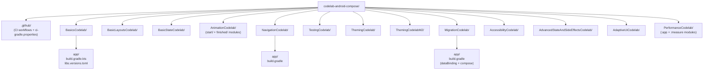
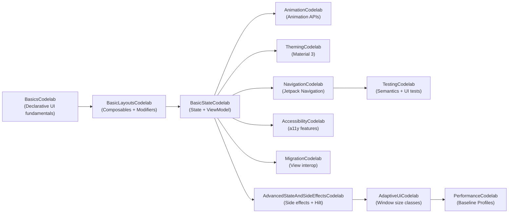
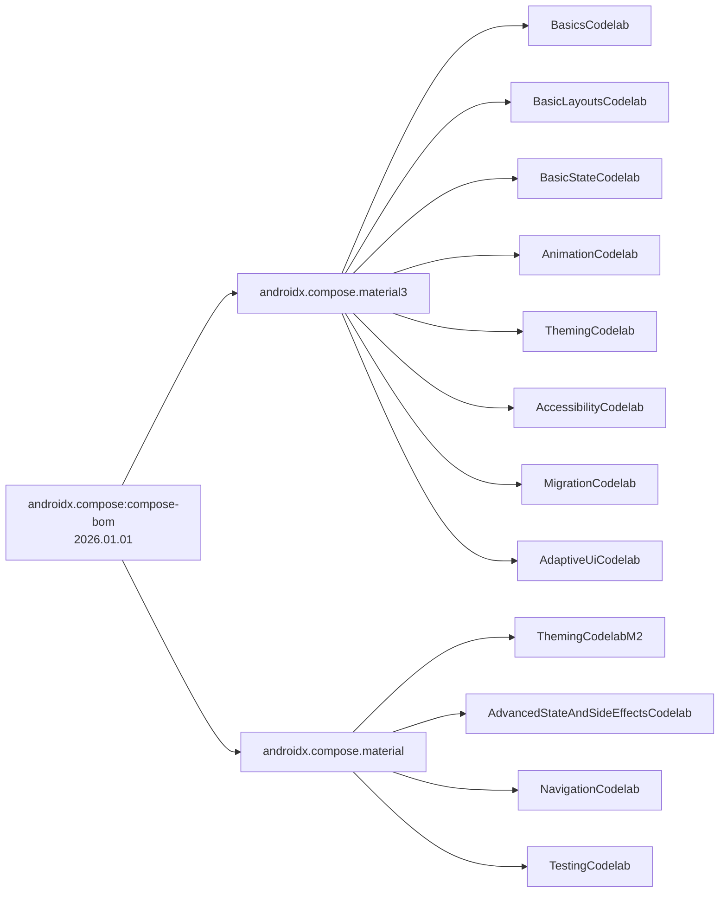

<!-- source: DeepWiki mcp.deepwiki.com · repo android/codelab-android-compose · page 1 Overview · fetched 2026-10-23 -->

# Overview

Relevant source files

The following files were used as context for generating this wiki page:

- [AccessibilityCodelab/build.gradle](AccessibilityCodelab/build.gradle)
- [AdvancedStateAndSideEffectsCodelab/build.gradle](AdvancedStateAndSideEffectsCodelab/build.gradle)
- [AnimationCodelab/build.gradle](AnimationCodelab/build.gradle)
- [BasicLayoutsCodelab/build.gradle](BasicLayoutsCodelab/build.gradle)
- [BasicStateCodelab/build.gradle](BasicStateCodelab/build.gradle)
- [BasicsCodelab/README.md](BasicsCodelab/README.md)
- [BasicsCodelab/build.gradle.kts](BasicsCodelab/build.gradle.kts)
- [MigrationCodelab/README.md](MigrationCodelab/README.md)
- [MigrationCodelab/build.gradle](MigrationCodelab/build.gradle)
- [NavigationCodelab/build.gradle](NavigationCodelab/build.gradle)
- [README.md](README.md)
- [TestingCodelab/build.gradle](TestingCodelab/build.gradle)
- [ThemingCodelab/README.md](ThemingCodelab/README.md)
- [ThemingCodelab/build.gradle](ThemingCodelab/build.gradle)
- [ThemingCodelabM2/build.gradle](ThemingCodelabM2/build.gradle)

This page describes the purpose, scope, and structure of the `codelab-android-compose` repository at a high level. It is intended as a starting point for developers exploring this codebase. For details on the Gradle build system, see [Build System](#3). For per-codelab deep dives, see [Codelabs](#5).

---

## Purpose

`codelab-android-compose` is a monorepo containing twelve self-contained Android Studio projects, each corresponding to a single Android Jetpack Compose learning codelab. The repository is maintained by the Android team at Google. Every directory at the root of the repository is an independent Android project with its own Gradle wrapper, build files, and application code.

The codelabs are designed to be completed individually. They do not share source code or a unified Gradle build. The only shared infrastructure is the GitHub Actions CI configuration under `.github/`.

---

## Codelab Inventory

The table below lists every codelab project in the repository, its root directory, Android application ID, the subject app it uses, and the primary Compose topic it teaches.

| Directory | Application ID | Subject App | Primary Topic |
|---|---|---|---|
| `BasicsCodelab` | `com.codelab.basics` | Custom (Greetings) | Declarative UI, state, layouts, theming |
| `BasicLayoutsCodelab` | `com.codelab.basiclayouts` | MySoothe | Composables, Modifiers |
| `BasicStateCodelab` | `com.codelabs.state` | Wellness app | State patterns, ViewModel |
| `AnimationCodelab` | `com.example.android.codelab.animation` | Custom (TabBar) | Animation APIs |
| `NavigationCodelab` | `com.example.compose.rally` | Rally (finance) | Jetpack Navigation |
| `TestingCodelab` | `com.example.compose.rally` | Rally (finance) | Semantics tree, UI testing |
| `ThemingCodelab` | `com.example.reply` | Reply (email) | Material 3 theming |
| `ThemingCodelabM2` | `com.codelab.theming` | Custom | Material 2 theming |
| `MigrationCodelab` | `com.google.samples.apps.sunflower` | Sunflower (plant) | View → Compose interop |
| `AccessibilityCodelab` | `com.example.jetnews` | JetNews | Touch targets, content descriptions |
| `AdvancedStateAndSideEffectsCodelab` | `androidx.compose.samples.crane` | Crane (travel) | Side effects, Hilt DI |
| `AdaptiveUiCodelab` | `com.example.reply` | Reply (email) | Phones, tablets, foldables |
| `PerformanceCodelab` | `com.compose.performance` | Custom | Baseline Profiles, benchmarking |

Sources: [README.md:1-63]()

---

## Repository Layout

Each top-level directory is a fully self-contained Android project. They share no Gradle root build or source code with each other.

**Repository layout diagram — directory names map directly to codelab projects:**

Sources: [README.md:1-63](), [BasicsCodelab/build.gradle.kts:1-22](), [MigrationCodelab/build.gradle:1-51]()

---

## Subject Apps

Several codelabs share a subject app. The table below groups codelabs by the app they build on.

| Subject App | Codelabs That Use It |
|---|---|
| Rally (finance app) | `NavigationCodelab`, `TestingCodelab` |
| Reply (email app) | `ThemingCodelab`, `AdaptiveUiCodelab` |
| Sunflower (plant app) | `MigrationCodelab` |
| JetNews | `AccessibilityCodelab` |
| Crane (travel app) | `AdvancedStateAndSideEffectsCodelab` |
| MySoothe | `BasicLayoutsCodelab` |
| Custom/standalone | `BasicsCodelab`, `BasicStateCodelab`, `AnimationCodelab`, `ThemingCodelabM2`, `PerformanceCodelab` |

---

## Intended Learning Path

The codelabs are designed to be independent but follow a natural progression from fundamental to advanced topics:

Sources: [README.md:13-63]()

---

## Common Build Conventions

Despite being independent projects, all codelabs share a consistent Gradle setup. The table below summarizes conventions that appear across all or most codelabs.

| Convention | Value | Notes |
|---|---|---|
| Android Gradle Plugin | `9.0.0` | Declared in each codelab's `build.gradle` |
| Kotlin Gradle Plugin | `2.3.0` | All except `AdvancedStateAndSideEffectsCodelab` (uses `2.3.10`) |
| Compose Compiler Plugin | `org.jetbrains.kotlin:compose-compiler-gradle-plugin:2.3.0` | Applied in all codelabs |
| Compose BOM | `androidx.compose:compose-bom:2026.01.01` | Applied in app-level `build.gradle` |
| Code style enforcement | Spotless `8.2.1` with ktlint | Present in most codelabs |
| Repositories | `google()` + `mavenCentral()` | Universal |

Two codelabs differ significantly from the common pattern:

- **`MigrationCodelab`** — adds `navigation-safe-args-gradle-plugin`, `com.android.legacy-kapt`, Room (kapt), Glide, and WorkManager. Enables `dataBinding = true` alongside `compose = true`. See [Migration Codelab](#5.8).
- **`AdvancedStateAndSideEffectsCodelab`** — adds Hilt (`dagger.hilt.android:2.59.1`), KSP (`symbol-processing-gradle-plugin:2.3.4`), and Google Maps Compose. See [Advanced State and Side Effects Codelab](#5.10).

Sources: [MigrationCodelab/build.gradle:1-51](), [AdvancedStateAndSideEffectsCodelab/build.gradle:1-66](), [BasicsCodelab/build.gradle.kts:1-22](), [ThemingCodelab/build.gradle:1-51](), [NavigationCodelab/build.gradle:1-51](), [AnimationCodelab/build.gradle:1-34](), [AccessibilityCodelab/build.gradle:1-51](), [BasicLayoutsCodelab/build.gradle:1-50](), [BasicStateCodelab/build.gradle:1-50](), [TestingCodelab/build.gradle:1-67](), [ThemingCodelabM2/build.gradle:1-41]()

---

## Material Design Version Split

Codelabs divide into two camps based on which Material Design library version they use. This affects the composables and theming APIs available in each project.

**Codelab-to-Material-version mapping:**

Sources: [ThemingCodelab/build.gradle:1-51](), [ThemingCodelabM2/build.gradle:1-41](), [AdvancedStateAndSideEffectsCodelab/build.gradle:1-66](), [NavigationCodelab/build.gradle:1-51]()

---

## CI/CD Overview

All twelve codelabs have a corresponding GitHub Actions workflow under `.github/workflows/`. Every workflow shares the same core steps: checkout, JDK 17 setup, Gradle setup, `assembleDebug`, `lintDebug`, and artifact upload.

Two codelabs additionally run instrumentation tests on an Android emulator matrix (API 26 and 29):

- `AdvancedStateAndSideEffectsCodelab` — uses `google_apis` emulator target
- `MigrationCodelab` — uses `default` emulator target

Three codelabs (`AccessibilityCodelab`, `NavigationCodelab`, `TestingCodelab`) trigger on both the `main` branch and an `end` branch. All others trigger on `main` only.

For full CI details, see [Continuous Integration](#4).

---

## Related Pages

| Page | Content |
|---|---|
| [Repository Structure](#2) | Directory layout and `settings.gradle` details |
| [Build System](#3) | Gradle two-level structure, root vs. app configs |
| [Continuous Integration](#4) | GitHub Actions workflows, emulator matrix |
| [Codelabs](#5) | Index of all codelabs with per-codelab deep dives |

---

