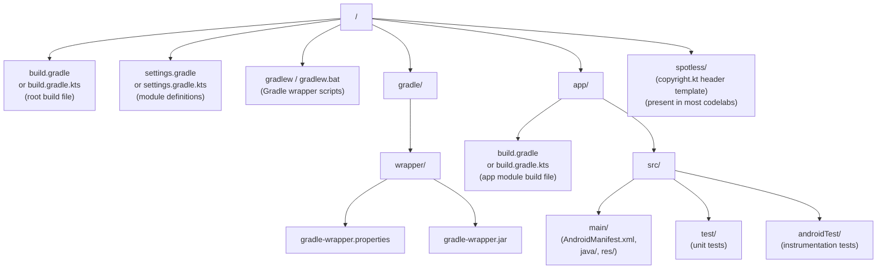
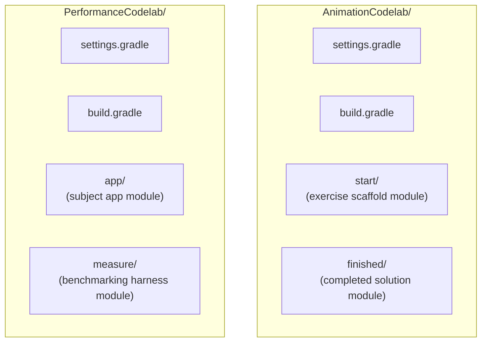
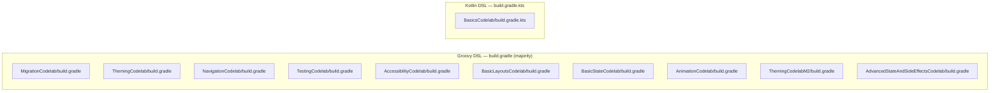

<!-- source: DeepWiki mcp.deepwiki.com · repo android/codelab-android-compose · page 2 Repository Structure · fetched 2026-10-23 -->

# Repository Structure

<details>
<summary>Relevant source files</summary>

The following files were used as context for generating this wiki page:

- [AccessibilityCodelab/build.gradle](AccessibilityCodelab/build.gradle)
- [AdvancedStateAndSideEffectsCodelab/build.gradle](AdvancedStateAndSideEffectsCodelab/build.gradle)
- [AnimationCodelab/build.gradle](AnimationCodelab/build.gradle)
- [BasicLayoutsCodelab/build.gradle](BasicLayoutsCodelab/build.gradle)
- [BasicLayoutsCodelab/settings.gradle](BasicLayoutsCodelab/settings.gradle)
- [BasicStateCodelab/build.gradle](BasicStateCodelab/build.gradle)
- [BasicStateCodelab/settings.gradle](BasicStateCodelab/settings.gradle)
- [BasicsCodelab/README.md](BasicsCodelab/README.md)
- [BasicsCodelab/build.gradle.kts](BasicsCodelab/build.gradle.kts)
- [MigrationCodelab/README.md](MigrationCodelab/README.md)
- [MigrationCodelab/build.gradle](MigrationCodelab/build.gradle)
- [NavigationCodelab/build.gradle](NavigationCodelab/build.gradle)
- [README.md](README.md)
- [TestingCodelab/build.gradle](TestingCodelab/build.gradle)
- [ThemingCodelab/README.md](ThemingCodelab/README.md)
- [ThemingCodelab/build.gradle](ThemingCodelab/build.gradle)
- [ThemingCodelabM2/build.gradle](ThemingCodelabM2/build.gradle)

</details>


## Purpose and Scope

This page describes the physical layout of the `codelab-android-compose` monorepo: the top-level directory organization, the internal structure common to each codelab project, and how `settings.gradle` defines module membership. For an introduction to what each codelab teaches, see [Overview](#1). For the Gradle plugin and dependency configuration within each codelab, see [Build System](#3).

---

## Monorepo Layout

The repository root contains one directory per codelab. There is **no shared root-level Gradle project** — each codelab directory is a fully independent Android Studio project with its own Gradle wrapper, root build file, and settings file. No cross-codelab Gradle dependencies exist.

**Top-level monorepo layout:**

```
codelab-android-compose/
├── .github/
├── README.md
├── AccessibilityCodelab/
├── AdaptiveUiCodelab/
├── AdvancedStateAndSideEffectsCodelab/
├── AnimationCodelab/
├── BasicLayoutsCodelab/
├── BasicStateCodelab/
├── BasicsCodelab/
├── MigrationCodelab/
├── NavigationCodelab/
├── PerformanceCodelab/
├── TestingCodelab/
├── ThemingCodelab/
└── ThemingCodelabM2/
```

Sources: [README.md:1-81]()

---

## Standard Codelab Project Layout

Each codelab directory follows a standard Android single-module project layout. The diagram below maps the directory tree to the specific file names used in the repository.

**Diagram: Standard single-module codelab layout**



Sources: [BasicStateCodelab/settings.gradle:17-18](), [BasicLayoutsCodelab/settings.gradle:17-18](), [MigrationCodelab/build.gradle:1-51](), [ThemingCodelab/build.gradle:1-51]()

---

## Module Definitions via `settings.gradle`

Each codelab's `settings.gradle` (or `settings.gradle.kts`) sets the Gradle project name and declares which subdirectory modules are included. The project name in `settings.gradle` is what appears in Android Studio's project panel — it does not have to match the directory name.

**Known `settings.gradle` configurations:**

| Codelab Directory | `rootProject.name` | Included Modules |
|-------------------|--------------------|------------------|
| `BasicLayoutsCodelab` | `MySoothe` | `:app` |
| `BasicStateCodelab` | `BasicStateCodelab` | `:app` |
| `AnimationCodelab` | — | `:start`, `:finished` |
| `PerformanceCodelab` | — | `:app`, `:measure` |
| All others (typical) | matches directory name | `:app` |

The `BasicLayoutsCodelab` uses the project name `MySoothe` because it implements the MySoothe fitness app as its subject, demonstrating that `rootProject.name` reflects the subject app, not the codelab name.

Sources: [BasicLayoutsCodelab/settings.gradle:17-18](), [BasicStateCodelab/settings.gradle:17-18]()

---

## Multi-Module Exceptions

Two codelabs deviate from the single `:app` module structure:

**Diagram: Multi-module codelab layouts**



- **`AnimationCodelab`** uses a `start/` module (the exercise scaffold with `TODO` annotations) and a `finished/` module (the completed reference implementation). This pattern lets learners compare their work against the solution.
- **`PerformanceCodelab`** uses an `app/` module (the subject app under optimization) and a `measure/` module (the macro-benchmark harness that runs Baseline Profile generation). See [Performance Codelab](#5.12) for details on the `:measure` module.

---

## Root Build File Variations

Each codelab contains a root-level build file that configures plugins and repositories for all submodules. Most codelabs use Groovy DSL (`.gradle`), but `BasicsCodelab` uses Kotlin DSL (`.gradle.kts`) with a version catalog.

**Diagram: Root build file structure by codelab**



The `BasicsCodelab/build.gradle.kts` file uses `alias(libs.plugins.android.application)`, `alias(libs.plugins.kotlin.android)`, and `alias(libs.plugins.kotlin.compose)` — version catalog aliases defined in a `libs.versions.toml` file — rather than hardcoded version strings. See [Dependency Management](#3.3) for details on the version catalog.

Sources: [BasicsCodelab/build.gradle.kts:18-22](), [MigrationCodelab/build.gradle:17-51](), [ThemingCodelab/build.gradle:17-51](), [NavigationCodelab/build.gradle:17-51](), [AnimationCodelab/build.gradle:17-34]()

---

## Notable Root Build File Differences

While every root `build.gradle` declares the Android Gradle Plugin and Kotlin plugin, several codelabs add unique entries:

| Codelab | Notable Root-Level Addition |
|---------|-----------------------------|
| `MigrationCodelab` | `androidx.navigation:navigation-safe-args-gradle-plugin:2.9.7`; `com.android.legacy-kapt` plugin |
| `AdvancedStateAndSideEffectsCodelab` | `com.google.dagger:hilt-android-gradle-plugin:2.59.1`; `com.google.devtools.ksp:symbol-processing-gradle-plugin:2.3.4` |
| `AccessibilityCodelab` | Compose compiler plugin declared in `plugins {}` block as `org.jetbrains.kotlin.plugin.compose`, not in `buildscript { dependencies {} }` |
| `TestingCodelab` | `kotlinOptions.allWarningsAsErrors = true` applied to all subprojects |
| `AdvancedStateAndSideEffectsCodelab` | `configurations.configureEach { resolutionStrategy { force "junit:junit:4.13.2" } }` across all subprojects |
| `BasicsCodelab` | No `buildscript {}` block; uses `plugins {}` block with version catalog aliases only |

Sources: [MigrationCodelab/build.gradle:26-33](), [AdvancedStateAndSideEffectsCodelab/build.gradle:22-33](), [AccessibilityCodelab/build.gradle:29-32](), [TestingCodelab/build.gradle:52-66](), [AdvancedStateAndSideEffectsCodelab/build.gradle:61-65](), [BasicsCodelab/build.gradle.kts:18-22]()

---

## Spotless Code Style Configuration

Most codelabs include a `spotless/` directory at the codelab root containing a `copyright.kt` file used as the license header template. The Spotless plugin (`com.diffplug.spotless`) is applied at the root level and targets all `**/*.kt` files in the project, excluding the `build/` and `bin/` directories.

Codelabs that apply Spotless per-subproject (using `subprojects { apply plugin: 'com.diffplug.spotless' }`) include: `ThemingCodelab`, `NavigationCodelab`, `TestingCodelab`, `AccessibilityCodelab`, `BasicLayoutsCodelab`, `BasicStateCodelab`, and `AdvancedStateAndSideEffectsCodelab`.

`MigrationCodelab` applies Spotless at the `allprojects` scope [MigrationCodelab/build.gradle:36-50]().

`AnimationCodelab` and `ThemingCodelabM2` use `allprojects` for repository declarations but do not apply Spotless [AnimationCodelab/build.gradle:29-34](), [ThemingCodelabM2/build.gradle:29-41]().

Sources: [ThemingCodelab/build.gradle:34-50](), [BasicLayoutsCodelab/build.gradle:33-50](), [BasicStateCodelab/build.gradle:33-50](), [MigrationCodelab/build.gradle:43-50]()

---

