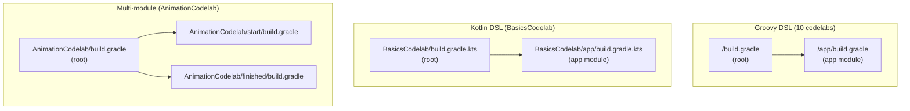
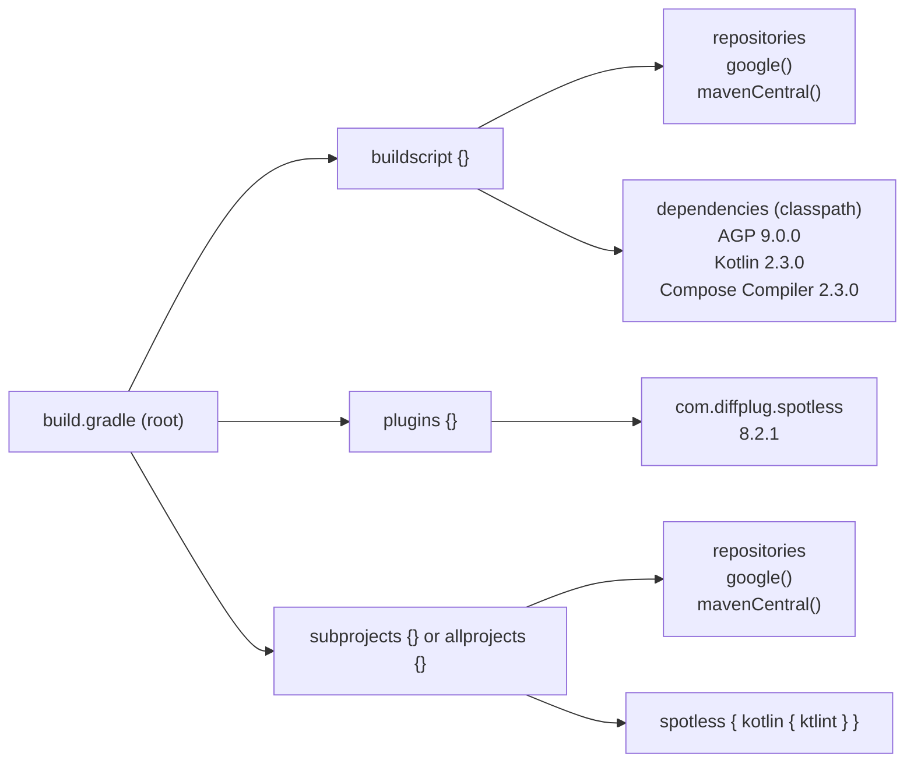
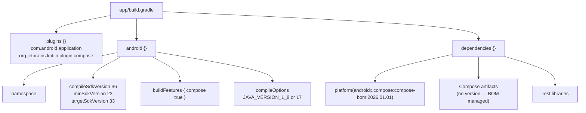

<!-- source: DeepWiki mcp.deepwiki.com · repo android/codelab-android-compose · page 3 Build System · fetched 2026-10-23 -->

# Build System

<details>
<summary>Relevant source files</summary>

The following files were used as context for generating this wiki page:

- [AccessibilityCodelab/app/build.gradle](AccessibilityCodelab/app/build.gradle)
- [AccessibilityCodelab/build.gradle](AccessibilityCodelab/build.gradle)
- [AdvancedStateAndSideEffectsCodelab/app/build.gradle](AdvancedStateAndSideEffectsCodelab/app/build.gradle)
- [AdvancedStateAndSideEffectsCodelab/build.gradle](AdvancedStateAndSideEffectsCodelab/build.gradle)
- [AnimationCodelab/build.gradle](AnimationCodelab/build.gradle)
- [AnimationCodelab/finished/build.gradle](AnimationCodelab/finished/build.gradle)
- [AnimationCodelab/start/build.gradle](AnimationCodelab/start/build.gradle)
- [BasicLayoutsCodelab/app/build.gradle](BasicLayoutsCodelab/app/build.gradle)
- [BasicLayoutsCodelab/build.gradle](BasicLayoutsCodelab/build.gradle)
- [BasicStateCodelab/build.gradle](BasicStateCodelab/build.gradle)
- [BasicsCodelab/build.gradle.kts](BasicsCodelab/build.gradle.kts)
- [MigrationCodelab/app/build.gradle](MigrationCodelab/app/build.gradle)
- [MigrationCodelab/build.gradle](MigrationCodelab/build.gradle)
- [NavigationCodelab/app/build.gradle](NavigationCodelab/app/build.gradle)
- [NavigationCodelab/build.gradle](NavigationCodelab/build.gradle)
- [TestingCodelab/app/build.gradle](TestingCodelab/app/build.gradle)
- [TestingCodelab/build.gradle](TestingCodelab/build.gradle)
- [ThemingCodelab/app/build.gradle](ThemingCodelab/app/build.gradle)
- [ThemingCodelab/build.gradle](ThemingCodelab/build.gradle)
- [ThemingCodelabM2/app/build.gradle](ThemingCodelabM2/app/build.gradle)
- [ThemingCodelabM2/build.gradle](ThemingCodelabM2/build.gradle)

</details>


This page describes the Gradle build system structure shared across all codelabs in the repository, including the two-level file layout, plugin versions, and how individual codelabs deviate from the common pattern. For details on how individual libraries are versioned and how the Compose BOM is used, see [Dependency Management](#3.3). For the Gradle wrapper configuration, see [Gradle Wrapper](#3.4). For CI pipeline integration, see [Continuous Integration](#4).

---

## Overview

Each codelab in the monorepo is a self-contained Android Gradle project. There is no shared root build file at the repository level — every codelab manages its own build independently. All codelabs follow the same two-level Gradle structure:

1. **Root `build.gradle` (or `build.gradle.kts`)** — declares classpath dependencies (plugins), repositories, and cross-project configuration such as code style enforcement.
2. **`app/build.gradle` (or `app/build.gradle.kts`)** — configures the Android application module, enables Compose, pins the BOM, and lists runtime and test dependencies.

One codelab (`BasicsCodelab`) uses Kotlin DSL (`.kts`) at both levels; all others use Groovy DSL.

---

## Two-Level Build Structure

**Diagram: Build file hierarchy across all codelabs**



Sources: [BasicsCodelab/build.gradle.kts:1-22](), [AnimationCodelab/build.gradle:1-34](), [AnimationCodelab/start/build.gradle:1-52](), [AnimationCodelab/finished/build.gradle:1-52]()

---

## Root Build Configuration

### Common Pattern

Most codelabs declare plugins in a `buildscript {}` block at the root level. The three plugins present in nearly every root build file are:

| Plugin | Artifact | Version |
|--------|----------|---------|
| Android Gradle Plugin | `com.android.tools.build:gradle` | `9.0.0` |
| Kotlin Gradle Plugin | `org.jetbrains.kotlin:kotlin-gradle-plugin` | `2.3.0` |
| Compose Compiler Plugin | `org.jetbrains.kotlin:compose-compiler-gradle-plugin` | `2.3.0` |

Repositories declared at root level are `google()` and `mavenCentral()`, applied either to `allprojects {}` or `subprojects {}`.

Most codelabs also apply **Spotless** (`com.diffplug.spotless` version `8.2.1`) for Kotlin code style, configured with `ktlint` and a `licenseHeaderFile`.

**Diagram: Root build file anatomy**



Sources: [ThemingCodelab/build.gradle:17-51](), [NavigationCodelab/build.gradle:17-51](), [BasicStateCodelab/build.gradle:16-50](), [BasicLayoutsCodelab/build.gradle:17-50]()

### Root-Level Deviations by Codelab

| Codelab | Notable Root-Level Differences |
|---------|-------------------------------|
| **BasicsCodelab** | Kotlin DSL; uses version catalog `alias(libs.plugins.*)` — no `buildscript {}` block |
| **MigrationCodelab** | Adds `androidx.navigation:navigation-safe-args-gradle-plugin:2.9.7`; adds `com.android.legacy-kapt:9.0.0` in `plugins {}` block |
| **AdvancedStateAndSideEffectsCodelab** | Adds `com.google.dagger:hilt-android-gradle-plugin:2.59.1`; adds `com.google.devtools.ksp:symbol-processing-gradle-plugin:2.3.4`; Compose compiler plugin version is `2.3.10` (differs from others) |
| **AnimationCodelab** | No Spotless; uses `allprojects {}` for repositories instead of `subprojects {}` |
| **ThemingCodelabM2** | No Spotless; uses `allprojects {}` with a global `KotlinCompile` task configuration for `-opt-in=kotlin.RequiresOptIn` |
| **AccessibilityCodelab** | Compose Compiler Plugin declared in `plugins {}` block (not `buildscript.dependencies`): `id 'org.jetbrains.kotlin.plugin.compose' version "2.3.0" apply false` |

Sources: [BasicsCodelab/build.gradle.kts:18-22](), [MigrationCodelab/build.gradle:17-50](), [AdvancedStateAndSideEffectsCodelab/build.gradle:17-66](), [AnimationCodelab/build.gradle:17-34](), [ThemingCodelabM2/build.gradle:17-41](), [AccessibilityCodelab/build.gradle:29-32]()

---

## Application Module Configuration

### Common Pattern

All `app/build.gradle` files share this structure:

**Diagram: App module build.gradle structure**



Sources: [AccessibilityCodelab/app/build.gradle:17-151](), [ThemingCodelab/app/build.gradle:17-143](), [NavigationCodelab/app/build.gradle:17-116]()

### SDK and Java Version Settings

All codelabs target the same SDK range. Java version varies slightly:

| Setting | Value |
|---------|-------|
| `compileSdkVersion` | `36` |
| `minSdkVersion` | `23` |
| `targetSdkVersion` | `33` (most) or `34` (AnimationCodelab) |
| `compileOptions` | `JavaVersion.VERSION_1_8` (most) or `JavaVersion.VERSION_17` (MigrationCodelab) |

Sources: [MigrationCodelab/app/build.gradle:41-44](), [AnimationCodelab/finished/build.gradle:26-35]()

### `buildFeatures` Flags

The `buildFeatures` block enables Compose in all codelabs. Some codelabs disable unused AGP features explicitly to reduce build overhead:

```
// AdvancedStateAndSideEffectsCodelab, TestingCodelab
buildFeatures {
    compose true
    buildConfig false
    aidl false
    renderScript false
    resValues false
    shaders false
}
```

`MigrationCodelab` is the only codelab that enables both `compose` and `dataBinding` simultaneously, supporting the hybrid View + Compose architecture:

```
// MigrationCodelab only
buildFeatures {
    dataBinding true
    compose true
}
```

Sources: [AdvancedStateAndSideEffectsCodelab/app/build.gradle:71-88](), [TestingCodelab/app/build.gradle:63-72](), [MigrationCodelab/app/build.gradle:46-49]()

### Material Version Split

All codelabs use the Compose BOM but divide into two camps by Material Design version:

| Material Version | Artifact | Codelabs |
|-----------------|----------|----------|
| Material 3 | `androidx.compose.material3:material3` | BasicsCodelab, BasicLayoutsCodelab, BasicStateCodelab, ThemingCodelab, AccessibilityCodelab, AnimationCodelab, MigrationCodelab, AdaptiveUiCodelab |
| Material 2 | `androidx.compose.material:material` | ThemingCodelabM2, AdvancedStateAndSideEffectsCodelab, NavigationCodelab, TestingCodelab |

Sources: [ThemingCodelabM2/app/build.gradle:45-56](), [AdvancedStateAndSideEffectsCodelab/app/build.gradle:105-116](), [NavigationCodelab/app/build.gradle:78-104](), [AnimationCodelab/finished/build.gradle:41-52]()

### Signing Configuration

Several codelabs include a bundled `debug.keystore` to allow CI debug builds to be upgradable across runs. This is configured in the `signingConfigs` block:

- `storePassword`: `android`
- `keyAlias`: `androiddebugkey`
- `keyPassword`: `android`

Codelabs with this pattern: AccessibilityCodelab, ThemingCodelab, NavigationCodelab, TestingCodelab, AdvancedStateAndSideEffectsCodelab.

Sources: [AccessibilityCodelab/app/build.gradle:35-43](), [ThemingCodelab/app/build.gradle:35-44](), [AdvancedStateAndSideEffectsCodelab/app/build.gradle:45-53]()

---

## Codelab-Specific Deviations

**Diagram: App-level plugin and dependency differences across codelabs**

```mermaid
graph TD
    BASE["Standard app/build.gradle\ncom.android.application\norg.jetbrains.kotlin.plugin.compose\nCompose BOM 2026.01.01\nmaterial3 or material"]

    BASE --> MC["MigrationCodelab/app/build.gradle"]
    MC --> MC1["+ apply plugin: androidx.navigation.safeargs.kotlin"]
    MC --> MC2["+ apply plugin: com.android.legacy-kapt"]
    MC --> MC3["+ dataBinding true"]
    MC --> MC4["+ kapt room-compiler:2.8.4"]
    MC --> MC5["+ kapt glide compiler:5.0.5"]
    MC --> MC6["+ room-runtime:2.8.4\n+ room-ktx:2.8.4"]
    MC --> MC7["+ work-runtime-ktx:2.11.1"]
    MC --> MC8["+ glide:5.0.5"]
    MC --> MC9["+ navigation-fragment-ktx:2.9.7"]
    MC --> MC10["+ viewpager2:1.1.0"]
    MC --> MC11["compileOptions: VERSION_17"]

    BASE --> AC["AdvancedStateAndSideEffectsCodelab/app/build.gradle"]
    AC --> AC1["+ id com.google.devtools.ksp"]
    AC --> AC2["+ id dagger.hilt.android.plugin"]
    AC --> AC3["+ hilt-android:2.59.1"]
    AC --> AC4["+ ksp hilt-compiler:2.59.1"]
    AC --> AC5["+ maps:3.1.0-beta\n+ maps-v3-ktx:3.4.0"]
    AC --> AC6["+ coil-compose:2.7.0"]
    AC --> AC7["custom testInstrumentationRunner:\nCustomTestRunner"]

    BASE --> NC["NavigationCodelab/app/build.gradle"]
    NC --> NC1["+ composeOptions {\nkotlinCompilerExtensionVersion 1.5.15\n}"]
```



Sources: [MigrationCodelab/app/build.gradle:17-107](), [AdvancedStateAndSideEffectsCodelab/app/build.gradle:17-139](), [NavigationCodelab/app/build.gradle:67-69]()

### MigrationCodelab

The most complex `app/build.gradle` in the repository. Key differences from the standard pattern:

- Applies `androidx.navigation.safeargs.kotlin` and `com.android.legacy-kapt` as additional plugins ([MigrationCodelab/app/build.gradle:18-20]())
- `buildFeatures` enables both `dataBinding true` and `compose true` ([MigrationCodelab/app/build.gradle:46-49]())
- `compileOptions` targets `JavaVersion.VERSION_17` (all others use `VERSION_1_8`) ([MigrationCodelab/app/build.gradle:41-44]())
- Uses `kapt` for annotation processing of Room (`room-compiler:2.8.4`) and Glide (`compiler:5.0.5`) ([MigrationCodelab/app/build.gradle:63-64]())
- Unique dependencies not found in any other codelab: `room-runtime`, `room-ktx`, `work-runtime-ktx`, `glide`, `navigation-fragment-ktx`, `viewpager2`, `gson`

### AdvancedStateAndSideEffectsCodelab

- Adds `com.google.devtools.ksp` and `dagger.hilt.android.plugin` to the `plugins {}` block ([AdvancedStateAndSideEffectsCodelab/app/build.gradle:17-22]())
- Uses `ksp` (not `kapt`) for `hilt-compiler` and `kotlin-metadata-jvm` ([AdvancedStateAndSideEffectsCodelab/app/build.gradle:123-124]())
- Declares a custom `testInstrumentationRunner`: `androidx.compose.samples.crane.CustomTestRunner` ([AdvancedStateAndSideEffectsCodelab/app/build.gradle:40]())
- Reads `MAPS_API_KEY` from `local.properties` via `manifestPlaceholders` ([AdvancedStateAndSideEffectsCodelab/app/build.gradle:25-42]())

### NavigationCodelab

Contains a `composeOptions {}` block setting `kotlinCompilerExtensionVersion '1.5.15'`, which is a legacy override not present in other codelabs ([NavigationCodelab/app/build.gradle:67-69]()).

### BasicsCodelab

Uses Kotlin DSL throughout. The root `build.gradle.kts` declares plugins via version catalog aliases rather than string literals:

```kotlin
alias(libs.plugins.android.application) apply false
alias(libs.plugins.kotlin.android) apply false
alias(libs.plugins.kotlin.compose) apply false
```

([BasicsCodelab/build.gradle.kts:18-22]())

---

## Kotlin Compiler Options

Several codelabs configure additional Kotlin compiler arguments in `tasks.withType(KotlinCompile)` blocks. These are typically placed either in the root `build.gradle` (under `subprojects {}`) or in `app/build.gradle`.

| Compiler Argument | Purpose | Codelabs |
|------------------|---------|----------|
| `-opt-in=kotlin.RequiresOptIn` | Enable opt-in annotations | Most codelabs |
| `-opt-in=kotlin.Experimental` | Enable experimental APIs | AccessibilityCodelab, ThemingCodelab |
| `-opt-in=kotlinx.coroutines.ExperimentalCoroutinesApi` | Experimental coroutines | TestingCodelab |
| `-opt-in=kotlinx.coroutines.FlowPreview` | Flow preview APIs | TestingCodelab |
| `allWarningsAsErrors = true` | Treat warnings as errors | TestingCodelab (root), NavigationCodelab (app), ThemingCodelabM2 (app) |
| `jvmTarget = "1.8"` | JVM bytecode target | All codelabs |

Sources: [TestingCodelab/build.gradle:52-66](), [AdvancedStateAndSideEffectsCodelab/build.gradle:52-58](), [NavigationCodelab/app/build.gradle:106-116](), [AccessibilityCodelab/app/build.gradle:135-147]()

---

## Summary: Build Configuration Matrix

| Codelab | DSL | Spotless | Compose BOM | Material | Extra Plugins | kapt/ksp |
|---------|-----|----------|-------------|----------|---------------|----------|
| BasicsCodelab | Kotlin | — | ✓ | M3 | — | — |
| BasicLayoutsCodelab | Groovy | ✓ | ✓ | M3 | — | — |
| BasicStateCodelab | Groovy | ✓ | ✓ | M3 | — | — |
| AnimationCodelab | Groovy | — | ✓ | M3 | — | — |
| NavigationCodelab | Groovy | ✓ | ✓ | M2 | — | — |
| TestingCodelab | Groovy | ✓ | ✓ | M2 | — | — |
| ThemingCodelab | Groovy | ✓ | ✓ | M3 | — | — |
| ThemingCodelabM2 | Groovy | — | ✓ | M2 | — | — |
| AccessibilityCodelab | Groovy | ✓ | ✓ | M3 | — | — |
| MigrationCodelab | Groovy | ✓ | ✓ | M3 | safe-args, legacy-kapt | kapt |
| AdvancedStateAndSideEffectsCodelab | Groovy | ✓ | ✓ | M2 | Hilt, KSP | ksp |

Sources: [MigrationCodelab/build.gradle:17-50](), [AdvancedStateAndSideEffectsCodelab/build.gradle:17-66](), [BasicsCodelab/build.gradle.kts:18-22](), [AnimationCodelab/build.gradle:17-34](), [ThemingCodelabM2/build.gradle:17-41]()

---

