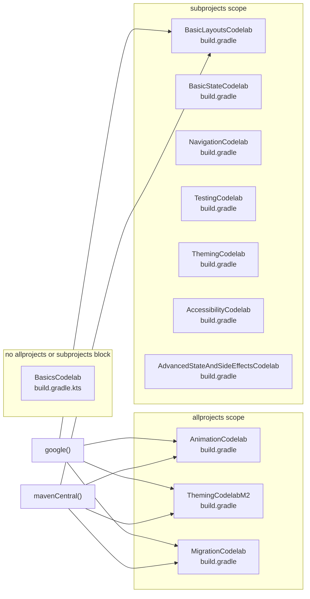

<!-- source: DeepWiki mcp.deepwiki.com · repo android/codelab-android-compose · page 3.1 Root Build Configuration · fetched 2026-10-23 -->

# Root Build Configuration

<details>
<summary>Relevant source files</summary>

The following files were used as context for generating this wiki page:

- [AccessibilityCodelab/build.gradle](AccessibilityCodelab/build.gradle)
- [AdvancedStateAndSideEffectsCodelab/build.gradle](AdvancedStateAndSideEffectsCodelab/build.gradle)
- [AnimationCodelab/build.gradle](AnimationCodelab/build.gradle)
- [BasicLayoutsCodelab/build.gradle](BasicLayoutsCodelab/build.gradle)
- [BasicStateCodelab/build.gradle](BasicStateCodelab/build.gradle)
- [BasicsCodelab/build.gradle.kts](BasicsCodelab/build.gradle.kts)
- [MigrationCodelab/build.gradle](MigrationCodelab/build.gradle)
- [NavigationCodelab/build.gradle](NavigationCodelab/build.gradle)
- [TestingCodelab/build.gradle](TestingCodelab/build.gradle)
- [ThemingCodelab/build.gradle](ThemingCodelab/build.gradle)
- [ThemingCodelabM2/build.gradle](ThemingCodelabM2/build.gradle)

</details>


This page documents the root-level `build.gradle` (or `build.gradle.kts`) file found at the top of each codelab's directory. These files configure the plugins and repositories that apply to all subprojects within a given codelab. For details on how individual app modules are configured, see [Application Module Configuration](#3.2). For version catalog and BOM usage, see [Dependency Management](#3.3).

---

## Purpose and Scope

Each codelab in this monorepo is an independent Gradle project with its own root build file. The root build file is responsible for:

- Declaring build tool plugins (AGP, Kotlin, Compose Compiler, Spotless, KSP, Hilt, kapt)
- Specifying repository sources for resolving those plugins
- Propagating repository declarations and shared compiler configuration down to subprojects or all projects

Root build files do **not** declare application dependencies (those live in `app/build.gradle`). They are purely a coordination layer for tooling.

---

## File Locations and DSL Format

| Codelab | Root Build File | DSL |
|---|---|---|
| BasicsCodelab | `BasicsCodelab/build.gradle.kts` | Kotlin DSL |
| BasicLayoutsCodelab | `BasicLayoutsCodelab/build.gradle` | Groovy DSL |
| BasicStateCodelab | `BasicStateCodelab/build.gradle` | Groovy DSL |
| AnimationCodelab | `AnimationCodelab/build.gradle` | Groovy DSL |
| NavigationCodelab | `NavigationCodelab/build.gradle` | Groovy DSL |
| TestingCodelab | `TestingCodelab/build.gradle` | Groovy DSL |
| ThemingCodelab | `ThemingCodelab/build.gradle` | Groovy DSL |
| ThemingCodelabM2 | `ThemingCodelabM2/build.gradle` | Groovy DSL |
| MigrationCodelab | `MigrationCodelab/build.gradle` | Groovy DSL |
| AccessibilityCodelab | `AccessibilityCodelab/build.gradle` | Groovy DSL |
| AdvancedStateAndSideEffectsCodelab | `AdvancedStateAndSideEffectsCodelab/build.gradle` | Groovy DSL |

Sources: [BasicsCodelab/build.gradle.kts:1-22](), [MigrationCodelab/build.gradle:1-50]()

**BasicsCodelab** is the only codelab using Kotlin DSL. All others use Groovy DSL. This is consistent with it being the most recently updated codelab in terms of Gradle conventions (see [Basics Codelab](#5.1)).

---

## Common Plugin Set

The diagram below maps each plugin to the codelabs that declare it, using the exact artifact or plugin ID that appears in the build files.

**Diagram: Plugin Declarations Across Root Build Files**

```mermaid
graph TD
    AGP["\"com.android.tools.build:gradle:9.0.0\""]
    KOTLIN["\"org.jetbrains.kotlin:kotlin-gradle-plugin:2.3.0\""]
    COMPOSE_COMPILER["\"org.jetbrains.kotlin:compose-compiler-gradle-plugin:2.3.0\""]
    SPOTLESS["\"com.diffplug.spotless\" version 8.2.1"]
    NAVARGS["\"androidx.navigation:navigation-safe-args-gradle-plugin:2.9.7\""]
    LEGACY_KAPT["\"com.android.legacy-kapt\" version 9.0.0"]
    HILT["\"com.google.dagger:hilt-android-gradle-plugin:2.59.1\""]
    KSP["\"com.google.devtools.ksp:symbol-processing-gradle-plugin:2.3.4\""]
    KOTLIN_COMPOSE_PLUGIN["\"org.jetbrains.kotlin.plugin.compose\" version 2.3.0"]

    AGP --> B1["BasicsCodelab"]
    AGP --> B2["BasicLayoutsCodelab"]
    AGP --> B3["BasicStateCodelab"]
    AGP --> B4["AnimationCodelab"]
    AGP --> B5["NavigationCodelab"]
    AGP --> B6["TestingCodelab"]
    AGP --> B7["ThemingCodelab"]
    AGP --> B8["ThemingCodelabM2"]
    AGP --> B9["MigrationCodelab"]
    AGP --> B10["AccessibilityCodelab"]
    AGP --> B11["AdvancedStateAndSideEffectsCodelab"]

    KOTLIN --> B1
    KOTLIN --> B2
    KOTLIN --> B3
    KOTLIN --> B4
    KOTLIN --> B5
    KOTLIN --> B6
    KOTLIN --> B7
    KOTLIN --> B8
    KOTLIN --> B9
    KOTLIN --> B10

    COMPOSE_COMPILER --> B2
    COMPOSE_COMPILER --> B3
    COMPOSE_COMPILER --> B4
    COMPOSE_COMPILER --> B5
    COMPOSE_COMPILER --> B6
    COMPOSE_COMPILER --> B7
    COMPOSE_COMPILER --> B8
    COMPOSE_COMPILER --> B9
    COMPOSE_COMPILER --> B11

    SPOTLESS --> B2
    SPOTLESS --> B3
    SPOTLESS --> B4
    SPOTLESS --> B5
    SPOTLESS --> B6
    SPOTLESS --> B7
    SPOTLESS --> B9
    SPOTLESS --> B10
    SPOTLESS --> B11

    NAVARGS --> B9
    LEGACY_KAPT --> B9
    HILT --> B11
    KSP --> B11
    KOTLIN_COMPOSE_PLUGIN --> B10
```

Sources: [AnimationCodelab/build.gradle:17-27](), [MigrationCodelab/build.gradle:17-34](), [AdvancedStateAndSideEffectsCodelab/build.gradle:17-33](), [AccessibilityCodelab/build.gradle:17-32](), [BasicsCodelab/build.gradle.kts:17-22]()

---

## Plugin Declaration Patterns

There are two distinct Gradle idioms for declaring plugins in these root build files.

### Pattern A: `buildscript` + `plugins` block (Groovy DSL, most codelabs)

Most Groovy DSL codelabs split declarations across two blocks:

- A `buildscript` block that declares AGP, Kotlin, and the Compose Compiler plugin as `classpath` dependencies. These are resolved from `google()` and `mavenCentral()`.
- A `plugins` block that declares Spotless (and, where applicable, KSP or `org.jetbrains.kotlin.plugin.compose`) using the `id ... version ...` syntax.

Example structure visible at [NavigationCodelab/build.gradle:17-31]().

### Pattern B: `plugins` block only (Kotlin DSL, BasicsCodelab)

BasicsCodelab uses the modern Kotlin DSL style, declaring all three plugins — AGP, Kotlin Android, and Kotlin Compose — exclusively through `alias(libs.plugins.*)` references into the version catalog. No `buildscript` block is present.

See [BasicsCodelab/build.gradle.kts:17-22]().

### Pattern C: AccessibilityCodelab hybrid

AccessibilityCodelab places the Kotlin plugin as a `classpath` inside `buildscript` but declares the Compose Compiler plugin (`org.jetbrains.kotlin.plugin.compose`) in the outer `plugins` block with `apply false`. This differs from all other Groovy DSL codelabs, which declare the Compose Compiler plugin inside `buildscript`. See [AccessibilityCodelab/build.gradle:17-32]().

---

## Repository Configuration Scope

Groovy DSL codelabs choose between `allprojects` and `subprojects` for propagating the `google()` / `mavenCentral()` repository declarations to child modules.

**Diagram: Repository Propagation Scope per Codelab**



Sources: [AnimationCodelab/build.gradle:29-34](), [ThemingCodelabM2/build.gradle:29-34](), [MigrationCodelab/build.gradle:36-41](), [BasicLayoutsCodelab/build.gradle:33-38](), [BasicStateCodelab/build.gradle:33-38](), [NavigationCodelab/build.gradle:34-39](), [ThemingCodelab/build.gradle:34-39]()

The practical distinction is that `allprojects` includes the root project itself, while `subprojects` applies only to child modules. In all codelabs, only one `app` child module exists, so the difference in behavior is minimal.

---

## Spotless Configuration Details

Spotless (`com.diffplug.spotless`) is applied to enforce Kotlin code style using `ktlint`. The ktlint version and whether a license header file is enforced vary by codelab.

| Codelab | ktlint Version | License Header |
|---|---|---|
| BasicLayoutsCodelab | 0.45.2 | `spotless/copyright.kt` |
| BasicStateCodelab | 0.45.2 | `spotless/copyright.kt` |
| NavigationCodelab | 0.46.1 | `spotless/copyright.kt` |
| TestingCodelab | 0.46.1 | `spotless/copyright.kt` |
| ThemingCodelab | 0.45.2 | `spotless/copyright.kt` |
| AccessibilityCodelab | 0.45.2 | `spotless/copyright.kt` |
| AdvancedStateAndSideEffectsCodelab | 0.45.2 | `spotless/copyright.kt` |
| MigrationCodelab | 0.46.1 | *(none)* |

Sources: [BasicLayoutsCodelab/build.gradle:39-50](), [NavigationCodelab/build.gradle:40-51](), [TestingCodelab/build.gradle:39-50](), [MigrationCodelab/build.gradle:43-50](), [AdvancedStateAndSideEffectsCodelab/build.gradle:41-50]()

The `target` pattern used in all cases is `**/*.kt`, with two standard excludes: `$buildDir/**/*.kt` and `bin/**/*.kt`.

BasicLayoutsCodelab and BasicStateCodelab additionally pass `.userData([android: "true"])` to `ktlint` [BasicLayoutsCodelab/build.gradle:46]().

AnimationCodelab and BasicsCodelab declare **no Spotless plugin** at the root level.

---

## Extra `subprojects` Kotlin Compiler Options

Two codelabs add `KotlinCompile` task configuration inside their `subprojects` block.

**TestingCodelab** [TestingCodelab/build.gradle:52-66]() configures:
- `allWarningsAsErrors = true`
- `freeCompilerArgs += '-opt-in=kotlin.RequiresOptIn'`
- `freeCompilerArgs += '-opt-in=kotlinx.coroutines.ExperimentalCoroutinesApi'`
- `freeCompilerArgs += '-opt-in=kotlinx.coroutines.FlowPreview'`
- `jvmTarget = "1.8"`

**AdvancedStateAndSideEffectsCodelab** [AdvancedStateAndSideEffectsCodelab/build.gradle:52-65]() configures:
- `jvmTarget = "1.8"`
- `freeCompilerArgs += '-opt-in=kotlin.RequiresOptIn'`
- A JUnit version conflict resolution forcing `junit:junit:4.13.2`

**ThemingCodelabM2** [ThemingCodelabM2/build.gradle:35-40]() adds `freeCompilerArgs += '-opt-in=kotlin.RequiresOptIn'` inside `allprojects`.

---

## Codelab-Specific Root Plugins

The three codelabs that add plugins not found in any other root build file are:

**Diagram: Unique Root-Level Plugin Declarations**

```mermaid
graph TD
    subgraph "MigrationCodelab/build.gradle"
        MC1["classpath: \"androidx.navigation:navigation-safe-args-gradle-plugin:2.9.7\""]
        MC2["id: \"com.android.legacy-kapt\" version 9.0.0 apply false"]
    end

    subgraph "AdvancedStateAndSideEffectsCodelab/build.gradle"
        ADV1["classpath: \"com.google.dagger:hilt-android-gradle-plugin:2.59.1\""]
        ADV2["classpath: \"com.google.devtools.ksp:symbol-processing-gradle-plugin:2.3.4\""]
        ADV3["id: \"com.google.devtools.ksp\" version 2.3.4 apply false"]
        ADV4["compose-compiler-gradle-plugin:2.3.10 (differs from 2.3.0 elsewhere)"]
    end

    subgraph "AccessibilityCodelab/build.gradle"
        ACC1["id: \"org.jetbrains.kotlin.plugin.compose\" version 2.3.0 apply false"]
        ACC2["Note: no kotlin-gradle-plugin in buildscript classpath"]
    end
```

Sources: [MigrationCodelab/build.gradle:23-34](), [AdvancedStateAndSideEffectsCodelab/build.gradle:17-33](), [AccessibilityCodelab/build.gradle:29-32]()

Key notes:
- `navigation-safe-args-gradle-plugin` is needed by MigrationCodelab because it uses Navigation Fragment (a View-based navigation component), unlike all other codelabs which use Compose Navigation.
- `com.android.legacy-kapt` enables annotation processing (`kapt`) for Room in MigrationCodelab.
- `hilt-android-gradle-plugin` and `ksp` are used together in AdvancedStateAndSideEffectsCodelab, replacing `kapt` for Hilt annotation processing.
- AdvancedStateAndSideEffectsCodelab uses `compose-compiler-gradle-plugin:2.3.10` — a patch version ahead of the `2.3.0` used by all other codelabs.

---

## Version Reference Summary

| Artifact | Version | Codelabs Using It |
|---|---|---|
| `com.android.tools.build:gradle` | 9.0.0 | All |
| `org.jetbrains.kotlin:kotlin-gradle-plugin` | 2.3.0 | All except BasicsCodelab (via catalog), AdvancedState |
| `org.jetbrains.kotlin:compose-compiler-gradle-plugin` | 2.3.0 | Most (see below) |
| `org.jetbrains.kotlin:compose-compiler-gradle-plugin` | 2.3.10 | AdvancedStateAndSideEffectsCodelab |
| `com.diffplug.spotless` | 8.2.1 | All except AnimationCodelab, BasicsCodelab |
| `androidx.navigation:navigation-safe-args-gradle-plugin` | 2.9.7 | MigrationCodelab only |
| `com.android.legacy-kapt` | 9.0.0 | MigrationCodelab only |
| `com.google.dagger:hilt-android-gradle-plugin` | 2.59.1 | AdvancedStateAndSideEffectsCodelab only |
| `com.google.devtools.ksp:symbol-processing-gradle-plugin` | 2.3.4 | AdvancedStateAndSideEffectsCodelab only |

Sources: [MigrationCodelab/build.gradle:24-28](), [AdvancedStateAndSideEffectsCodelab/build.gradle:22-27](), [ThemingCodelab/build.gradle:24-27](), [BasicsCodelab/build.gradle.kts:18-22]()

---

