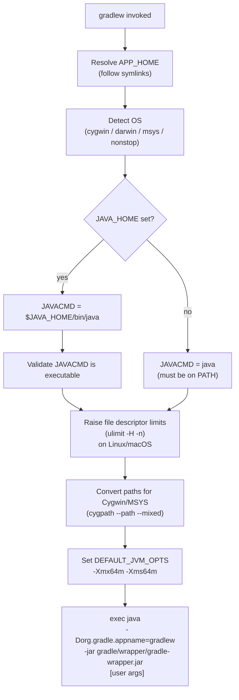
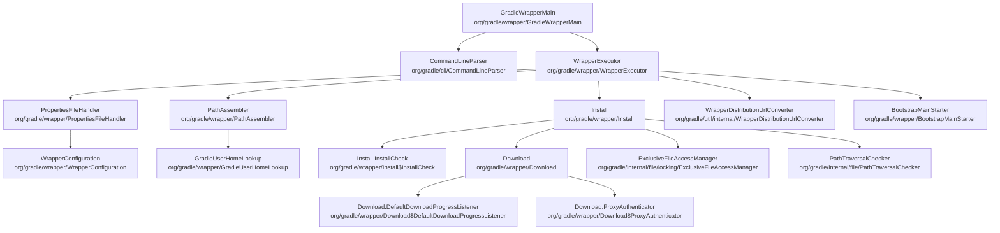
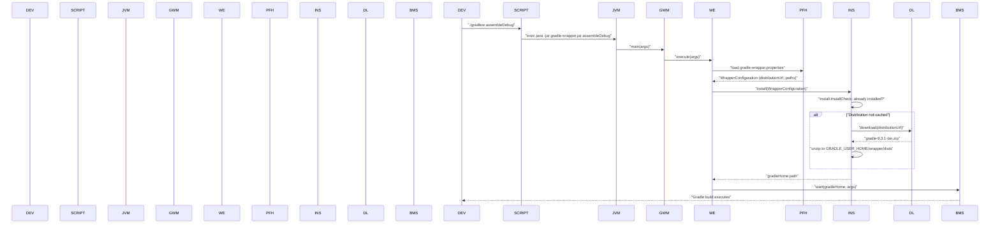

<!-- source: DeepWiki mcp.deepwiki.com · repo android/codelab-android-compose · page 3.4 Gradle Wrapper · fetched 2026-10-23 -->

# Gradle Wrapper

<details>
<summary>Relevant source files</summary>

The following files were used as context for generating this wiki page:

- [AccessibilityCodelab/gradle/wrapper/gradle-wrapper.jar](AccessibilityCodelab/gradle/wrapper/gradle-wrapper.jar)
- [AccessibilityCodelab/gradle/wrapper/gradle-wrapper.properties](AccessibilityCodelab/gradle/wrapper/gradle-wrapper.properties)
- [AccessibilityCodelab/gradlew](AccessibilityCodelab/gradlew)
- [AdvancedStateAndSideEffectsCodelab/gradle/wrapper/gradle-wrapper.jar](AdvancedStateAndSideEffectsCodelab/gradle/wrapper/gradle-wrapper.jar)
- [AdvancedStateAndSideEffectsCodelab/gradle/wrapper/gradle-wrapper.properties](AdvancedStateAndSideEffectsCodelab/gradle/wrapper/gradle-wrapper.properties)
- [AdvancedStateAndSideEffectsCodelab/gradlew](AdvancedStateAndSideEffectsCodelab/gradlew)
- [AnimationCodelab/gradle/wrapper/gradle-wrapper.jar](AnimationCodelab/gradle/wrapper/gradle-wrapper.jar)
- [AnimationCodelab/gradle/wrapper/gradle-wrapper.properties](AnimationCodelab/gradle/wrapper/gradle-wrapper.properties)
- [AnimationCodelab/gradlew](AnimationCodelab/gradlew)
- [BasicLayoutsCodelab/gradle/wrapper/gradle-wrapper.properties](BasicLayoutsCodelab/gradle/wrapper/gradle-wrapper.properties)
- [BasicStateCodelab/gradle/wrapper/gradle-wrapper.properties](BasicStateCodelab/gradle/wrapper/gradle-wrapper.properties)
- [BasicsCodelab/gradle/wrapper/gradle-wrapper.properties](BasicsCodelab/gradle/wrapper/gradle-wrapper.properties)
- [MigrationCodelab/gradle/wrapper/gradle-wrapper.properties](MigrationCodelab/gradle/wrapper/gradle-wrapper.properties)
- [NavigationCodelab/gradle/wrapper/gradle-wrapper.properties](NavigationCodelab/gradle/wrapper/gradle-wrapper.properties)
- [TestingCodelab/gradle/wrapper/gradle-wrapper.properties](TestingCodelab/gradle/wrapper/gradle-wrapper.properties)
- [ThemingCodelab/gradle/wrapper/gradle-wrapper.properties](ThemingCodelab/gradle/wrapper/gradle-wrapper.properties)
- [ThemingCodelabM2/gradle/wrapper/gradle-wrapper.properties](ThemingCodelabM2/gradle/wrapper/gradle-wrapper.properties)

</details>


## Purpose and Scope

This page documents the Gradle Wrapper setup used by every codelab in the repository. The Gradle Wrapper is the mechanism that allows a codelab to build without requiring a pre-installed Gradle on the developer's machine — it bootstraps the correct Gradle version automatically.

Every codelab directory contains three wrapper files: `gradlew` (the POSIX shell script), `gradle/wrapper/gradle-wrapper.jar` (the bootstrapping JVM runtime), and `gradle/wrapper/gradle-wrapper.properties` (the configuration file). All codelabs use identical configurations for these files.

For how Gradle is used at the project level once it is bootstrapped, see [Root Build Configuration](#3.1) and [Application Module Configuration](#3.2).

---

## File Layout

Every codelab follows this directory structure for wrapper files:

```
<CodelabDir>/
├── gradlew                              ← POSIX shell script
├── gradlew.bat                          ← Windows batch script (not covered here)
└── gradle/
    └── wrapper/
        ├── gradle-wrapper.jar           ← Bootstrapping JAR
        └── gradle-wrapper.properties    ← Wrapper configuration
```

**Sources:** [BasicsCodelab/gradle/wrapper/gradle-wrapper.properties:1-7](), [AccessibilityCodelab/gradlew:1-5]()

---

## gradle-wrapper.properties

All eleven codelabs use an identical `gradle-wrapper.properties` file. The properties are:

| Key | Value | Purpose |
|---|---|---|
| `distributionBase` | `GRADLE_USER_HOME` | Root base directory for storing the distribution |
| `distributionPath` | `wrapper/dists` | Subdirectory under `distributionBase` where distributions are unpacked |
| `distributionUrl` | `https\://services.gradle.org/distributions/gradle-9.3.1-bin.zip` | URL of the Gradle distribution to download |
| `networkTimeout` | `10000` | Timeout in milliseconds for network operations (10 seconds) |
| `validateDistributionUrl` | `true` | Enforces that `distributionUrl` is a trusted Gradle URL |
| `zipStoreBase` | `GRADLE_USER_HOME` | Root base directory for storing the downloaded ZIP |
| `zipStorePath` | `wrapper/dists` | Subdirectory under `zipStoreBase` where the ZIP is cached |

### Distribution Resolution

The downloaded distribution resolves to a local path constructed from the base and path values:

**Distribution directory:** `$GRADLE_USER_HOME/wrapper/dists/gradle-9.3.1-bin/`

`GRADLE_USER_HOME` defaults to `~/.gradle` if not set by the environment.

The `bin` suffix in `gradle-9.3.1-bin.zip` means only the runtime binaries are downloaded, not sources or documentation.

**Sources:** [BasicsCodelab/gradle/wrapper/gradle-wrapper.properties:1-7](), [ThemingCodelab/gradle/wrapper/gradle-wrapper.properties:1-7](), [MigrationCodelab/gradle/wrapper/gradle-wrapper.properties:1-7]()

---

## gradlew — Shell Script Execution Flow

The `gradlew` script is a standard POSIX shell script generated by Gradle. It is identical across all codelabs. Its job is to locate the JVM and invoke `gradle-wrapper.jar`.

**Execution flow diagram:**



**Sources:** [AccessibilityCodelab/gradlew:67-248](), [AnimationCodelab/gradlew:67-248](), [AdvancedStateAndSideEffectsCodelab/gradlew:67-200]()

### Key Script Variables

| Variable | Set at line(s) | Description |
|---|---|---|
| `APP_HOME` | [AccessibilityCodelab/gradlew:74-89]() | Absolute path to the codelab root (resolved through symlinks) |
| `APP_BASE_NAME` | [AccessibilityCodelab/gradlew:87]() | Set to `gradlew`; passed as `-Dorg.gradle.appname` |
| `JAVACMD` | [AccessibilityCodelab/gradlew:121-142]() | Path to the `java` executable |
| `MAX_FD` | [AccessibilityCodelab/gradlew:92-161]() | Maximum file descriptors; set to system max on Linux/macOS |
| `DEFAULT_JVM_OPTS` | [AccessibilityCodelab/gradlew:203]() | JVM heap limits: `-Xmx64m -Xms64m` |

### Final Java Invocation

The script terminates with an `exec` call constructed as [AccessibilityCodelab/gradlew:211-214]():

```
java
  -Dorg.gradle.appname=gradlew
  -jar <APP_HOME>/gradle/wrapper/gradle-wrapper.jar
  [DEFAULT_JVM_OPTS] [JAVA_OPTS] [GRADLE_OPTS]
  [user-supplied arguments]
```

The environment variables `JAVA_OPTS` and `GRADLE_OPTS` are incorporated into the final argument list at [AccessibilityCodelab/gradlew:241-246]() using `xargs` and `sed` to safely handle quoted values without relying on Bash-specific features.

---

## gradle-wrapper.jar — Internal Classes

`gradle-wrapper.jar` is a self-contained bootstrapping runtime. It is committed to the repository so it requires no prior Gradle installation. The JAR contains compiled class files under the `org/gradle/` namespace.

**Class responsibility diagram:**



**Sources:** [AccessibilityCodelab/gradle/wrapper/gradle-wrapper.jar:1-148]()

### Class Descriptions

| Class | Package | Role |
|---|---|---|
| `GradleWrapperMain` | `org.gradle.wrapper` | Entry point; parses arguments, delegates to `WrapperExecutor` |
| `WrapperExecutor` | `org.gradle.wrapper` | Reads properties, coordinates installation and launch |
| `PropertiesFileHandler` | `org.gradle.wrapper` | Reads and parses `gradle-wrapper.properties` |
| `WrapperConfiguration` | `org.gradle.wrapper` | Value object holding `distributionUrl`, base/path settings |
| `PathAssembler` | `org.gradle.wrapper` | Constructs local filesystem paths for the distribution |
| `GradleUserHomeLookup` | `org.gradle.wrapper` | Resolves `GRADLE_USER_HOME` |
| `Install` | `org.gradle.wrapper` | Downloads and unpacks the distribution if not present |
| `Install.InstallCheck` | `org.gradle.wrapper` | Checks whether the distribution is already installed |
| `Download` | `org.gradle.wrapper` | Performs the HTTP download of the ZIP |
| `Download.DefaultDownloadProgressListener` | `org.gradle.wrapper` | Reports download progress to stdout |
| `Download.ProxyAuthenticator` | `org.gradle.wrapper` | Handles proxy authentication |
| `ExclusiveFileAccessManager` | `org.gradle.internal.file.locking` | File locking to prevent concurrent installs |
| `PathTraversalChecker` | `org.gradle.internal.file` | Security check to prevent path traversal in the ZIP |
| `WrapperDistributionUrlConverter` | `org.gradle.util.internal` | Converts and validates the `distributionUrl` |
| `BootstrapMainStarter` | `org.gradle.wrapper` | Launches Gradle's main entry point after installation |
| `CommandLineParser` | `org.gradle.cli` | Parses command-line arguments passed through `gradlew` |

---

## End-to-End Bootstrap Flow

This diagram shows the complete sequence from invoking `./gradlew` to Gradle running a build task.



**Sources:** [AccessibilityCodelab/gradlew:211-248](), [AccessibilityCodelab/gradle/wrapper/gradle-wrapper.jar:1-148]()

---

## Uniformity Across Codelabs

All eleven codelabs use the identical Gradle version and wrapper configuration. The table below confirms uniformity:

| Codelab | `distributionUrl` | `networkTimeout` | `validateDistributionUrl` |
|---|---|---|---|
| BasicsCodelab | `gradle-9.3.1-bin.zip` | `10000` | `true` |
| BasicLayoutsCodelab | `gradle-9.3.1-bin.zip` | `10000` | `true` |
| BasicStateCodelab | `gradle-9.3.1-bin.zip` | `10000` | `true` |
| AnimationCodelab | `gradle-9.3.1-bin.zip` | `10000` | `true` |
| NavigationCodelab | `gradle-9.3.1-bin.zip` | `10000` | `true` |
| TestingCodelab | `gradle-9.3.1-bin.zip` | `10000` | `true` |
| ThemingCodelab | `gradle-9.3.1-bin.zip` | `10000` | `true` |
| ThemingCodelabM2 | `gradle-9.3.1-bin.zip` | `10000` | `true` |
| MigrationCodelab | `gradle-9.3.1-bin.zip` | `10000` | `true` |
| AccessibilityCodelab | `gradle-9.3.1-bin.zip` | `10000` | `true` |
| AdvancedStateAndSideEffectsCodelab | `gradle-9.3.1-bin.zip` | `10000` | `true` |

Because the wrapper configuration is uniform, any developer or CI runner that has already built one codelab will find the Gradle distribution already cached on disk when building another.

**Sources:** [BasicsCodelab/gradle/wrapper/gradle-wrapper.properties:1-7](), [ThemingCodelab/gradle/wrapper/gradle-wrapper.properties:1-7](), [MigrationCodelab/gradle/wrapper/gradle-wrapper.properties:1-7](), [AnimationCodelab/gradle/wrapper/gradle-wrapper.properties:1-7](), [NavigationCodelab/gradle/wrapper/gradle-wrapper.properties:1-7](), [AccessibilityCodelab/gradle/wrapper/gradle-wrapper.properties:1-7](), [TestingCodelab/gradle/wrapper/gradle-wrapper.properties:1-7](), [BasicLayoutsCodelab/gradle/wrapper/gradle-wrapper.properties:1-7](), [BasicStateCodelab/gradle/wrapper/gradle-wrapper.properties:1-7](), [AdvancedStateAndSideEffectsCodelab/gradle/wrapper/gradle-wrapper.properties:1-7](), [ThemingCodelabM2/gradle/wrapper/gradle-wrapper.properties:1-7]()

---

## CI Usage

The CI workflows invoke the wrapper directly. The standard build command used across all ten CI workflows is:

```
./gradlew assembleDebug lintDebug --stacktrace
```

For codelabs with instrumentation tests (`AdvancedStateAndSideEffectsCodelab`, `MigrationCodelab`), the CI additionally runs:

```
./gradlew connectedCheck
```

The CI also copies `.github/ci-gradle.properties` to `~/.gradle/gradle.properties` before the wrapper is invoked, which can supply Gradle properties such as JVM heap settings that override the `DEFAULT_JVM_OPTS` set in the `gradlew` script.

For full CI workflow details, see [Continuous Integration](#4).

---

