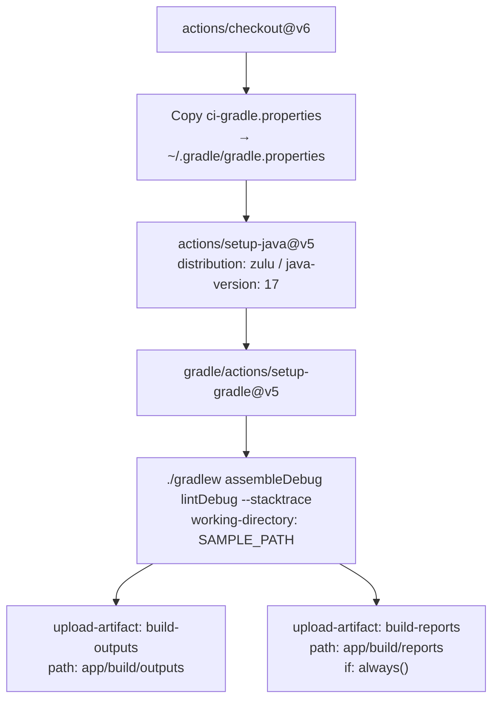
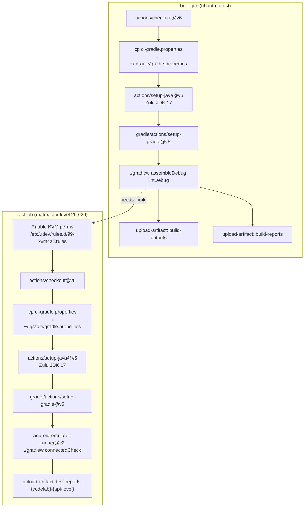

<!-- source: DeepWiki mcp.deepwiki.com · repo android/codelab-android-compose · page 4 Continuous Integration · fetched 2026-10-23 -->

# Continuous Integration

<details>
<summary>Relevant source files</summary>

The following files were used as context for generating this wiki page:

- [.github/renovate.json](.github/renovate.json)
- [.github/workflows/AccessibilityCodelab.yaml](.github/workflows/AccessibilityCodelab.yaml)
- [.github/workflows/AdvancedStateAndSideEffectsCodelab.yaml](.github/workflows/AdvancedStateAndSideEffectsCodelab.yaml)
- [.github/workflows/AnimationCodelab.yaml](.github/workflows/AnimationCodelab.yaml)
- [.github/workflows/BasicLayoutsCodelab.yaml](.github/workflows/BasicLayoutsCodelab.yaml)
- [.github/workflows/BasicStateCodelab.yaml](.github/workflows/BasicStateCodelab.yaml)
- [.github/workflows/BasicsCodelab.yaml](.github/workflows/BasicsCodelab.yaml)
- [.github/workflows/MigrationCodelab.yaml](.github/workflows/MigrationCodelab.yaml)
- [.github/workflows/NavigationCodelab.yaml](.github/workflows/NavigationCodelab.yaml)
- [.github/workflows/TestingCodelab.yaml](.github/workflows/TestingCodelab.yaml)
- [.github/workflows/ThemingCodelab.yaml](.github/workflows/ThemingCodelab.yaml)

</details>


This page documents the GitHub Actions CI/CD configuration for the `codelab-android-compose` monorepo. It covers workflow structure, trigger rules, the shared Gradle properties file, instrumentation test configuration, and automated dependency management. For information about what each individual codelab builds, see page [5]().

---

## Overview

Each codelab in the repository has its own dedicated GitHub Actions workflow file located under [.github/workflows/]() . All ten workflows share the same structural template and differ only in:

1. Which branches trigger a `push` event.
2. Whether an instrumentation test job is included after the build.
3. Which Android emulator `target` is used when running tests.

The workflows are triggered by three event types: `push`, `pull_request`, and `workflow_dispatch` (manual trigger).

---

## Workflow Inventory

The table below lists every workflow file, its branch trigger scope, and whether it runs instrumentation tests.

| Workflow File | Codelab | Push Triggers | Instrumentation Tests |
|---|---|---|---|
| `BasicsCodelab.yaml` | BasicsCodelab | `main` | No |
| `BasicLayoutsCodelab.yaml` | BasicLayoutsCodelab | `main` | No |
| `BasicStateCodelab.yaml` | BasicStateCodelab | `main` | No |
| `AnimationCodelab.yaml` | AnimationCodelab | `main` | No |
| `ThemingCodelab.yaml` | ThemingCodelab | `main` | No |
| `AccessibilityCodelab.yaml` | AccessibilityCodelab | `main`, `end` | No |
| `NavigationCodelab.yaml` | NavigationCodelab | `main`, `end` | No |
| `TestingCodelab.yaml` | TestingCodelab | `main`, `end` | No |
| `AdvancedStateAndSideEffectsCodelab.yaml` | AdvancedStateAndSideEffectsCodelab | `main` | Yes |
| `MigrationCodelab.yaml` | MigrationCodelab | `main` | Yes |

Sources: [.github/workflows/BasicsCodelab.yaml:1-14](), [.github/workflows/BasicLayoutsCodelab.yaml:1-14](), [.github/workflows/BasicStateCodelab.yaml:1-14](), [.github/workflows/AnimationCodelab.yaml:1-14](), [.github/workflows/ThemingCodelab.yaml:1-14](), [.github/workflows/AccessibilityCodelab.yaml:1-15](), [.github/workflows/NavigationCodelab.yaml:1-15](), [.github/workflows/TestingCodelab.yaml:1-15](), [.github/workflows/AdvancedStateAndSideEffectsCodelab.yaml:1-14](), [.github/workflows/MigrationCodelab.yaml:1-14]()

---

## Branch Trigger Patterns

All `pull_request` triggers apply to any branch. The `push` trigger is where workflows differ.

**`main` branch only (7 workflows):** BasicsCodelab, BasicLayoutsCodelab, BasicStateCodelab, AnimationCodelab, ThemingCodelab, AdvancedStateAndSideEffectsCodelab, MigrationCodelab.

**`main` + `end` branches (3 workflows):** AccessibilityCodelab, NavigationCodelab, TestingCodelab.

The `end` branch convention is used in codelabs that have a "start state" on `main` and a "completed solution" on `end`. These three codelabs need CI validation on both the exercise starting point and the finished solution. This pattern is also reflected in the Renovate configuration, which targets both branches for dependency updates (see [.github/renovate.json:9-12]()).

---

## Path Filtering

Every workflow applies path filters so that a push only triggers the workflow when relevant files have changed. Each workflow monitors two paths:

- The codelab's own directory (e.g., `AdvancedStateAndSideEffectsCodelab/**`)
- Its own workflow YAML file (e.g., `.github/workflows/AdvancedStateAndSideEffectsCodelab.yaml`)

This prevents unrelated changes from triggering every workflow simultaneously. The `SAMPLE_PATH` environment variable is set per workflow to the matching directory name and is used throughout the job steps as the working directory.

Sources: [.github/workflows/AdvancedStateAndSideEffectsCodelab.yaml:8-14](), [.github/workflows/MigrationCodelab.yaml:8-14](), [.github/workflows/AccessibilityCodelab.yaml:8-15]()

---

## Shared Build Job Structure

Every workflow's `build` job follows the same sequence of steps. The diagram below maps each step to the action or command it uses.

**Diagram: Shared Build Job Step Sequence**



Sources: [.github/workflows/BasicsCodelab.yaml:24-55](), [.github/workflows/AdvancedStateAndSideEffectsCodelab.yaml:24-54]()

Key points:
- All runners use `ubuntu-latest` with a 30-minute timeout.
- The Zulu distribution of JDK 17 is installed via `actions/setup-java@v5`.
- `gradle/actions/setup-gradle@v5` handles Gradle caching and wrapper validation.
- The Gradle command `assembleDebug lintDebug --stacktrace` compiles the debug variant and runs lint checks.
- Build outputs (APKs) are always uploaded. Build reports are uploaded unconditionally (`if: always()`) so they are available even when the build fails.

---

## The `ci-gradle.properties` File

A central file at [.github/ci-gradle.properties]() is copied into `~/.gradle/gradle.properties` at the start of every job. This allows CI-specific Gradle properties (such as memory settings or daemon configuration) to be maintained in one place and applied consistently to all ten workflows without duplicating configuration inside each YAML file.

The copy step is:

```
mkdir -p ~/.gradle ; cp .github/ci-gradle.properties ~/.gradle/gradle.properties
```

[.github/workflows/BasicsCodelab.yaml:29-29]()

---

## Instrumentation Test Jobs

Two workflows define an additional `test` job that runs Android instrumentation tests on emulated devices: `AdvancedStateAndSideEffectsCodelab` and `MigrationCodelab`.

### Job Dependency

The `test` job declares `needs: build`, so instrumentation tests only run if the build job succeeds.

[.github/workflows/AdvancedStateAndSideEffectsCodelab.yaml:57-58](), [.github/workflows/MigrationCodelab.yaml:57-58]()

### Emulator Matrix

Both workflows run tests across a matrix of two API levels.

| Parameter | AdvancedStateAndSideEffectsCodelab | MigrationCodelab |
|---|---|---|
| `api-level` | `[26, 29]` | `[26, 29]` |
| `target` | `google_apis` | *(default)* |
| `arch` | `x86` | `x86` |
| `disable-animations` | `true` | `true` |
| Script | `./gradlew connectedCheck --stacktrace` | `./gradlew connectedCheck --stacktrace` |

The `google_apis` target is required by AdvancedStateAndSideEffectsCodelab (the Crane travel app) because it uses Google Play Services for Maps integration. MigrationCodelab uses the default AOSP system image.

Sources: [.github/workflows/AdvancedStateAndSideEffectsCodelab.yaml:60-95](), [.github/workflows/MigrationCodelab.yaml:60-94]()

### KVM Hardware Acceleration

Before running the emulator, both test jobs enable KVM kernel module permissions on the GitHub Actions runner:

[.github/workflows/AdvancedStateAndSideEffectsCodelab.yaml:65-71]()

This is required for hardware-accelerated Android virtualization on Linux runners. Without it, x86 emulators either fail to start or run at unacceptable speed.

### Test Artifact Upload

Test reports are uploaded using a matrix-qualified artifact name to avoid collisions between the two parallel API-level runs:

- AdvancedStateAndSideEffectsCodelab: `test-reports-state-${{ matrix.api-level }}`
- MigrationCodelab: `test-reports-migration-${{ matrix.api-level }}`

[.github/workflows/AdvancedStateAndSideEffectsCodelab.yaml:97-103](), [.github/workflows/MigrationCodelab.yaml:97-102]()

---

## Full Pipeline Diagram (Build + Test)

The diagram below illustrates the complete two-job pipeline used by the two instrumentation-testing workflows, including the emulator runner action and artifact destinations.

**Diagram: AdvancedStateAndSideEffectsCodelab / MigrationCodelab Pipeline**



Sources: [.github/workflows/AdvancedStateAndSideEffectsCodelab.yaml:19-103](), [.github/workflows/MigrationCodelab.yaml:19-102]()

---

## Automated Dependency Updates

The repository uses the Renovate bot, configured at [.github/renovate.json](). It runs on a daily schedule and targets both the `main` and `end` branches.

All dependency updates are grouped into a single pull request (`group:all`). Kotlin-related packages (`org.jetbrains.kotlin` and `androidx.compose.compiler`) are further grouped under a dedicated rule named `"Kotlin Dependencies"` for visibility.

[.github/renovate.json:1-29]()

For more information about how dependencies are declared and versioned within the codelabs themselves, see the Dependency Management section on page [3.3]().

---

