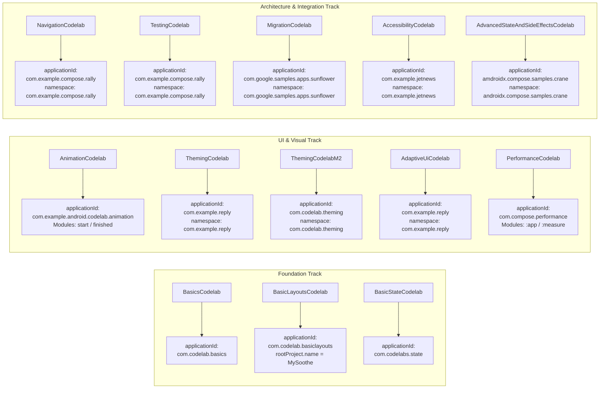
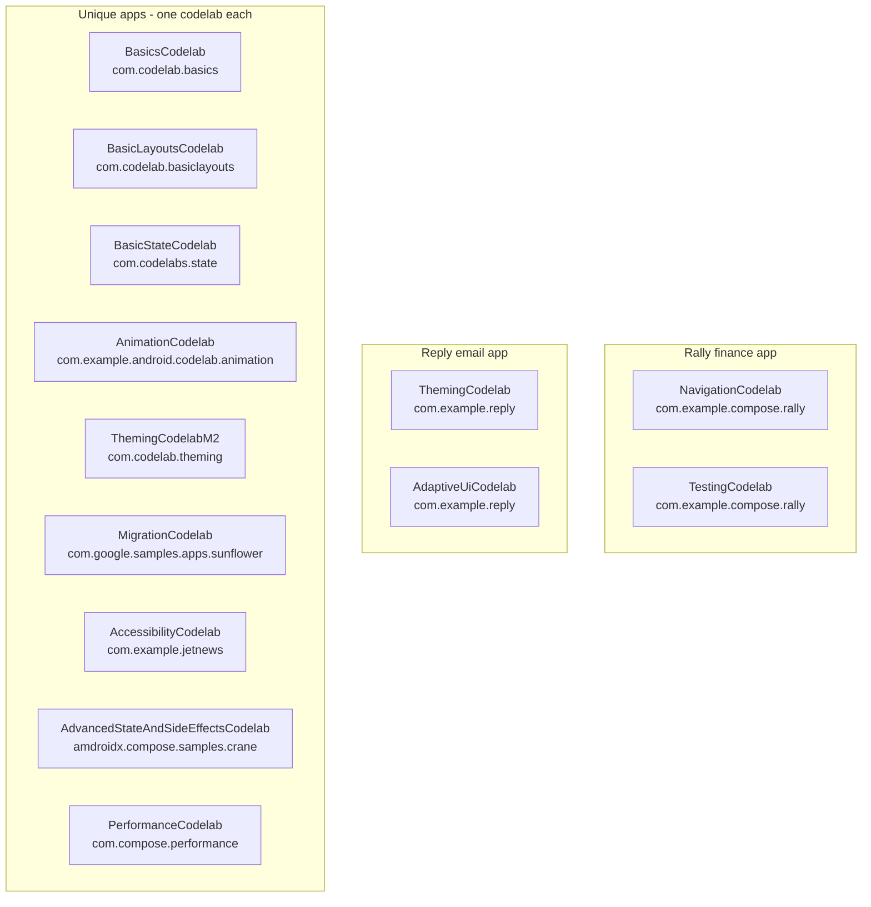
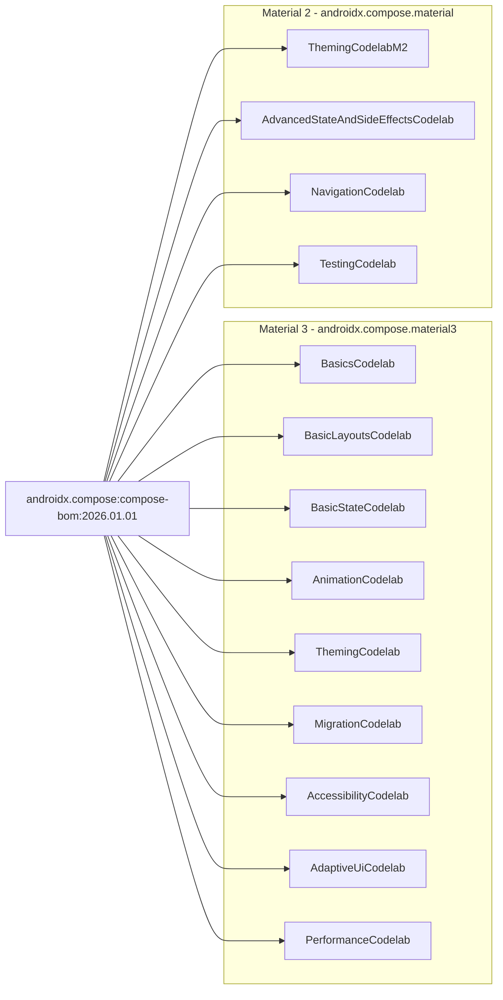

<!-- source: DeepWiki mcp.deepwiki.com · repo android/codelab-android-compose · page 5 Codelabs · fetched 2026-10-23 -->

# Codelabs

Relevant source files

The following files were used as context for generating this wiki page:

- [AccessibilityCodelab/app/build.gradle](AccessibilityCodelab/app/build.gradle)
- [AdvancedStateAndSideEffectsCodelab/app/build.gradle](AdvancedStateAndSideEffectsCodelab/app/build.gradle)
- [AnimationCodelab/finished/build.gradle](AnimationCodelab/finished/build.gradle)
- [AnimationCodelab/start/build.gradle](AnimationCodelab/start/build.gradle)
- [BasicLayoutsCodelab/app/build.gradle](BasicLayoutsCodelab/app/build.gradle)
- [BasicsCodelab/README.md](BasicsCodelab/README.md)
- [MigrationCodelab/README.md](MigrationCodelab/README.md)
- [MigrationCodelab/app/build.gradle](MigrationCodelab/app/build.gradle)
- [NavigationCodelab/app/build.gradle](NavigationCodelab/app/build.gradle)
- [README.md](README.md)
- [TestingCodelab/app/build.gradle](TestingCodelab/app/build.gradle)
- [ThemingCodelab/README.md](ThemingCodelab/README.md)
- [ThemingCodelab/app/build.gradle](ThemingCodelab/app/build.gradle)
- [ThemingCodelabM2/app/build.gradle](ThemingCodelabM2/app/build.gradle)

This page is an index of all codelabs contained in the `codelab-android-compose` monorepo. It lists each codelab's directory, application identity, subject app, primary topic, and Material Design version, with links to dedicated detail pages. For information about the build system shared across these codelabs, see page [3](). For CI/CD pipeline details, see page [4]().

---

## Overview

Each codelab is a self-contained Android Studio project under the repository root. They are ordered roughly from foundational to advanced topics.

| # | Directory | Application ID | Subject App | Primary Topic | Material | Detail Page |
|---|-----------|---------------|-------------|---------------|----------|-------------|
| 1 | `BasicsCodelab` | `com.codelab.basics` | Custom (Greetings) | Declarative UI, state, layouts, theming | M3 | [5.1]() |
| 2 | `BasicLayoutsCodelab` | `com.codelab.basiclayouts` | MySoothe | Composables, Modifiers | M3 | [5.2]() |
| 3 | `BasicStateCodelab` | `com.codelabs.state` | Wellness app | State patterns, ViewModel | M3 | [5.3]() |
| 4 | `AnimationCodelab` | `com.example.android.codelab.animation` | Custom (Home) | Animation APIs | M3 | [5.4]() |
| 5 | `NavigationCodelab` | `com.example.compose.rally` | Rally (finance) | Jetpack Navigation | M2 | [5.5]() |
| 6 | `TestingCodelab` | `com.example.compose.rally` | Rally (finance) | Semantics tree, test isolation | M2 | [5.6]() |
| 7 | `ThemingCodelab` | `com.example.reply` | Reply (email) | Material 3 theming | M3 | [5.7]() |
| 8 | `ThemingCodelabM2` | `com.codelab.theming` | Custom (Owl) | Material 2 theming | M2 | [5.7]() |
| 9 | `MigrationCodelab` | `com.google.samples.apps.sunflower` | Sunflower (plants) | View → Compose interop | M3 | [5.8]() |
| 10 | `AccessibilityCodelab` | `com.example.jetnews` | JetNews | Touch targets, content descriptions | M3 | [5.9]() |
| 11 | `AdvancedStateAndSideEffectsCodelab` | `androidx.compose.samples.crane` | Crane (travel) | Side effects, Hilt DI | M2 | [5.10]() |
| 12 | `AdaptiveUiCodelab` | `com.example.reply` | Reply (email) | Phones, tablets, foldables | M3 | [5.11]() |
| 13 | `PerformanceCodelab` | `com.compose.performance` | Custom (lists) | Baseline Profiles, benchmarking | M3 | [5.12]() |

Sources: [README.md:1-81](), [MigrationCodelab/app/build.gradle:25-26](), [AdvancedStateAndSideEffectsCodelab/app/build.gradle:31-32](), [AccessibilityCodelab/app/build.gradle:23-24](), [NavigationCodelab/app/build.gradle:22-27](), [TestingCodelab/app/build.gradle:22-27](), [ThemingCodelab/app/build.gradle:22-23](), [ThemingCodelabM2/app/build.gradle:22-23](), [AnimationCodelab/start/build.gradle:22-24](), [BasicLayoutsCodelab/app/build.gradle:22-24]()

---

## Codelab-to-Code-Entity Map

This diagram links each codelab's directory name to the concrete code identifiers that identify it at the Android application layer.

Sources: [MigrationCodelab/app/build.gradle:25-26](), [AdvancedStateAndSideEffectsCodelab/app/build.gradle:31-32](), [AccessibilityCodelab/app/build.gradle:23-24](), [NavigationCodelab/app/build.gradle:22-27](), [TestingCodelab/app/build.gradle:22-27](), [ThemingCodelab/app/build.gradle:22-23](), [ThemingCodelabM2/app/build.gradle:22-23](), [AnimationCodelab/start/build.gradle:22-24](), [BasicLayoutsCodelab/app/build.gradle:22-24]()

---

## Shared Subject Apps

Several codelabs share the same subject application. This is intentional — each codelab teaches a different aspect of the same codebase.

Sources: [NavigationCodelab/app/build.gradle:22-28](), [TestingCodelab/app/build.gradle:22-28](), [ThemingCodelab/app/build.gradle:22-24]()

---

## Key Differentiators by Codelab

| Codelab | Unique Build / Structural Feature |
|---------|-----------------------------------|
| `AnimationCodelab` | Two modules: `start/` (TODOs) and `finished/` (solutions) |
| `MigrationCodelab` | Only codelab with `dataBinding = true` and `compose = true` simultaneously; uses `kapt` for Room and Glide |
| `AdvancedStateAndSideEffectsCodelab` | Only codelab using Hilt DI (`dagger.hilt.android.plugin`) and KSP (`com.google.devtools.ksp`) |
| `PerformanceCodelab` | Two modules: `:app` (subject) and `:measure` (macro benchmarking harness) |
| `NavigationCodelab` / `TestingCodelab` | Share the same `applicationId` (`com.example.compose.rally`) |
| `ThemingCodelab` / `AdaptiveUiCodelab` | Share the same `applicationId` (`com.example.reply`) |
| `MigrationCodelab` | Uses `androidx.navigation.safeargs.kotlin` plugin for Fragment-based navigation |

Sources: [MigrationCodelab/app/build.gradle:17-56](), [AdvancedStateAndSideEffectsCodelab/app/build.gradle:17-23](), [AnimationCodelab/start/build.gradle:17-39](), [AnimationCodelab/finished/build.gradle:17-39]()

---

## Material Design Version Split

Sources: [ThemingCodelabM2/app/build.gradle:46-56](), [AdvancedStateAndSideEffectsCodelab/app/build.gradle:105-116](), [NavigationCodelab/app/build.gradle:79-94](), [TestingCodelab/app/build.gradle:82-101](), [ThemingCodelab/app/build.gradle:88-107](), [MigrationCodelab/app/build.gradle:59-93](), [AccessibilityCodelab/app/build.gradle:88-107](), [BasicLayoutsCodelab/app/build.gradle:59-78]()

---

## CI Pipeline Classification

Two codelabs run instrumentation tests in CI; the rest are build-and-lint only. See page [4]() for the full CI pipeline documentation.

| CI Class | Codelabs | Test API Levels | Emulator Target |
|----------|----------|-----------------|-----------------|
| **Build + Lint only** | BasicsCodelab, BasicLayoutsCodelab, BasicStateCodelab, AnimationCodelab, ThemingCodelab, ThemingCodelabM2, AccessibilityCodelab, NavigationCodelab, TestingCodelab, AdaptiveUiCodelab, PerformanceCodelab | — | — |
| **Build + Instrumentation Tests** | `AdvancedStateAndSideEffectsCodelab` | API 26, 29 | `google_apis` / x86 |
| **Build + Instrumentation Tests** | `MigrationCodelab` | API 26, 29 | `default` / x86 |

Sources: [README.md:1-81](), [AdvancedStateAndSideEffectsCodelab/app/build.gradle:1-139](), [MigrationCodelab/app/build.gradle:1-107]()

---

## Codelab Detail Pages

Each codelab has a dedicated detail page covering its composable hierarchy, state management patterns, build configuration specifics, and notable design decisions:

- [5.1 — Basics Codelab]()
- [5.2 — Basic Layouts Codelab]()
- [5.3 — Basic State Codelab]()
- [5.4 — Animation Codelab]()
- [5.5 — Navigation Codelab]()
- [5.6 — Testing Codelab]()
- [5.7 — Theming Codelab]() *(covers both `ThemingCodelab` and `ThemingCodelabM2`)*
- [5.8 — Migration Codelab]()
- [5.9 — Accessibility Codelab]()
- [5.10 — Advanced State and Side Effects Codelab]()
- [5.11 — Adaptive UI Codelab]()
- [5.12 — Performance Codelab]()

---

