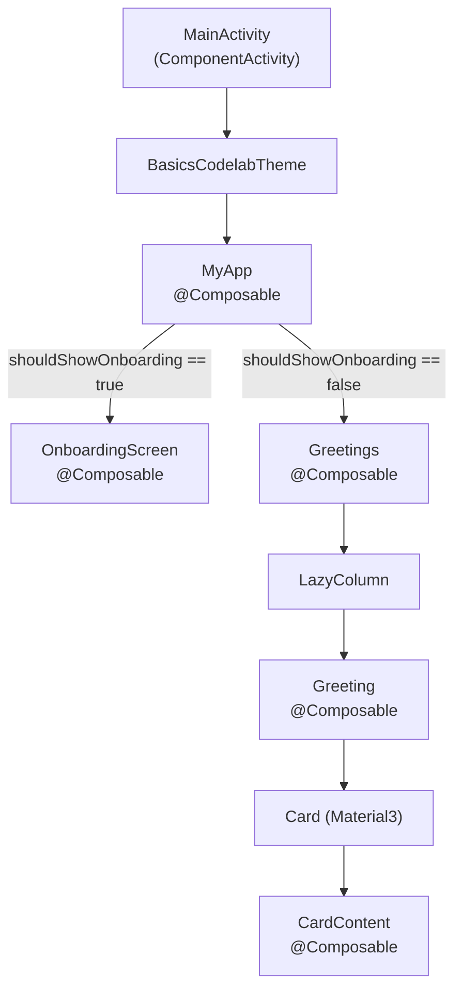
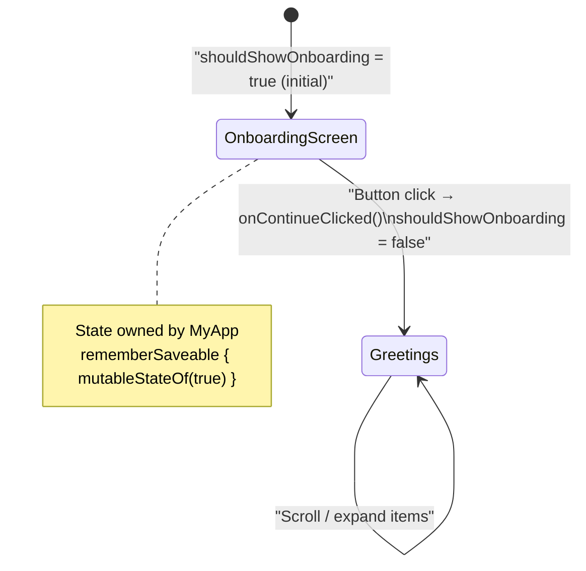
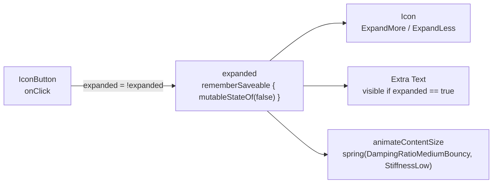

<!-- source: DeepWiki mcp.deepwiki.com · repo android/codelab-android-compose · page 5.1 Basics Codelab · fetched 2026-10-23 -->

# Basics Codelab

<details>
<summary>Relevant source files</summary>

The following files were used as context for generating this wiki page:

- [BasicStateCodelab/app/build.gradle.kts](BasicStateCodelab/app/build.gradle.kts)
- [BasicsCodelab/app/build.gradle.kts](BasicsCodelab/app/build.gradle.kts)
- [BasicsCodelab/app/src/main/AndroidManifest.xml](BasicsCodelab/app/src/main/AndroidManifest.xml)
- [BasicsCodelab/app/src/main/java/com/codelab/basics/MainActivity.kt](BasicsCodelab/app/src/main/java/com/codelab/basics/MainActivity.kt)
- [BasicsCodelab/app/src/main/res/values/themes.xml](BasicsCodelab/app/src/main/res/values/themes.xml)
- [BasicsCodelab/settings.gradle](BasicsCodelab/settings.gradle)

</details>


## Purpose and Scope

This page documents the **BasicsCodelab** project, which teaches declarative UI fundamentals in Jetpack Compose: composable function composition, hoisted state, `rememberSaveable`, lazy lists, and basic animation. The codelab lives under `BasicsCodelab/` in the monorepo.

For state patterns and ViewModel integration, see the [Basic State Codelab](#5.3). For layout and modifier techniques, see the [Basic Layouts Codelab](#5.2).

---

## Project Identity

| Property | Value |
|---|---|
| `rootProject.name` | `BasicsCodelab` |
| Application ID | `com.codelab.basics` |
| Namespace | `com.codelab.basics` |
| `compileSdk` | 36 |
| `minSdk` | 24 |
| `targetSdk` | 33 |
| Module structure | Single `:app` module |
| Build script DSL | Kotlin DSL (`build.gradle.kts`) |

Sources: [BasicsCodelab/settings.gradle:31-32](), [BasicsCodelab/app/build.gradle.kts:27-36]()

---

## Composable Hierarchy

The entire UI is contained in a single file: [BasicsCodelab/app/src/main/java/com/codelab/basics/MainActivity.kt]().

**Composable Hierarchy Diagram**



Sources: [BasicsCodelab/app/src/main/java/com/codelab/basics/MainActivity.kt:57-172]()

### Component Descriptions

| Composable | Role | Key Detail |
|---|---|---|
| `MainActivity` | Entry point; `ComponentActivity` | Calls `setContent` wrapping `MyApp` in `BasicsCodelabTheme` |
| `MyApp` | Root composable; owns navigation state | Holds `shouldShowOnboarding` via `rememberSaveable` |
| `OnboardingScreen` | Welcome screen | Centered column; calls `onContinueClicked` lambda on button tap |
| `Greetings` | List screen | `LazyColumn` over a list of 1,000 generated names |
| `Greeting` | Single list row wrapper | Wraps `CardContent` in a Material3 `Card` with primary color |
| `CardContent` | Expandable row content | Owns `expanded` state via `rememberSaveable`; uses `animateContentSize` |

Sources: [BasicsCodelab/app/src/main/java/com/codelab/basics/MainActivity.kt:68-172]()

---

## Two-Screen State Machine

The app has exactly two screens. The transition between them is governed by a single `Boolean` held in `MyApp` using `rememberSaveable`. Using `rememberSaveable` (rather than plain `remember`) ensures the state survives activity recreation (e.g., screen rotation).

**State Machine Diagram**



The `onContinueClicked` callback is passed down from `MyApp` to `OnboardingScreen` as a lambda parameter — state is hoisted to `MyApp` and `OnboardingScreen` is stateless.

Sources: [BasicsCodelab/app/src/main/java/com/codelab/basics/MainActivity.kt:68-103]()

---

## Expandable Card State

`CardContent` demonstrates a second independent use of `rememberSaveable`. Each card in the list independently tracks whether it is expanded or collapsed.

**CardContent State Flow**



The `animateContentSize` modifier is applied to the `Row` in `CardContent`, with a `spring` animation spec using `Spring.DampingRatioMediumBouncy` and `Spring.StiffnessLow`. The expand/collapse icon switches between `Filled.ExpandMore` and `Filled.ExpandLess` from `androidx.compose.material.icons.filled`.

Sources: [BasicsCodelab/app/src/main/java/com/codelab/basics/MainActivity.kt:129-172]()

---

## Build Configuration

The `BasicsCodelab` uses Kotlin DSL and the **version catalog** (`libs.versions.toml`) for all dependency and plugin declarations. This is distinct from `BasicStateCodelab`, which uses hardcoded string coordinates.

**Plugin declarations** (via catalog aliases):

```
libs.plugins.android.application
libs.plugins.kotlin.android
libs.plugins.kotlin.compose
```

Sources: [BasicsCodelab/app/build.gradle.kts:20-24]()

**Key dependencies:**

| Catalog Alias | Purpose |
|---|---|
| `libs.androidx.core.ktx` | Android KTX |
| `libs.androidx.lifecycle.runtime.ktx` | Lifecycle runtime |
| `libs.androidx.activity.compose` | `ComponentActivity.setContent` |
| `libs.androidx.compose.bom` (platform) | Compose BOM version pinning |
| `libs.androidx.material3` | Material 3 components |
| `libs.androidx.material.icons.extended` | Extended icon set (ExpandMore, ExpandLess) |
| `libs.androidx.ui.tooling.preview` | `@Preview` support |

Sources: [BasicsCodelab/app/build.gradle.kts:72-89]()

`buildFeatures { compose = true }` enables the Compose compiler. JVM target is set to 1.8 via `kotlin { compilerOptions { jvmTarget = JvmTarget.JVM_1_8 } }`.

Sources: [BasicsCodelab/app/build.gradle.kts:57-69]()

---

## Comparison: BasicsCodelab vs BasicStateCodelab

These two codelabs share many surface-level similarities but differ in purpose and configuration.

| Aspect | BasicsCodelab | BasicStateCodelab |
|---|---|---|
| Package | `com.codelab.basics` | `com.codelabs.state` |
| Build script DSL | Kotlin DSL | Kotlin DSL |
| Plugin declaration | Version catalog aliases (`alias(libs.plugins.*)`) | Hardcoded plugin IDs (`id("...")`) |
| Dependency declaration | Version catalog aliases | Hardcoded string coordinates |
| ViewModel dependency | None | `lifecycle-viewmodel-compose:2.10.0` |
| State mechanism taught | `rememberSaveable`, state hoisting | ViewModel, `StateFlow`, `collectAsStateWithLifecycle` |
| Navigation model | Single boolean flag in `MyApp` | Managed via ViewModel state |
| `material-icons` dependency | `material.icons.extended` | `material-icons-core` |

Sources: [BasicsCodelab/app/build.gradle.kts:20-89](), [BasicStateCodelab/app/build.gradle.kts:20-89]()

---

## Previews

Three `@Preview` functions are declared in `MainActivity.kt`:

| Preview Function | Subject | Configuration |
|---|---|---|
| `OnboardingPreview` | `OnboardingScreen` | `widthDp=320`, `heightDp=320`, light |
| `GreetingPreview` | `Greetings` | `widthDp=320`, light + dark (`UI_MODE_NIGHT_YES`) |
| `MyAppPreview` | `MyApp` | Default, `fillMaxSize` |

The dark mode preview for `Greetings` uses `@Preview(uiMode = UI_MODE_NIGHT_YES, name = "GreetingPreviewDark")` stacked with a second light `@Preview` on `GreetingPreview`.

Sources: [BasicsCodelab/app/src/main/java/com/codelab/basics/MainActivity.kt:175-203]()

---

## Manifest

The manifest declares a single activity, `MainActivity`, as the launcher activity. The application theme is `Theme.BasicsCodelab`, which extends `android.Theme.Material.Light.NoActionBar`.

Sources: [BasicsCodelab/app/src/main/AndroidManifest.xml:15-36](), [BasicsCodelab/app/src/main/res/values/themes.xml:14-17]()

---

