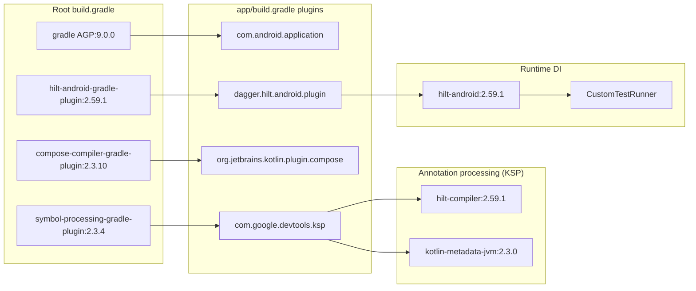
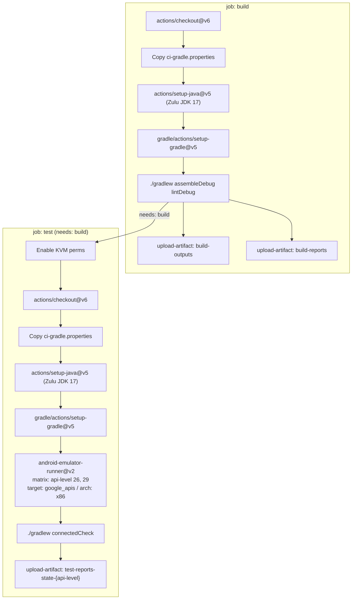

<!-- source: DeepWiki mcp.deepwiki.com · repo android/codelab-android-compose · page 5.10 Advanced State and Side Effects Codelab · fetched 2026-10-23 -->

# Advanced State and Side Effects Codelab

<details>
<summary>Relevant source files</summary>

The following files were used as context for generating this wiki page:

- [.github/workflows/AccessibilityCodelab.yaml](.github/workflows/AccessibilityCodelab.yaml)
- [.github/workflows/AdvancedStateAndSideEffectsCodelab.yaml](.github/workflows/AdvancedStateAndSideEffectsCodelab.yaml)
- [.github/workflows/AnimationCodelab.yaml](.github/workflows/AnimationCodelab.yaml)
- [.github/workflows/BasicLayoutsCodelab.yaml](.github/workflows/BasicLayoutsCodelab.yaml)
- [.github/workflows/BasicStateCodelab.yaml](.github/workflows/BasicStateCodelab.yaml)
- [.github/workflows/BasicsCodelab.yaml](.github/workflows/BasicsCodelab.yaml)
- [.github/workflows/MigrationCodelab.yaml](.github/workflows/MigrationCodelab.yaml)
- [.github/workflows/NavigationCodelab.yaml](.github/workflows/NavigationCodelab.yaml)
- [.github/workflows/TestingCodelab.yaml](.github/workflows/TestingCodelab.yaml)
- [.github/workflows/ThemingCodelab.yaml](.github/workflows/ThemingCodelab.yaml)
- [AccessibilityCodelab/app/build.gradle](AccessibilityCodelab/app/build.gradle)
- [AccessibilityCodelab/build.gradle](AccessibilityCodelab/build.gradle)
- [AdvancedStateAndSideEffectsCodelab/app/build.gradle](AdvancedStateAndSideEffectsCodelab/app/build.gradle)
- [AdvancedStateAndSideEffectsCodelab/build.gradle](AdvancedStateAndSideEffectsCodelab/build.gradle)
- [AnimationCodelab/build.gradle](AnimationCodelab/build.gradle)
- [AnimationCodelab/finished/build.gradle](AnimationCodelab/finished/build.gradle)
- [AnimationCodelab/start/build.gradle](AnimationCodelab/start/build.gradle)
- [BasicLayoutsCodelab/app/build.gradle](BasicLayoutsCodelab/app/build.gradle)
- [BasicLayoutsCodelab/build.gradle](BasicLayoutsCodelab/build.gradle)
- [BasicStateCodelab/build.gradle](BasicStateCodelab/build.gradle)
- [BasicsCodelab/build.gradle.kts](BasicsCodelab/build.gradle.kts)
- [MigrationCodelab/app/build.gradle](MigrationCodelab/app/build.gradle)
- [MigrationCodelab/build.gradle](MigrationCodelab/build.gradle)
- [NavigationCodelab/app/build.gradle](NavigationCodelab/app/build.gradle)
- [NavigationCodelab/build.gradle](NavigationCodelab/build.gradle)
- [TestingCodelab/app/build.gradle](TestingCodelab/app/build.gradle)
- [TestingCodelab/build.gradle](TestingCodelab/build.gradle)
- [ThemingCodelab/app/build.gradle](ThemingCodelab/app/build.gradle)
- [ThemingCodelab/build.gradle](ThemingCodelab/build.gradle)
- [ThemingCodelabM2/app/build.gradle](ThemingCodelabM2/app/build.gradle)
- [ThemingCodelabM2/build.gradle](ThemingCodelabM2/build.gradle)

</details>


This page documents the `AdvancedStateAndSideEffectsCodelab` project: its subject app, build configuration, unique dependencies, Hilt dependency injection setup, Google Maps integration, and CI pipeline. This is the most infrastructure-heavy codelab in the monorepo due to Hilt DI and maps support.

For general build system patterns shared across all codelabs, see [Build System](#3). For CI pipeline structure shared across all codelabs, see [Continuous Integration](#4).

---

## Subject App: Crane

The codelab uses the **Crane** travel app as its exercise subject.

| Property | Value |
|---|---|
| Application ID | `androidx.compose.samples.crane` |
| Namespace | `androidx.compose.samples.crane` |
| Min SDK | 23 |
| Target SDK | 33 |
| Compile SDK | 36 |
| Material version | Material 2 (`androidx.compose.material:material`) |
| Test runner | `androidx.compose.samples.crane.CustomTestRunner` |

The Crane app is a travel-themed UI that exercises advanced Compose patterns: side effects, coroutine-aware state, and Hilt-injected dependencies. It is one of only two codelabs in the monorepo that uses Hilt DI (the other codelabs do not use a DI framework).

Sources: [AdvancedStateAndSideEffectsCodelab/app/build.gradle:30-43]()

---

## Build Configuration

### Root Build File

The root `build.gradle` for this codelab is distinct from all others in the monorepo: it registers both the **Hilt Gradle plugin** and the **KSP symbol processing plugin** at the root level.

**Root-level plugin declarations:**

| Plugin | Version | Purpose |
|---|---|---|
| `com.google.dagger:hilt-android-gradle-plugin` | 2.59.1 | Hilt DI code generation |
| `com.google.devtools.ksp:symbol-processing-gradle-plugin` | 2.3.4 | KSP annotation processing |
| `org.jetbrains.kotlin:compose-compiler-gradle-plugin` | 2.3.10 | Compose compiler |
| `com.android.tools.build:gradle` | 9.0.0 | AGP |
| `com.diffplug.spotless` | 8.2.1 | Code style (ktlint 0.45.2) |

A notable subproject-level configuration forces JUnit to `4.13.2` to resolve a version conflict introduced by `androidx.test` and Hilt, which both transitively pull in `4.12`:

[AdvancedStateAndSideEffectsCodelab/build.gradle:61-65]()

Sources: [AdvancedStateAndSideEffectsCodelab/build.gradle:17-66]()

### App Module Build File

The `app/build.gradle` applies four plugins:

```
com.android.application
com.google.devtools.ksp
org.jetbrains.kotlin.plugin.compose
dagger.hilt.android.plugin
```

Several unused AGP build features are explicitly disabled to reduce build overhead:

[AdvancedStateAndSideEffectsCodelab/app/build.gradle:71-80]()

| Feature flag | Value |
|---|---|
| `compose` | `true` |
| `buildConfig` | `false` |
| `aidl` | `false` |
| `renderScript` | `false` |
| `resValues` | `false` |
| `shaders` | `false` |

**Google Maps API key** is read from `local.properties` at configuration time and injected as an `AndroidManifest` placeholder `MAPS_API_KEY`:

[AdvancedStateAndSideEffectsCodelab/app/build.gradle:24-28]()
[AdvancedStateAndSideEffectsCodelab/app/build.gradle:42-43]()

Sources: [AdvancedStateAndSideEffectsCodelab/app/build.gradle:17-88]()

---

## Dependency Overview

The following diagram maps the major dependency groups to the artifacts declared in `app/build.gradle`.

**Dependency group map:**

```mermaid
graph TD
    subgraph "Compose (via BOM 2026.01.01)"
        C1["androidx.compose.runtime:runtime"]
        C2["androidx.compose.material:material (M2)"]
        C3["androidx.compose.foundation:foundation"]
        C4["androidx.compose.animation:animation"]
        C5["androidx.compose.ui:ui-tooling-preview"]
    end

    subgraph "Hilt DI"
        H1["com.google.dagger:hilt-android:2.59.1"]
        H2["ksp: hilt-compiler:2.59.1"]
        H3["ksp: kotlin-metadata-jvm:2.3.0"]
        H4["androidTest: hilt-android-testing:2.59.1"]
        H5["kspAndroidTest: hilt-compiler:2.59.1"]
    end

    subgraph "Google Maps"
        M1["com.google.android.libraries.maps:maps:3.1.0-beta"]
        M2["com.google.maps.android:maps-v3-ktx:3.4.0"]
        M3["constraint: com.android.volley:volley:1.2.1"]
    end

    subgraph "Image Loading"
        I1["io.coil-kt:coil-compose:2.7.0"]
    end

    subgraph "Lifecycle / ViewModel"
        L1["lifecycle-viewmodel-compose:2.10.0"]
        L2["lifecycle-viewmodel-ktx:2.10.0"]
    end

    subgraph "Test"
        T1["androidx.compose.ui:ui-test-junit4"]
        T2["kotlinx-coroutines-test:1.10.2"]
        T3["CustomTestRunner"]
    end

    APP["app/build.gradle"] --> C1
    APP --> H1
    APP --> M1
    APP --> I1
    APP --> L1
    APP --> T1
```



Sources: [AdvancedStateAndSideEffectsCodelab/app/build.gradle:90-138]()

---

## Hilt Dependency Injection

This codelab is the **only project** in the monorepo that uses Hilt. KSP is used instead of `kapt` for annotation processing, which is a more modern approach compared to the legacy-kapt usage in `MigrationCodelab` (see [Migration Codelab](#5.8)).

### KSP vs kapt

| Codelab | Annotation processor | Tool |
|---|---|---|
| AdvancedStateAndSideEffectsCodelab | Hilt | `ksp` |
| MigrationCodelab | Room, Glide | `kapt` (legacy) |

The `ksp` and `kspAndroidTest` configurations are used to supply Hilt's compiler and Kotlin metadata:

[AdvancedStateAndSideEffectsCodelab/app/build.gradle:122-138]()

### Hilt Test Infrastructure

Instrumentation tests use `CustomTestRunner` (declared at `testInstrumentationRunner "androidx.compose.samples.crane.CustomTestRunner"`) instead of the default `AndroidJUnitRunner`. This is the standard pattern for Hilt-based instrumentation tests: a custom runner initializes Hilt's test application. The test classpath includes:

- `com.google.dagger:hilt-android:2.59.1` (runtime)
- `com.google.dagger:hilt-android-testing:2.59.1`
- `kspAndroidTest "com.google.dagger:hilt-compiler:2.59.1"`
- `kspAndroidTest "org.jetbrains.kotlin:kotlin-metadata-jvm:2.3.0"`

Sources: [AdvancedStateAndSideEffectsCodelab/app/build.gradle:122-138](), [AdvancedStateAndSideEffectsCodelab/app/build.gradle:40-41]()

---

## Google Maps Integration

This codelab integrates Google Maps, which is unique among all codelabs in the monorepo. Two libraries are used:

| Library | Version | Purpose |
|---|---|---|
| `com.google.android.libraries.maps:maps` | 3.1.0-beta | Core Maps SDK (non-Play Services variant) |
| `com.google.maps.android:maps-v3-ktx` | 3.4.0 | Kotlin extensions for the Maps v3 SDK |

`Volley` is a transitive dependency of the Maps SDK; a constraint pins it to `1.2.1` to ensure it is available on `maven.google.com`:

[AdvancedStateAndSideEffectsCodelab/app/build.gradle:94-98]()

The API key is injected at build time from `local.properties` using a manifest placeholder, meaning the app will compile without a key (the placeholder will be empty) but maps will not function at runtime without a valid key.

Sources: [AdvancedStateAndSideEffectsCodelab/app/build.gradle:92-98](), [AdvancedStateAndSideEffectsCodelab/app/build.gradle:25-28]()

---

## Module and Plugin Architecture

The following diagram shows how the build plugins and major frameworks relate to the `app` module.

**Build plugin and framework wiring:**



Sources: [AdvancedStateAndSideEffectsCodelab/build.gradle:17-28](), [AdvancedStateAndSideEffectsCodelab/app/build.gradle:17-22]()

---

## CI Pipeline

The workflow is defined in [.github/workflows/AdvancedStateAndSideEffectsCodelab.yaml:1-103]() and is one of only two workflows in the monorepo that run instrumentation tests (the other is `MigrationCodelab`).

### Trigger Conditions

| Event | Branch / Path filter |
|---|---|
| `push` | `main` branch, `AdvancedStateAndSideEffectsCodelab/**` |
| `pull_request` | `AdvancedStateAndSideEffectsCodelab/**` |
| `workflow_dispatch` | Manual trigger |

This codelab triggers only on `main` (not `end`), unlike `AccessibilityCodelab`, `NavigationCodelab`, and `TestingCodelab` which trigger on both `main` and `end`.

### Job Structure

The workflow has two sequential jobs:



### Emulator Matrix Configuration

| Parameter | Value |
|---|---|
| `api-level` | `[26, 29]` (matrix) |
| `target` | `google_apis` |
| `arch` | `x86` |
| `disable-animations` | `true` |
| `script` | `./gradlew connectedCheck --stacktrace` |

The `google_apis` target is notable: it differs from `MigrationCodelab`, which uses the `default` target. The `google_apis` system image includes Google Play Services, which is required for the Maps SDK.

### Artifact Outputs

| Artifact name | Path | Condition |
|---|---|---|
| `build-outputs` | `app/build/outputs` | Always |
| `build-reports` | `app/build/reports` | Always |
| `test-reports-state-26` | `app/build/reports` | Always (even on failure) |
| `test-reports-state-29` | `app/build/reports` | Always (even on failure) |

Sources: [.github/workflows/AdvancedStateAndSideEffectsCodelab.yaml:1-103]()

---

## Comparison with Other Codelabs

| Feature | AdvancedStateAndSideEffectsCodelab | MigrationCodelab | Others |
|---|---|---|---|
| DI framework | Hilt 2.59.1 | None | None |
| Annotation processor | KSP | legacy-kapt | None |
| Maps SDK | Yes (v3 non-Play-Services) | No | No |
| Material version | Material 2 | Material 3 | Varies |
| Instrumentation tests | Yes (CI) | Yes (CI) | No |
| Emulator target | `google_apis` | `default` | N/A |
| Custom test runner | `CustomTestRunner` | `AndroidJUnitRunner` | `AndroidJUnitRunner` |
| CI branch triggers | `main` only | `main` only | Most: `main` only; some: `main` + `end` |
| Image loading | Coil | Glide | None or Coil |

Sources: [AdvancedStateAndSideEffectsCodelab/app/build.gradle:1-139](), [AdvancedStateAndSideEffectsCodelab/build.gradle:1-66](), [.github/workflows/AdvancedStateAndSideEffectsCodelab.yaml:1-103]()

---

