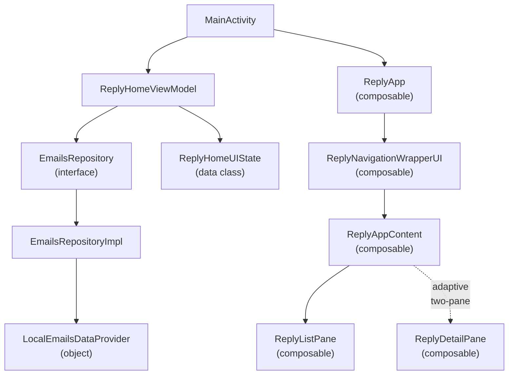
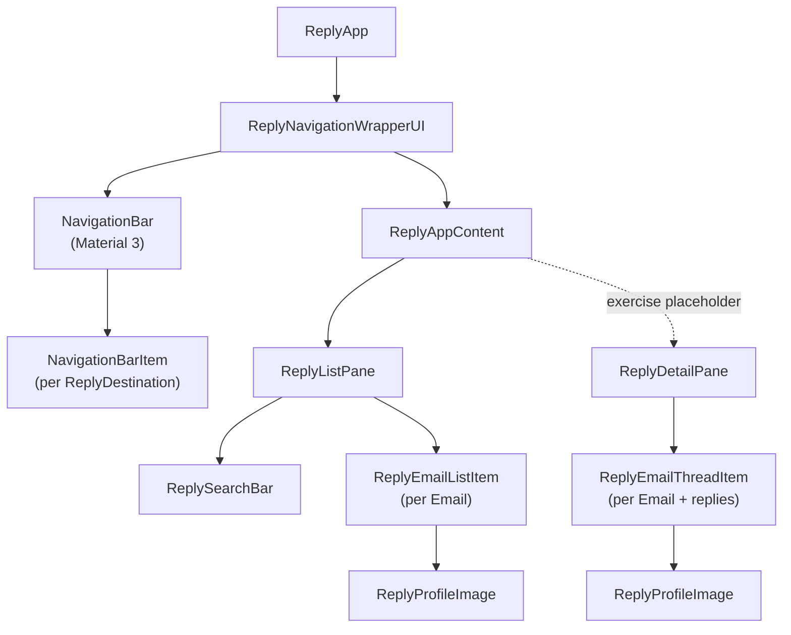
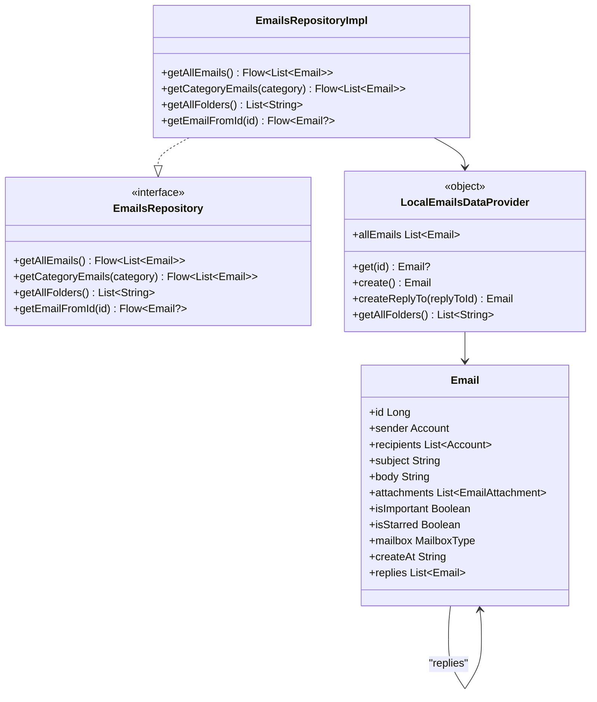

<!-- source: DeepWiki mcp.deepwiki.com · repo android/codelab-android-compose · page 5.11 Adaptive UI Codelab · fetched 2026-10-23 -->

# Adaptive UI Codelab

<details>
<summary>Relevant source files</summary>

The following files were used as context for generating this wiki page:

- [AdaptiveUiCodelab/app/build.gradle.kts](AdaptiveUiCodelab/app/build.gradle.kts)
- [AdaptiveUiCodelab/app/proguard-rules.pro](AdaptiveUiCodelab/app/proguard-rules.pro)
- [AdaptiveUiCodelab/app/src/main/java/com/example/reply/data/Email.kt](AdaptiveUiCodelab/app/src/main/java/com/example/reply/data/Email.kt)
- [AdaptiveUiCodelab/app/src/main/java/com/example/reply/data/EmailsRepositoryImpl.kt](AdaptiveUiCodelab/app/src/main/java/com/example/reply/data/EmailsRepositoryImpl.kt)
- [AdaptiveUiCodelab/app/src/main/java/com/example/reply/data/local/LocalEmailsDataProvider.kt](AdaptiveUiCodelab/app/src/main/java/com/example/reply/data/local/LocalEmailsDataProvider.kt)
- [AdaptiveUiCodelab/app/src/main/java/com/example/reply/ui/MainActivity.kt](AdaptiveUiCodelab/app/src/main/java/com/example/reply/ui/MainActivity.kt)
- [AdaptiveUiCodelab/app/src/main/java/com/example/reply/ui/ReplyApp.kt](AdaptiveUiCodelab/app/src/main/java/com/example/reply/ui/ReplyApp.kt)
- [AdaptiveUiCodelab/app/src/main/java/com/example/reply/ui/ReplyHomeViewModel.kt](AdaptiveUiCodelab/app/src/main/java/com/example/reply/ui/ReplyHomeViewModel.kt)
- [AdaptiveUiCodelab/app/src/main/java/com/example/reply/ui/ReplyListContent.kt](AdaptiveUiCodelab/app/src/main/java/com/example/reply/ui/ReplyListContent.kt)
- [AdaptiveUiCodelab/app/src/main/java/com/example/reply/ui/ReplyNavigation.kt](AdaptiveUiCodelab/app/src/main/java/com/example/reply/ui/ReplyNavigation.kt)
- [AdaptiveUiCodelab/app/src/main/java/com/example/reply/ui/theme/Theme.kt](AdaptiveUiCodelab/app/src/main/java/com/example/reply/ui/theme/Theme.kt)
- [AdaptiveUiCodelab/app/src/main/res/values/strings.xml](AdaptiveUiCodelab/app/src/main/res/values/strings.xml)
- [AdaptiveUiCodelab/build.gradle.kts](AdaptiveUiCodelab/build.gradle.kts)
- [AdaptiveUiCodelab/gradle/libs.versions.toml](AdaptiveUiCodelab/gradle/libs.versions.toml)
- [AdaptiveUiCodelab/settings.gradle.kts](AdaptiveUiCodelab/settings.gradle.kts)
- [PerformanceCodelab/app/build.gradle.kts](PerformanceCodelab/app/build.gradle.kts)
- [PerformanceCodelab/gradle/libs.versions.toml](PerformanceCodelab/gradle/libs.versions.toml)
- [PerformanceCodelab/measure/build.gradle.kts](PerformanceCodelab/measure/build.gradle.kts)

</details>


## Purpose and Scope

This page documents the `AdaptiveUiCodelab` project: its subject app (Reply), composable hierarchy, data layer, ViewModel pattern, and key dependencies used to teach adaptive layout design for phones, tablets, and foldables.

The codelab's primary exercise areas are (a) swapping between `NavigationBar`, `NavigationRail`, and `NavigationDrawer` based on window size, and (b) showing a two-pane list/detail layout on wider screens. Both of these exercise points are marked with `TODO` comments in the starting code.

> **Note:** The ThemingCodelab (see [5.7](#5.7)) also uses an app named "Reply" with the same package `com.example.reply`. They are separate, independent projects. The AdaptiveUiCodelab focuses on adaptive layouts; the ThemingCodelab focuses on Material 3 color schemes and typography.

---

## Project Identity and Build Configuration

| Property | Value |
|---|---|
| Root project name | `Reply` |
| Application ID | `com.example.reply` |
| Module | `:app` |
| Namespace | `com.example.reply` |
| `minSdk` | 23 |
| `compileSdk` | 36 |
| Build DSL | Kotlin DSL (`.gradle.kts`) |
| Material version | Material 3 |

[AdaptiveUiCodelab/settings.gradle.kts:31-32]()  
[AdaptiveUiCodelab/app/build.gradle.kts:22-29]()

### Key Dependencies

| Library alias | Artifact | Purpose |
|---|---|---|
| `androidx.compose.bom` | `androidx.compose:compose-bom:2026.01.01` | Version alignment for all Compose libraries |
| `androidx.material3` | `androidx.compose.material3:material3` | Material 3 UI components |
| `androidx.material.icons.extended` | `androidx.compose.material:material-icons-extended` | Navigation icons |
| `androidx.window` | `androidx.window:window:1.5.1` | Window size class APIs |
| `androidx.lifecycle.viewmodel.compose` | `androidx.lifecycle:lifecycle-viewmodel-compose:2.10.0` | `viewModel()` composable integration |
| `androidx.lifecycle.runtime.compose` | `androidx.lifecycle:lifecycle-runtime-compose:2.10.0` | `collectAsStateWithLifecycle()` |
| `kotlinx.coroutines.android` | `org.jetbrains.kotlinx:kotlinx-coroutines-android:1.10.2` | Coroutine support |

The `androidx.window` library is the codelab-specific dependency not present in most other codelabs. It provides `WindowSizeClass` and related APIs for deciding which navigation component and layout to display.

[AdaptiveUiCodelab/gradle/libs.versions.toml:1-36]()  
[AdaptiveUiCodelab/app/build.gradle.kts:63-86]()

---

## App Architecture Overview

**Diagram: Top-level runtime flow**



Sources: [AdaptiveUiCodelab/app/src/main/java/com/example/reply/ui/MainActivity.kt:32-54](), [AdaptiveUiCodelab/app/src/main/java/com/example/reply/ui/ReplyApp.kt:38-99](), [AdaptiveUiCodelab/app/src/main/java/com/example/reply/ui/ReplyHomeViewModel.kt:29-56]()

---

## Entry Point: `MainActivity`

`MainActivity` extends `ComponentActivity` and:

1. Calls `enableEdgeToEdge()` so content renders under system bars.
2. Disables navigation bar contrast enforcement on Android Q+ (`window.isNavigationBarContrastEnforced = false`).
3. Instantiates `ReplyHomeViewModel` via `viewModels()`.
4. Collects `viewModel.uiState` with `collectAsStateWithLifecycle()`.
5. Passes UI state and the `viewModel::setSelectedEmail` callback into `ReplyApp`.

The file also includes three `@Preview` composables that cover phone (default), tablet (700dp wide), and desktop (1000dp wide) form factors.

[AdaptiveUiCodelab/app/src/main/java/com/example/reply/ui/MainActivity.kt:32-93]()

---

## UI Composable Hierarchy

**Diagram: Composable call tree**



Sources: [AdaptiveUiCodelab/app/src/main/java/com/example/reply/ui/ReplyApp.kt:38-99](), [AdaptiveUiCodelab/app/src/main/java/com/example/reply/ui/ReplyListContent.kt:65-317]()

### `ReplyApp`

[AdaptiveUiCodelab/app/src/main/java/com/example/reply/ui/ReplyApp.kt:38-49]()

Top-level composable. Delegates all layout to `ReplyNavigationWrapperUI` for the navigation chrome, and `ReplyAppContent` for the content area.

### `ReplyNavigationWrapperUI`

[AdaptiveUiCodelab/app/src/main/java/com/example/reply/ui/ReplyApp.kt:51-87]()

Manages a `selectedDestination: ReplyDestination` state variable. Currently renders a `NavigationBar` at the bottom of the screen populated from `ReplyDestination.entries`. Contains the comment `// You will implement adaptive navigation here`, marking it as the primary exercise location for replacing `NavigationBar` with `NavigationRail` or `NavigationDrawer` based on window size.

### `ReplyAppContent`

[AdaptiveUiCodelab/app/src/main/java/com/example/reply/ui/ReplyApp.kt:89-99]()

Currently renders only `ReplyListPane`. Contains the comment `// You will implement an adaptive two-pane layout here`, marking where students add `ReplyDetailPane` alongside the list for wider screens.

### `ReplyListPane`

[AdaptiveUiCodelab/app/src/main/java/com/example/reply/ui/ReplyListContent.kt:65-86]()

A `LazyColumn` that renders `ReplySearchBar` as a header, then one `ReplyEmailListItem` per email. Uses `WindowInsets.safeDrawing` for padding.

Accepts:
- `replyHomeUIState: ReplyHomeUIState` — the list of emails to display
- `onEmailClick: (Email) -> Unit` — click callback forwarded from the ViewModel

### `ReplyDetailPane`

[AdaptiveUiCodelab/app/src/main/java/com/example/reply/ui/ReplyListContent.kt:88-108]()

A `LazyColumn` that renders the selected `Email` as a `ReplyEmailThreadItem`, followed by thread replies. This pane appears alongside `ReplyListPane` on wider screens (two-pane layout) but is the sole view on compact displays after an email is selected.

### `ReplyEmailListItem`

[AdaptiveUiCodelab/app/src/main/java/com/example/reply/ui/ReplyListContent.kt:111-175]()

A `Card` that shows:
- `ReplyProfileImage` (sender avatar)
- Sender first name and `createAt` timestamp
- Star `IconButton`
- Subject and a 2-line body preview (`TextOverflow.Ellipsis`)

### `ReplyEmailThreadItem`

[AdaptiveUiCodelab/app/src/main/java/com/example/reply/ui/ReplyListContent.kt:177-268]()

A `Card` showing the full email body plus Reply / Reply All buttons.

### `ReplySearchBar`

[AdaptiveUiCodelab/app/src/main/java/com/example/reply/ui/ReplyListContent.kt:287-317]()

A static `Row` styled as a search pill: search icon, placeholder text, and the user's avatar.

---

## Navigation Destinations

The `ReplyDestination` enum defines all four navigation entries used to populate `NavigationBar` (and in the completed codelab, `NavigationRail` / `NavigationDrawer`).

[AdaptiveUiCodelab/app/src/main/java/com/example/reply/ui/ReplyNavigation.kt:29-40]()

| Enum entry | Label resource | Icon |
|---|---|---|
| `Inbox` | `tab_inbox` | `Icons.Default.Inbox` |
| `Articles` | `tab_article` | `Icons.Default.Article` |
| `Messages` | `tab_dm` | `Icons.Outlined.Chat` |
| `Groups` | `tab_groups` | `Icons.Outlined.People` |

---

## Data Layer

**Diagram: Data layer class relationships**



Sources: [AdaptiveUiCodelab/app/src/main/java/com/example/reply/data/Email.kt:25-46](), [AdaptiveUiCodelab/app/src/main/java/com/example/reply/data/EmailsRepositoryImpl.kt:23-41](), [AdaptiveUiCodelab/app/src/main/java/com/example/reply/data/local/LocalEmailsDataProvider.kt:28-313]()

### `Email`

[AdaptiveUiCodelab/app/src/main/java/com/example/reply/data/Email.kt:25-46]()

Immutable data class. The `replies: List<Email>` field allows nested email threads. Computed properties include `senderPreview`, `hasBody`, `hasAttachments`, `recipientsPreview`, and `nonUserAccountRecipients`.

### `EmailsRepositoryImpl`

[AdaptiveUiCodelab/app/src/main/java/com/example/reply/data/EmailsRepositoryImpl.kt:23-41]()

Concrete implementation of `EmailsRepository`. All methods wrap `LocalEmailsDataProvider` data in `flow { emit(...) }`. There is no network layer — all data is static and local.

### `LocalEmailsDataProvider`

[AdaptiveUiCodelab/app/src/main/java/com/example/reply/data/local/LocalEmailsDataProvider.kt:28-313]()

Singleton `object` holding 12 hardcoded `Email` entries across mailboxes (`INBOX`, `SENT`, `DRAFTS`, `TRASH`, `SPAM`). Also provides a `replies` list reused across multiple emails.

---

## ViewModel and UI State

[AdaptiveUiCodelab/app/src/main/java/com/example/reply/ui/ReplyHomeViewModel.kt:29-62]()

`ReplyHomeViewModel` holds and exposes all state for the home screen.

```
ReplyHomeViewModel
  ├── emailsRepository: EmailsRepository       (default: EmailsRepositoryImpl)
  ├── _uiState: MutableStateFlow<ReplyHomeUIState>
  ├── uiState: StateFlow<ReplyHomeUIState>      (exposed to UI)
  ├── observeEmails()                           (called in init block)
  └── setSelectedEmail(email: Email)            (TODO stub for exercise)
```

`ReplyHomeUIState` is a simple data class:

| Field | Type | Default |
|---|---|---|
| `emails` | `List<Email>` | `emptyList()` |
| `loading` | `Boolean` | `false` |
| `error` | `String?` | `null` |

The `setSelectedEmail` function body is left empty with a `// You will implement email selection here.` comment. Students are expected to add a `selectedEmail` field to `ReplyHomeUIState` and update it here to drive `ReplyDetailPane`.

---

## Theming

`ReplyTheme` in [AdaptiveUiCodelab/app/src/main/java/com/example/reply/ui/theme/Theme.kt:88-108]() wraps `MaterialTheme` (Material 3). It applies:

| Condition | Color scheme used |
|---|---|
| Android 12+ (`>= Build.VERSION_CODES.S`) and `dynamicColor = true` | `dynamicDarkColorScheme` / `dynamicLightColorScheme` |
| `darkTheme = true` | `replyDarkColorScheme` (custom static) |
| Otherwise | `replyLightColorScheme` (custom static) |

Both `replyDarkColorScheme` and `replyLightColorScheme` are private `val`s defined in the same file, with fully specified Material 3 color roles (primary, secondary, tertiary, error, surface, background, outline, and their variants).

The `replyTypography` value is defined in a separate `Typography.kt` file (not shown) and is passed as the `typography` parameter to `MaterialTheme`.

---

## Codelab Exercise Summary

The starting code provides a functional single-pane email app. The exercises require students to make the layout adaptive:

| Exercise area | File | Marker comment |
|---|---|---|
| Adaptive navigation (bar → rail → drawer) | `ReplyApp.kt` | `// You will implement adaptive navigation here.` |
| Two-pane list + detail | `ReplyApp.kt` | `// You will implement an adaptive two-pane layout here.` |
| Email selection state | `ReplyHomeViewModel.kt` | `// You will implement email selection here.` |

All three changes require reading from `WindowSizeClass` (provided by `androidx.window:window:1.5.1`) to decide which layout variant to show. The three `@Preview` composables in `MainActivity.kt` — default phone, 700dp tablet, 1000dp desktop — are provided so students can verify all breakpoints without a physical device.

Sources: [AdaptiveUiCodelab/app/src/main/java/com/example/reply/ui/ReplyApp.kt:58-99](), [AdaptiveUiCodelab/app/src/main/java/com/example/reply/ui/ReplyHomeViewModel.kt:53-55](), [AdaptiveUiCodelab/app/src/main/java/com/example/reply/ui/MainActivity.kt:56-93](), [AdaptiveUiCodelab/gradle/libs.versions.toml:12]()

---

