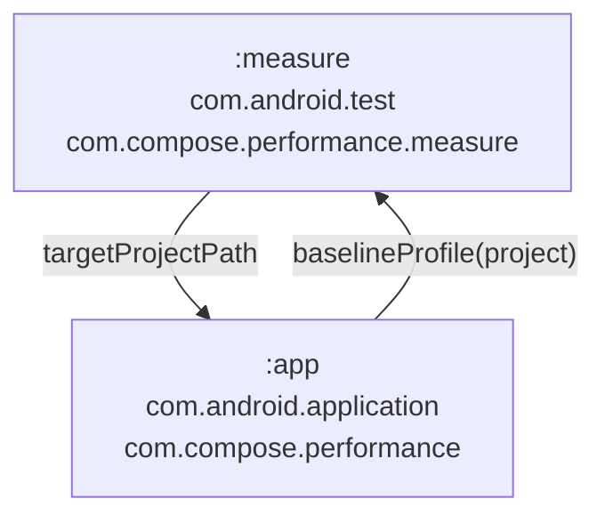
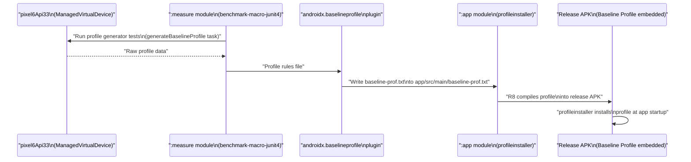
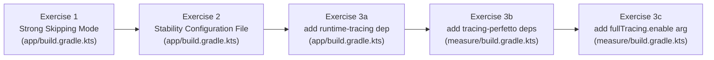

<!-- source: DeepWiki mcp.deepwiki.com · repo android/codelab-android-compose · page 5.12 Performance Codelab · fetched 2026-10-23 -->

# Performance Codelab

<details>
<summary>Relevant source files</summary>

The following files were used as context for generating this wiki page:

- [AdaptiveUiCodelab/app/build.gradle.kts](AdaptiveUiCodelab/app/build.gradle.kts)
- [AdaptiveUiCodelab/app/proguard-rules.pro](AdaptiveUiCodelab/app/proguard-rules.pro)
- [AdaptiveUiCodelab/build.gradle.kts](AdaptiveUiCodelab/build.gradle.kts)
- [AdaptiveUiCodelab/gradle/libs.versions.toml](AdaptiveUiCodelab/gradle/libs.versions.toml)
- [AdaptiveUiCodelab/settings.gradle.kts](AdaptiveUiCodelab/settings.gradle.kts)
- [PerformanceCodelab/app/build.gradle.kts](PerformanceCodelab/app/build.gradle.kts)
- [PerformanceCodelab/gradle/libs.versions.toml](PerformanceCodelab/gradle/libs.versions.toml)
- [PerformanceCodelab/measure/build.gradle.kts](PerformanceCodelab/measure/build.gradle.kts)

</details>


## Purpose and Scope

This page documents the **PerformanceCodelab**, located at `PerformanceCodelab/` in the repository. It covers the two-module project structure, the Baseline Profile generation pipeline, the benchmarking harness configuration using Managed Virtual Devices, and the three Compose-specific optimization exercises (Strong Skipping Mode, Stability Configuration, and Composition Tracing) that learners are expected to complete.

This codelab's subject app (`com.compose.performance`) is distinct from the Reply email app used in the Adaptive UI Codelab. For documentation on the Reply app and its adaptive layout system, see [Adaptive UI Codelab](#5.11).

---

## Module Structure

PerformanceCodelab is the only codelab in this repository that uses a **two-module** project layout. The modules have clearly separated roles:

| Module | Gradle Namespace | Android Plugin | Role |
|--------|-----------------|----------------|------|
| `:app` | `com.compose.performance` | `com.android.application` | Subject app under test |
| `:measure` | `com.compose.performance.measure` | `com.android.test` | Benchmarking and profile generation harness |

The `:measure` module references `:app` as its target via `targetProjectPath = ":app"` in [PerformanceCodelab/measure/build.gradle.kts:55]().

The `:app` module declares `:measure` as a provider of its Baseline Profile artifact via `baselineProfile(project(":measure"))` in [PerformanceCodelab/app/build.gradle.kts:98]().

**Module Dependency Diagram**



Sources: [PerformanceCodelab/app/build.gradle.kts:1-108](), [PerformanceCodelab/measure/build.gradle.kts:1-81]()

---

## Build Configuration

### `:app` Module

[PerformanceCodelab/app/build.gradle.kts]() applies three plugins:

- `com.android.application`
- `androidx.baselineprofile` — integrates Baseline Profile generation into the app build
- `org.jetbrains.kotlin.plugin.compose` (aliased as `compose`) — the Compose compiler plugin

Key build settings in the `release` build type [PerformanceCodelab/app/build.gradle.kts:39-47]():

| Setting | Value | Effect |
|---------|-------|--------|
| `isMinifyEnabled` | `true` | R8 code shrinking enabled for release |
| `isProfileable` | `true` | Allows profiling of release builds |
| `isShrinkResources` | `true` | Resource shrinking enabled |

Core library desugaring is enabled (`isCoreLibraryDesugaringEnabled = true`) to support `kotlinx-datetime` on older API levels [PerformanceCodelab/app/build.gradle.kts:52]().

The `composeCompiler` block [PerformanceCodelab/app/build.gradle.kts:67-74]() contains the exercise entry points:

```
composeCompiler {
    enableStrongSkippingMode = false   // TODO: enable
    // TODO: add stability configuration file
}
```

### `:measure` Module

[PerformanceCodelab/measure/build.gradle.kts]() applies two plugins:

- `com.android.test`
- `androidx.baselineprofile`

The module configures a **Managed Virtual Device** named `pixel6Api33` [PerformanceCodelab/measure/build.gradle.kts:57-63]():

| Property | Value |
|----------|-------|
| `device` | `"Pixel 6"` |
| `apiLevel` | `33` |
| `systemImageSource` | `"aosp"` |

The `baselineProfile` block [PerformanceCodelab/measure/build.gradle.kts:68-71]() instructs the plugin to use that managed device instead of a connected device:

```
baselineProfile {
    managedDevices += "pixel6Api33"
    useConnectedDevices = false
}
```

A suppression argument for emulator-based runs is set in `testInstrumentationRunnerArguments`:

```
testInstrumentationRunnerArguments["androidx.benchmark.suppressErrors"] = "EMULATOR"
```

[PerformanceCodelab/measure/build.gradle.kts:46]()

Sources: [PerformanceCodelab/app/build.gradle.kts:1-108](), [PerformanceCodelab/measure/build.gradle.kts:1-81]()

---

## Dependency Overview

### `:app` Dependencies

**Runtime dependencies** relevant to performance and profiling:

| Alias in `libs` | Library | Version | Purpose |
|-----------------|---------|---------|---------|
| `profileinstaller` | `androidx.profileinstaller:profileinstaller` | 1.4.1 | Installs Baseline Profiles at app startup |
| `androidx.tracing.ktx` | `androidx.tracing:tracing-ktx` | 1.3.0 | Tracing API for custom trace sections |
| `compose.bom` | `androidx.compose:compose-bom` | 2026.01.01 | BOM version management |
| `material3` | `androidx.compose.material3:material3` | 1.4.0 | UI components |
| `coil.compose` | `io.coil-kt:coil-compose` | 2.7.0 | Image loading |
| `androidx.media3.exoplayer` | `androidx.media3:media3-exoplayer` | 1.9.1 | Video playback |

**TODO dependency** (codelab exercise):

| Alias | Library | Version | Purpose |
|-------|---------|---------|---------|
| `androidx.runtime-tracing` | `androidx.compose.runtime:runtime-tracing` | 1.10.2 | Composition Tracing support |

[PerformanceCodelab/app/build.gradle.kts:76-108]()

### `:measure` Dependencies

| Alias in `libs` | Library | Purpose |
|-----------------|---------|---------|
| `androidx.test.ext.junit` | `androidx.test.ext:junit` | Test runner |
| `espresso.core` | `androidx.test.espresso:espresso-core` | UI interaction |
| `uiautomator` | `androidx.test.uiautomator:uiautomator` | UI automation for benchmarks |
| `benchmark.macro.junit4` | `androidx.benchmark:benchmark-macro-junit4` | Macrobenchmark framework |

**TODO dependencies** (codelab exercise):

| Alias | Library | Version | Purpose |
|-------|---------|---------|---------|
| `androidx.tracing.perfetto` | `androidx.tracing:tracing-perfetto` | 1.0.1 | Perfetto tracing integration |
| `androidx.tracing.perfetto.binary` | `androidx.tracing:tracing-perfetto-binary` | 1.0.1 | Native binary for Perfetto |

[PerformanceCodelab/measure/build.gradle.kts:73-80]()

Sources: [PerformanceCodelab/gradle/libs.versions.toml:1-68](), [PerformanceCodelab/app/build.gradle.kts:76-108](), [PerformanceCodelab/measure/build.gradle.kts:73-80]()

---

## Baseline Profile Generation Pipeline

The Baseline Profile pipeline connects the `:measure` module (which generates profiles) to the `:app` module (which consumes them).

**Baseline Profile Pipeline**



Sources: [PerformanceCodelab/measure/build.gradle.kts:55-71](), [PerformanceCodelab/app/build.gradle.kts:16-20](), [PerformanceCodelab/app/build.gradle.kts:89](), [PerformanceCodelab/app/build.gradle.kts:98]()

---

## Codelab Exercise Steps (TODO Tasks)

The codelab is structured around four `TODO Codelab task` annotations in the build files. Each represents a distinct optimization technique.

**Exercise Overview**



### Exercise 1: Strong Skipping Mode

**Location:** [PerformanceCodelab/app/build.gradle.kts:67-74]()

**What it does:** When `enableStrongSkippingMode` is set to `true` in the `composeCompiler` block, the Compose compiler allows skipping recomposition of composables with unstable parameters by using instance equality (`===`) comparison instead of structural equality. This reduces unnecessary recompositions.

**Current state:** `enableStrongSkippingMode = false` — learner must change to `true`.

### Exercise 2: Stability Configuration File

**Location:** [PerformanceCodelab/app/build.gradle.kts:73]()

**What it does:** A stability configuration file allows declaring external classes (e.g., from third-party libraries) as stable to the Compose compiler, preventing unnecessary recompositions when those classes are used as composable parameters.

**Current state:** The configuration property is commented out as a `TODO` — learner must add the `stabilityConfigurationFile` property pointing to a configuration file.

### Exercise 3: Composition Tracing

Composition Tracing requires changes in **both** modules.

**Step 3a — `:app` dependency** [PerformanceCodelab/app/build.gradle.kts:92]():
Add `implementation(libs.androidx.runtime.tracing)` to enable the `runtime-tracing` library, which instruments composable function calls with trace events.

**Step 3b — `:measure` dependencies** [PerformanceCodelab/measure/build.gradle.kts:79]():
Add `implementation(libs.androidx.tracing.perfetto)` and `implementation(libs.androidx.tracing.perfetto.binary)` to the `:measure` module.

**Step 3c — `:measure` runner argument** [PerformanceCodelab/measure/build.gradle.kts:52]():
Add `testInstrumentationRunnerArguments["androidx.benchmark.fullTracing.enable"] = "true"` to the `defaultConfig` block to activate full Composition Tracing output in benchmark runs.

| Exercise | File | Symbol | Action |
|----------|------|--------|--------|
| 1 | `app/build.gradle.kts` | `enableStrongSkippingMode` | Change `false` → `true` |
| 2 | `app/build.gradle.kts` | `stabilityConfigurationFile` | Add property referencing config file |
| 3a | `app/build.gradle.kts` | `androidx.runtime-tracing` | Add `implementation` dependency |
| 3b | `measure/build.gradle.kts` | `androidx.tracing.perfetto(-binary)` | Add `implementation` dependencies |
| 3c | `measure/build.gradle.kts` | `androidx.benchmark.fullTracing.enable` | Add runner argument |

Sources: [PerformanceCodelab/app/build.gradle.kts:67-74](), [PerformanceCodelab/app/build.gradle.kts:92](), [PerformanceCodelab/measure/build.gradle.kts:46-52](), [PerformanceCodelab/measure/build.gradle.kts:79]()

---

## Version Catalog

The codelab uses a `libs.versions.toml` version catalog at [PerformanceCodelab/gradle/libs.versions.toml](). Versions specific to the performance and profiling stack:

| Version Key | Value | Used By |
|-------------|-------|---------|
| `benchmark` | `1.4.1` | `benchmark-macro-junit4` |
| `androidx-baselineprofile` | `1.4.1` | `androidx.baselineprofile` plugin |
| `profileinstaller` | `1.4.1` | `profileinstaller` library |
| `runtime-tracing` | `1.10.2` | `runtime-tracing` library |
| `tracing-ktx` | `1.3.0` | `tracing-ktx` library |
| `tracing-perfetto` | `1.0.1` | `tracing-perfetto` and `tracing-perfetto-binary` |
| `compose-bom` | `2026.01.01` | All Compose UI libraries |
| `material3` | `1.4.0` | Material 3 components (pinned outside BOM) |

Sources: [PerformanceCodelab/gradle/libs.versions.toml:1-68]()

---

## Relationship to Other Codelabs

The PerformanceCodelab is unique in this repository for several reasons:

- It is the **only codelab** with a dedicated `:measure` test module acting as a benchmarking harness.
- It is one of the few codelabs enabling `isMinifyEnabled = true` and `isShrinkResources = true` in the release build type (most other codelabs leave these disabled).
- It is the **only codelab** using `isProfileable = true` for profiling release builds.
- It uses `com.android.test` plugin (in `:measure`) instead of `com.android.application` or `com.android.library`, which is unique to this codelab.
- Unlike most codelabs that target a single app feature, this codelab focuses on instrumentation tooling that spans the entire app.

For the Adaptive UI Codelab, which shares the Reply email app but focuses on window size class adaptation rather than performance, see [Adaptive UI Codelab](#5.11).