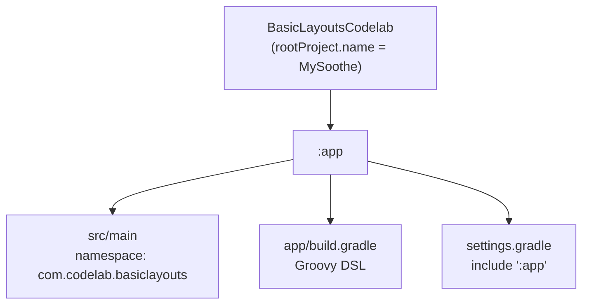
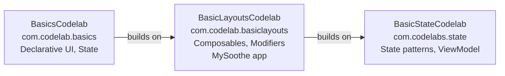

<!-- source: DeepWiki mcp.deepwiki.com · repo android/codelab-android-compose · page 5.2 Basic Layouts Codelab · fetched 2026-10-23 -->

# Basic Layouts Codelab

<details>
<summary>Relevant source files</summary>

The following files were used as context for generating this wiki page:

- [AccessibilityCodelab/app/build.gradle](AccessibilityCodelab/app/build.gradle)
- [AdvancedStateAndSideEffectsCodelab/app/build.gradle](AdvancedStateAndSideEffectsCodelab/app/build.gradle)
- [AnimationCodelab/finished/build.gradle](AnimationCodelab/finished/build.gradle)
- [AnimationCodelab/start/build.gradle](AnimationCodelab/start/build.gradle)
- [BasicLayoutsCodelab/app/build.gradle](BasicLayoutsCodelab/app/build.gradle)
- [BasicLayoutsCodelab/settings.gradle](BasicLayoutsCodelab/settings.gradle)
- [BasicStateCodelab/settings.gradle](BasicStateCodelab/settings.gradle)
- [MigrationCodelab/app/build.gradle](MigrationCodelab/app/build.gradle)
- [NavigationCodelab/app/build.gradle](NavigationCodelab/app/build.gradle)
- [TestingCodelab/app/build.gradle](TestingCodelab/app/build.gradle)
- [ThemingCodelab/app/build.gradle](ThemingCodelab/app/build.gradle)
- [ThemingCodelabM2/app/build.gradle](ThemingCodelabM2/app/build.gradle)

</details>


## Purpose and Scope

This page documents the **BasicLayoutsCodelab**, which teaches how to build UI layouts in Jetpack Compose using composable functions and `Modifier` chains. The subject application is **MySoothe**, a wellness/fitness UI demo.

This codelab sits between the fundamentals introduced in the Basics Codelab (see [5.1](#5.1)) and the state management patterns covered in the Basic State Codelab (see [5.3](#5.3)). It is not concerned with state management, navigation, or animation — only with layout structure and modifier application.

---

## Project Identity

The codelab is its own self-contained Android project under the `BasicLayoutsCodelab/` directory.

| Property | Value |
|---|---|
| `rootProject.name` | `MySoothe` |
| Android namespace | `com.codelab.basiclayouts` |
| `applicationId` | `com.codelab.basiclayouts` |
| `compileSdk` | 36 |
| `minSdk` | 23 |
| `targetSdk` | 33 |
| Build file format | Groovy DSL (`build.gradle`) |

The project name `MySoothe` (set in `settings.gradle`) distinguishes this from the package namespace `com.codelab.basiclayouts`.

Sources: [BasicLayoutsCodelab/settings.gradle:17-18](), [BasicLayoutsCodelab/app/build.gradle:22-36]()

---

## Module Structure

The project uses the standard single-module layout shared across most codelabs in this repository.

**Module structure diagram:**



Sources: [BasicLayoutsCodelab/settings.gradle:17-18](), [BasicLayoutsCodelab/app/build.gradle:1-78]()

---

## Build Configuration

### Plugins

[BasicLayoutsCodelab/app/build.gradle:17-20]()

The app module applies two plugins:

| Plugin ID | Purpose |
|---|---|
| `com.android.application` | Standard Android application plugin |
| `org.jetbrains.kotlin.plugin.compose` | Enables the Compose compiler plugin |

There are no additional plugins (no Hilt, no KSP, no Navigation safe-args, no kapt). This keeps the build configuration among the simplest in the repository.

### Build Features

[BasicLayoutsCodelab/app/build.gradle:49-56]()

```
buildFeatures {
    compose true
}
```

Only `compose` is enabled. `dataBinding` is not present (unlike `MigrationCodelab`).

### Packaging

[BasicLayoutsCodelab/app/build.gradle:52-56]()

Standard license exclusions are applied:

```
packagingOptions {
    resources {
        excludes += '/META-INF/{AL2.0,LGPL2.1}'
    }
}
```

Sources: [BasicLayoutsCodelab/app/build.gradle:17-57]()

---

## Dependency Graph

**Dependency diagram (mapped to declared artifact IDs):**

```mermaid
graph TD
    BOM["compose-bom:2026.01.01"]

    BOM --> UI["compose.ui:ui"]
    BOM --> M3["compose.material3:material3"]
    BOM --> ICONS["compose.material:material-icons-extended"]
    BOM --> PREVIEW["compose.ui:ui-tooling-preview"]
    BOM --> UITEST["compose.ui:ui-test-junit4"]

    EXPLICIT["Explicit versioned deps"]
    EXPLICIT --> WINSIZE["material3-window-size-class:1.4.0"]
    EXPLICIT --> COREKTX["core-ktx:1.17.0"]
    EXPLICIT --> LIFECYCLE["lifecycle-runtime-ktx:2.10.0"]
    EXPLICIT --> ACTIVITY["activity-compose:1.12.3"]
    EXPLICIT --> MATERIAL["material:1.13.0"]

    DEBUG["debugImplementation"]
    DEBUG --> TOOLING["compose.ui:ui-tooling"]

    TEST["testImplementation"]
    TEST --> JUNIT["junit:4.13.2"]

    ANDROIDTEST["androidTestImplementation"]
    ANDROIDTEST --> EXTJUNIT["test.ext:junit:1.3.0"]
    ANDROIDTEST --> ESPRESSO["espresso-core:3.7.0"]
    ANDROIDTEST --> UITEST
```



Sources: [BasicLayoutsCodelab/app/build.gradle:59-78]()

### Notable Dependency Choices

| Dependency | Notes |
|---|---|
| `androidx.compose.material3:material3` | Material 3 (not Material 2) |
| `androidx.compose.material3:material3-window-size-class:1.4.0` | Explicit version — not covered by BOM at declaration time |
| `androidx.compose.material:material-icons-extended` | Provides the extended icon set used in MySoothe UI |
| `com.google.android.material:material:1.13.0` | View-based material library; present for `MaterialTheme` interop in XML resources |
| `androidx.lifecycle:lifecycle-runtime-ktx` | Runtime coroutine lifecycle scoping |
| `androidx.activity:activity-compose` | `ComponentActivity.setContent {}` integration |

There is no ViewModel dependency, no Navigation, and no Room — consistent with the codelab's exclusive focus on layout structure.

Sources: [BasicLayoutsCodelab/app/build.gradle:59-78]()

---

## Relationship to Other Codelabs

**Codelab comparison diagram:**



| Feature | BasicsCodelab | BasicLayoutsCodelab | BasicStateCodelab |
|---|---|---|---|
| Subject app | Generic greeting | MySoothe | Wellness tracker |
| Material version | M3 | M3 | M3 |
| ViewModel | No | No | Yes |
| Navigation | No | No | No |
| `lifecycle-viewmodel-compose` | No | No | Yes |
| Window size class | No | Yes | No |
| Build file DSL | Kotlin (`.kts`) | Groovy (`.gradle`) | Groovy (`.gradle`) |

Sources: [BasicLayoutsCodelab/app/build.gradle:1-78](), [BasicLayoutsCodelab/settings.gradle:17-18]()

---

## CI Integration

The BasicLayoutsCodelab participates in the standard **build-only** CI workflow (no instrumentation tests). The workflow runs `./gradlew assembleDebug lintDebug` and uploads build outputs and lint reports as artifacts. It is triggered on the `main` branch only.

For the full CI pipeline description, see [4](#4).

---

