<!-- source: DeepWiki mcp.deepwiki.com · repo android/codelab-android-compose · page 5.3 Basic State Codelab · fetched 2026-10-23 -->

# Basic State Codelab

<details>
<summary>Relevant source files</summary>

The following files were used as context for generating this wiki page:

- [BasicLayoutsCodelab/settings.gradle](BasicLayoutsCodelab/settings.gradle)
- [BasicStateCodelab/app/build.gradle.kts](BasicStateCodelab/app/build.gradle.kts)
- [BasicStateCodelab/settings.gradle](BasicStateCodelab/settings.gradle)
- [BasicsCodelab/app/build.gradle.kts](BasicsCodelab/app/build.gradle.kts)

</details>


This page documents the **BasicStateCodelab** project: its purpose, project identity, build configuration, and how it compares to sibling codelabs in the repository. The codelab teaches state management patterns in Jetpack Compose and integrates `ViewModel` for state hoisting.

> For declarative UI fundamentals without ViewModel, see the [Basics Codelab](#5.1). For advanced side-effect and state patterns, see the [Advanced State and Side Effects Codelab](#5.10).

---

## Purpose and Scope

BasicStateCodelab focuses on the progression of state ownership in Compose:

- Internal composable state using `remember` and `mutableStateOf`
- State hoisting from a child composable to a parent
- Delegating state ownership to a `ViewModel` via `lifecycle-viewmodel-compose`

The subject is a simple wellness/task-tracking screen rather than a dedicated named app (unlike the MySoothe app in [BasicLayoutsCodelab](#5.2)).

---

## Project Identity

| Property | Value |
|---|---|
| `rootProject.name` | `BasicStateCodelab` |
| Application ID | `com.codelabs.state` |
| Namespace | `com.codelabs.state` |
| `minSdk` | 24 |
| `targetSdk` | 33 |
| `compileSdk` | 36 |
| Settings file syntax | Groovy DSL (`.gradle`, not `.gradle.kts`) |
| App build file syntax | Kotlin DSL (`.gradle.kts`) |

Sources: [BasicStateCodelab/settings.gradle:17-18](), [BasicStateCodelab/app/build.gradle.kts:26-34]()

---

## Build Configuration

### Plugin Declarations

BasicStateCodelab applies plugins using **literal string IDs** rather than version catalog aliases. This is a key structural difference from BasicsCodelab.

**Diagram: Plugin Declaration Style Comparison**

```mermaid
graph LR
    subgraph "BasicsCodelab/app/build.gradle.kts"
        B1["alias(libs.plugins.android.application)"]
        B2["alias(libs.plugins.kotlin.android)"]
        B3["alias(libs.plugins.kotlin.compose)"]
    end
    subgraph "BasicStateCodelab/app/build.gradle.kts"
        S1["id(\"com.android.application\")"]
        S2["id(\"org.jetbrains.kotlin.plugin.compose\")"]
    end
```

Notable: BasicStateCodelab omits the `kotlin.android` plugin declaration entirely (it still applies the Compose compiler plugin via `org.jetbrains.kotlin.plugin.compose`).

Sources: [BasicStateCodelab/app/build.gradle.kts:20-23](), [BasicsCodelab/app/build.gradle.kts:20-24]()

---

### Dependency Declaration Style

BasicsCodelab uses version catalog references (`libs.*`). BasicStateCodelab uses **hardcoded string coordinates** for all dependencies.

**Diagram: Dependency Resolution Approach**

```mermaid
graph TD
    subgraph "BasicStateCodelab — direct coordinates"
        D1["\"androidx.core:core-ktx:1.17.0\""]
        D2["\"androidx.lifecycle:lifecycle-runtime-ktx:2.10.0\""]
        D3["\"androidx.lifecycle:lifecycle-viewmodel-compose:2.10.0\""]
        D4["\"androidx.activity:activity-compose:1.12.3\""]
        D5["platform(\"androidx.compose:compose-bom:2026.01.01\")"]
        D6["\"androidx.compose.material3:material3\""]
        D7["\"androidx.compose.material:material-icons-core\""]
    end
    subgraph "BasicsCodelab — version catalog"
        C1["libs.androidx.core.ktx"]
        C2["libs.androidx.lifecycle.runtime.ktx"]
        C3["libs.androidx.activity.compose"]
        C4["platform(libs.androidx.compose.bom)"]
        C5["libs.androidx.material3"]
        C6["libs.androidx.material.icons.extended"]
    end
```

Sources: [BasicStateCodelab/app/build.gradle.kts:71-89](), [BasicsCodelab/app/build.gradle.kts:72-89]()

---

### Key Dependencies

| Dependency | Coordinate | Present in BasicsCodelab? |
|---|---|---|
| `core-ktx` | `androidx.core:core-ktx:1.17.0` | Yes |
| `lifecycle-runtime-ktx` | `androidx.lifecycle:lifecycle-runtime-ktx:2.10.0` | Yes |
| **`lifecycle-viewmodel-compose`** | `androidx.lifecycle:lifecycle-viewmodel-compose:2.10.0` | **No** |
| `activity-compose` | `androidx.activity:activity-compose:1.12.3` | Yes |
| Compose BOM | `androidx.compose:compose-bom:2026.01.01` | Yes |
| `material3` | `androidx.compose.material3:material3` (BOM-managed) | Yes |
| **`material-icons-core`** | `androidx.compose.material:material-icons-core` (BOM-managed) | No (uses `icons.extended`) |

The critical addition is `lifecycle-viewmodel-compose`, which provides the `viewModel()` composable function used to obtain a `ViewModel` instance scoped to the composition.

Sources: [BasicStateCodelab/app/build.gradle.kts:71-89](), [BasicsCodelab/app/build.gradle.kts:72-89]()

---

## State Management Architecture

Based on the codelab's documented purpose, the state ownership is progressively hoisted across three stages:

**Diagram: State Hoisting Progression**

```mermaid
graph TD
    subgraph "Stage 1 — Internal State"
        C1["WellnessTaskItem composable"]
        C1 -->|"remember / mutableStateOf"| S1["checkedState : Boolean"]
    end
    subgraph "Stage 2 — State Hoisted to Parent"
        C2["WellnessTasksList composable"]
        C2 -->|"owns state, passes down"| C3["WellnessTaskItem composable"]
    end
    subgraph "Stage 3 — State in ViewModel"
        VM["WellnessViewModel"]
        VM -->|"exposes via StateFlow / mutableStateListOf"| C4["WellnessScreen composable"]
        C4 -->|"delegates to"| C5["WellnessTasksList composable"]
        ENTRY["viewModel() — from lifecycle-viewmodel-compose"]
        ENTRY -->|"resolves"| VM
    end
```



Sources: [BasicStateCodelab/app/build.gradle.kts:74]() (lifecycle-viewmodel-compose dependency)

---

## Project Settings Structure

The `settings.gradle` file uses **Groovy DSL** (not Kotlin DSL), which is distinct from several other codelabs in the repository:

```
rootProject.name = "BasicStateCodelab"
include ':app'
```

Only one module (`:app`) is included. There is no `start`/`finished` dual-module pattern (unlike AnimationCodelab or ThemingCodelab). The entire codelab is a single module where learners modify the source incrementally.

Sources: [BasicStateCodelab/settings.gradle:17-18]()

---

## Comparison with BasicsCodelab

**Diagram: BasicsCodelab vs BasicStateCodelab Structure**

```mermaid
graph LR
    subgraph "BasicsCodelab"
        BA_PKG["com.codelab.basics"]
        BA_SETTINGS["settings.gradle.kts (Kotlin DSL)"]
        BA_BUILD["build.gradle.kts — alias(libs.plugins.*)"]
        BA_DEP["No ViewModel dependency"]
        BA_ICONS["material.icons.extended"]
    end
    subgraph "BasicStateCodelab"
        BS_PKG["com.codelabs.state"]
        BS_SETTINGS["settings.gradle (Groovy DSL)"]
        BS_BUILD["build.gradle.kts — id(\"...\")"]
        BS_DEP["lifecycle-viewmodel-compose:2.10.0"]
        BS_ICONS["material-icons-core"]
    end
```

| Attribute | BasicsCodelab | BasicStateCodelab |
|---|---|---|
| Package | `com.codelab.basics` | `com.codelabs.state` |
| Settings syntax | Kotlin DSL | Groovy DSL |
| Plugin declarations | Version catalog aliases | Literal string IDs |
| Dependency declarations | Version catalog refs | Hardcoded coordinates |
| ViewModel dependency | Absent | `lifecycle-viewmodel-compose` |
| Icons artifact | `material.icons.extended` | `material-icons-core` |
| Subject app | Named composable hierarchy | Wellness task tracker |

Sources: [BasicStateCodelab/app/build.gradle.kts:1-89](), [BasicsCodelab/app/build.gradle.kts:1-89](), [BasicStateCodelab/settings.gradle:17-18]()

---

## CI Pipeline

BasicStateCodelab is a **build-only** workflow in CI. It runs `assembleDebug` and `lintDebug` but does not execute instrumentation tests. The workflow is triggered only on the `main` branch.

For the two codelabs that include full instrumentation test pipelines, see [Migration Codelab](#5.8) and [Advanced State and Side Effects Codelab](#5.10).

---

