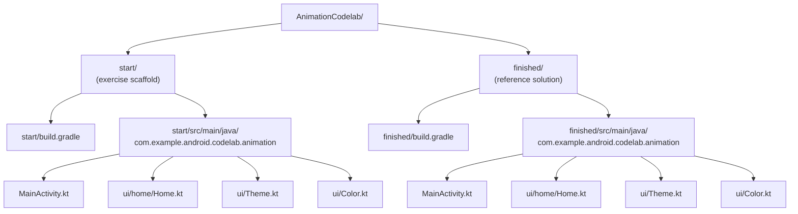
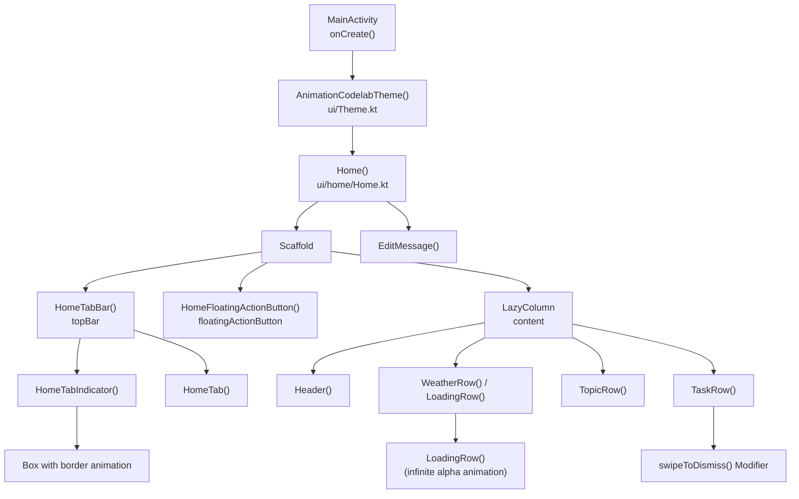
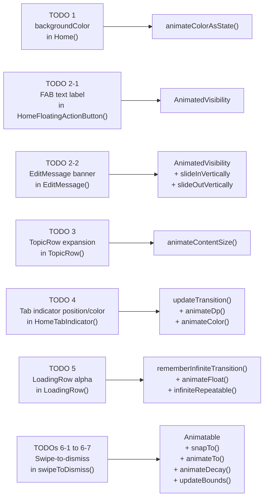
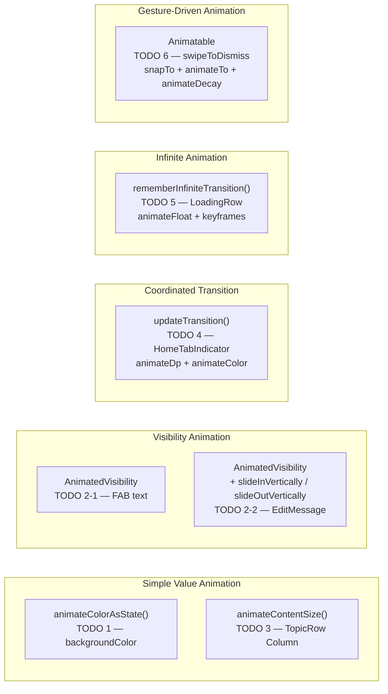

<!-- source: DeepWiki mcp.deepwiki.com · repo android/codelab-android-compose · page 5.4 Animation Codelab · fetched 2026-10-23 -->

# Animation Codelab

<details>
<summary>Relevant source files</summary>

The following files were used as context for generating this wiki page:

- [AccessibilityCodelab/app/build.gradle](AccessibilityCodelab/app/build.gradle)
- [AdvancedStateAndSideEffectsCodelab/app/build.gradle](AdvancedStateAndSideEffectsCodelab/app/build.gradle)
- [AnimationCodelab/finished/build.gradle](AnimationCodelab/finished/build.gradle)
- [AnimationCodelab/finished/src/main/java/com/example/android/codelab/animation/MainActivity.kt](AnimationCodelab/finished/src/main/java/com/example/android/codelab/animation/MainActivity.kt)
- [AnimationCodelab/finished/src/main/java/com/example/android/codelab/animation/ui/Color.kt](AnimationCodelab/finished/src/main/java/com/example/android/codelab/animation/ui/Color.kt)
- [AnimationCodelab/finished/src/main/java/com/example/android/codelab/animation/ui/Theme.kt](AnimationCodelab/finished/src/main/java/com/example/android/codelab/animation/ui/Theme.kt)
- [AnimationCodelab/finished/src/main/java/com/example/android/codelab/animation/ui/home/Home.kt](AnimationCodelab/finished/src/main/java/com/example/android/codelab/animation/ui/home/Home.kt)
- [AnimationCodelab/start/build.gradle](AnimationCodelab/start/build.gradle)
- [AnimationCodelab/start/src/main/java/com/example/android/codelab/animation/MainActivity.kt](AnimationCodelab/start/src/main/java/com/example/android/codelab/animation/MainActivity.kt)
- [AnimationCodelab/start/src/main/java/com/example/android/codelab/animation/ui/Color.kt](AnimationCodelab/start/src/main/java/com/example/android/codelab/animation/ui/Color.kt)
- [AnimationCodelab/start/src/main/java/com/example/android/codelab/animation/ui/Theme.kt](AnimationCodelab/start/src/main/java/com/example/android/codelab/animation/ui/Theme.kt)
- [AnimationCodelab/start/src/main/java/com/example/android/codelab/animation/ui/home/Home.kt](AnimationCodelab/start/src/main/java/com/example/android/codelab/animation/ui/home/Home.kt)
- [AnimationCodelab/start/src/main/res/values/themes.xml](AnimationCodelab/start/src/main/res/values/themes.xml)
- [BasicLayoutsCodelab/app/build.gradle](BasicLayoutsCodelab/app/build.gradle)
- [MigrationCodelab/app/build.gradle](MigrationCodelab/app/build.gradle)
- [NavigationCodelab/app/build.gradle](NavigationCodelab/app/build.gradle)
- [TestingCodelab/app/build.gradle](TestingCodelab/app/build.gradle)
- [ThemingCodelab/app/build.gradle](ThemingCodelab/app/build.gradle)
- [ThemingCodelabM2/app/build.gradle](ThemingCodelabM2/app/build.gradle)

</details>


This page documents the **AnimationCodelab** project located in the `AnimationCodelab/` directory of the monorepo. It covers the dual-module codelab structure, the composable hierarchy inside `Home.kt`, the six Compose animation APIs that learners exercise, and the `TODO`-based exercise scaffold that connects the `start` module to the `finished` module. For information about CI configuration for this codelab, see [Continuous Integration](#4). For the build system patterns common to all codelabs, see [Build System](#3).

---

## Project Structure

The AnimationCodelab is unique in the monorepo in that it contains **two fully independent Android application modules** side by side under the same root project:

| Module | Path | Role |
|--------|------|------|
| `start` | `AnimationCodelab/start/` | Starting scaffold — animations are replaced with `TODO` markers |
| `finished` | `AnimationCodelab/finished/` | Reference solution — all animations fully implemented |

Both modules share the same application ID (`com.example.android.codelab.animation`), the same package structure, and identical `build.gradle` files.

**Module relationship diagram:**



Sources: [AnimationCodelab/start/build.gradle:1-52](), [AnimationCodelab/finished/build.gradle:1-52]()

---

## Build Configuration

Both modules use identical Groovy DSL `build.gradle` files. Key properties:

| Property | Value |
|----------|-------|
| `namespace` | `com.example.android.codelab.animation` |
| `compileSdk` | 36 |
| `minSdkVersion` | 23 |
| `targetSdk` | 34 |
| `buildFeatures.compose` | `true` |
| Compose BOM | `androidx.compose:compose-bom:2026.01.01` |

**Dependencies** (both modules are identical):

| Dependency | Purpose |
|-----------|---------|
| `androidx.activity:activity-compose` | `setContent {}` entry point |
| `androidx.compose.ui:ui` | Core UI |
| `androidx.compose.material3:material3` | Material 3 components (`Scaffold`, `TabRow`, `FloatingActionButton`, etc.) |
| `androidx.compose.material:material-icons-core` | `Icons.Default.*` |
| `androidx.compose.ui:ui-tooling-preview` | `@Preview` support |

Neither module includes any ViewModel, navigation, or test libraries. The scope is intentionally minimal — the entire codelab exercises happen inside a single composable tree.

Sources: [AnimationCodelab/start/build.gradle:1-52](), [AnimationCodelab/finished/build.gradle:1-52]()

---

## App Entry Point and Composable Hierarchy

`MainActivity` is the sole activity in both modules. Its `onCreate` calls `enableEdgeToEdge()`, then sets the Compose content to `AnimationCodelabTheme { Home() }`.

**Composable call graph:**



Sources: [AnimationCodelab/start/src/main/java/com/example/android/codelab/animation/MainActivity.kt:1-37](), [AnimationCodelab/start/src/main/java/com/example/android/codelab/animation/ui/home/Home.kt:144-285]()

---

## Theme and Colors

`AnimationCodelabTheme` wraps `MaterialTheme` with a custom `lightColorScheme` defined in `Theme.kt`. The color tokens used in animations are declared in `Color.kt`:

| Constant | Hex Value | Used In |
|----------|-----------|---------|
| `Seashell` | `#f8edeb` | Background when `TabPage.Home` is selected |
| `GreenLight` | `#EBF1EE` | Background when `TabPage.Work` is selected |
| `PaleDogwood` | `#fcd5ce` | Tab indicator border when on `Home` tab |
| `Green` | `#d8e2dc` | Tab indicator border when on `Work` tab |
| `Amber600` | `#FFB300` | Sun circle in `WeatherRow` |
| `Melon` | `#fec5bb` | `primary` in color scheme |
| `Peach` | `#fec89a` | `secondary` in color scheme |

Sources: [AnimationCodelab/start/src/main/java/com/example/android/codelab/animation/ui/Color.kt:1-28](), [AnimationCodelab/start/src/main/java/com/example/android/codelab/animation/ui/Theme.kt:1-37]()

---

## State Variables in `Home()`

The `Home()` composable owns all application state. There are no ViewModels or repositories — all state is held via `remember` / `mutableStateOf` locally.

| Variable | Type | Purpose |
|----------|------|---------|
| `tabPage` | `TabPage` (`Home` or `Work`) | Currently selected tab; drives background color |
| `weatherLoading` | `Boolean` | Whether the 3-second simulated weather load is in progress |
| `tasks` | `SnapshotStateList<String>` | Task list items, populated from `R.array.tasks` |
| `expandedTopic` | `String?` | The topic currently expanded; `null` if none |
| `editMessageShown` | `Boolean` | Whether the "edit feature unavailable" banner is visible |
| `lazyListState` | `LazyListState` | Scroll state used to determine FAB expansion |

The `TabPage` enum is declared privately in `Home.kt`:

```
private enum class TabPage { Home, Work }
```

Sources: [AnimationCodelab/start/src/main/java/com/example/android/codelab/animation/ui/home/Home.kt:137-195]()

---

## Animation Exercises

The codelab structures its exercises as numbered `TODO` comments in the `start` module. Each `TODO` corresponds to a specific Compose animation API. The `finished` module contains the completed implementations.

**Exercise-to-API mapping:**



Sources: [AnimationCodelab/start/src/main/java/com/example/android/codelab/animation/ui/home/Home.kt:191-675](), [AnimationCodelab/finished/src/main/java/com/example/android/codelab/animation/ui/home/Home.kt:191-760]()

---

### TODO 1 — `animateColorAsState`

**Location:** `Home()`, line computing `backgroundColor`

**Start (`start` module):**

The `backgroundColor` variable is set by a plain `if` expression with no animation:

[AnimationCodelab/start/src/main/java/com/example/android/codelab/animation/ui/home/Home.kt:191-192]()

**Finished (`finished` module):**

`animateColorAsState` wraps the same conditional, producing a smoothly interpolated `Color` delegate:

[AnimationCodelab/finished/src/main/java/com/example/android/codelab/animation/ui/home/Home.kt:191-194]()

The resulting color is passed to `Scaffold`'s `containerColor` and to `HomeTabBar`'s `backgroundColor` parameter, so the whole screen background and tab bar transition together.

---

### TODO 2-1 — `AnimatedVisibility` (FAB label)

**Location:** `HomeFloatingActionButton()`

**Start:** The `Text` label inside the FAB is shown/hidden by a plain `if (extended)` condition — no transition.

[AnimationCodelab/start/src/main/java/com/example/android/codelab/animation/ui/home/Home.kt:309-318]()

**Finished:** The `if` block is replaced with `AnimatedVisibility(visible = extended)`, giving the label a default enter/exit fade+expand transition.

[AnimationCodelab/finished/src/main/java/com/example/android/codelab/animation/ui/home/Home.kt:308-316]()

The `extended` value is derived from `LazyListState.isScrollingUp()`, a `derivedStateOf` extension function defined in `Home.kt` that compares `firstVisibleItemIndex` and `firstVisibleItemScrollOffset` across frames.

---

### TODO 2-2 — `AnimatedVisibility` with custom enter/exit specs (EditMessage banner)

**Location:** `EditMessage(shown: Boolean)`

**Start:** `AnimatedVisibility` is already present but uses default enter/exit specs (no directional slide).

[AnimationCodelab/start/src/main/java/com/example/android/codelab/animation/ui/home/Home.kt:328-341]()

**Finished:** Custom `enter` and `exit` specs are added:

- `enter = slideInVertically(initialOffsetY = { -fullHeight }, animationSpec = tween(150, easing = LinearOutSlowInEasing))`
- `exit = slideOutVertically(targetOffsetY = { -fullHeight }, animationSpec = tween(250, easing = FastOutLinearInEasing))`

This produces a banner that slides down from above the screen on appear and slides back up on disappear.

[AnimationCodelab/finished/src/main/java/com/example/android/codelab/animation/ui/home/Home.kt:323-349]()

---

### TODO 3 — `animateContentSize`

**Location:** `TopicRow()`, on the `Column` modifier

**Start:** The `Column` inside `TopicRow` has a plain `.padding(16.dp)` modifier. When `expanded` changes, the extra body `Text` appears or disappears instantaneously.

[AnimationCodelab/start/src/main/java/com/example/android/codelab/animation/ui/home/Home.kt:398-402]()

**Finished:** `.animateContentSize()` is appended to the `Column`'s modifier chain. This single modifier causes the composable's measured size to animate smoothly when its content changes height.

[AnimationCodelab/finished/src/main/java/com/example/android/codelab/animation/ui/home/Home.kt:404-409]()

---

### TODO 4 — `updateTransition` (tab indicator)

**Location:** `HomeTabIndicator(tabPositions, tabPage)`

**Start:** `indicatorLeft`, `indicatorRight`, and `color` are computed directly from `tabPage` with no animation:

[AnimationCodelab/start/src/main/java/com/example/android/codelab/animation/ui/home/Home.kt:484-500]()

**Finished:** A `Transition<TabPage>` is created with `updateTransition(tabPage, ...)`. Three animated values are derived from it:

| Animated Value | API | Animation Spec |
|---------------|-----|----------------|
| `indicatorLeft` | `transition.animateDp` | `spring(StiffnessVeryLow)` moving right, `spring(StiffnessMedium)` moving left |
| `indicatorRight` | `transition.animateDp` | `spring(StiffnessMedium)` moving right, `spring(StiffnessVeryLow)` moving left |
| `color` | `transition.animateColor` | Default spring |

The asymmetric spring stiffness causes the indicator box to "stretch" toward the new tab before contracting, simulating a rubber-band effect.

[AnimationCodelab/finished/src/main/java/com/example/android/codelab/animation/ui/home/Home.kt:492-545]()

---

### TODO 5 — `rememberInfiniteTransition` (loading shimmer)

**Location:** `LoadingRow()`

**Start:** `alpha` is hardcoded to `1f`:

[AnimationCodelab/start/src/main/java/com/example/android/codelab/animation/ui/home/Home.kt:572-573]()

**Finished:** An `InfiniteTransition` drives `alpha` between `0f` and `1f` repeatedly:

```
rememberInfiniteTransition(label = "infinite loading")
  .animateFloat(
      initialValue = 0f,
      targetValue = 1f,
      animationSpec = infiniteRepeatable(
          animation = keyframes {
              durationMillis = 1000
              0.7f at 500
          },
          repeatMode = RepeatMode.Reverse
      )
  )
```

The `keyframes` spec causes the alpha to reach `0.7` at the halfway point of each 1000 ms cycle, then reverse. The result is a pulsing shimmer effect on the gray placeholder boxes.

[AnimationCodelab/finished/src/main/java/com/example/android/codelab/animation/ui/home/Home.kt:617-656]()

---

### TODO 6 — `Animatable` (swipe-to-dismiss gesture)

**Location:** `Modifier.swipeToDismiss(onDismissed: () -> Unit)` — a custom `Modifier` extension using `composed {}`

This is the most complex exercise, split into seven sub-TODOs (6-1 through 6-7), each adding one part of the gesture-driven animation pipeline.

**Start:** The pointer input reads touch/drag events but uses no `Animatable`. The `.offset { IntOffset(0, 0) }` at the end does not move the element.

[AnimationCodelab/start/src/main/java/com/example/android/codelab/animation/ui/home/Home.kt:633-675]()

**Finished pipeline:**

| Sub-TODO | Code construct | Effect |
|----------|---------------|--------|
| 6-1 | `val offsetX = remember { Animatable(0f) }` | Creates the animatable horizontal offset |
| 6-2 | `offsetX.stop()` on `awaitFirstDown` | Cancels any in-progress animation on new touch |
| 6-3 | `offsetX.snapTo(horizontalDragOffset)` | Immediately moves the element to follow the finger |
| 6-4 | `decay.calculateTargetValue(offsetX.value, velocity)` | Predicts fling settle position |
| 6-5 | `offsetX.updateBounds(-size.width, size.width)` | Clamps animation within screen edges |
| 6-6 | `offsetX.animateTo(0f, velocity)` or `offsetX.animateDecay(velocity, decay)` + `onDismissed()` | Snaps back if fling is too short; removes item if swiped far enough |
| 6-7 | `.offset { IntOffset(offsetX.value.roundToInt(), 0) }` | Applies the animated value to the layout position |

[AnimationCodelab/finished/src/main/java/com/example/android/codelab/animation/ui/home/Home.kt:696-760]()

---

## Summary of All Animation APIs Exercised



Sources: [AnimationCodelab/start/src/main/java/com/example/android/codelab/animation/ui/home/Home.kt:1-695](), [AnimationCodelab/finished/src/main/java/com/example/android/codelab/animation/ui/home/Home.kt:1-760]()

---

## File Inventory

| File | Module | Purpose |
|------|--------|---------|
| `MainActivity.kt` | both | Activity entry point; calls `Home()` inside `AnimationCodelabTheme` |
| `ui/home/Home.kt` | both | All composables and animation exercises |
| `ui/Theme.kt` | both | `AnimationCodelabTheme` wrapping Material3 `lightColorScheme` |
| `ui/Color.kt` | both | Custom `Color` constants used by animations |
| `build.gradle` | both | Identical Groovy DSL module config |
| `src/main/res/values/themes.xml` | start | XML theme stub (`Theme.Animation`, no action bar) |

Sources: [AnimationCodelab/start/src/main/java/com/example/android/codelab/animation/MainActivity.kt:1-37](), [AnimationCodelab/finished/src/main/java/com/example/android/codelab/animation/MainActivity.kt:1-37](), [AnimationCodelab/start/src/main/res/values/themes.xml:1-20]()

---

