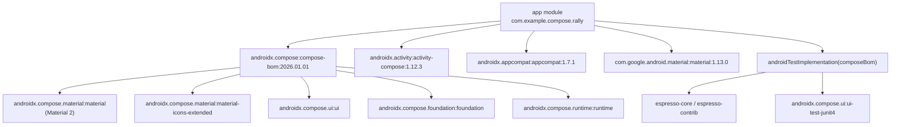
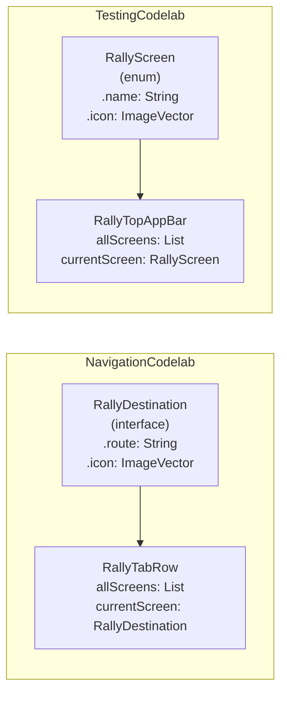
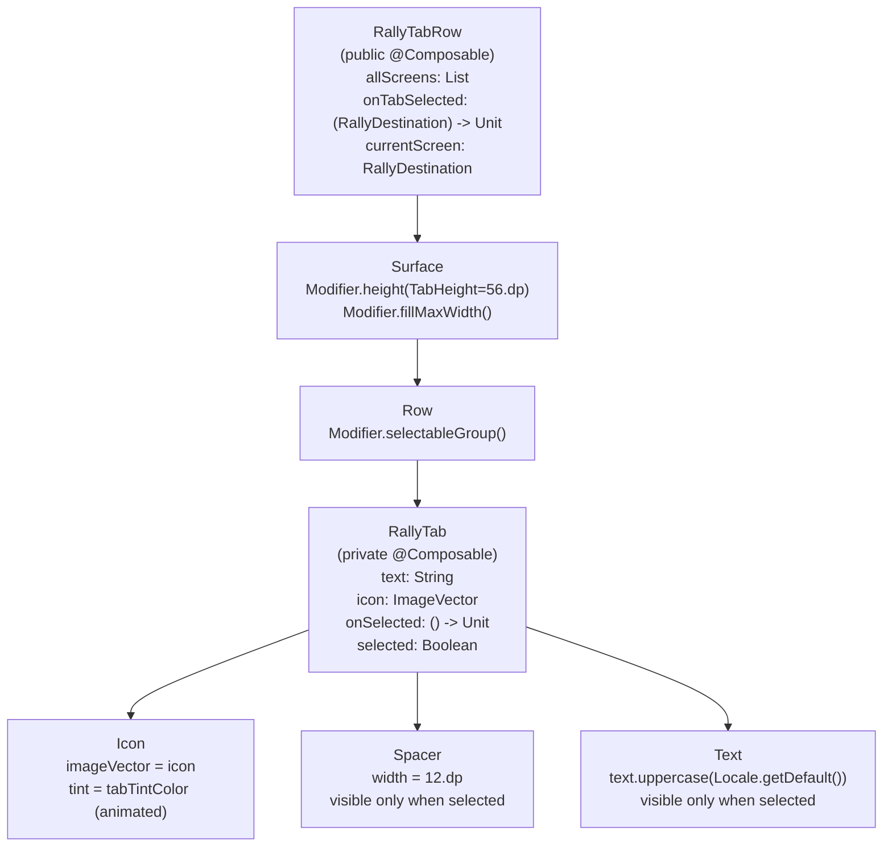
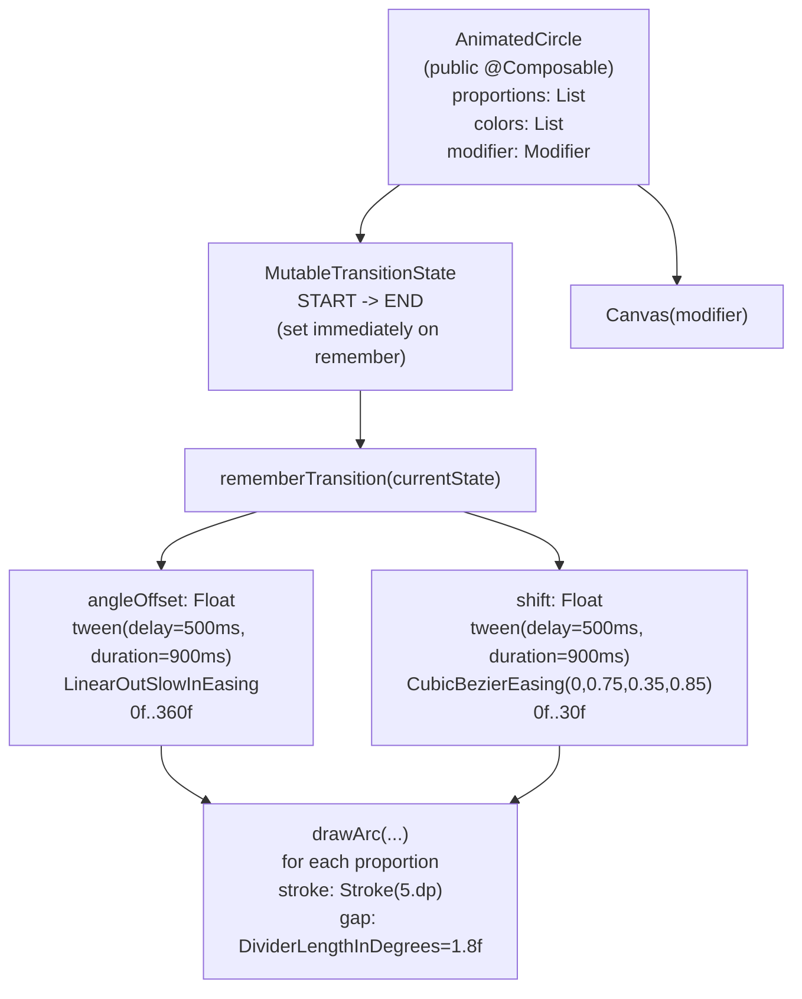

<!-- source: DeepWiki mcp.deepwiki.com · repo android/codelab-android-compose · page 5.5 Navigation Codelab · fetched 2026-10-23 -->

# Navigation Codelab

<details>
<summary>Relevant source files</summary>

The following files were used as context for generating this wiki page:

- [AccessibilityCodelab/app/build.gradle](AccessibilityCodelab/app/build.gradle)
- [AdvancedStateAndSideEffectsCodelab/app/build.gradle](AdvancedStateAndSideEffectsCodelab/app/build.gradle)
- [AnimationCodelab/finished/build.gradle](AnimationCodelab/finished/build.gradle)
- [AnimationCodelab/start/build.gradle](AnimationCodelab/start/build.gradle)
- [BasicLayoutsCodelab/app/build.gradle](BasicLayoutsCodelab/app/build.gradle)
- [MigrationCodelab/app/build.gradle](MigrationCodelab/app/build.gradle)
- [NavigationCodelab/app/build.gradle](NavigationCodelab/app/build.gradle)
- [NavigationCodelab/app/src/main/java/com/example/compose/rally/ui/components/RallyAnimatedCircle.kt](NavigationCodelab/app/src/main/java/com/example/compose/rally/ui/components/RallyAnimatedCircle.kt)
- [NavigationCodelab/app/src/main/java/com/example/compose/rally/ui/components/RallyTabRow.kt](NavigationCodelab/app/src/main/java/com/example/compose/rally/ui/components/RallyTabRow.kt)
- [TestingCodelab/app/build.gradle](TestingCodelab/app/build.gradle)
- [TestingCodelab/app/src/main/java/com/example/compose/rally/ui/components/AnimatedCircle.kt](TestingCodelab/app/src/main/java/com/example/compose/rally/ui/components/AnimatedCircle.kt)
- [TestingCodelab/app/src/main/java/com/example/compose/rally/ui/components/RallyTopAppBar.kt](TestingCodelab/app/src/main/java/com/example/compose/rally/ui/components/RallyTopAppBar.kt)
- [ThemingCodelab/app/build.gradle](ThemingCodelab/app/build.gradle)
- [ThemingCodelabM2/app/build.gradle](ThemingCodelabM2/app/build.gradle)

</details>


## Purpose and Scope

This page documents the **NavigationCodelab**, one of the codelabs in the `codelab-android-compose` monorepo. It covers the Rally finance demo app used as the subject, the `RallyDestination` navigation pattern, the `RallyTabRow` composable that drives tab-based navigation, the `AnimatedCircle` donut chart component, and the build configuration specific to this codelab.

The NavigationCodelab and TestingCodelab share the same `com.example.compose.rally` app identity and overlapping component implementations. For documentation on the testing patterns applied to Rally, see the [Testing Codelab](#5.6). For the Navigation Fragment-based approach used in the MigrationCodelab, see [Migration Codelab](#5.8).

---

## Subject App: Rally

The subject app is **Rally**, a fictional personal finance application. It displays financial summaries across multiple screens (Overview, Accounts, Bills) and uses a tab bar for top-level navigation. The app serves as a practical context for teaching Compose Navigation concepts.

- **Application ID:** `com.example.compose.rally`
- **Namespace:** `com.example.compose.rally`
- **Material library:** Material 2 (`androidx.compose.material:material`)

Sources: [NavigationCodelab/app/build.gradle:22-30]()

---

## Build Configuration

**Diagram: NavigationCodelab Build Dependencies**



Sources: [NavigationCodelab/app/build.gradle:78-104]()

Key points about this build configuration:

| Property | Value |
|---|---|
| `compileSdkVersion` | 36 |
| `minSdkVersion` | 23 |
| `targetSdkVersion` | 33 |
| Compose BOM | `2026.01.01` |
| Material version | Material 2 (`androidx.compose.material`) |
| `buildFeatures.compose` | `true` |
| Navigation library | Not declared as a pre-existing dependency (added during codelab exercises) |

The `composeOptions.kotlinCompilerExtensionVersion` is pinned to `'1.5.15'` in this codelab's build file, which is notable since most other codelabs in the monorepo omit this field and rely solely on the Compose Compiler Gradle plugin.

Sources: [NavigationCodelab/app/build.gradle:67-69]()

---

## Navigation Architecture

### The `RallyDestination` Pattern

The NavigationCodelab uses a `RallyDestination` interface (defined in the root package `com.example.compose.rally`) to represent each navigable screen. Each destination object exposes at minimum two properties used by the tab row:

- **`route`** — A `String` that identifies the destination in the navigation graph and is also displayed as the tab label.
- **`icon`** — An `ImageVector` displayed in the tab.

This is the key architectural difference from the TestingCodelab, which uses an enum called `RallyScreen` with a `name` property as the label. The `RallyDestination` interface-based approach aligns with how `NavController` route strings work in the Compose Navigation library.

**Diagram: RallyDestination vs RallyScreen (NavigationCodelab vs TestingCodelab)**



Sources: [NavigationCodelab/app/src/main/java/com/example/compose/rally/ui/components/RallyTabRow.kt:48-55](), [TestingCodelab/app/src/main/java/com/example/compose/rally/ui/components/RallyTopAppBar.kt:52-56]()

---

### `RallyTabRow` Composable

`RallyTabRow` is the primary navigation UI component. It renders a horizontal row of tabs, one per destination.

**File:** [NavigationCodelab/app/src/main/java/com/example/compose/rally/ui/components/RallyTabRow.kt]()

**Diagram: RallyTabRow Composable Hierarchy**



Sources: [NavigationCodelab/app/src/main/java/com/example/compose/rally/ui/components/RallyTabRow.kt:51-127]()

#### Tab Behavior Details

Each `RallyTab` composable applies the following behaviors:

| Behavior | Implementation |
|---|---|
| Color animation on selection | `animateColorAsState` with `tween(150ms, LinearEasing, 100ms delay)` for fade-in; `tween(100ms)` for fade-out |
| Size animation when selected | `Modifier.animateContentSize()` expands to show text label |
| Selection handling | `Modifier.selectable(role = Role.Tab)` |
| Ripple effect | `ripple(bounded = false)` |
| Accessibility | `clearAndSetSemantics { contentDescription = text }` — overrides default semantics with the route string |
| Inactive tab opacity | 60% (`InactiveTabOpacity = 0.60f`) |

The `contentDescription` on each tab is set to `screen.route`, meaning the route string doubles as the accessible label. This is a semantic design choice specific to the `RallyDestination` pattern.

Sources: [NavigationCodelab/app/src/main/java/com/example/compose/rally/ui/components/RallyTabRow.kt:75-127]()

---

## `AnimatedCircle` Donut Chart Component

`AnimatedCircle` is a `Canvas`-based composable that renders a multi-segment donut (ring) chart with an entrance animation. It is used on summary screens to visualize financial proportions.

**File:** [NavigationCodelab/app/src/main/java/com/example/compose/rally/ui/components/RallyAnimatedCircle.kt]()

**Diagram: AnimatedCircle State Machine and Animation**

```mermaid
stateDiagram-v2
    direction LR
    [*] --> "AnimatedCircleProgress.START": "remember { MutableTransitionState(START) }"
    "AnimatedCircleProgress.START" --> "AnimatedCircleProgress.END": "targetState = END (on remember)"
    "AnimatedCircleProgress.END" --> "AnimatedCircleProgress.END": "stable"
```

**Diagram: AnimatedCircle Composable Structure**



Sources: [NavigationCodelab/app/src/main/java/com/example/compose/rally/ui/components/RallyAnimatedCircle.kt:42-109]()

#### Drawing Logic

The chart is drawn on a `Canvas` using the following algorithm:

1. Compute `innerRadius` from the canvas `minDimension` minus stroke width.
2. Set `startAngle = shift - 90f` (so the chart begins at the top, offset by the animated `shift`).
3. Iterate over each `proportion` in `proportions`:
   - `sweep = proportion * angleOffset` (scales the full 360° by the animation progress).
   - Call `drawArc` with `startAngle + DividerLengthInDegrees / 2` and `sweepAngle = sweep - DividerLengthInDegrees` to leave small gaps between segments.
   - Advance `startAngle += sweep`.

The `DividerLengthInDegrees = 1.8f` constant controls the gap size between segments.

Sources: [NavigationCodelab/app/src/main/java/com/example/compose/rally/ui/components/RallyAnimatedCircle.kt:85-108]()

---

## Component Sharing with TestingCodelab

Both `NavigationCodelab` and `TestingCodelab` use the `com.example.compose.rally` package and share structurally identical components. The key difference is the naming of the navigation abstraction:

| Aspect | NavigationCodelab | TestingCodelab |
|---|---|---|
| Navigation unit | `RallyDestination` (interface) | `RallyScreen` (enum) |
| Tab component | `RallyTabRow` | `RallyTopAppBar` |
| Tab label field | `screen.route` | `screen.name` |
| `AnimatedCircle` file | `RallyAnimatedCircle.kt` | `AnimatedCircle.kt` |
| `AnimatedCircle` implementation | Identical | Identical |

The `AnimatedCircle` implementation in both codelabs is byte-for-byte equivalent. The TestingCodelab uses this component as a subject for semantics testing exercises, while the NavigationCodelab uses it as a display component within screen content.

Sources: [NavigationCodelab/app/src/main/java/com/example/compose/rally/ui/components/RallyAnimatedCircle.kt:42-109](), [TestingCodelab/app/src/main/java/com/example/compose/rally/ui/components/AnimatedCircle.kt:42-109](), [TestingCodelab/app/src/main/java/com/example/compose/rally/ui/components/RallyTopAppBar.kt:52-73]()

---

## CI Pipeline

The NavigationCodelab CI workflow is a **build-only** pipeline (no instrumentation tests). It is one of the three codelabs that trigger on both the `main` branch and the `end` branch (which represents the completed codelab solution).

| Property | Value |
|---|---|
| Workflow type | Build-only (`assembleDebug`, `lintDebug`) |
| Branch triggers | `main` and `end` |
| Instrumentation tests | No |

For full CI pipeline details, see the [Continuous Integration](#4) page.

---

