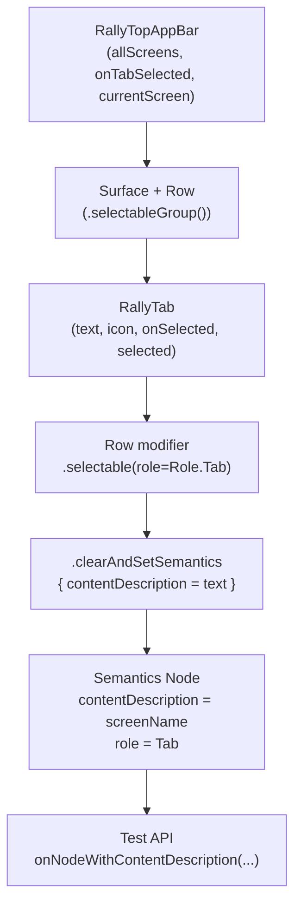
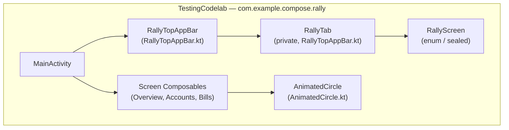
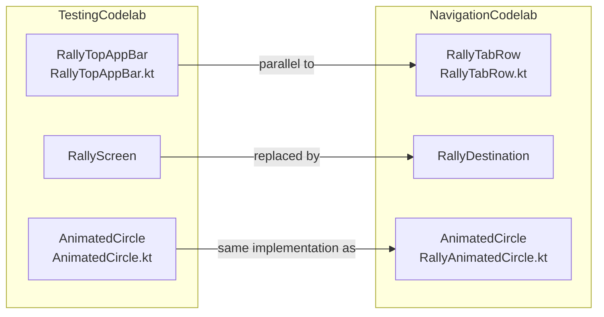

<!-- source: DeepWiki mcp.deepwiki.com · repo android/codelab-android-compose · page 5.6 Testing Codelab · fetched 2026-10-23 -->

# Testing Codelab

<details>
<summary>Relevant source files</summary>

The following files were used as context for generating this wiki page:

- [.github/workflows/AccessibilityCodelab.yaml](.github/workflows/AccessibilityCodelab.yaml)
- [.github/workflows/AdvancedStateAndSideEffectsCodelab.yaml](.github/workflows/AdvancedStateAndSideEffectsCodelab.yaml)
- [.github/workflows/AnimationCodelab.yaml](.github/workflows/AnimationCodelab.yaml)
- [.github/workflows/BasicLayoutsCodelab.yaml](.github/workflows/BasicLayoutsCodelab.yaml)
- [.github/workflows/BasicStateCodelab.yaml](.github/workflows/BasicStateCodelab.yaml)
- [.github/workflows/BasicsCodelab.yaml](.github/workflows/BasicsCodelab.yaml)
- [.github/workflows/MigrationCodelab.yaml](.github/workflows/MigrationCodelab.yaml)
- [.github/workflows/NavigationCodelab.yaml](.github/workflows/NavigationCodelab.yaml)
- [.github/workflows/TestingCodelab.yaml](.github/workflows/TestingCodelab.yaml)
- [.github/workflows/ThemingCodelab.yaml](.github/workflows/ThemingCodelab.yaml)
- [AccessibilityCodelab/app/build.gradle](AccessibilityCodelab/app/build.gradle)
- [AdvancedStateAndSideEffectsCodelab/app/build.gradle](AdvancedStateAndSideEffectsCodelab/app/build.gradle)
- [AnimationCodelab/finished/build.gradle](AnimationCodelab/finished/build.gradle)
- [AnimationCodelab/start/build.gradle](AnimationCodelab/start/build.gradle)
- [BasicLayoutsCodelab/app/build.gradle](BasicLayoutsCodelab/app/build.gradle)
- [MigrationCodelab/app/build.gradle](MigrationCodelab/app/build.gradle)
- [NavigationCodelab/app/build.gradle](NavigationCodelab/app/build.gradle)
- [NavigationCodelab/app/src/main/java/com/example/compose/rally/ui/components/RallyAnimatedCircle.kt](NavigationCodelab/app/src/main/java/com/example/compose/rally/ui/components/RallyAnimatedCircle.kt)
- [NavigationCodelab/app/src/main/java/com/example/compose/rally/ui/components/RallyTabRow.kt](NavigationCodelab/app/src/main/java/com/example/compose/rally/ui/components/RallyTabRow.kt)
- [TestingCodelab/app/build.gradle](TestingCodelab/app/build.gradle)
- [TestingCodelab/app/src/main/java/com/example/compose/rally/ui/components/AnimatedCircle.kt](TestingCodelab/app/src/main/java/com/example/compose/rally/ui/components/AnimatedCircle.kt)
- [TestingCodelab/app/src/main/java/com/example/compose/rally/ui/components/RallyTopAppBar.kt](TestingCodelab/app/src/main/java/com/example/compose/rally/ui/components/RallyTopAppBar.kt)
- [ThemingCodelab/app/build.gradle](ThemingCodelab/app/build.gradle)
- [ThemingCodelabM2/app/build.gradle](ThemingCodelabM2/app/build.gradle)

</details>


This page documents the **TestingCodelab** project located at `TestingCodelab/` in the monorepo. It covers the Rally finance app as the test subject, the key composable components that are tested, how semantics are used to enable test access, and the codelab's build and CI configuration.

For the NavigationCodelab, which uses the same Rally app codebase but focuses on the Navigation library, see [Navigation Codelab](#5.5). For information on how CI workflows are structured across all codelabs, see [Continuous Integration](#4).

---

## Subject Application: Rally Finance App

The Testing Codelab uses the **Rally** personal finance app, identified by the application ID `com.example.compose.rally`. The same application shell is also used in the NavigationCodelab, meaning both codelabs share the same package namespace and the same overall UI structure, but differ in which components they emphasize and what the tests target.

The codelab teaches testing of Compose UI components by exercising the semantics tree rather than inspecting the view hierarchy directly—the fundamental shift in how Compose UI tests work compared to traditional View-based testing.

Sources: [TestingCodelab/app/build.gradle:22-35]()

---

## Project Identity and Build Configuration

### Build Coordinates

| Property | Value |
|---|---|
| `namespace` | `com.example.compose.rally` |
| `applicationId` | `com.example.compose.rally` |
| `minSdkVersion` | 23 |
| `targetSdkVersion` | 33 |
| `compileSdkVersion` | 36 |

### Notable Build Feature Flags

The TestingCodelab disables several AGP features that are not needed for this project:

```
buildConfig false
aidl false
renderScript false
resValues false
shaders false
```

This is documented in [TestingCodelab/app/build.gradle:64-72]().

### Material Version

TestingCodelab uses **Material 2** (`androidx.compose.material`), not Material 3. This places it in the same Material-2 group as NavigationCodelab, AdvancedStateAndSideEffectsCodelab, and ThemingCodelabM2.

Sources: [TestingCodelab/app/build.gradle:81-113]()

### Testing Dependencies

| Dependency | Configuration |
|---|---|
| `androidx.compose.ui:ui-test` | `androidTestImplementation` |
| `androidx.compose.ui:ui-test-junit4` | `androidTestImplementation` |
| `androidx.compose.ui:ui-test-manifest` | `debugImplementation` |
| `androidx.test.espresso:espresso-core:3.7.0` | `androidTestImplementation` |
| `androidx.test.espresso:espresso-contrib:3.7.0` | `androidTestImplementation` |
| `androidx.arch.core:core-testing:2.2.0` | `androidTestImplementation` |

Both `ui-test` and `ui-test-junit4` are present. `ui-test-junit4` provides the `ComposeTestRule` and `createComposeRule()` / `createAndroidComposeRule()` entry points. `ui-test-manifest` is scoped to debug builds and adds the test activity to the manifest.

Sources: [TestingCodelab/app/build.gradle:104-112]()

---

## Key Components Under Test

The codelab focuses on two composable components as the primary subjects for testing exercises.

### `RallyTopAppBar`

**File**: [TestingCodelab/app/src/main/java/com/example/compose/rally/ui/components/RallyTopAppBar.kt]()

`RallyTopAppBar` is the tab-based navigation bar at the top of the Rally app. Its signature is:

```
RallyTopAppBar(
    allScreens: List<RallyScreen>,
    onTabSelected: (RallyScreen) -> Unit,
    currentScreen: RallyScreen
)
```

It renders a `Row` inside a `Surface` with `Modifier.selectableGroup()`. Each tab is rendered by the private `RallyTab` composable.

The critical semantics detail relevant to testing is on [TestingCodelab/app/src/main/java/com/example/compose/rally/ui/components/RallyTopAppBar.kt:111]():

```
.clearAndSetSemantics { contentDescription = text }
```

This line uses `clearAndSetSemantics` to replace the default semantics of the tab `Row` with a single `contentDescription` equal to the tab's screen name. This makes each tab findable by content description in a test, while suppressing the individual semantics of the icon and text children. This pattern is a direct teaching point about how semantics interact with the testing APIs.

`RallyTab` also uses:
- `animateColorAsState` for tab tint color transitions
- `animateContentSize` for width animation when a tab is selected/deselected

[TestingCodelab/app/src/main/java/com/example/compose/rally/ui/components/RallyTopAppBar.kt:75-119]()

### `AnimatedCircle`

**File**: [TestingCodelab/app/src/main/java/com/example/compose/rally/ui/components/AnimatedCircle.kt]()

`AnimatedCircle` is a Canvas-based donut chart composable. Its signature is:

```
AnimatedCircle(
    proportions: List<Float>,
    colors: List<Color>,
    modifier: Modifier = Modifier
)
```

On first composition, it immediately transitions from `AnimatedCircleProgress.START` to `AnimatedCircleProgress.END` via a `MutableTransitionState`. Two animated floats drive the drawing:

| Animated value | Purpose | Duration | Delay |
|---|---|---|---|
| `angleOffset` | Sweep angle of each arc segment (0° → 360°) | 900ms | 500ms |
| `shift` | Rotation offset of the chart (0° → 30°) | 900ms | 500ms |

[TestingCodelab/app/src/main/java/com/example/compose/rally/ui/components/AnimatedCircle.kt:48-83]()

The animation starts automatically on composition. In a test context, controlling or advancing the animation clock is necessary to assert stable drawing state.

---

## Semantics Tree Testing Approach

Compose UI tests interact with the composition through the **semantics tree** — a parallel tree of semantic nodes generated alongside the layout tree. Each composable can contribute to or modify the semantics tree via `Modifier.semantics {}`.

The diagram below shows how semantic information flows from the `RallyTopAppBar` component to test assertions.

**Semantics Flow in `RallyTopAppBar`**



The `clearAndSetSemantics` modifier on [TestingCodelab/app/src/main/java/com/example/compose/rally/ui/components/RallyTopAppBar.kt:111]() removes all child semantics and replaces them with a single `contentDescription`. This means a test can locate the tab via `onNodeWithContentDescription("Overview")` but cannot find the child `Icon` or `Text` individually.

Sources: [TestingCodelab/app/src/main/java/com/example/compose/rally/ui/components/RallyTopAppBar.kt:95-118]()

---

## Component Structure

**TestingCodelab Component Hierarchy**



Sources: [TestingCodelab/app/src/main/java/com/example/compose/rally/ui/components/RallyTopAppBar.kt](), [TestingCodelab/app/src/main/java/com/example/compose/rally/ui/components/AnimatedCircle.kt]()

---

## Relationship to NavigationCodelab

The TestingCodelab and NavigationCodelab share the same Rally app identity (`com.example.compose.rally`) and implement closely parallel components. The table below summarizes the key differences.

| Aspect | TestingCodelab | NavigationCodelab |
|---|---|---|
| Tab bar composable | `RallyTopAppBar` | `RallyTabRow` |
| Tab type parameter | `RallyScreen` | `RallyDestination` |
| Donut chart file | `AnimatedCircle.kt` | `RallyAnimatedCircle.kt` |
| Donut chart composable | `AnimatedCircle` | `AnimatedCircle` (same name) |
| Icon `contentDescription` arg | `null` | screen name string |
| Navigation library | Not present | `navigation-compose` |
| Material version | Material 2 | Material 2 |

The `RallyTopAppBar` in TestingCodelab and `RallyTabRow` in NavigationCodelab are structurally identical — both use `clearAndSetSemantics { contentDescription = text }` and the same animation constants. The key difference is the type of the items they display: the Testing codelab uses a simpler `RallyScreen` enum, while the Navigation codelab uses `RallyDestination` objects tied into the Navigation back stack.

**Component Correspondence: TestingCodelab vs NavigationCodelab**



Sources: [TestingCodelab/app/src/main/java/com/example/compose/rally/ui/components/RallyTopAppBar.kt](), [NavigationCodelab/app/src/main/java/com/example/compose/rally/ui/components/RallyTabRow.kt](), [TestingCodelab/app/src/main/java/com/example/compose/rally/ui/components/AnimatedCircle.kt](), [NavigationCodelab/app/src/main/java/com/example/compose/rally/ui/components/RallyAnimatedCircle.kt]()

---

## CI Pipeline

The TestingCodelab CI workflow is defined in [.github/workflows/TestingCodelab.yaml]().

### Trigger Branches

TestingCodelab is one of three codelabs that trigger CI on **both** `main` and `end` branches (alongside NavigationCodelab and AccessibilityCodelab). All other codelabs trigger only on `main`.

[.github/workflows/TestingCodelab.yaml:7-9]()

### Workflow Steps

The workflow is **build-only** — it does not run instrumentation tests on an emulator. This contrasts with AdvancedStateAndSideEffectsCodelab and MigrationCodelab, which have a separate `test` job with emulator matrix runs.

| Step | Action |
|---|---|
| Checkout | `actions/checkout@v6` |
| Copy CI Gradle properties | `.github/ci-gradle.properties → ~/.gradle/gradle.properties` |
| Set up JDK 17 | `actions/setup-java@v5` (Zulu distribution) |
| Set up Gradle | `gradle/actions/setup-gradle@v5` |
| Build | `./gradlew assembleDebug lintDebug --stacktrace` |
| Upload APKs | `actions/upload-artifact@v6` (build-outputs) |
| Upload reports | `actions/upload-artifact@v6` (build-reports, always) |

Sources: [.github/workflows/TestingCodelab.yaml:1-55]()

---

## Summary

| Property | Value |
|---|---|
| Directory | `TestingCodelab/` |
| Package / App ID | `com.example.compose.rally` |
| Subject app | Rally finance app |
| Primary topic | Semantics tree, composable test isolation |
| Material version | Material 2 |
| Key composables | `RallyTopAppBar`, `AnimatedCircle` |
| Test libraries | `ui-test`, `ui-test-junit4`, Espresso |
| CI branch triggers | `main`, `end` |
| CI test mode | Build-only (no emulator tests) |

---

