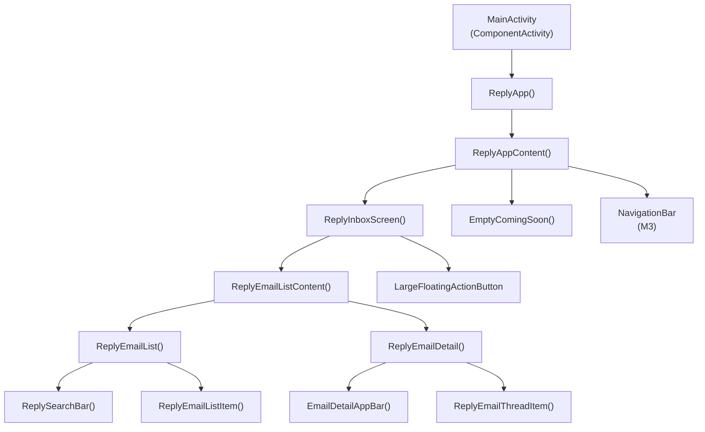
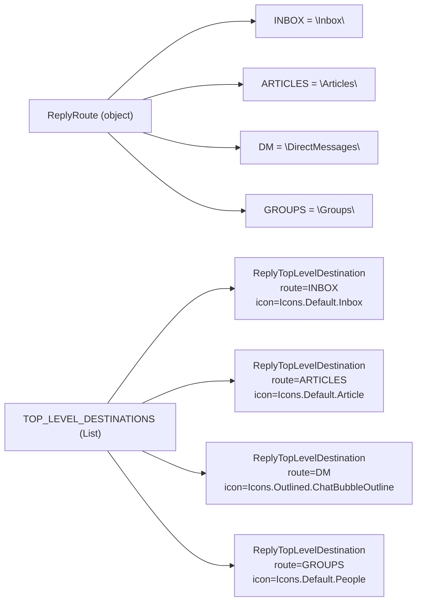
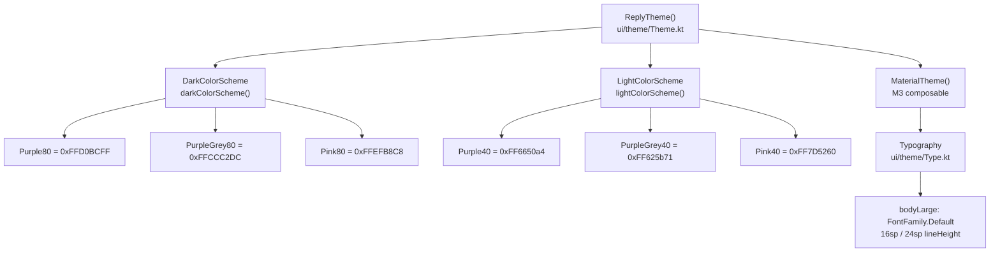
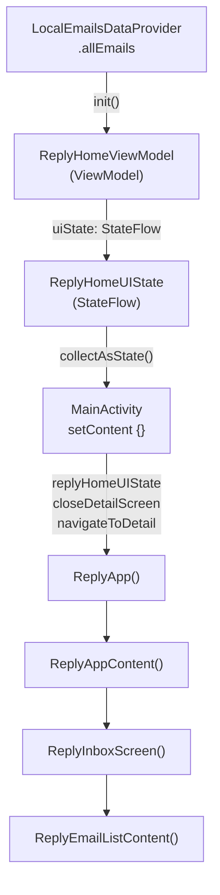

<!-- source: DeepWiki mcp.deepwiki.com · repo android/codelab-android-compose · page 5.7 Theming Codelab · fetched 2026-10-23 -->

# Theming Codelab

<details>
<summary>Relevant source files</summary>

The following files were used as context for generating this wiki page:

- [AccessibilityCodelab/app/build.gradle](AccessibilityCodelab/app/build.gradle)
- [AdvancedStateAndSideEffectsCodelab/app/build.gradle](AdvancedStateAndSideEffectsCodelab/app/build.gradle)
- [AnimationCodelab/finished/build.gradle](AnimationCodelab/finished/build.gradle)
- [AnimationCodelab/start/build.gradle](AnimationCodelab/start/build.gradle)
- [BasicLayoutsCodelab/app/build.gradle](BasicLayoutsCodelab/app/build.gradle)
- [MigrationCodelab/app/build.gradle](MigrationCodelab/app/build.gradle)
- [NavigationCodelab/app/build.gradle](NavigationCodelab/app/build.gradle)
- [TestingCodelab/app/build.gradle](TestingCodelab/app/build.gradle)
- [ThemingCodelab/app/build.gradle](ThemingCodelab/app/build.gradle)
- [ThemingCodelab/app/src/main/java/com/example/reply/ui/MainActivity.kt](ThemingCodelab/app/src/main/java/com/example/reply/ui/MainActivity.kt)
- [ThemingCodelab/app/src/main/java/com/example/reply/ui/ReplyApp.kt](ThemingCodelab/app/src/main/java/com/example/reply/ui/ReplyApp.kt)
- [ThemingCodelab/app/src/main/java/com/example/reply/ui/ReplyHomeViewModel.kt](ThemingCodelab/app/src/main/java/com/example/reply/ui/ReplyHomeViewModel.kt)
- [ThemingCodelab/app/src/main/java/com/example/reply/ui/ReplyListContent.kt](ThemingCodelab/app/src/main/java/com/example/reply/ui/ReplyListContent.kt)
- [ThemingCodelab/app/src/main/java/com/example/reply/ui/components/ReplyAppBars.kt](ThemingCodelab/app/src/main/java/com/example/reply/ui/components/ReplyAppBars.kt)
- [ThemingCodelab/app/src/main/java/com/example/reply/ui/components/ReplyEmailListItem.kt](ThemingCodelab/app/src/main/java/com/example/reply/ui/components/ReplyEmailListItem.kt)
- [ThemingCodelab/app/src/main/java/com/example/reply/ui/components/ReplyEmailThreadItem.kt](ThemingCodelab/app/src/main/java/com/example/reply/ui/components/ReplyEmailThreadItem.kt)
- [ThemingCodelab/app/src/main/java/com/example/reply/ui/theme/Color.kt](ThemingCodelab/app/src/main/java/com/example/reply/ui/theme/Color.kt)
- [ThemingCodelab/app/src/main/java/com/example/reply/ui/theme/Theme.kt](ThemingCodelab/app/src/main/java/com/example/reply/ui/theme/Theme.kt)
- [ThemingCodelab/app/src/main/java/com/example/reply/ui/theme/Type.kt](ThemingCodelab/app/src/main/java/com/example/reply/ui/theme/Type.kt)
- [ThemingCodelab/app/src/main/res/drawable-v24/ic_launcher_foreground.xml](ThemingCodelab/app/src/main/res/drawable-v24/ic_launcher_foreground.xml)
- [ThemingCodelab/app/src/main/res/mipmap-anydpi-v26/ic_launcher.xml](ThemingCodelab/app/src/main/res/mipmap-anydpi-v26/ic_launcher.xml)
- [ThemingCodelab/app/src/main/res/mipmap-anydpi-v26/ic_launcher_round.xml](ThemingCodelab/app/src/main/res/mipmap-anydpi-v26/ic_launcher_round.xml)
- [ThemingCodelab/app/src/main/res/values/strings.xml](ThemingCodelab/app/src/main/res/values/strings.xml)
- [ThemingCodelab/app/src/main/res/values/themes.xml](ThemingCodelab/app/src/main/res/values/themes.xml)
- [ThemingCodelabM2/app/build.gradle](ThemingCodelabM2/app/build.gradle)

</details>


This page documents the two theming codelabs in the repository: **ThemingCodelab** (Material 3) and **ThemingCodelabM2** (Material 2). Both teach theming in Jetpack Compose using a shared subject app concept (the Reply email app), but target different generations of Material Design. For the adaptive layout variant of the Reply app, see [Adaptive UI Codelab](#5.11).

---

## Overview

| Codelab | Directory | App ID | Material Version | Subject App |
|---|---|---|---|---|
| ThemingCodelab | `ThemingCodelab/` | `com.example.reply` | Material 3 | Reply email client |
| ThemingCodelabM2 | `ThemingCodelabM2/` | `com.codelab.theming` | Material 2 | (standalone) |

ThemingCodelab is the more fully featured project. It contains a working email client UI built entirely in Compose with Material 3, structured so that learners apply theming attributes (`colorScheme`, `typography`, `shapes`) to unstyled composables.

ThemingCodelabM2 is a simpler self-contained project targeting the older `androidx.compose.material` library.

---

## Build Configuration

### ThemingCodelab (Material 3)

[ThemingCodelab/app/build.gradle:1-143]()

Key properties:

| Property | Value |
|---|---|
| `namespace` | `com.example.reply` |
| `compileSdkVersion` | 36 |
| `minSdkVersion` | 23 |
| Compose BOM | `androidx.compose:compose-bom:2026.01.01` |
| Material library | `androidx.compose.material3:material3` |
| Icons | `androidx.compose.material:material-icons-extended` |
| ViewModel | `androidx.lifecycle:lifecycle-viewmodel-compose:2.10.0` |

The build file also defines a shared test source set (`src/sharedTest/java`) used by both Robolectric unit tests and instrumented tests, and sets `kotlinOptions.freeCompilerArgs` to enable experimental coroutines APIs.

Sources: [ThemingCodelab/app/build.gradle:17-143]()

### ThemingCodelabM2 (Material 2)

[ThemingCodelabM2/app/build.gradle:1-56]()

Key properties:

| Property | Value |
|---|---|
| `namespace` | `com.codelab.theming` |
| `compileSdkVersion` | 36 |
| `minSdkVersion` | 23 |
| Compose BOM | `androidx.compose:compose-bom:2026.01.01` |
| Material library | `androidx.compose.material:material` |

ThemingCodelabM2 is leaner: no Lifecycle/ViewModel dependencies, no test infrastructure beyond the BOM, and uses `kotlinOptions` directly inside the `android` block (Groovy DSL inline style) rather than a separate `tasks.withType` block.

Sources: [ThemingCodelabM2/app/build.gradle:1-56]()

---

## ThemingCodelab: Architecture

### Composable Hierarchy Diagram

**Diagram: ThemingCodelab composable call tree**



Sources: [ThemingCodelab/app/src/main/java/com/example/reply/ui/MainActivity.kt:32-52](), [ThemingCodelab/app/src/main/java/com/example/reply/ui/ReplyApp.kt:38-92](), [ThemingCodelab/app/src/main/java/com/example/reply/ui/ReplyListContent.kt:46-149]()

---

### Navigation and Route Definitions

Navigation state in `ReplyAppContent` is managed with a simple `remember { mutableStateOf(ReplyRoute.INBOX) }` — there is no `NavController` or Navigation Compose library involved. Switching tabs updates `selectedDestination`, and `ReplyInboxScreen` is shown only for `INBOX`; all other routes display `EmptyComingSoon`.

**Diagram: Route definitions and destination configuration**



`ReplyTopLevelDestination` is a data class with fields `route: String`, `selectedIcon: ImageVector`, `unselectedIcon: ImageVector`, and `iconTextId: Int`.

Sources: [ThemingCodelab/app/src/main/java/com/example/reply/ui/ReplyApp.kt:95-134]()

---

### ViewModel and State

`ReplyHomeViewModel` exposes a single `StateFlow<ReplyHomeUIState>` named `uiState`. The ViewModel loads emails from `LocalEmailsDataProvider.allEmails` on initialization.

**`ReplyHomeUIState` fields:**

| Field | Type | Description |
|---|---|---|
| `emails` | `List<Email>` | Full email list |
| `selectedEmail` | `Email?` | Currently selected email |
| `isDetailOnlyOpen` | `Boolean` | True when detail screen occupies full pane (single-pane mode) |
| `loading` | `Boolean` | Initial loading flag |
| `error` | `String?` | Error message, if any |

**ViewModel public methods:**

| Method | Behavior |
|---|---|
| `setSelectedEmail(emailId: Long)` | Finds email by ID, sets `selectedEmail` and `isDetailOnlyOpen = true` |
| `closeDetailScreen()` | Resets `isDetailOnlyOpen = false`, resets `selectedEmail` to first email |

`MainActivity` collects `uiState` via `collectAsState()` and passes callbacks into `ReplyApp`.

Sources: [ThemingCodelab/app/src/main/java/com/example/reply/ui/ReplyHomeViewModel.kt:28-72](), [ThemingCodelab/app/src/main/java/com/example/reply/ui/MainActivity.kt:32-52]()

---

### Theme System

**Diagram: ThemingCodelab theme layer (code entities)**



`ReplyTheme` is the top-level theme composable. It selects between `DarkColorScheme` and `LightColorScheme` based on a `darkTheme: Boolean` parameter (defaulting to `false`), then passes the chosen scheme into `MaterialTheme`.

Note: the `MainActivity` does **not** call `ReplyTheme` in the starting state of the codelab — applying `ReplyTheme` as a wrapper around `ReplyApp` inside `setContent` is one of the exercises learners complete.

Sources: [ThemingCodelab/app/src/main/java/com/example/reply/ui/theme/Theme.kt:1-51](), [ThemingCodelab/app/src/main/java/com/example/reply/ui/theme/Color.kt:1-30](), [ThemingCodelab/app/src/main/java/com/example/reply/ui/theme/Type.kt:1-51]()

---

### UI Components

#### `ReplySearchBar`

Location: [ThemingCodelab/app/src/main/java/com/example/reply/ui/components/ReplyAppBars.kt:44-72]()

A `Row` composable placed at the top of the email list. Contains:
- `Icons.Default.Search` icon
- `Text` with `style = MaterialTheme.typography.bodyMedium`
- `ReplyProfileImage` (avatar thumbnail, 32dp)

This component is where learners observe the effect of applying `MaterialTheme.typography` styles and `MaterialTheme.colorScheme` background colors.

#### `EmailDetailAppBar`

Location: [ThemingCodelab/app/src/main/java/com/example/reply/ui/components/ReplyAppBars.kt:74-133]()

A Material 3 `TopAppBar` that shows:
- `email.subject` styled with `MaterialTheme.typography.titleMedium` and `colorScheme.onSurfaceVariant`
- Thread count in `MaterialTheme.typography.labelMedium` and `colorScheme.outline`
- A `FilledIconButton` (back) shown only when `isFullScreen == true`, styled with `colorScheme.surface` / `colorScheme.onSurface`
- A `MoreVert` action icon tinted with `colorScheme.onSurfaceVariant`

#### `ReplyEmailListItem`

Location: [ThemingCodelab/app/src/main/java/com/example/reply/ui/components/ReplyEmailListItem.kt:44-104]()

A `Card` composable for each email in the list. Clickable via `navigateToDetail(email.id)`. Contains sender avatar, sender name, creation timestamp, subject, and truncated body (2-line max with `TextOverflow.Ellipsis`). Uses `semantics { selected = isSelected }` for accessibility.

#### `ReplyEmailThreadItem`

Location: [ThemingCodelab/app/src/main/java/com/example/reply/ui/components/ReplyEmailThreadItem.kt:42-116]()

Renders an individual message within an email thread. Contains:
- Sender avatar + name + timestamp row
- Star/un-star `IconButton` (tinted with `colorScheme.secondary` when starred, `colorScheme.outline` when not)
- Subject and full body text
- Reply / Reply All `Button` row

---

### Screen-Level Composables

**`ReplyInboxScreen`** ([ThemingCodelab/app/src/main/java/com/example/reply/ui/ReplyListContent.kt:46-79]())

`Box` containing `ReplyEmailListContent` (weighted fill) and a `LargeFloatingActionButton` anchored to the bottom-end corner.

**`ReplyEmailListContent`** ([ThemingCodelab/app/src/main/java/com/example/reply/ui/ReplyListContent.kt:81-104]())

Conditional display:
- If `isDetailOnlyOpen == true` and `selectedEmail != null`: shows `ReplyEmailDetail` with a `BackHandler` wired to `closeDetailScreen()`.
- Otherwise: shows `ReplyEmailList`.

**`ReplyEmailList`** ([ThemingCodelab/app/src/main/java/com/example/reply/ui/ReplyListContent.kt:106-127]())

`LazyColumn` with a sticky header item (`ReplySearchBar`) followed by one `ReplyEmailListItem` per email, keyed by `email.id`.

**`ReplyEmailDetail`** ([ThemingCodelab/app/src/main/java/com/example/reply/ui/ReplyListContent.kt:129-149]())

`LazyColumn` with `EmailDetailAppBar` as a header item, followed by one `ReplyEmailThreadItem` per `email.threads` entry, keyed by thread `id`.

---

### Data Flow Diagram

**Diagram: State and data flow in ThemingCodelab**



Sources: [ThemingCodelab/app/src/main/java/com/example/reply/ui/ReplyHomeViewModel.kt:28-72](), [ThemingCodelab/app/src/main/java/com/example/reply/ui/MainActivity.kt:32-52](), [ThemingCodelab/app/src/main/java/com/example/reply/ui/ReplyApp.kt:38-92](), [ThemingCodelab/app/src/main/java/com/example/reply/ui/ReplyListContent.kt:81-104]()

---

## ThemingCodelabM2: Overview

ThemingCodelabM2 is a standalone, simpler project targeting the Material 2 theming APIs (`androidx.compose.material`). Its package is `com.codelab.theming` and it has no ViewModel, no navigation, and no shared data providers.

The key difference from ThemingCodelab is the Material library version:

| Aspect | ThemingCodelab | ThemingCodelabM2 |
|---|---|---|
| Material lib | `material3` | `material` |
| Color API | `darkColorScheme()` / `lightColorScheme()` | `darkColors()` / `lightColors()` |
| Typography | `androidx.compose.material3.Typography` | `androidx.compose.material.Typography` |
| Theme wrapper | `MaterialTheme` (M3) | `MaterialTheme` (M2) |

Sources: [ThemingCodelabM2/app/build.gradle:44-55]()

---

## File Structure Summary

```
ThemingCodelab/
└── app/src/main/java/com/example/reply/
    ├── ui/
    │   ├── MainActivity.kt          — ComponentActivity, setContent, collectAsState
    │   ├── ReplyApp.kt              — ReplyApp, ReplyAppContent, ReplyRoute, TOP_LEVEL_DESTINATIONS
    │   ├── ReplyHomeViewModel.kt    — ReplyHomeViewModel, ReplyHomeUIState
    │   ├── ReplyListContent.kt      — ReplyInboxScreen, ReplyEmailListContent, ReplyEmailList, ReplyEmailDetail
    │   ├── theme/
    │   │   ├── Color.kt             — Purple80/40, PurpleGrey80/40, Pink80/40
    │   │   ├── Theme.kt             — ReplyTheme, DarkColorScheme, LightColorScheme
    │   │   └── Type.kt              — Typography (bodyLarge)
    │   └── components/
    │       ├── ReplyAppBars.kt      — ReplySearchBar, EmailDetailAppBar
    │       ├── ReplyEmailListItem.kt — ReplyEmailListItem
    │       └── ReplyEmailThreadItem.kt — ReplyEmailThreadItem

ThemingCodelabM2/
└── app/src/main/java/com/codelab/theming/
    └── (M2 theming exercises — no shared code with ThemingCodelab)
```

Sources: [ThemingCodelab/app/build.gradle:17-20](), [ThemingCodelabM2/app/build.gradle:17-20]()

---

