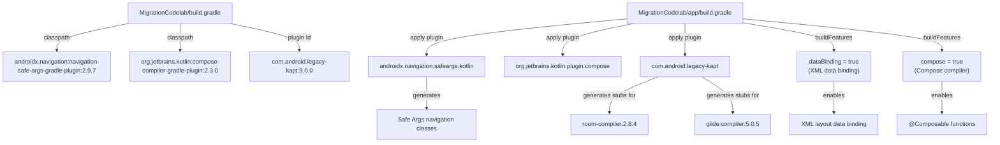
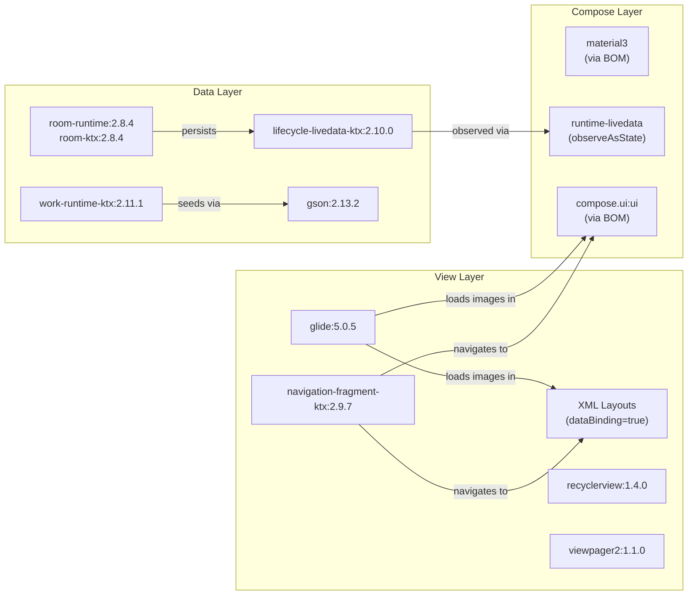

<!-- source: DeepWiki mcp.deepwiki.com · repo android/codelab-android-compose · page 5.8 Migration Codelab · fetched 2026-10-23 -->

# Migration Codelab

<details>
<summary>Relevant source files</summary>

The following files were used as context for generating this wiki page:

- [.github/workflows/AccessibilityCodelab.yaml](.github/workflows/AccessibilityCodelab.yaml)
- [.github/workflows/AdvancedStateAndSideEffectsCodelab.yaml](.github/workflows/AdvancedStateAndSideEffectsCodelab.yaml)
- [.github/workflows/AnimationCodelab.yaml](.github/workflows/AnimationCodelab.yaml)
- [.github/workflows/BasicLayoutsCodelab.yaml](.github/workflows/BasicLayoutsCodelab.yaml)
- [.github/workflows/BasicStateCodelab.yaml](.github/workflows/BasicStateCodelab.yaml)
- [.github/workflows/BasicsCodelab.yaml](.github/workflows/BasicsCodelab.yaml)
- [.github/workflows/MigrationCodelab.yaml](.github/workflows/MigrationCodelab.yaml)
- [.github/workflows/NavigationCodelab.yaml](.github/workflows/NavigationCodelab.yaml)
- [.github/workflows/TestingCodelab.yaml](.github/workflows/TestingCodelab.yaml)
- [.github/workflows/ThemingCodelab.yaml](.github/workflows/ThemingCodelab.yaml)
- [AccessibilityCodelab/app/build.gradle](AccessibilityCodelab/app/build.gradle)
- [AccessibilityCodelab/build.gradle](AccessibilityCodelab/build.gradle)
- [AdvancedStateAndSideEffectsCodelab/app/build.gradle](AdvancedStateAndSideEffectsCodelab/app/build.gradle)
- [AdvancedStateAndSideEffectsCodelab/build.gradle](AdvancedStateAndSideEffectsCodelab/build.gradle)
- [AnimationCodelab/build.gradle](AnimationCodelab/build.gradle)
- [AnimationCodelab/finished/build.gradle](AnimationCodelab/finished/build.gradle)
- [AnimationCodelab/start/build.gradle](AnimationCodelab/start/build.gradle)
- [BasicLayoutsCodelab/app/build.gradle](BasicLayoutsCodelab/app/build.gradle)
- [BasicLayoutsCodelab/build.gradle](BasicLayoutsCodelab/build.gradle)
- [BasicStateCodelab/build.gradle](BasicStateCodelab/build.gradle)
- [BasicsCodelab/README.md](BasicsCodelab/README.md)
- [BasicsCodelab/build.gradle.kts](BasicsCodelab/build.gradle.kts)
- [MigrationCodelab/README.md](MigrationCodelab/README.md)
- [MigrationCodelab/app/build.gradle](MigrationCodelab/app/build.gradle)
- [MigrationCodelab/build.gradle](MigrationCodelab/build.gradle)
- [NavigationCodelab/app/build.gradle](NavigationCodelab/app/build.gradle)
- [NavigationCodelab/build.gradle](NavigationCodelab/build.gradle)
- [README.md](README.md)
- [TestingCodelab/app/build.gradle](TestingCodelab/app/build.gradle)
- [TestingCodelab/build.gradle](TestingCodelab/build.gradle)
- [ThemingCodelab/README.md](ThemingCodelab/README.md)
- [ThemingCodelab/app/build.gradle](ThemingCodelab/app/build.gradle)
- [ThemingCodelab/build.gradle](ThemingCodelab/build.gradle)
- [ThemingCodelabM2/app/build.gradle](ThemingCodelabM2/app/build.gradle)
- [ThemingCodelabM2/build.gradle](ThemingCodelabM2/build.gradle)

</details>


## Purpose and Scope

This page documents the `MigrationCodelab` project, which teaches incremental migration of a View-based Android app to Jetpack Compose. The subject app is **Sunflower**, a plant-tracking application. The codelab specifically focuses on migrating the Plant Details screen from XML layouts to Compose while keeping the rest of the app in its original View form.

This is the only codelab in the repository that demonstrates View and Compose interoperability in a single build. For codelabs that are fully Compose from the start, see the index at [5]().

---

## Subject App: Sunflower

The Sunflower app (`com.google.samples.apps.sunflower`) presents three screens:

- **Plant list** — a browsable catalog of plants backed by a `RecyclerView`
- **Plant details** — the migration target, showing a plant's name, description, and image
- **My Garden** — a list of plants added by the user, also backed by a `RecyclerView`

The app uses a conventional MVVM stack with Room for persistence, LiveData for observability, WorkManager for background seeding, and Glide for image loading. Navigation is handled via the Fragment-based `navigation-fragment-ktx` library, not Compose Navigation.

Sources: [MigrationCodelab/README.md](), [MigrationCodelab/app/build.gradle:26-33]()

---

## Branch Model

The repository uses two branches to distinguish exercise stages:

| Branch | Role |
|--------|------|
| `main` | Starting point — Plant Details screen is in XML/Views |
| `end`  | Solution — Plant Details screen is migrated to Compose |

The CI workflow only triggers on `main` (and pull requests), meaning the `end` branch is not separately validated by CI.

Sources: [MigrationCodelab/README.md:8-9](), [.github/workflows/MigrationCodelab.yaml:6-14]()

---

## Build Configuration

### Root-Level Build

**Root build plugins and classpath** — [MigrationCodelab/build.gradle]()

```
MigrationCodelab/build.gradle
```

The root build file declares four classpath entries and two plugins, which together enable the unique feature set of this codelab:

| Declaration | Artifact | Purpose |
|-------------|----------|---------|
| `classpath` | `com.android.tools.build:gradle:9.0.0` | Android Gradle Plugin |
| `classpath` | `org.jetbrains.kotlin:kotlin-gradle-plugin:2.3.0` | Kotlin compilation |
| `classpath` | `androidx.navigation:navigation-safe-args-gradle-plugin:2.9.7` | Safe Args code generation for Fragment navigation |
| `classpath` | `org.jetbrains.kotlin:compose-compiler-gradle-plugin:2.3.0` | Compose compiler |
| `plugin` | `com.diffplug.spotless:8.2.1` | Code formatting (ktlint 0.46.1) |
| `plugin` | `com.android.legacy-kapt:9.0.0` | Legacy kapt support for Room and Glide annotation processors |

`navigation-safe-args-gradle-plugin` and `com.android.legacy-kapt` are **not present in any other codelab** in this repository.

Sources: [MigrationCodelab/build.gradle:17-34]()

### App-Level Build

The app module applies four plugins in sequence:

**Plugin application order** — [MigrationCodelab/app/build.gradle:17-21]()

```
com.android.application
androidx.navigation.safeargs.kotlin
org.jetbrains.kotlin.plugin.compose
com.android.legacy-kapt
```

Key `android {}` block settings:

| Setting | Value | Note |
|---------|-------|------|
| `namespace` | `com.google.samples.apps.sunflower` | |
| `compileSdkVersion` | 36 | |
| `minSdkVersion` | 23 | |
| `targetSdkVersion` | 33 | |
| `sourceCompatibility` | `JavaVersion.VERSION_17` | Most other codelabs use `VERSION_1_8` |
| `targetCompatibility` | `JavaVersion.VERSION_17` | Most other codelabs use `VERSION_1_8` |

Sources: [MigrationCodelab/app/build.gradle:17-55]()

### Hybrid View + Compose Setup

The defining characteristic of this codelab is the simultaneous activation of both `dataBinding` and `compose` in `buildFeatures`:

```
buildFeatures {
    dataBinding true
    compose true
}
```

[MigrationCodelab/app/build.gradle:46-49]()

No other codelab in this repository enables `dataBinding`. This flag is what allows XML layouts with `<data>` binding expressions to coexist with Compose `@Composable` functions in the same module. The `compose = true` flag activates the Compose compiler plugin for that module.

The following diagram shows how the plugin and feature flags connect:

**Hybrid Build Feature Activation**



Sources: [MigrationCodelab/app/build.gradle:17-56](), [MigrationCodelab/build.gradle:17-34]()

---

## Dependencies

### Unique Runtime Dependencies

The following dependencies appear in `MigrationCodelab` but in no other codelab in this repository:

| Library | Coordinate | Role |
|---------|-----------|------|
| Room runtime | `androidx.room:room-runtime:2.8.4` | SQLite ORM for plant and garden data |
| Room KTX | `androidx.room:room-ktx:2.8.4` | Coroutine-friendly Room extensions |
| Room compiler (kapt) | `androidx.room:room-compiler:2.8.4` | Generates DAO implementation code |
| Glide | `com.github.bumptech.glide:glide:5.0.5` | Image loading for plant photos |
| Glide compiler (kapt) | `com.github.bumptech.glide:compiler:5.0.5` | Generates Glide API extensions |
| WorkManager | `androidx.work:work-runtime-ktx:2.11.1` | Background plant data seeding |
| ViewPager2 | `androidx.viewpager2:viewpager2:1.1.0` | Swipeable page views |
| Navigation Fragment | `androidx.navigation:navigation-fragment-ktx:2.9.7` | Fragment-based navigation |
| Navigation UI | `androidx.navigation:navigation-ui-ktx:2.9.7` | Toolbar/drawer integration for navigation |
| RecyclerView | `androidx.recyclerview:recyclerview:1.4.0` | Plant list and garden list |
| ConstraintLayout | `androidx.constraintlayout:constraintlayout:2.2.1` | XML layout constraint system |
| Gson | `com.google.code.gson:gson:2.13.2` | JSON parsing for seed data |
| Tracing | `androidx.tracing:tracing:1.3.0` | Performance tracing |

Sources: [MigrationCodelab/app/build.gradle:58-107]()

### Compose Dependencies

Compose libraries are version-managed via the BOM (`androidx.compose:compose-bom:2026.01.01`). The subset used by this codelab:

| Artifact | Purpose |
|----------|---------|
| `androidx.compose.runtime:runtime` | Core Compose runtime |
| `androidx.compose.ui:ui` | UI toolkit |
| `androidx.compose.foundation:foundation` | Layout primitives |
| `androidx.compose.foundation:foundation-layout` | Box, Row, Column, etc. |
| `androidx.compose.material3:material3` | Material 3 components |
| `androidx.compose.runtime:runtime-livedata` | `observeAsState()` for LiveData interop |
| `androidx.compose.ui:ui-tooling-preview` | `@Preview` support |

The `runtime-livedata` artifact is particularly important to this codelab: it bridges the existing LiveData-based ViewModel (part of the View layer) with Compose composables via `observeAsState()`, enabling interop without rewriting data layer code.

Sources: [MigrationCodelab/app/build.gradle:85-107]()

### Dependency Architecture Diagram

**Dependency roles in the hybrid Sunflower app**



Sources: [MigrationCodelab/app/build.gradle:58-107]()

---

## CI Pipeline

MigrationCodelab is one of only two codelabs (along with `AdvancedStateAndSideEffectsCodelab`) that run instrumentation tests in CI. The workflow file is [.github/workflows/MigrationCodelab.yaml]().

### Trigger Conditions

| Event | Branch |
|-------|--------|
| `push` | `main` only |
| `pull_request` | any path matching `MigrationCodelab/**` |
| `workflow_dispatch` | manual |

This is a `main`-only trigger. The `end` branch is **not** CI-validated, unlike codelabs such as `AccessibilityCodelab`, `NavigationCodelab`, and `TestingCodelab` which also trigger on the `end` branch.

### Job Structure

**MigrationCodelab CI workflow**

```mermaid
graph TD
    trigger["Push to main\nor Pull Request"]

    subgraph "build job"
        B1["actions/checkout@v6"]
        B2["cp ci-gradle.properties\n→ ~/.gradle/gradle.properties"]
        B3["setup-java@v5\nZulu JDK 17"]
        B4["gradle/actions/setup-gradle@v5"]
        B5["./gradlew assembleDebug lintDebug --stacktrace\nworking-dir: MigrationCodelab"]
        B6["upload-artifact: build-outputs\napp/build/outputs"]
        B7["upload-artifact: build-reports\napp/build/reports"]
        B1 --> B2 --> B3 --> B4 --> B5 --> B6
        B5 --> B7
    end

    subgraph "test job (needs: build)"
        T0["matrix: api-level: 26, 29"]
        T1["Enable KVM\n(udev rules for /dev/kvm)"]
        T2["actions/checkout@v6"]
        T3["setup-java@v5 / setup-gradle@v5"]
        T4["android-emulator-runner@v2\napi-level: matrix\narch: x86\ndisable-animations: true\nscript: ./gradlew connectedCheck"]
        T5["upload-artifact:\ntest-reports-migration-{api-level}"]
        T0 --> T1 --> T2 --> T3 --> T4 --> T5
    end

    trigger --> B1
    B5 --> test job
```

Sources: [.github/workflows/MigrationCodelab.yaml]()

### Emulator Configuration vs. AdvancedStateAndSideEffectsCodelab

A notable difference between the two instrumentation-test codelabs:

| Setting | MigrationCodelab | AdvancedStateAndSideEffectsCodelab |
|---------|-----------------|-----------------------------------|
| `target` | *(not set — defaults to `default`)* | `google_apis` |
| `arch` | `x86` | `x86` |
| `api-level` matrix | `[26, 29]` | `[26, 29]` |
| Test report prefix | `test-reports-migration-` | `test-reports-state-` |

Sources: [.github/workflows/MigrationCodelab.yaml:87-101](), [.github/workflows/AdvancedStateAndSideEffectsCodelab.yaml:87-102]()

---

## Comparison with Other Codelabs

The table below highlights what makes MigrationCodelab structurally distinct from all other codelabs in the repository.

| Feature | MigrationCodelab | Other Codelabs |
|---------|----------------|---------------|
| `dataBinding = true` | ✅ | ✗ |
| `compose = true` | ✅ | ✅ |
| `kapt` (via `com.android.legacy-kapt`) | ✅ | ✗ |
| `navigation-safe-args-gradle-plugin` | ✅ | ✗ |
| Fragment-based Navigation | ✅ | ✗ (most use Navigation Compose) |
| Room | ✅ | ✗ |
| Glide | ✅ | ✗ |
| WorkManager | ✅ | ✗ |
| ViewPager2 | ✅ | ✗ |
| Java 17 compile target | ✅ | ✗ (most use Java 1.8) |
| Material 3 | ✅ | Varies (see [5.7]()) |
| Instrumentation tests in CI | ✅ | Only `AdvancedStateAndSideEffectsCodelab` also has these |
| CI triggers on `end` branch | ✗ | Some codelabs do (e.g. `AccessibilityCodelab`) |
| Groovy DSL (not Kotlin DSL) | ✅ | Mixed — see [3.2]() |

Sources: [MigrationCodelab/app/build.gradle](), [MigrationCodelab/build.gradle](), [.github/workflows/MigrationCodelab.yaml]()

---

