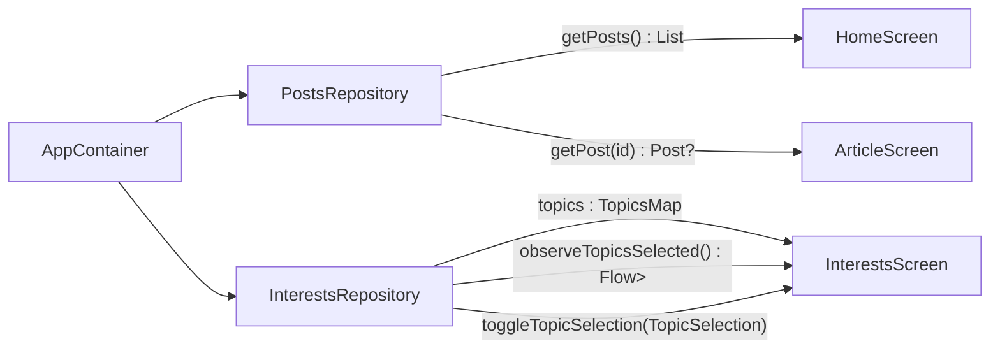
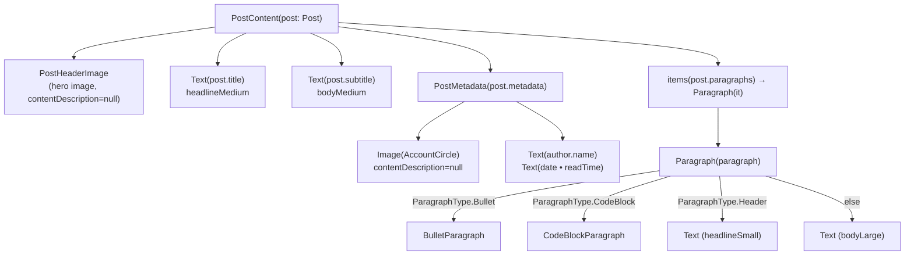

<!-- source: DeepWiki mcp.deepwiki.com · repo android/codelab-android-compose · page 5.9 Accessibility Codelab · fetched 2026-10-23 -->

# Accessibility Codelab

<details>
<summary>Relevant source files</summary>

The following files were used as context for generating this wiki page:

- [AccessibilityCodelab/app/build.gradle](AccessibilityCodelab/app/build.gradle)
- [AccessibilityCodelab/app/src/main/java/com/example/jetnews/ui/AppDrawer.kt](AccessibilityCodelab/app/src/main/java/com/example/jetnews/ui/AppDrawer.kt)
- [AccessibilityCodelab/app/src/main/java/com/example/jetnews/ui/JetnewsApp.kt](AccessibilityCodelab/app/src/main/java/com/example/jetnews/ui/JetnewsApp.kt)
- [AccessibilityCodelab/app/src/main/java/com/example/jetnews/ui/JetnewsNavGraph.kt](AccessibilityCodelab/app/src/main/java/com/example/jetnews/ui/JetnewsNavGraph.kt)
- [AccessibilityCodelab/app/src/main/java/com/example/jetnews/ui/article/ArticleScreen.kt](AccessibilityCodelab/app/src/main/java/com/example/jetnews/ui/article/ArticleScreen.kt)
- [AccessibilityCodelab/app/src/main/java/com/example/jetnews/ui/article/PostContent.kt](AccessibilityCodelab/app/src/main/java/com/example/jetnews/ui/article/PostContent.kt)
- [AccessibilityCodelab/app/src/main/java/com/example/jetnews/ui/components/InsetAwareTopAppBar.kt](AccessibilityCodelab/app/src/main/java/com/example/jetnews/ui/components/InsetAwareTopAppBar.kt)
- [AccessibilityCodelab/app/src/main/java/com/example/jetnews/ui/home/HomeScreen.kt](AccessibilityCodelab/app/src/main/java/com/example/jetnews/ui/home/HomeScreen.kt)
- [AccessibilityCodelab/app/src/main/java/com/example/jetnews/ui/interests/InterestsScreen.kt](AccessibilityCodelab/app/src/main/java/com/example/jetnews/ui/interests/InterestsScreen.kt)
- [AccessibilityCodelab/app/src/main/java/com/example/jetnews/ui/theme/Color.kt](AccessibilityCodelab/app/src/main/java/com/example/jetnews/ui/theme/Color.kt)
- [AdvancedStateAndSideEffectsCodelab/app/build.gradle](AdvancedStateAndSideEffectsCodelab/app/build.gradle)
- [AnimationCodelab/finished/build.gradle](AnimationCodelab/finished/build.gradle)
- [AnimationCodelab/start/build.gradle](AnimationCodelab/start/build.gradle)
- [BasicLayoutsCodelab/app/build.gradle](BasicLayoutsCodelab/app/build.gradle)
- [MigrationCodelab/app/build.gradle](MigrationCodelab/app/build.gradle)
- [NavigationCodelab/app/build.gradle](NavigationCodelab/app/build.gradle)
- [TestingCodelab/app/build.gradle](TestingCodelab/app/build.gradle)
- [ThemingCodelab/app/build.gradle](ThemingCodelab/app/build.gradle)
- [ThemingCodelabM2/app/build.gradle](ThemingCodelabM2/app/build.gradle)

</details>


## Purpose and Scope

This page documents the `AccessibilityCodelab`, located in the `AccessibilityCodelab/` directory of the monorepo. It covers the JetNews subject app's architecture, navigation structure, composable hierarchy, data layer, and the content rendering pipeline that the codelab uses to teach Compose accessibility patterns.

This codelab is concerned with making a working Compose app accessible — covering content descriptions, touch target sizing, semantics merging, and state descriptions. For the build system conventions shared across all codelabs, see page [3](). For the CI pipeline, see page [4]().

---

## Subject App: JetNews

The subject application is a news-reading app with package name `com.example.jetnews`. It provides three screens (Home, Interests, Article) connected via Compose Navigation, wrapped in a Material 3 `ModalNavigationDrawer`.

| Property | Value |
|---|---|
| Application ID | `com.example.jetnews` |
| Namespace | `com.example.jetnews` |
| Min SDK | 23 |
| Compile SDK | 36 |
| Material version | Material 3 (`material3`) |
| Navigation | `navigation-compose:2.9.7` |
| Test runner | `AndroidJUnitRunner` + Robolectric |

Sources: [AccessibilityCodelab/app/build.gradle:1-152]()

---

## Build Configuration

The codelab uses a Groovy DSL `build.gradle` with the standard two-plugin setup: `com.android.application` and `org.jetbrains.kotlin.plugin.compose`. No Hilt, KSP, kapt, or safe-args are used.

**Key dependencies not present in most other codelabs:**

| Dependency | Purpose |
|---|---|
| `accompanist-swiperefresh:0.36.0` | Pull-to-refresh gesture on post lists |
| `accompanist-systemuicontroller:0.36.0` | Transparent status bar / system UI tinting |
| `navigation-compose:2.9.7` | Compose-native Navigation component |
| `robolectric:4.16.1` | Unit tests running against Android framework |
| `material-icons-extended` | Extended icon set (Home, ListAlt, ArrowBack, AccountCircle) |

A shared test source directory is configured at `src/sharedTest/java`, making test classes available to both the `test` and `androidTest` source sets.

Sources: [AccessibilityCodelab/app/build.gradle:88-151]()

---

## Application Entry Point

**Top-level composable call chain:**

```
MainActivity
  └── JetnewsApp(appContainer: AppContainer)
        └── JetnewsTheme
              └── ModalNavigationDrawer
                    ├── drawerContent: AppDrawer
                    └── content: Scaffold → JetnewsNavGraph
```

`JetnewsApp` [AccessibilityCodelab/app/src/main/java/com/example/jetnews/ui/JetnewsApp.kt:43-84]() is the root composable. It:

- Installs `JetnewsTheme` and sets transparent system bars via `rememberSystemUiController`
- Creates and holds `NavController` and `DrawerState`
- Reads the current back-stack route via `navController.currentBackStackEntryAsState()` to pass `currentRoute` into `AppDrawer`
- Embeds `JetnewsNavGraph` inside the drawer's `content` lambda

Sources: [AccessibilityCodelab/app/src/main/java/com/example/jetnews/ui/JetnewsApp.kt:1-84]()

---

## Navigation Graph

**Navigation route diagram:**

```mermaid
graph TD
    A["JetnewsNavGraph"] --> B["NavHost\nstartDestination = HOME_ROUTE"]
    B --> C["composable(\"home\")\nHomeScreen"]
    B --> D["composable(\"interests\")\nInterestsScreen"]
    B --> E["composable(\"post/{postId}\")\nArticleScreen"]
    C -->|"navigateToArticle(postId)"| E
    E -->|"actions.upPress"| C
```

Sources: [AccessibilityCodelab/app/src/main/java/com/example/jetnews/ui/JetnewsNavGraph.kt:1-95]()

Route constants are defined in the `MainDestinations` object:

| Constant | Value | Destination |
|---|---|---|
| `HOME_ROUTE` | `"home"` | `HomeScreen` |
| `INTERESTS_ROUTE` | `"interests"` | `InterestsScreen` |
| `ARTICLE_ROUTE` | `"post"` | `ArticleScreen` |
| `ARTICLE_ID_KEY` | `"postId"` | URL path argument |

Navigation actions are encapsulated in `MainActions(navController)`, which exposes `navigateToArticle: (String) -> Unit` and `upPress: () -> Unit`.

Sources: [AccessibilityCodelab/app/src/main/java/com/example/jetnews/ui/JetnewsNavGraph.kt:40-95]()

---

## Data Layer

The app uses a simple in-memory data layer surfaced through `AppContainer`.

**Data container diagram:**



- `TopicsMap` is a type alias for `Map<String, List<String>>` (section name → list of topic strings).
- `TopicSelection(section: String, topic: String)` is the data class used as the key for tracking selected topics.
- `InterestsRepository.observeTopicsSelected()` returns a `Flow`, consumed in `InterestsScreen` via `collectAsState`.

Sources: [AccessibilityCodelab/app/src/main/java/com/example/jetnews/ui/interests/InterestsScreen.kt:62-83](), [AccessibilityCodelab/app/src/main/java/com/example/jetnews/ui/home/HomeScreen.kt:62-72]()

---

## Screen Composables

### HomeScreen

`HomeScreen` follows the stateful/stateless split pattern:

- **Stateful** `HomeScreen(postsRepository, navigateToArticle, openDrawer)`: calls `postsRepository.getPosts()` and delegates.
- **Stateless** `HomeScreen(posts, navigateToArticle, openDrawer)`: manages a `Scaffold` with `InsetAwareTopAppBar` and `PostList`.

`PostList` [AccessibilityCodelab/app/src/main/java/com/example/jetnews/ui/home/HomeScreen.kt:123-143]() divides the post list:

| Slot | Posts | Layout |
|---|---|---|
| History | indices 0–2 | `LazyColumn` with `PostCardHistory` |
| Popular | indices 3–4 | `PostListPopularSection` → horizontal `LazyRow` with `PostCardPopular` |

`rememberContentPaddingForScreen` computes bottom-inset-aware padding using `WindowInsets.systemBars`.

Sources: [AccessibilityCodelab/app/src/main/java/com/example/jetnews/ui/home/HomeScreen.kt:1-211]()

---

### InterestsScreen

`InterestsScreen` also follows the stateful/stateless split:

- **Stateful**: reads `selectedTopics` from `interestsRepository.observeTopicsSelected()` as `collectAsState`, and wires `onTopicSelect` to `interestsRepository.toggleTopicSelection()` via `rememberCoroutineScope`.
- **Stateless**: accepts `topics: TopicsMap`, `selectedTopics: Set<TopicSelection>`, and `onTopicSelect`.

`TopicItem` renders a `Row` containing:
1. A 56×56dp topic image (decorative, `contentDescription = null`)
2. A `Text` label
3. A spacer
4. A `Checkbox` bound to `onToggle`

`TopicDivider` renders a full-width `Divider` with `start = 90.dp` padding to align with the text.

> **Accessibility note:** The `TopicItem` row exposes a separate `Checkbox` touch target. One key exercise in this codelab is merging these into a single semantics node and ensuring the entire row is the interactable element, meeting the 48dp minimum touch target requirement.

Sources: [AccessibilityCodelab/app/src/main/java/com/example/jetnews/ui/interests/InterestsScreen.kt:1-201]()

---

### ArticleScreen

- **Stateful**: resolves `Post` from `postsRepository.getPost(postId)` and delegates.
- **Stateless**: renders a `Scaffold` with `InsetAwareTopAppBar` showing the publication name, a back arrow, and `PostContent`.

An `AlertDialog` called `FunctionalityNotAvailablePopup` is shown when features are triggered that aren't implemented.

Sources: [AccessibilityCodelab/app/src/main/java/com/example/jetnews/ui/article/ArticleScreen.kt:1-149]()

---

## PostContent Rendering Pipeline

`PostContent` is the composable that renders a full article. It uses a `LazyColumn` and dispatches items to sub-composables.

**PostContent composition diagram:**



Sources: [AccessibilityCodelab/app/src/main/java/com/example/jetnews/ui/article/PostContent.kt:77-113]()

### ParagraphType Rendering

`ParagraphType.getTextAndParagraphStyle()` is an extension function that maps enum values to `ParagraphStyling(textStyle, paragraphStyle, trailingPadding)`:

| `ParagraphType` | Text Style | Trailing Padding |
|---|---|---|
| `Caption` | `bodyLarge` | 24dp |
| `Title` | `headlineMedium` | 24dp |
| `Subhead` | `titleLarge` | 16dp |
| `Text` | `bodyLarge` (lineHeight 28sp) | 24dp |
| `Header` | `headlineSmall` | 16dp |
| `CodeBlock` | `bodyLarge` (Monospace) | 24dp |
| `Quote` | `bodyLarge` | 24dp |
| `Bullet` | `bodyLarge` (8sp textIndent) | 24dp |

Sources: [AccessibilityCodelab/app/src/main/java/com/example/jetnews/ui/article/PostContent.kt:250-285]()

### MarkupType Annotation

`paragraphToAnnotatedString` converts a `Paragraph`'s `markups: List<Markup>` into `AnnotatedString.Range<SpanStyle>` entries via `Markup.toAnnotatedStringItem()`:

| `MarkupType` | Applied Style |
|---|---|
| `Italic` | `fontStyle = FontStyle.Italic` |
| `Link` | `textDecoration = TextDecoration.Underline` |
| `Bold` | `fontWeight = FontWeight.Bold` |
| `Code` | `fontFamily = Monospace` + `background = codeBlockBackground` |

`codeBlockBackground` is defined as a `ColorScheme` extension property: `onSurface.copy(alpha = .15f)`.

Sources: [AccessibilityCodelab/app/src/main/java/com/example/jetnews/ui/article/PostContent.kt:287-338]()

---

## AppDrawer

`AppDrawer` is the navigation drawer content composable:

```
AppDrawer(currentRoute, navigateToHome, navigateToInterests, closeDrawer)
  ├── JetNewsLogo   (ic_jetnews_logo + ic_jetnews_wordmark, both contentDescription=null)
  ├── Divider
  ├── DrawerButton("Home",      Icons.Filled.Home,    isSelected = currentRoute == HOME_ROUTE)
  └── DrawerButton("Interests", Icons.Filled.ListAlt, isSelected = currentRoute == INTERESTS_ROUTE)
```

`DrawerButton` uses `TextButton` inside a `Surface` and adjusts `textIconColor` and `backgroundColor` based on `isSelected`. The image inside each button has `contentDescription = null` (decorative) because the button label already conveys the meaning.

Sources: [AccessibilityCodelab/app/src/main/java/com/example/jetnews/ui/AppDrawer.kt:51-158]()

---

## Shared Component: InsetAwareTopAppBar

`InsetAwareTopAppBar` [AccessibilityCodelab/app/src/main/java/com/example/jetnews/ui/components/InsetAwareTopAppBar.kt:38-64]() wraps `TopAppBar` inside a `Surface` with:

- `shadowElevation = elevation` (default 4dp)
- `Modifier.statusBarsPadding()` applied to the inner `TopAppBar`
- Transparent `containerColor` so the `Surface` background shows behind the status bar

This component is used on all three screens to implement edge-to-edge drawing with proper inset handling.

Sources: [AccessibilityCodelab/app/src/main/java/com/example/jetnews/ui/components/InsetAwareTopAppBar.kt:1-64]()

---

## Full Composable Hierarchy

```mermaid
graph TD
    MA["MainActivity"] --> JA["JetnewsApp(AppContainer)"]
    JA --> JT["JetnewsTheme"]
    JT --> MND["ModalNavigationDrawer"]
    MND --> AD["AppDrawer"]
    AD --> JNL["JetNewsLogo"]
    AD --> DB1["DrawerButton(\"Home\")"]
    AD --> DB2["DrawerButton(\"Interests\")"]
    MND --> SC["Scaffold"]
    SC --> NG["JetnewsNavGraph(NavHostController, DrawerState)"]
    NG --> HM["HomeScreen"]
    NG --> IS["InterestsScreen"]
    NG --> AS["ArticleScreen"]
    HM --> IATB1["InsetAwareTopAppBar"]
    HM --> PL["PostList"]
    PL --> PCH["PostCardHistory"]
    PL --> PPS["PostListPopularSection → PostCardPopular"]
    IS --> IATB2["InsetAwareTopAppBar"]
    IS --> LC["LazyColumn → TopicItem"]
    AS --> IATB3["InsetAwareTopAppBar"]
    AS --> PCT["PostContent"]
    PCT --> PGR["Paragraph → BulletParagraph / CodeBlockParagraph / Text"]
```

Sources: [AccessibilityCodelab/app/src/main/java/com/example/jetnews/ui/JetnewsApp.kt:1-84](), [AccessibilityCodelab/app/src/main/java/com/example/jetnews/ui/JetnewsNavGraph.kt:1-95](), [AccessibilityCodelab/app/src/main/java/com/example/jetnews/ui/home/HomeScreen.kt:1-211](), [AccessibilityCodelab/app/src/main/java/com/example/jetnews/ui/interests/InterestsScreen.kt:1-201](), [AccessibilityCodelab/app/src/main/java/com/example/jetnews/ui/article/ArticleScreen.kt:1-149](), [AccessibilityCodelab/app/src/main/java/com/example/jetnews/ui/article/PostContent.kt:1-349]()

---

## Accessibility Features Taught

The codelab uses this app as a vehicle to teach specific Compose accessibility APIs. Key patterns identifiable in the codebase:

| Pattern | Location | Notes |
|---|---|---|
| `contentDescription = null` for decorative images | `PostHeaderImage`, `JetNewsLogo`, `PostMetadata` author icon | Suppresses TalkBack announcement for purely visual images |
| `contentDescription` string resource for interactive icons | `InsetAwareTopAppBar` navigation icon (`cd_open_navigation_drawer`) | Ensures TalkBack announces the icon's action |
| Checkbox accessibility | `TopicItem` in `InterestsScreen` | Exercise: merge the row into a single semantics node |
| Minimum touch target (48dp) | `TopicItem`, `DrawerButton`, `IconButton` | Exercises target size enforcement |
| `Modifier.statusBarsPadding()` | `InsetAwareTopAppBar` | Edge-to-edge with proper inset handling for screen readers |

The CI workflow for `AccessibilityCodelab` triggers on both `main` and `end` branches (the `end` branch typically representing the completed exercise solution), and runs `assembleDebug` + `lintDebug` only — no instrumentation tests in CI. See page [4]() for the full CI pipeline documentation.

Sources: [AccessibilityCodelab/app/build.gradle:1-152](), [AccessibilityCodelab/app/src/main/java/com/example/jetnews/ui/article/PostContent.kt:115-128](), [AccessibilityCodelab/app/src/main/java/com/example/jetnews/ui/interests/InterestsScreen.kt:147-176]()

---

