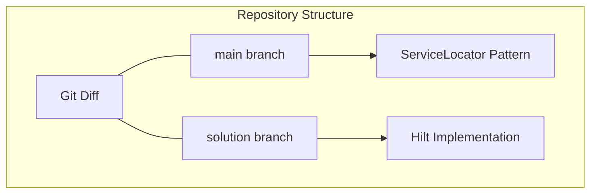
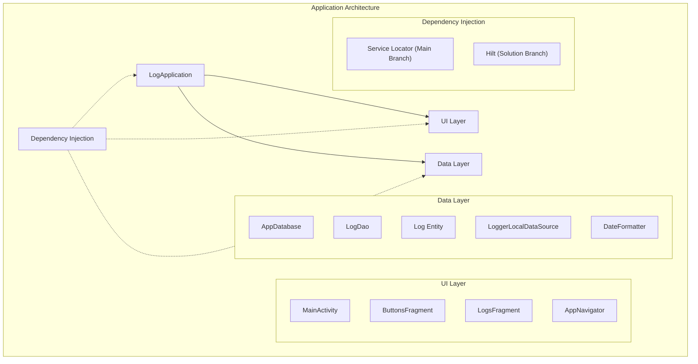
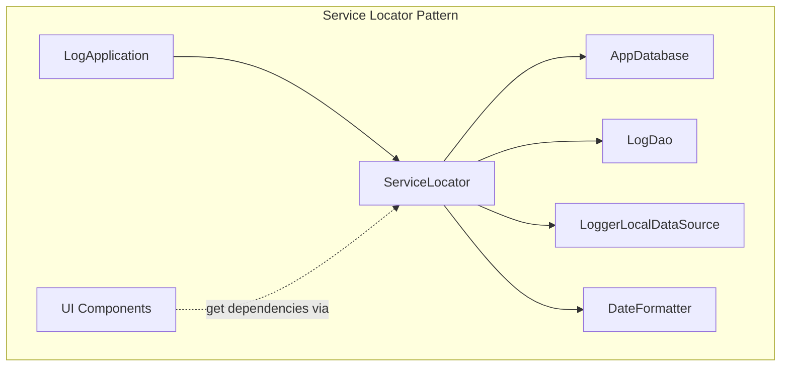
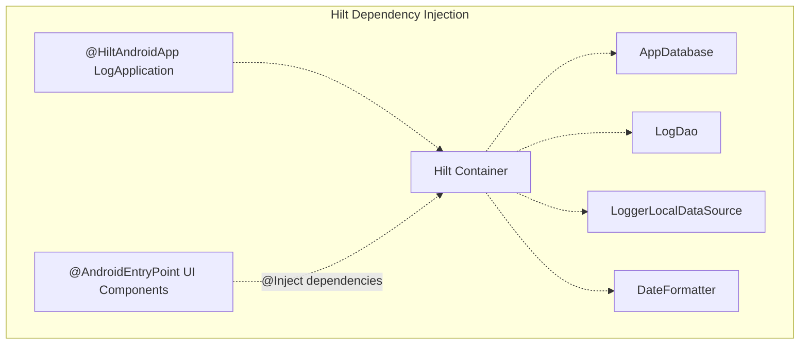
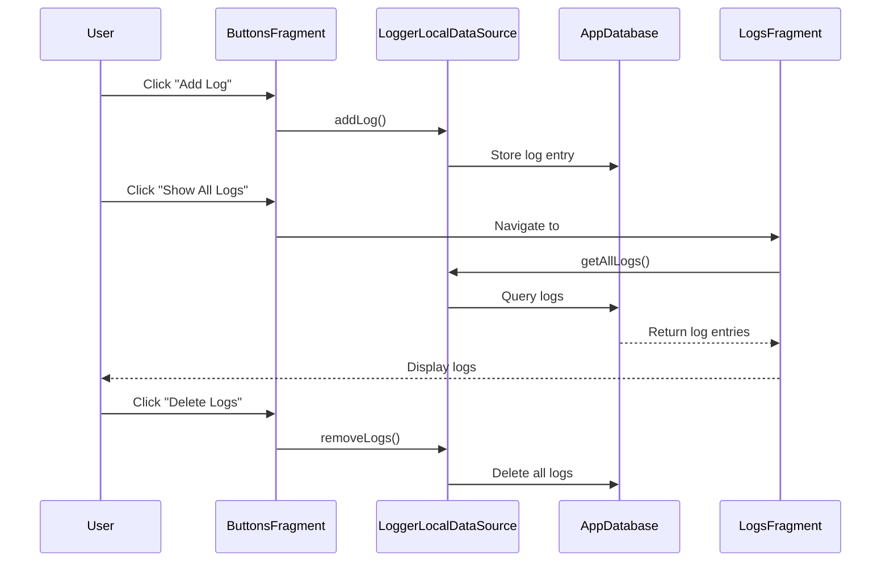

<!-- source: DeepWiki mcp.deepwiki.com · repo android/codelab-android-hilt · page 1 Android Hilt Codelab Overview · fetched 2026-10-23 -->

# Android Hilt Codelab Overview

Relevant source files

The following files were used as context for generating this wiki page:

- [README.md](README.md)
- [app/build.gradle](app/build.gradle)
- [build.gradle](build.gradle)

## Purpose and Scope

This document provides an overview of the Android Hilt Codelab repository located at [https://github.com/android/codelab-android-hilt](). The codelab demonstrates how to implement dependency injection in Android applications using Hilt, Google's recommended dependency injection library for Android. It covers the transition from manual dependency management to automated dependency injection with Hilt, highlighting the benefits and implementation details.

For specific information about the build system configuration, see [Build System Configuration](#2). For detailed application architecture, see [Application Architecture](#3).

Sources: [README.md:1-29]()

## Repository Structure

The codelab is structured across multiple branches:
- `main` branch: Starting point of the codelab with a functional application using manual dependency management
- `solution` branch: Completed implementation demonstrating proper Hilt integration

This structure allows developers to compare the application before and after implementing Hilt, providing a clear view of the changes required.

Sources: [README.md:5-7]()

## Educational Goals

The primary educational goals of this codelab are:

1. Demonstrate the benefits of dependency injection in Android app architecture:
   - Reusability of code
   - Ease of refactoring
   - Improved testability

2. Provide a practical implementation of Hilt in an Android application

3. Show the migration process from manual dependency management to Hilt

Sources: [README.md:10-18]()

## System Architecture Overview

The application follows a modern Android architecture with clear separation of concerns between different layers. It implements a logging system that allows users to create, view, and delete logs.

The architecture consists of:
- **Application Layer**: Entry point for the application
- **UI Layer**: Activities and fragments that display data and handle user interactions
- **Data Layer**: Database, entities, and data access objects for log storage and retrieval
- **Dependency Injection Layer**: Either ServiceLocator (main branch) or Hilt (solution branch)

Sources: [README.md:10-18](), [app/build.gradle:52-71]()

## Technology Stack

The codelab utilizes the following technologies:

| Component | Technology | Purpose |
|-----------|------------|---------|
| Language | Kotlin 1.7.20 | Primary programming language |
| Dependency Injection | Hilt 2.40.1 | Automated dependency injection |
| Database | Room 2.4.3 | Local data persistence |
| UI | AndroidX components | UI components and RecyclerView |
| Testing | JUnit, Espresso | Unit and UI testing |

Sources: [build.gradle:17-29](), [app/build.gradle:51-71]()

## Dependency Injection Evolution

One of the core educational aspects of this codelab is demonstrating the evolution from manual dependency management to Hilt-based dependency injection.

### Before: Service Locator Pattern

### After: Hilt Dependency Injection

The transition to Hilt eliminates the need for manually maintaining a ServiceLocator, reducing boilerplate code and improving testability by allowing for easier dependency substitution.

Sources: [app/build.gradle:69-71]()

## Application Functionality

The sample application provides a simple logging system with the following features:

Sources: [app/build.gradle:52-60]()

## Prerequisites and Setup

### Prerequisites
- Kotlin programming experience
- Understanding of dependency injection concepts

### Development Setup
1. Install Android Studio
2. Clone the repository
3. Import the project into Android Studio
4. Build and run the application

Sources: [README.md:21-29]()

## Conclusion

The Android Hilt Codelab repository serves as an educational resource for implementing dependency injection in Android applications using Hilt. By comparing the main branch (ServiceLocator pattern) with the solution branch (Hilt implementation), developers can gain a practical understanding of how to incorporate Hilt into their applications and benefit from improved code reusability, refactorability, and testability.

For more detailed information on specific aspects of the codelab:
- Build system configuration: [Build System Configuration](#2)
- Application architecture: [Application Architecture](#3)
- Hilt implementation details: [Dependency Injection with Hilt](#3.1)
- Data layer: [Data Layer](#3.2)
- UI components: [UI Components](#3.3)

Sources: [README.md:1-52](), [build.gradle:1-41](), [app/build.gradle:1-72]()

---

