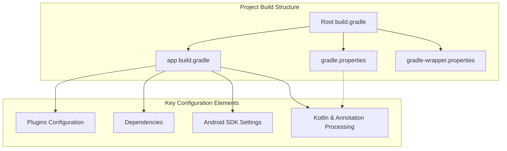
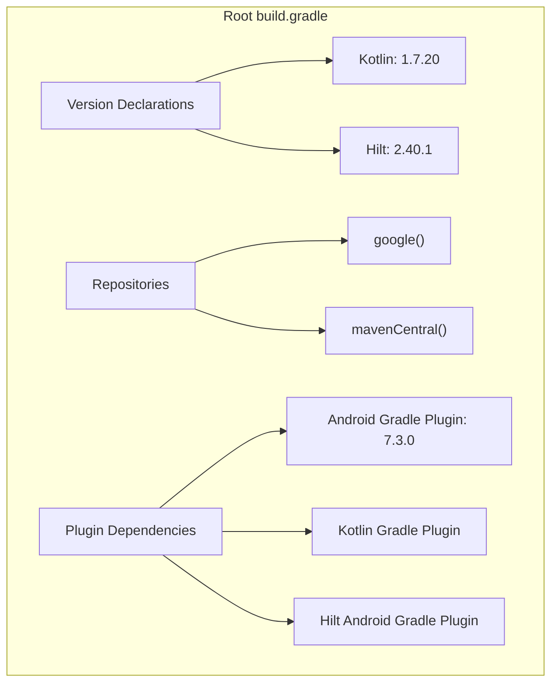
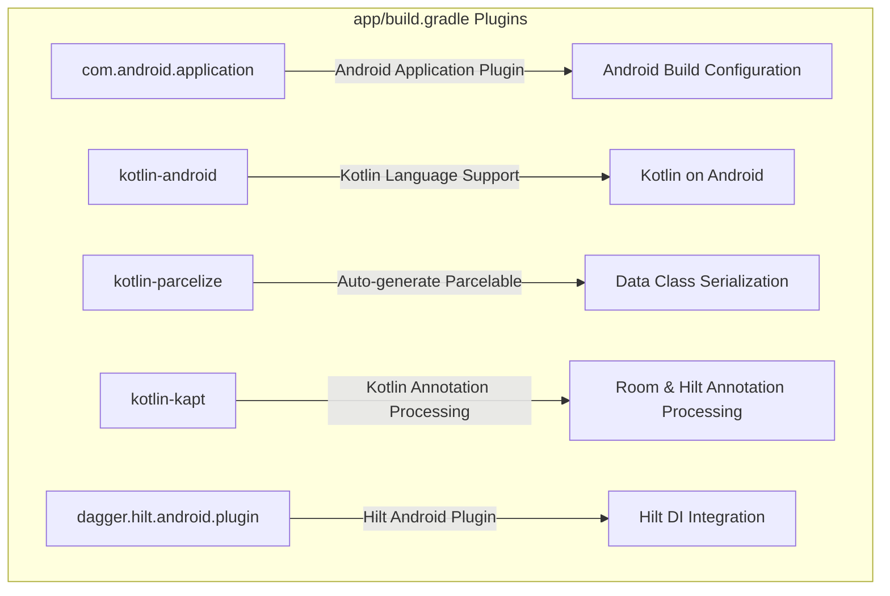
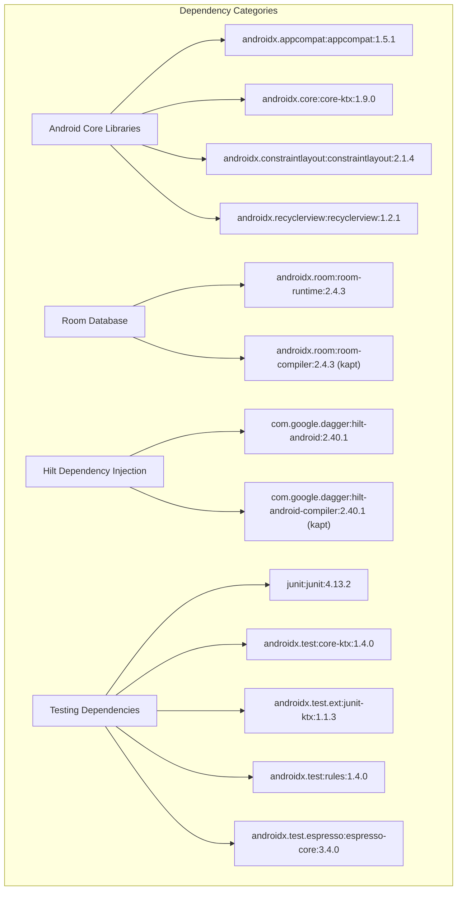
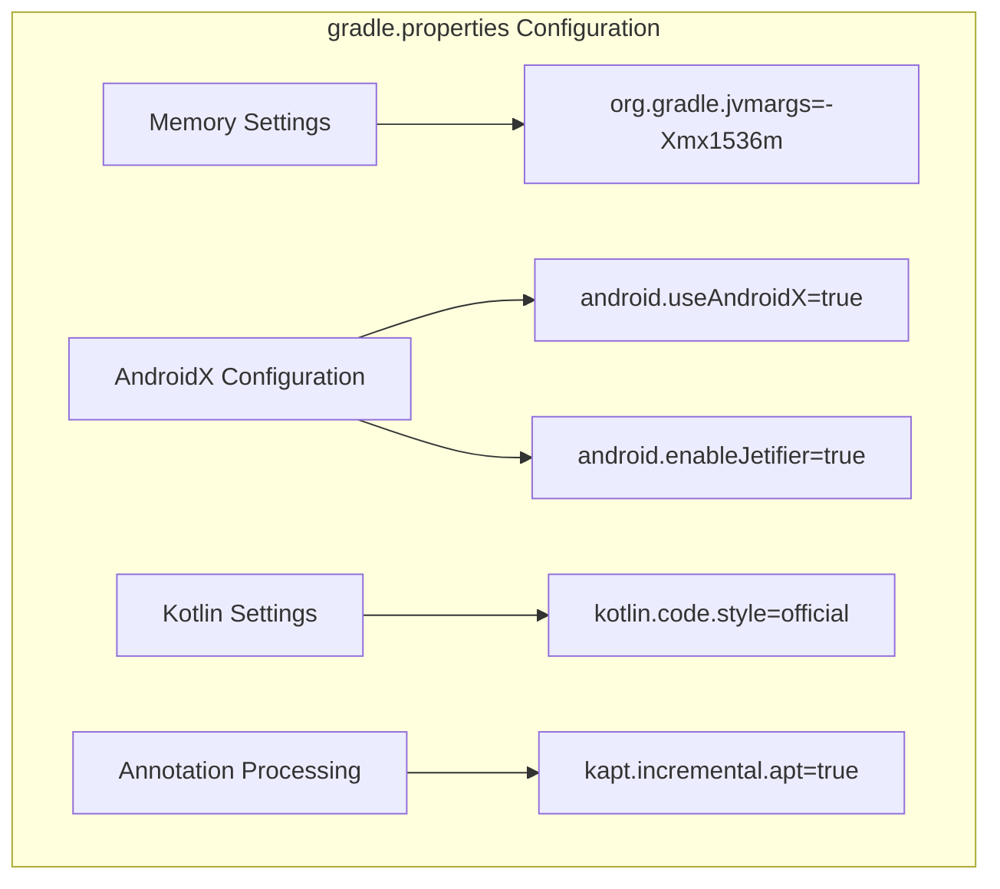

<!-- source: DeepWiki mcp.deepwiki.com · repo android/codelab-android-hilt · page 2 Build System Configuration · fetched 2026-10-23 -->

# Build System Configuration

<details>
<summary>Relevant source files</summary>

The following files were used as context for generating this wiki page:

- [app/build.gradle](app/build.gradle)
- [build.gradle](build.gradle)
- [gradle.properties](gradle.properties)
- [gradle/wrapper/gradle-wrapper.properties](gradle/wrapper/gradle-wrapper.properties)

</details>


## Purpose and Scope

This document describes the Gradle build system configuration for the Android Hilt Codelab project. It covers the project-level and module-level Gradle files, build settings, plugins, and dependencies required to support Hilt dependency injection and other project features. For information about how Hilt is implemented in the application architecture, see [Dependency Injection with Hilt](#3.1).

## Build System Overview

The Android Hilt Codelab uses Gradle as its build system, with specific configurations to support Hilt dependency injection, Room database, and other Android Jetpack components.



Sources: [build.gradle](), [app/build.gradle](), [gradle.properties](), [gradle/wrapper/gradle-wrapper.properties]()

## Root Gradle Configuration

The root `build.gradle` file defines global project settings including version declarations, repository configurations, and project-wide plugin dependencies.



Sources: [build.gradle:17-29]()

### Version Declarations

The project declares key version numbers as global variables to ensure consistency across modules:

| Dependency | Version |
|------------|---------|
| Kotlin     | 1.7.20  |
| Hilt       | 2.40.1  |

Sources: [build.gradle:18-19]()

### Build Script Dependencies

The root build.gradle includes the following classpath dependencies:

```
classpath 'com.android.tools.build:gradle:7.3.0'
classpath "org.jetbrains.kotlin:kotlin-gradle-plugin:$kotlin_version"
classpath "com.google.dagger:hilt-android-gradle-plugin:$hilt_version"
```

Sources: [build.gradle:24-28]()

### Repository Configuration

All project modules use Google and Maven Central repositories for dependency resolution:

```
allprojects {
    repositories {
        google()
        mavenCentral()
    }
}
```

Sources: [build.gradle:31-36]()

## App Module Configuration

The `app/build.gradle` file contains module-specific settings, including Android configuration, plugin applications, and dependencies.

### Applied Plugins



Sources: [app/build.gradle:17-23]()

The application uses the following Gradle plugins:

| Plugin                    | Purpose                                                  |
|---------------------------|----------------------------------------------------------|
| com.android.application   | Core Android application functionality                   |
| kotlin-android           | Kotlin language support for Android                       |
| kotlin-parcelize         | Automatic Parcelable implementation for data classes      |
| kotlin-kapt              | Kotlin Annotation Processing Tool for code generation     |
| dagger.hilt.android.plugin | Hilt dependency injection framework integration         |

Sources: [app/build.gradle:17-23]()

### Android Configuration

The app module defines several Android-specific configurations:

```
android {
    compileSdkVersion 33

    defaultConfig {
        applicationId "com.example.android.hilt"
        minSdkVersion 16
        targetSdkVersion 33
        versionCode 1
        versionName "1.0"
        
        testInstrumentationRunner 'androidx.test.runner.AndroidJUnitRunner'
        
        javaCompileOptions {
            annotationProcessorOptions {
                arguments["room.incremental"] = "true"
            }
        }
    }

    compileOptions {
        sourceCompatibility 1.8
        targetCompatibility 1.8
    }
}
```

Sources: [app/build.gradle:25-49]()

Key configurations include:

| Configuration                | Value                           | Purpose                                          |
|-----------------------------|----------------------------------|--------------------------------------------------|
| compileSdkVersion           | 33                               | Android API level to compile against             |
| applicationId               | com.example.android.hilt         | Unique application identifier                    |
| minSdkVersion               | 16                               | Minimum supported Android API level              |
| targetSdkVersion            | 33                               | Target Android API level                         |
| testInstrumentationRunner   | androidx.test.runner.AndroidJUnitRunner | Test runner for Android instrumentation tests |
| room.incremental            | true                             | Enable incremental processing for Room           |
| Java compatibility          | 1.8                              | Java language features level                     |

Sources: [app/build.gradle:26-48]()

## Dependencies Configuration

The app module includes several dependencies to support Android development, Hilt dependency injection, Room database, and testing.



Sources: [app/build.gradle:51-72]()

### Android Core Libraries

The application uses the following core Android libraries:

| Library                      | Version | Purpose                                   |
|------------------------------|---------|-------------------------------------------|
| androidx.appcompat           | 1.5.1   | Backward compatibility support            |
| androidx.core:core-ktx       | 1.9.0   | Kotlin extensions for Android core        |
| androidx.constraintlayout    | 2.1.4   | Modern layout system                      |
| androidx.recyclerview        | 1.2.1   | List rendering component                  |

Sources: [app/build.gradle:53-56]()

### Room Database

Room is used for local database storage:

| Library                    | Version | Purpose                                   |
|----------------------------|---------|-------------------------------------------|
| androidx.room:room-runtime | 2.4.3   | Room ORM runtime                          |
| androidx.room:room-compiler| 2.4.3   | Room annotation processor (kapt)          |

Sources: [app/build.gradle:59-60]()

### Hilt Dependency Injection

Hilt is configured with the following dependencies:

| Library                               | Version  | Purpose                                   |
|---------------------------------------|----------|-------------------------------------------|
| com.google.dagger:hilt-android        | 2.40.1   | Hilt runtime for Android                  |
| com.google.dagger:hilt-android-compiler| 2.40.1  | Hilt annotation processor (kapt)          |

Sources: [app/build.gradle:70-71]()

### Testing Dependencies

The project uses several testing libraries:

| Library                              | Version | Purpose                                   |
|--------------------------------------|---------|-------------------------------------------|
| junit:junit                          | 4.13.2  | Unit testing framework                    |
| androidx.test:core-ktx               | 1.4.0   | Android test core library with Kotlin     |
| androidx.test.ext:junit-ktx          | 1.1.3   | JUnit extensions for Android              |
| androidx.test:rules                  | 1.4.0   | Android test rules                        |
| androidx.test.espresso:espresso-core | 3.4.0   | UI testing framework                      |

Sources: [app/build.gradle:63-67]()

## Gradle Properties

The project includes several Gradle properties in `gradle.properties` that configure build behavior:



Sources: [gradle.properties]()

### Key Gradle Properties

| Property                | Value     | Purpose                                                   |
|-------------------------|-----------|-----------------------------------------------------------|
| org.gradle.jvmargs      | -Xmx1536m | Memory allocation for Gradle daemon                       |
| android.useAndroidX     | true      | Enables AndroidX libraries                                |
| android.enableJetifier  | true      | Auto-converts support libraries to AndroidX               |
| kotlin.code.style       | official  | Uses Kotlin's official code style                         |
| kapt.incremental.apt    | true      | Enables incremental annotation processing for performance |

Sources: [gradle.properties:9-23]()

## Gradle Wrapper Configuration

The project uses the Gradle Wrapper to ensure build consistency. The wrapper is configured to use Gradle version 7.4.

| Property            | Value                                                |
|---------------------|------------------------------------------------------|
| distributionUrl     | https://services.gradle.org/distributions/gradle-7.4-bin.zip |
| distributionBase    | GRADLE_USER_HOME                                     |
| distributionPath    | wrapper/dists                                        |

Sources: [gradle/wrapper/gradle-wrapper.properties]()

## Build System Integration with Hilt

The build system is specifically configured to support Hilt dependency injection:

1. The Hilt Gradle plugin is applied in the app module using `id 'dagger.hilt.android.plugin'`
2. Hilt dependencies are included with the matching version declared in the root build file
3. Kotlin annotation processing (kapt) is enabled to support Hilt's code generation
4. Incremental annotation processing is enabled to improve build performance

This configuration allows the application to leverage Hilt for automated dependency injection, which replaces the manual ServiceLocator pattern. The build system handles the code generation needed for Hilt's dependency graphs and component hierarchies.

Sources: [build.gradle:19](), [app/build.gradle:22](), [app/build.gradle:70-71]()

## Room Database Build Configuration

The build system includes specific configurations for Room database:

1. Room libraries are added as dependencies
2. Room incremental annotation processing is enabled with `room.incremental=true`
3. Kapt incremental processing is enabled for better build performance

These settings ensure that Room database code generation is optimized for faster builds.

Sources: [app/build.gradle:39-42](), [app/build.gradle:59-60](), [gradle.properties:23]()

---

