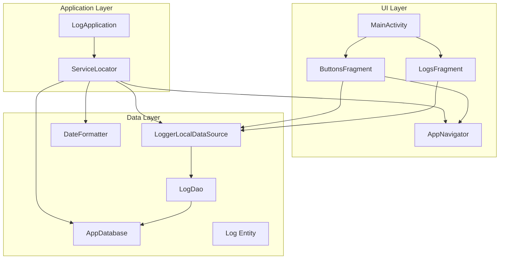
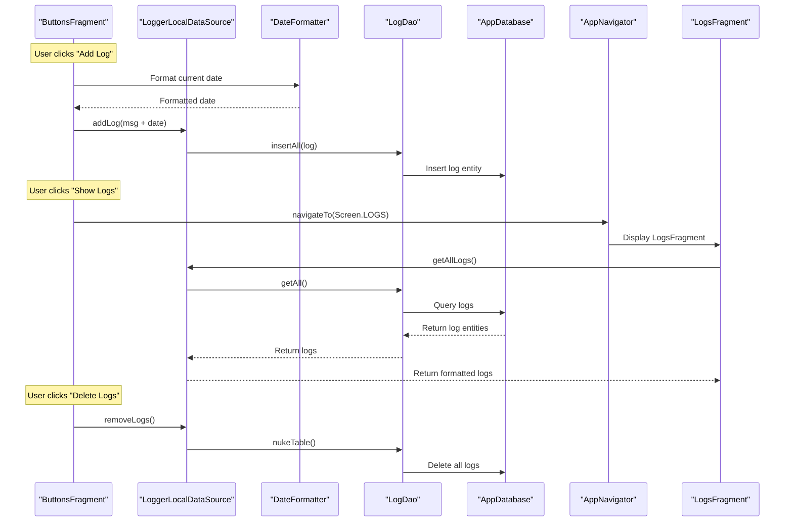
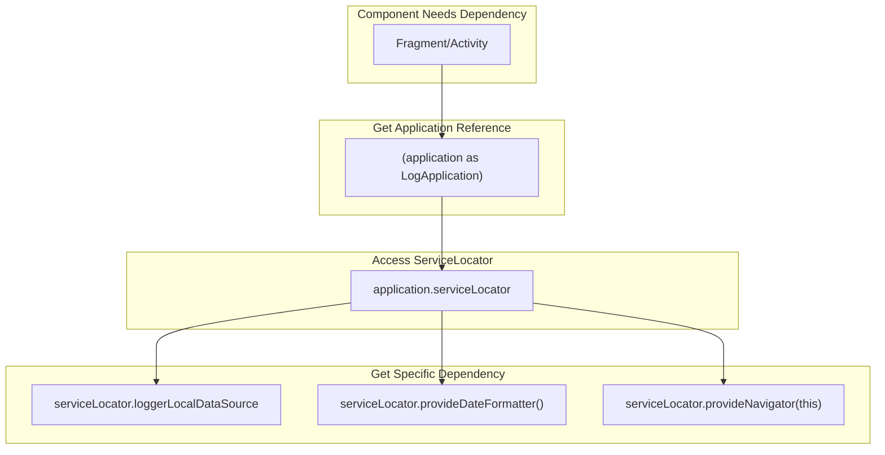

<!-- source: DeepWiki mcp.deepwiki.com · repo android/codelab-android-hilt · page 3 Application Architecture · fetched 2026-10-23 -->

# Application Architecture

<details>
<summary>Relevant source files</summary>

The following files were used as context for generating this wiki page:

- [app/src/main/AndroidManifest.xml](app/src/main/AndroidManifest.xml)
- [app/src/main/java/com/example/android/hilt/LogApplication.kt](app/src/main/java/com/example/android/hilt/LogApplication.kt)
- [app/src/main/java/com/example/android/hilt/ServiceLocator.kt](app/src/main/java/com/example/android/hilt/ServiceLocator.kt)

</details>


This document provides a comprehensive overview of the Android Hilt codelab application architecture, highlighting the main components and their interactions. It covers the high-level architecture, key components, and how they work together to implement a logging application.

For detailed information about specific architectural aspects, see:
- [Dependency Injection with Hilt](#3.1) for details on the Hilt implementation
- [Data Layer](#3.2) for database and data source specifics
- [UI Components](#3.3) for user interface implementation details

## Overview

The Android Hilt codelab application implements a simple logging system that demonstrates dependency injection patterns. The architecture follows modern Android development practices with clear separation of concerns across different layers.



Sources: [app/src/main/AndroidManifest.xml:17-40](), [app/src/main/java/com/example/android/hilt/LogApplication.kt:17-29](), [app/src/main/java/com/example/android/hilt/ServiceLocator.kt:17-43]()

## Key Architecture Components

### Application Layer

The Application Layer serves as the entry point and provides global application state and services.

- **LogApplication**: The application subclass that initializes the ServiceLocator
- **ServiceLocator**: Manages dependency creation and providing access throughout the app

### UI Layer

The UI Layer handles user interactions and displays data to the user.

- **MainActivity**: The main entry point activity
- **ButtonsFragment**: Contains buttons for adding logs and navigating to the logs view
- **LogsFragment**: Displays stored logs
- **AppNavigator/AppNavigatorImpl**: Handles navigation between UI components

### Data Layer

The Data Layer manages data operations and persistence.

- **AppDatabase**: Room database configuration
- **LogDao**: Data Access Object for database operations
- **Log Entity**: Database entity representing a log entry
- **LoggerLocalDataSource**: Repository that interfaces with the LogDao
- **DateFormatter**: Utility for formatting timestamp data

Sources: [app/src/main/java/com/example/android/hilt/ServiceLocator.kt:28-43]()

## Dependency Management

The application demonstrates two approaches to dependency management:

1. **Service Locator Pattern** (initial implementation): Centralizes dependency creation and management through the ServiceLocator class
2. **Dependency Injection with Hilt** (target implementation): Uses annotation-based dependency injection to automatically provide dependencies

### Service Locator Implementation

The ServiceLocator class is responsible for:
- Creating the Room database instance
- Providing the LoggerLocalDataSource
- Creating DateFormatter instances
- Providing AppNavigator implementations

```mermaid
classDiagram
    class LogApplication {
        +serviceLocator: ServiceLocator
        +onCreate()
    }
    
    class ServiceLocator {
        -logsDatabase: AppDatabase
        +loggerLocalDataSource: LoggerLocalDataSource
        +provideDateFormatter()
        +provideNavigator(activity)
    }
    
    class AppDatabase {
        +logDao()
    }
    
    class LoggerLocalDataSource {
        -logDao: LogDao
        +addLog()
        +getAllLogs()
        +removeLogs()
    }
    
    LogApplication --> ServiceLocator : creates
    ServiceLocator --> AppDatabase : creates
    ServiceLocator --> LoggerLocalDataSource : creates
    AppDatabase --> "LogDao" : provides
    ServiceLocator ..> "DateFormatter" : provides
    ServiceLocator ..> "AppNavigator" : provides
```

Sources: [app/src/main/java/com/example/android/hilt/LogApplication.kt:21-29](), [app/src/main/java/com/example/android/hilt/ServiceLocator.kt:28-43]()

## Data Flow and Component Interactions

The application follows a unidirectional data flow pattern for its main operations:



Sources: [app/src/main/java/com/example/android/hilt/ServiceLocator.kt:30-42]()

## Database Configuration

The application uses Room for data persistence, with the database set up in the ServiceLocator:

```
private val logsDatabase = Room.databaseBuilder(
    applicationContext,
    AppDatabase::class.java,
    "logging.db"
).build()
```

This creates an SQLite database named "logging.db" with tables defined by the AppDatabase class.

Sources: [app/src/main/java/com/example/android/hilt/ServiceLocator.kt:30-34]()

## Architectural Patterns

The application architecture employs several key design patterns:

1. **Repository Pattern**: LoggerLocalDataSource serves as a repository that abstracts data operations
2. **Service Locator Pattern**: The initial approach for dependency management
3. **Dependency Injection**: The target approach using Hilt (covered in detail in [Dependency Injection with Hilt](#3.1))
4. **Factory Pattern**: Used within the ServiceLocator to create various components

## Application Startup Flow

When the application starts:

1. The Android system instantiates the `LogApplication` class (specified in the AndroidManifest.xml)
2. `LogApplication.onCreate()` initializes the `ServiceLocator`
3. `ServiceLocator` creates the Room database and dependencies
4. `MainActivity` is launched as the entry point activity
5. `MainActivity` accesses dependencies through the `ServiceLocator` in the application

Sources: [app/src/main/AndroidManifest.xml:21-38](), [app/src/main/java/com/example/android/hilt/LogApplication.kt:21-29]()

## Dependency Access Pattern

Components access dependencies through the following pattern:



This manual dependency access pattern creates tight coupling between components and their dependencies, which is later addressed by implementing Hilt for dependency injection.

Sources: [app/src/main/java/com/example/android/hilt/LogApplication.kt:21-29](), [app/src/main/java/com/example/android/hilt/ServiceLocator.kt:28-43]()

## Architecture Benefits and Limitations

### Benefits of the Initial Architecture

1. **Clear separation of concerns**: UI, data, and application logic are separated
2. **Centralized dependency management**: ServiceLocator provides a single point for dependency creation
3. **Testability**: Components can be tested in isolation

### Limitations Addressed by Hilt

1. **Manual dependency wiring**: Requires manual coding to connect dependencies
2. **Global access to ServiceLocator**: Creates tight coupling
3. **Manual scoping of dependencies**: No built-in lifecycle management
4. **Boilerplate code**: Requires writing and maintaining ServiceLocator code

The transition to Hilt (covered in [Dependency Injection with Hilt](#3.1)) addresses these limitations while maintaining the benefits of the architecture.

## Conclusion

The application architecture demonstrates a clear separation of concerns with distinct layers for the application, UI, and data components. The initial implementation uses the ServiceLocator pattern for dependency management, which provides centralized access to dependencies but has limitations that are addressed by implementing Hilt for dependency injection.

---

