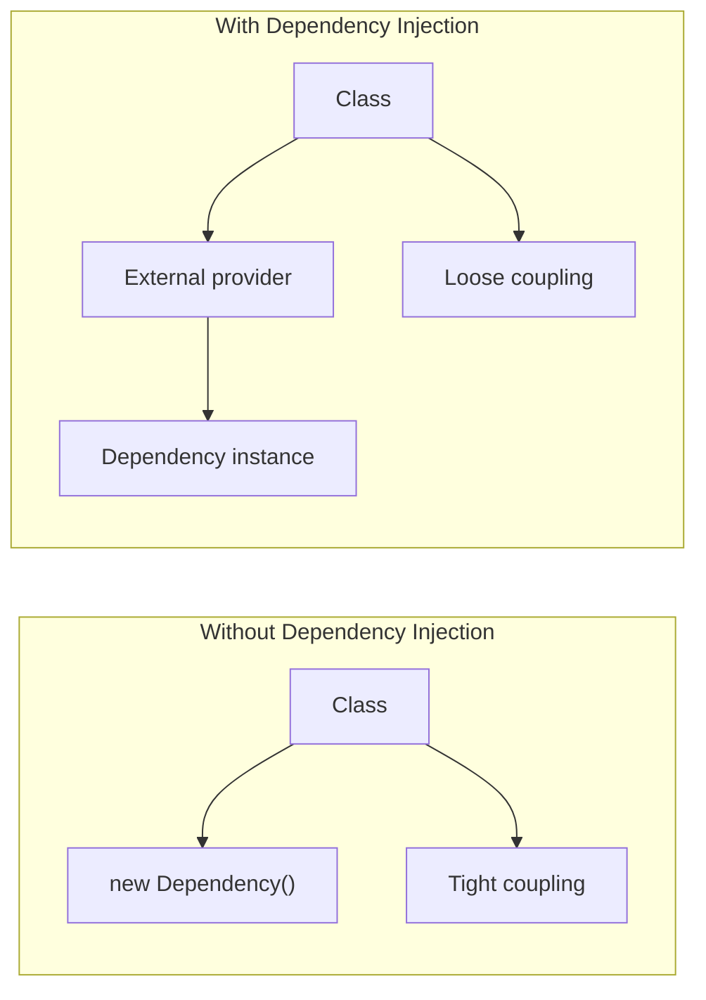
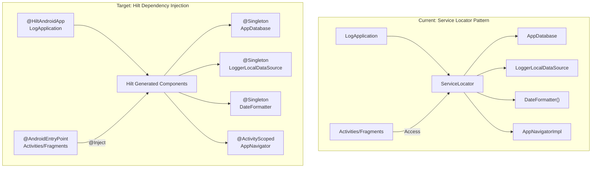
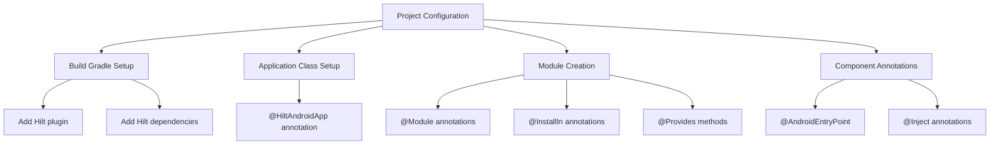
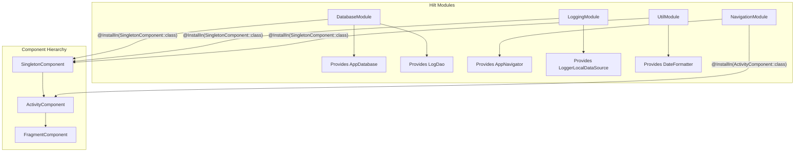
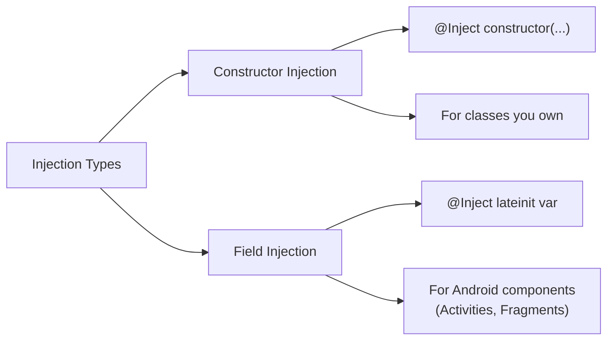
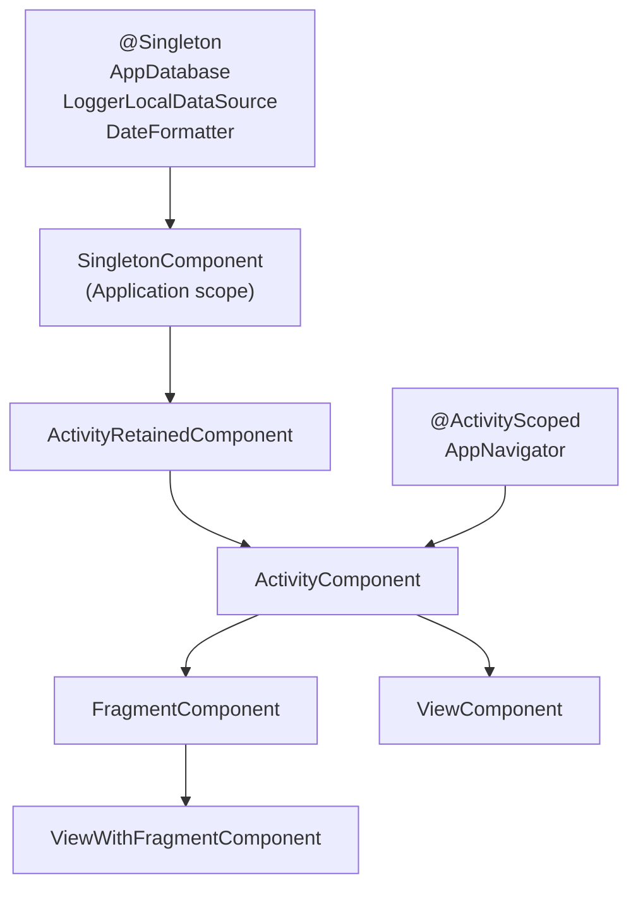
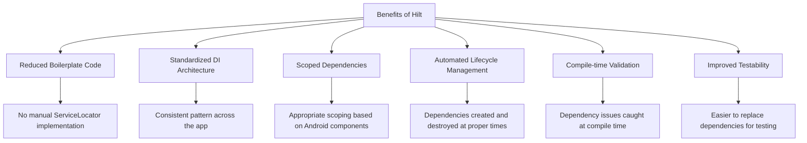

<!-- source: DeepWiki mcp.deepwiki.com · repo android/codelab-android-hilt · page 3.1 Dependency Injection with Hilt · fetched 2026-10-23 -->

# Dependency Injection with Hilt

<details>
<summary>Relevant source files</summary>

The following files were used as context for generating this wiki page:

- [app/build.gradle](app/build.gradle)
- [app/src/main/java/com/example/android/hilt/LogApplication.kt](app/src/main/java/com/example/android/hilt/LogApplication.kt)
- [app/src/main/java/com/example/android/hilt/ServiceLocator.kt](app/src/main/java/com/example/android/hilt/ServiceLocator.kt)

</details>


## Purpose and Scope

This document explains how dependency injection is implemented in the Android Hilt codelab application, focusing on Hilt as the dependency injection framework. We compare the ServiceLocator pattern (the "before" state of the codebase) with Hilt's automated dependency injection approach, explaining the benefits and implementation details of transitioning to Hilt.

For information about the overall application architecture, see [Application Architecture](#3). For details about specific data layer components, see [Data Layer](#3.2).

## Understanding Dependency Injection

Dependency injection is a design pattern that allows classes to receive their dependencies from external sources rather than creating them internally. This improves testability, modularity, and flexibility of the codebase.

### Diagram: Dependency Injection Concept



Sources: [app/src/main/java/com/example/android/hilt/ServiceLocator.kt]()

## Service Locator Pattern vs. Hilt

The codelab demonstrates the transition from manually providing dependencies through a ServiceLocator pattern to using Hilt's automated dependency injection.

### Diagram: ServiceLocator vs. Hilt Implementation



Sources: 
- [app/src/main/java/com/example/android/hilt/LogApplication.kt]()
- [app/src/main/java/com/example/android/hilt/ServiceLocator.kt]()

### Current Implementation: ServiceLocator

The ServiceLocator class centralizes dependency creation and management:

| Responsibility | Implementation |
|----------------|----------------|
| Database Creation | Creates `AppDatabase` instance via Room.databaseBuilder |
| Data Source Provision | Initializes `LoggerLocalDataSource` with the database DAO |
| Utility Provision | Provides `DateFormatter` instances |
| Navigation | Provides `AppNavigator` for fragment transactions |

The `LogApplication` class initializes the ServiceLocator in its `onCreate()` method:

```kotlin
// Current implementation in LogApplication
lateinit var serviceLocator: ServiceLocator

override fun onCreate() {
    super.onCreate()
    serviceLocator = ServiceLocator(applicationContext)
}
```

Dependencies are then accessed through the application instance:

```kotlin
// Example of accessing dependencies in a fragment
val logger = (requireActivity().application as LogApplication)
    .serviceLocator.loggerLocalDataSource
```

Sources:
- [app/src/main/java/com/example/android/hilt/LogApplication.kt]()
- [app/src/main/java/com/example/android/hilt/ServiceLocator.kt]()

## Hilt Implementation Requirements

### Diagram: Hilt Project Configuration



Sources:
- [app/build.gradle:17-23]()
- [app/build.gradle:69-71]()

### Build Configuration

Hilt requires specific Gradle configuration:

```kotlin
// Plugins required for Hilt
plugins {
    id 'kotlin-kapt'
    id 'dagger.hilt.android.plugin'
}

// Dependencies required for Hilt
dependencies {
    implementation "com.google.dagger:hilt-android:$hilt_version"
    kapt "com.google.dagger:hilt-android-compiler:$hilt_version"
}
```

Sources: 
- [app/build.gradle:17-23]()
- [app/build.gradle:69-71]()

### Application Modification

To implement Hilt, the `LogApplication` class needs to be annotated:

```kotlin
// Hilt implementation would modify LogApplication
@HiltAndroidApp
class LogApplication : Application() {
    // ServiceLocator no longer needed
    override fun onCreate() {
        super.onCreate()
        // Hilt handles dependency initialization
    }
}
```

## Hilt Dependency Provision

### Diagram: Hilt Module Structure



Sources:
- [app/src/main/java/com/example/android/hilt/ServiceLocator.kt:30-34]()
- [app/src/main/java/com/example/android/hilt/ServiceLocator.kt:36]()
- [app/src/main/java/com/example/android/hilt/ServiceLocator.kt:38-42]()

### Implementing Modules

Hilt uses modules to define how dependencies are created. The modules would replace the functionality in the current ServiceLocator:

#### Database Module

```kotlin
@Module
@InstallIn(SingletonComponent::class)
object DatabaseModule {
    @Provides
    @Singleton
    fun provideDatabase(@ApplicationContext context: Context): AppDatabase {
        return Room.databaseBuilder(
            context,
            AppDatabase::class.java,
            "logging.db"
        ).build()
    }
    
    @Provides
    fun provideLogDao(database: AppDatabase) = database.logDao()
}
```

#### Navigation Module

```kotlin
@Module
@InstallIn(ActivityComponent::class)
object NavigationModule {
    @Provides
    fun provideNavigator(activity: FragmentActivity): AppNavigator {
        return AppNavigatorImpl(activity)
    }
}
```

## Dependency Injection Methods

### Diagram: Injection Types in Hilt



Sources:
- [app/src/main/java/com/example/android/hilt/ServiceLocator.kt]()

### Constructor Injection

Constructor injection is used for classes that you create:

```kotlin
class LoggerLocalDataSource @Inject constructor(
    private val logDao: LogDao
) {
    // Implementation
}
```

### Field Injection

Field injection is used in Android components like activities and fragments:

```kotlin
@AndroidEntryPoint
class LogsFragment : Fragment() {
    @Inject lateinit var loggerLocalDataSource: LoggerLocalDataSource
    @Inject lateinit var dateFormatter: DateFormatter
    
    // Implementation
}
```

## Hilt Component Hierarchy

### Diagram: Hilt Standard Components



Sources:
- [app/src/main/java/com/example/android/hilt/ServiceLocator.kt]()

Hilt provides standard components that align with Android architecture components:

| Component | Scope | Lifetime | Used For |
|-----------|-------|----------|----------|
| SingletonComponent | @Singleton | Application lifetime | AppDatabase, LoggerLocalDataSource, DateFormatter |
| ActivityComponent | @ActivityScoped | Activity lifetime | AppNavigator |
| FragmentComponent | @FragmentScoped | Fragment lifetime | Fragment-specific dependencies |

## Benefits of Using Hilt

### Diagram: Advantages of Hilt Over ServiceLocator



Sources:
- [app/build.gradle:69-71]()
- [app/src/main/java/com/example/android/hilt/ServiceLocator.kt]()

### Key Advantages

1. **Reduced Boilerplate**: Eliminates need for manual ServiceLocator implementation
2. **Standardized Architecture**: Follows Android's component architecture
3. **Automated Lifecycle Management**: Dependencies are automatically created and destroyed based on their scope
4. **Compile-time Validation**: Dependency graph is verified during compilation
5. **Improved Testability**: Dependencies can be easily replaced for testing

## Refactoring Considerations

When migrating from ServiceLocator to Hilt:

1. Start by adding Hilt dependencies and plugins to build.gradle
2. Annotate Application class with @HiltAndroidApp
3. Create modules to provide dependencies
4. Annotate Android components with @AndroidEntryPoint
5. Convert manual dependency retrieval to @Inject annotations
6. Remove ServiceLocator class once migration is complete

Sources:
- [app/src/main/java/com/example/android/hilt/LogApplication.kt]()
- [app/src/main/java/com/example/android/hilt/ServiceLocator.kt]()
- [app/build.gradle:69-71]()

---

