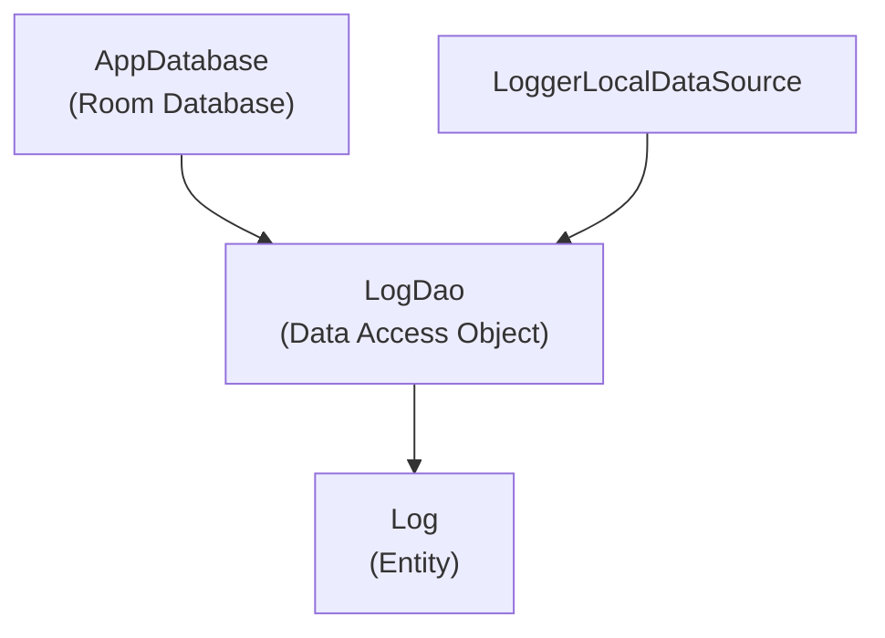
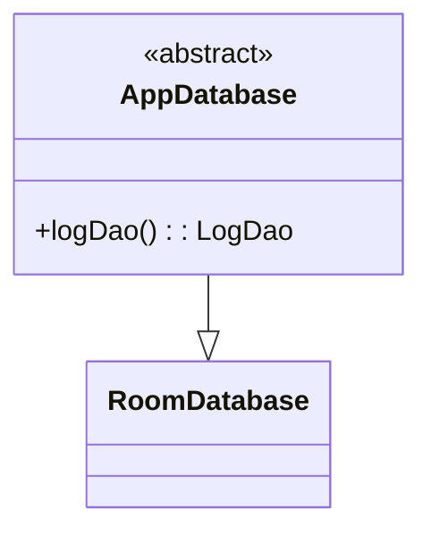
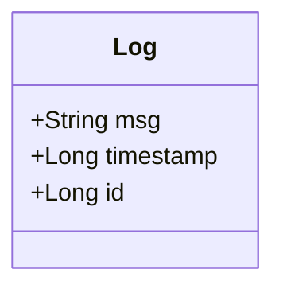
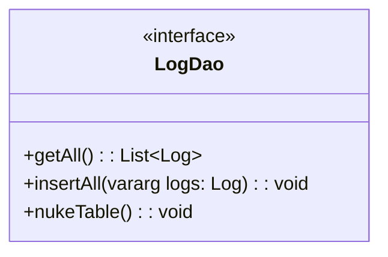
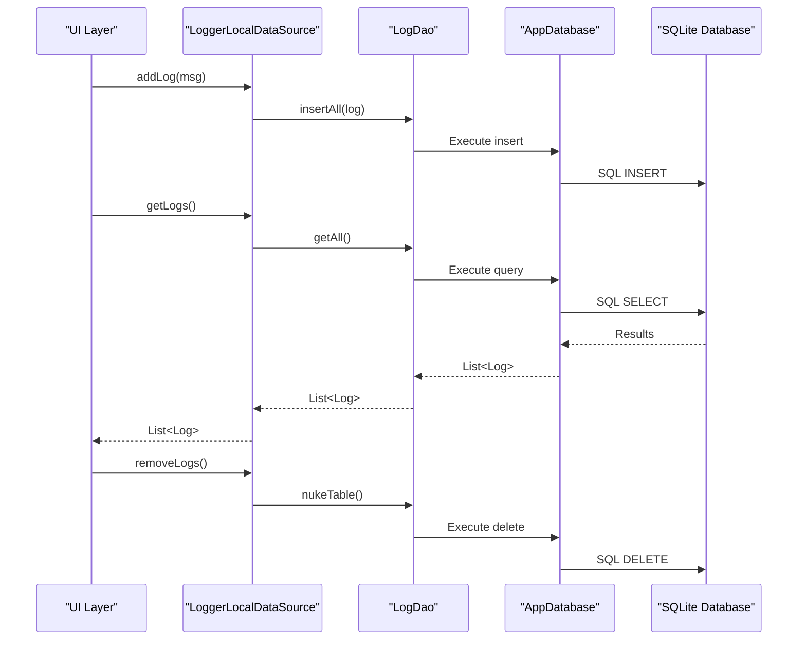
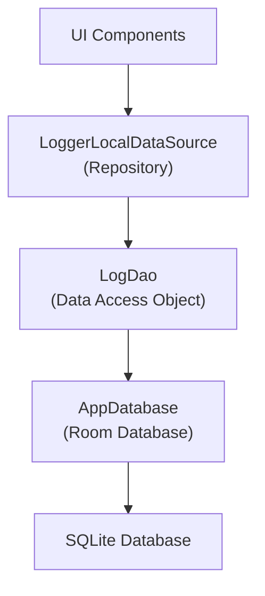

<!-- source: DeepWiki mcp.deepwiki.com · repo android/codelab-android-hilt · page 3.2 Data Layer · fetched 2026-10-23 -->

# Data Layer

Relevant source files

The following files were used as context for generating this wiki page:

- [app/src/main/java/com/example/android/hilt/data/AppDatabase.kt](app/src/main/java/com/example/android/hilt/data/AppDatabase.kt)
- [app/src/main/java/com/example/android/hilt/data/Log.kt](app/src/main/java/com/example/android/hilt/data/Log.kt)
- [app/src/main/java/com/example/android/hilt/data/LogDao.kt](app/src/main/java/com/example/android/hilt/data/LogDao.kt)

## Purpose and Scope

This document describes the data persistence architecture in the Android Hilt codelab application. It covers the Room database implementation, including the database definition, entity structure, and data access mechanisms. For information about how this data layer integrates with Hilt dependency injection, see [Dependency Injection with Hilt](#3.1).

## Room Database Architecture

The application uses Room, a part of Android Jetpack, to provide an abstraction layer over SQLite for database operations. The data layer follows a clean architecture approach with three main components:

Sources: [app/src/main/java/com/example/android/hilt/data/AppDatabase.kt](), [app/src/main/java/com/example/android/hilt/data/LogDao.kt](), [app/src/main/java/com/example/android/hilt/data/Log.kt]()

### Database Definition

The application defines a Room database called `AppDatabase` which serves as the main access point for the underlying SQLite database.

The database is defined in [app/src/main/java/com/example/android/hilt/data/AppDatabase.kt:25-28]() and contains the following key elements:

- Extends `RoomDatabase`
- Annotated with `@Database` to specify entities and version
- Includes a single entity: `Log`
- Contains an abstract method `logDao()` that returns the DAO interface

Sources: [app/src/main/java/com/example/android/hilt/data/AppDatabase.kt]()

### Entity Structure

The application defines a single entity called `Log` that represents a log entry in the database.

The `Log` entity [app/src/main/java/com/example/android/hilt/data/Log.kt:25-30]() has the following properties:

| Property  | Type   | Description                      | Annotations              |
|-----------|--------|----------------------------------|--------------------------|
| msg       | String | The log message text             | -                        |
| timestamp | Long   | Unix timestamp of the log entry  | -                        |
| id        | Long   | Unique identifier for the entry  | @PrimaryKey(autoGenerate = true) |

The entity is annotated with `@Entity(tableName = "logs")` to define the table name in the database.

Sources: [app/src/main/java/com/example/android/hilt/data/Log.kt]()

### Data Access Object (DAO)

The Data Access Object pattern is implemented through the `LogDao` interface, which provides methods to interact with the database.

The `LogDao` interface [app/src/main/java/com/example/android/hilt/data/LogDao.kt:26-37]() provides the following methods:

| Method       | Return Type | Parameters      | SQL Query                                | Description                       |
|--------------|-------------|-----------------|------------------------------------------|-----------------------------------|
| getAll()     | List\<Log\> | None            | SELECT * FROM logs ORDER BY id DESC      | Retrieves all logs in reverse chronological order |
| insertAll()  | void        | vararg logs: Log| (Handled by Room)                        | Inserts one or more log entries   |
| nukeTable()  | void        | None            | DELETE FROM logs                         | Deletes all logs from the table   |

The DAO is annotated with `@Dao` and uses Room annotations (`@Query`, `@Insert`) to define database operations.

Sources: [app/src/main/java/com/example/android/hilt/data/LogDao.kt]()

## Data Flow

The following diagram illustrates how data flows through the application's data layer:

Sources: [app/src/main/java/com/example/android/hilt/data/LogDao.kt]()

## Database Operations

The data layer supports three primary operations:

1. **Adding logs**: Creates new log entries with a message and timestamp
2. **Retrieving logs**: Fetches all logs from the database in reverse chronological order
3. **Clearing logs**: Removes all logs from the database

These operations are implemented through the DAO methods and are typically accessed via a repository pattern implementation.

### Data Access Pattern

The application follows a structured data access pattern:

This layered approach provides:
- Separation of concerns
- Abstraction of data source details from UI components
- Centralized data access logic
- Improved testability

Sources: [app/src/main/java/com/example/android/hilt/data/AppDatabase.kt](), [app/src/main/java/com/example/android/hilt/data/LogDao.kt](), [app/src/main/java/com/example/android/hilt/data/Log.kt]()

## Room Database Creation

The database instance is not created directly in any of the data layer files. Instead, it would typically be created and provided through dependency injection (Hilt) or a service locator pattern. The creation would involve:

1. Building the database using `Room.databaseBuilder()`
2. Specifying the database name and migration strategies
3. Creating a singleton instance to be used throughout the application

The database instance creation is handled in the dependency injection framework, as described in [Dependency Injection with Hilt](#3.1).

Sources: [app/src/main/java/com/example/android/hilt/data/AppDatabase.kt]()

---

