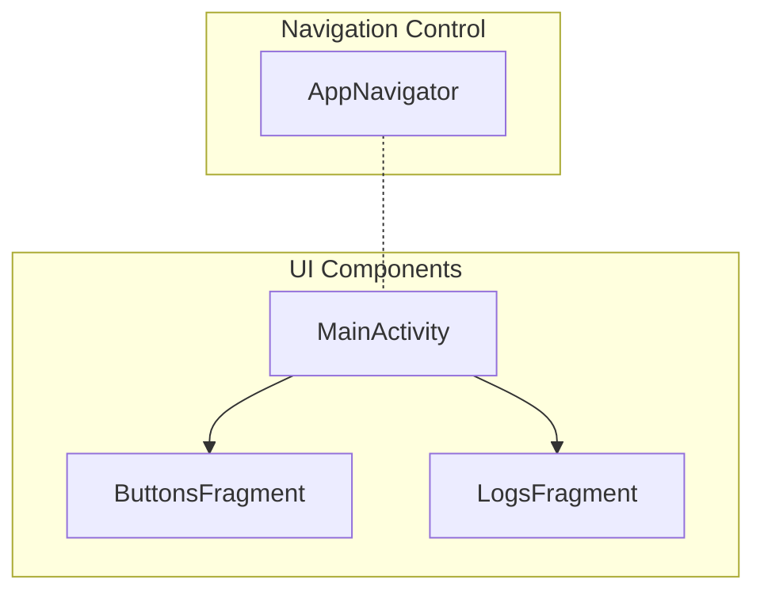
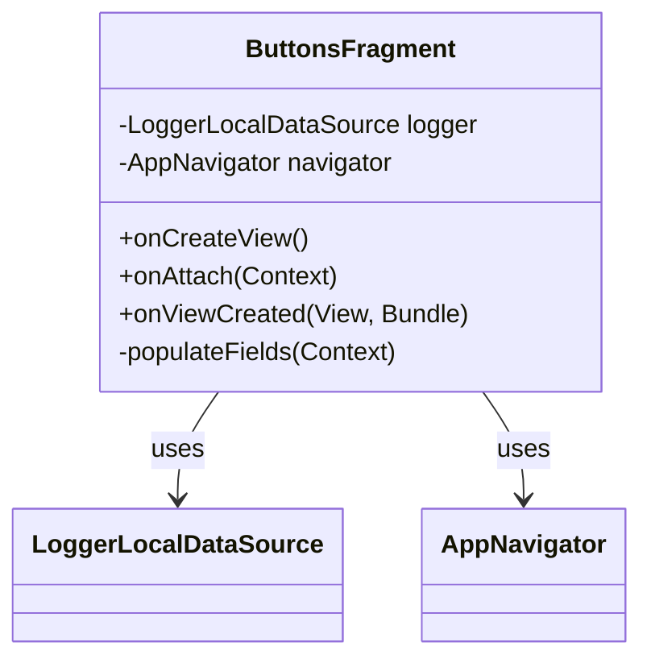
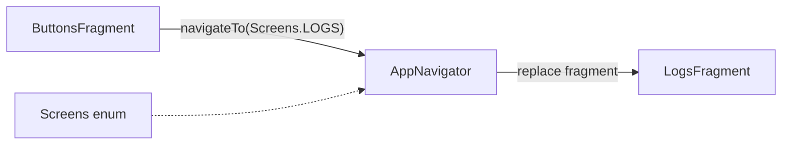
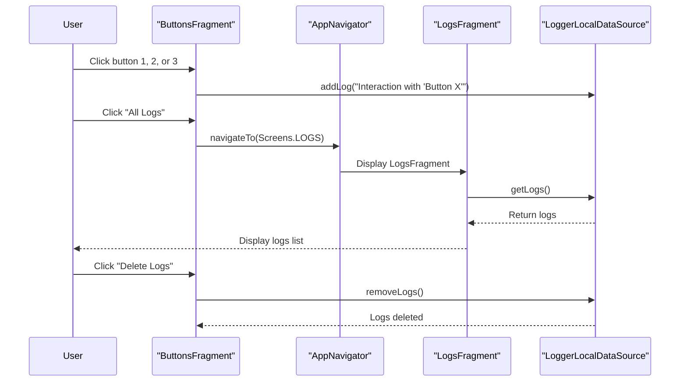
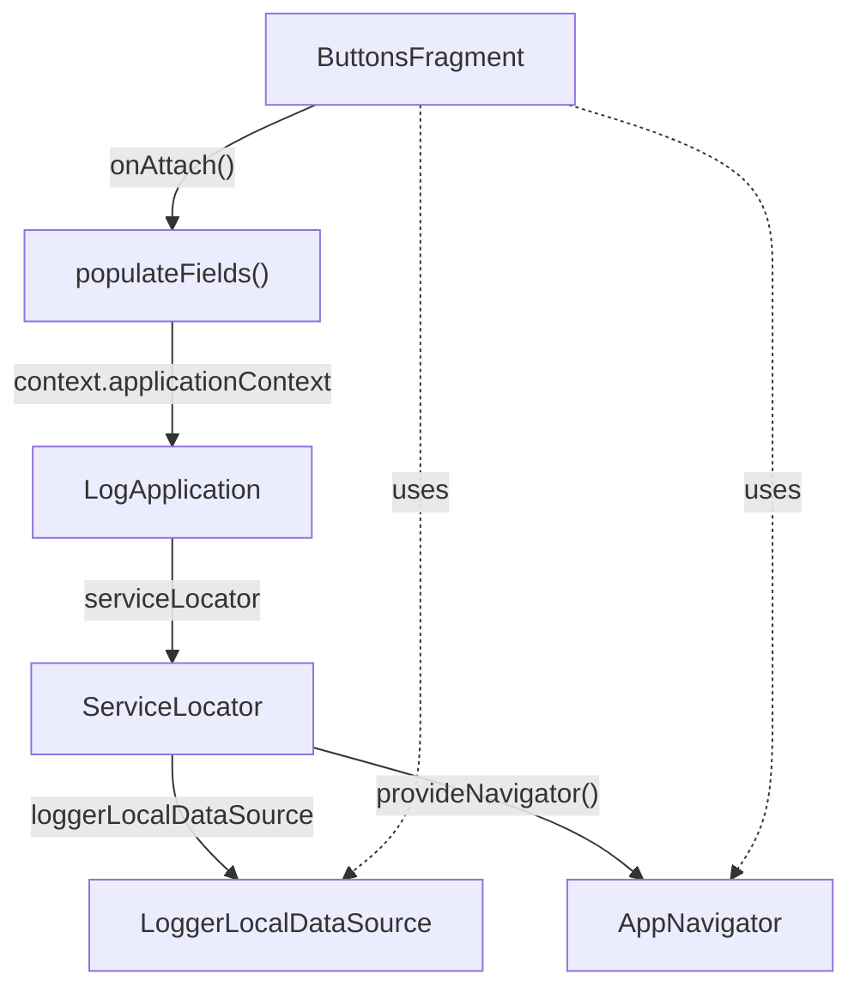

<!-- source: DeepWiki mcp.deepwiki.com · repo android/codelab-android-hilt · page 3.3 UI Components · fetched 2026-10-23 -->

# UI Components

Relevant source files

The following files were used as context for generating this wiki page:

- [app/src/main/AndroidManifest.xml](app/src/main/AndroidManifest.xml)
- [app/src/main/java/com/example/android/hilt/ui/ButtonsFragment.kt](app/src/main/java/com/example/android/hilt/ui/ButtonsFragment.kt)

This document covers the user interface components of the Android Hilt codelab application. It describes the main UI elements, their responsibilities, and the navigation flow between them. For information about the data layer that these components interact with, see [Data Layer](#3.2). For details on how dependency injection is implemented across these components, see [Dependency Injection with Hilt](#3.1).

## Overview of UI Structure

The application has a simple UI structure consisting of a main activity and two fragments. The main activity serves as the container for the fragments, while the fragments handle specific user interactions and displays.

Sources: [app/src/main/AndroidManifest.xml:29-38](), [app/src/main/java/com/example/android/hilt/ui/ButtonsFragment.kt:35-83]()

## Main UI Components

### MainActivity

The MainActivity is the application's entry point and the container for all fragments. It implements the navigation mechanism using the AppNavigator.

Key responsibilities:
- Acts as the primary UI container
- Hosts fragments (ButtonsFragment and LogsFragment)
- Provides fragment transaction functionality via AppNavigator

Sources: [app/src/main/AndroidManifest.xml:29-38]()

### ButtonsFragment

The ButtonsFragment displays interactive buttons that allow users to:
- Record interactions with three different buttons (stored as logs)
- Navigate to the logs screen to view all recorded logs
- Delete all logs from the system

When a user clicks one of the three primary buttons, the fragment logs the interaction through the LoggerLocalDataSource. The "All Logs" button triggers navigation to the LogsFragment via the AppNavigator, while the "Delete Logs" button clears all logs from the database.

Sources: [app/src/main/java/com/example/android/hilt/ui/ButtonsFragment.kt:35-83]()

### LogsFragment

The LogsFragment displays a list of recorded logs retrieved from the database. It shows all interactions the user has had with the three buttons in ButtonsFragment, along with timestamps.

Key responsibilities:
- Retrieve logs from LoggerLocalDataSource
- Display logs in a readable format
- Update the display when logs change

## Navigation System

### AppNavigator Interface and Implementation

The navigation between fragments is managed by the AppNavigator interface and its implementation. This approach decouples the navigation logic from the fragments, enhancing maintainability and testability.

The AppNavigator is responsible for fragment transactions within the MainActivity. The ButtonsFragment uses it to navigate to the LogsFragment when the user wants to view all logs.

The navigation is implemented using the Screens enum to define available destinations in the app.

Sources: [app/src/main/java/com/example/android/hilt/ui/ButtonsFragment.kt:76-77]()

## UI Component Interactions

The UI components interact with each other and with the data layer in a well-defined flow:

Sources: [app/src/main/java/com/example/android/hilt/ui/ButtonsFragment.kt:62-82]()

## Dependency Acquisition

In the current implementation, UI components obtain their dependencies through the ServiceLocator pattern. When using ButtonsFragment as an example:

When the ButtonsFragment is attached to its context, it retrieves the required dependencies:
1. It obtains the LoggerLocalDataSource from the application's ServiceLocator
2. It obtains the AppNavigator from the ServiceLocator, passing the activity as a parameter

This approach will be replaced with Hilt dependency injection in the final implementation, where dependencies will be injected directly into the UI components using annotations.

Sources: [app/src/main/java/com/example/android/hilt/ui/ButtonsFragment.kt:48-60]()

## UI Layout Structure

The ButtonsFragment uses a layout defined in `fragment_buttons.xml` which contains:
- Three interactive buttons that log interactions
- A button to view all logs
- A button to delete all logs

The LogsFragment likely uses a layout that includes a RecyclerView or similar component to display the list of logs retrieved from the database.

Sources: [app/src/main/java/com/example/android/hilt/ui/ButtonsFragment.kt:40-46](), [app/src/main/java/com/example/android/hilt/ui/ButtonsFragment.kt:62-82]()

## Summary

The UI layer of the application consists of:

| Component | Purpose |
|-----------|---------|
| MainActivity | Main container for fragments and entry point for the application |
| ButtonsFragment | Provides interactive buttons that record user interactions and controls navigation |
| LogsFragment | Displays the history of user interactions with the buttons |
| AppNavigator | Manages navigation between fragments |

This simple UI structure demonstrates common patterns in Android development while providing a foundation for implementing Hilt dependency injection to replace the ServiceLocator pattern.

---

