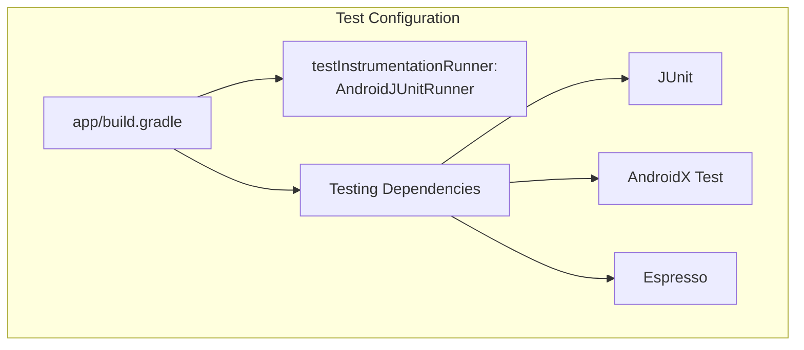
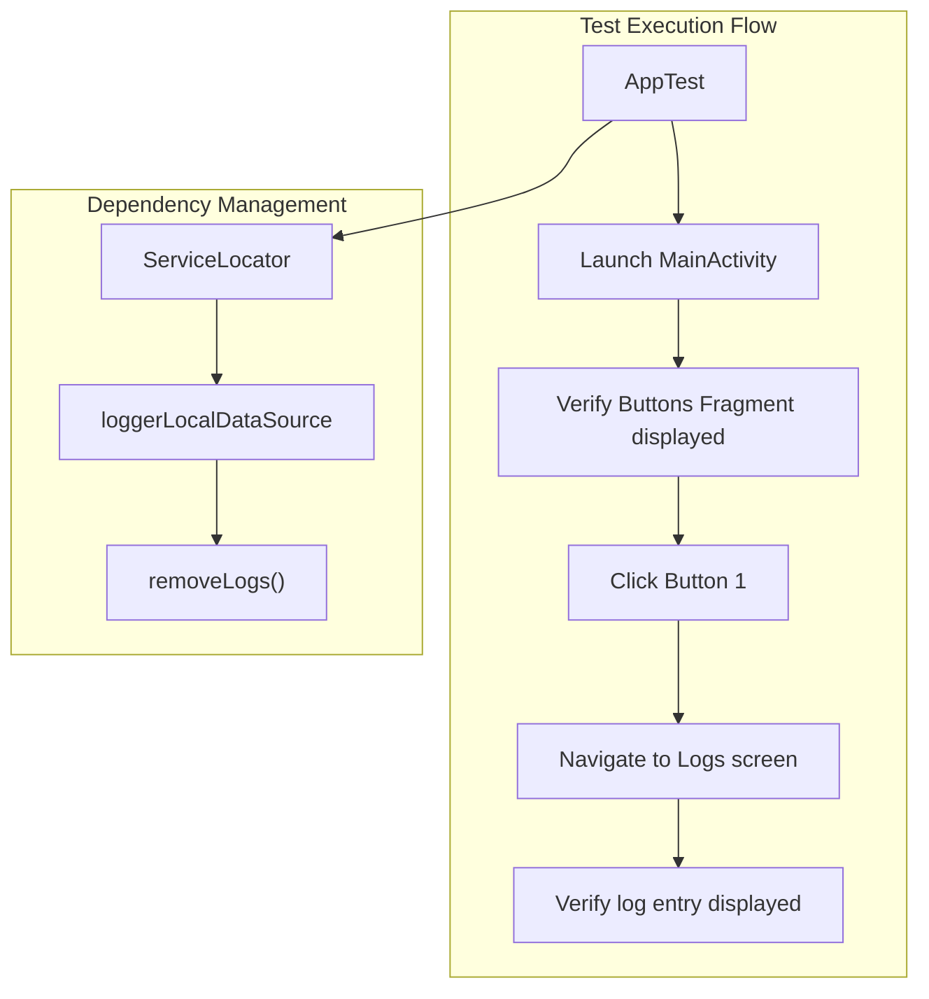
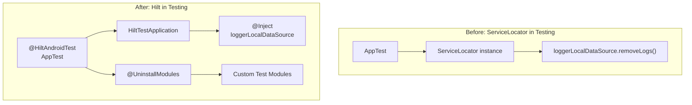
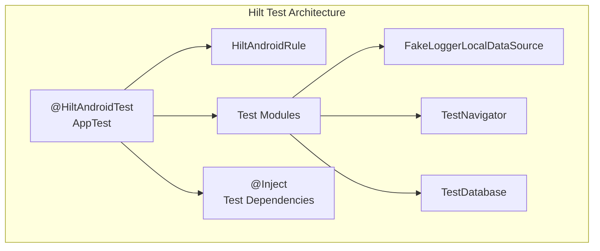
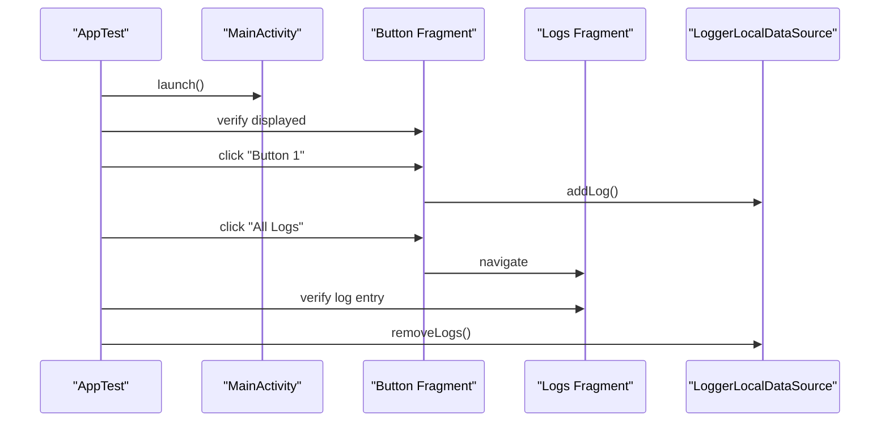

<!-- source: DeepWiki mcp.deepwiki.com · repo android/codelab-android-hilt · page 4 Testing the Application · fetched 2026-10-23 -->

# Testing the Application

Relevant source files

The following files were used as context for generating this wiki page:

- [app/build.gradle](app/build.gradle)
- [app/src/androidTest/java/com/example/android/hilt/AppTest.kt](app/src/androidTest/java/com/example/android/hilt/AppTest.kt)

## Purpose and Scope

This document details the testing approach for the Android Hilt Codelab application. It focuses on instrumentation tests using Hilt for dependency injection, explaining how tests are structured, configured, and executed. This page covers testing configuration, test implementation patterns, and how Hilt facilitates testing through dependency injection.

For information about the application architecture and components being tested, see [Application Architecture](#3).

## Testing Configuration

The application uses standard Android testing libraries configured in the build.gradle file. The test instrumentation runner is set to the default `AndroidJUnitRunner`.

Sources: [app/build.gradle:36-36](), [app/build.gradle:62-67]()

### Test Dependencies

The application uses the following testing dependencies:

| Dependency | Purpose |
|------------|---------|
| JUnit | Core testing framework |
| AndroidX Test Core-KTX | Android-specific testing utilities |
| AndroidX Test JUnit Extensions | JUnit extensions for Android testing |
| AndroidX Test Rules | Test rules for instrumentation tests |
| Espresso | UI testing framework |

Sources: [app/build.gradle:62-67]()

## Test Implementation

### Current Testing Approach

The application includes an instrumentation test that validates the basic user flow through the application. This test currently uses the ServiceLocator pattern for managing dependencies during testing.

Sources: [app/src/androidTest/java/com/example/android/hilt/AppTest.kt:34-60]()

### Key Test Components

The main test class `AppTest` includes:

1. **Test Setup/Teardown**: 
   - Teardown method that cleans up logs after each test using ServiceLocator
   - This ensures test isolation by preventing data from one test affecting others

2. **Happy Path Test**:
   - Launches the main activity
   - Performs UI interactions using Espresso
   - Verifies expected UI states using view matchers

Sources: [app/src/androidTest/java/com/example/android/hilt/AppTest.kt:37-59]()

## Transitioning to Hilt for Testing

While the current test uses the ServiceLocator pattern, the application is designed to use Hilt for dependency injection. Here's how testing can be transitioned to use Hilt:

### Implementing Hilt in Tests

To transition tests to use Hilt for dependency injection, the following changes would be needed:

1. **Test Annotations**:
   - Add `@HiltAndroidTest` annotation to test classes
   - Use `@UninstallModules` to replace production modules with test modules when needed

2. **Custom Test Rule**:
   - Use `HiltAndroidRule` to manage the Hilt component's lifecycle in tests

3. **Test Modules**:
   - Create test-specific modules that provide test doubles (mocks, fakes, etc.)

4. **Test Application**:
   - Use `HiltTestApplication` as the application class for tests

### Test Doubles with Hilt

## Espresso UI Testing Integration

The application uses Espresso for UI testing, which integrates well with Hilt for dependency injection in tests.

Sources: [app/src/androidTest/java/com/example/android/hilt/AppTest.kt:43-59]()

## Best Practices for Testing with Hilt

1. **Separate Test Modules**: Create dedicated modules for testing to provide test doubles.

2. **Targeted Module Replacement**: Use `@UninstallModules` to replace only the necessary modules, keeping the rest of the dependency graph intact.

3. **Consistent Teardown**: Ensure proper cleanup after tests using `@After` methods to maintain test isolation.

4. **Test Hierarchies**: Structure tests to match the application's component hierarchy (Application, Activity, Fragment).

5. **Custom Test Application**: When needed, create a custom test application class to control application-level dependencies.

Sources: [app/src/androidTest/java/com/example/android/hilt/AppTest.kt:37-40]()

## Test Execution

The application's tests can be executed through:

1. Android Studio's test runner
2. Gradle command line: `./gradlew connectedAndroidTest`
3. Continuous integration systems

Test results provide information about test success/failure and execution time, helping identify issues in the application's functionality.

---

