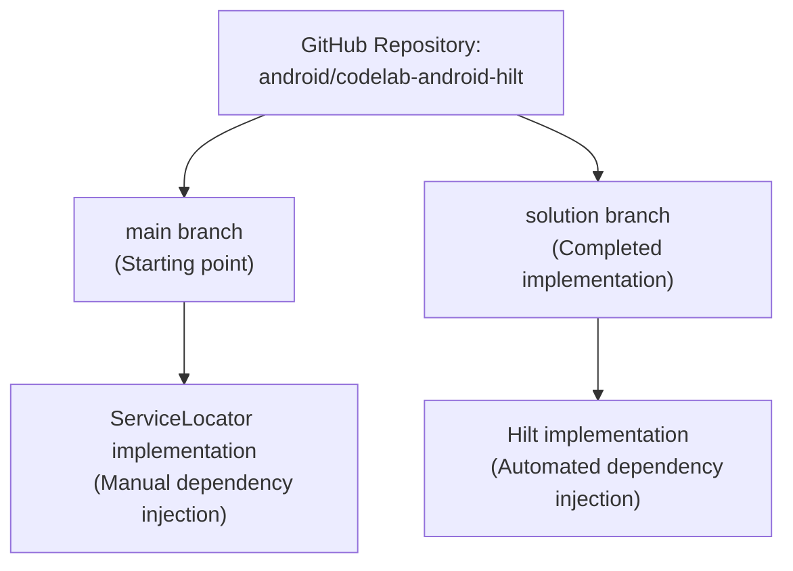
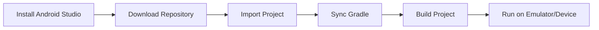
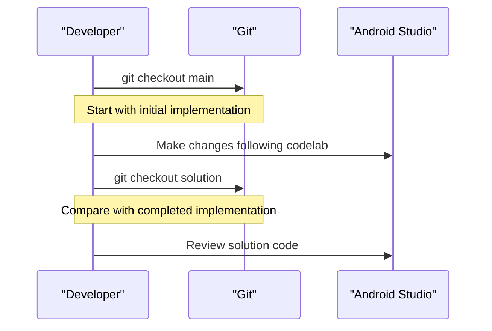
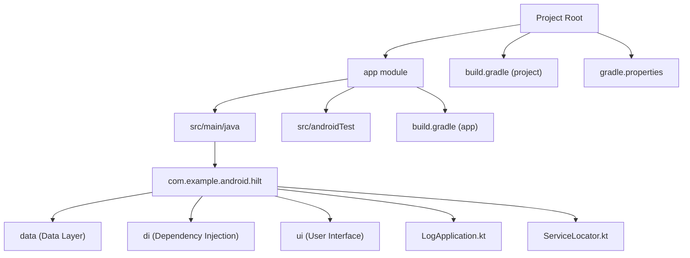
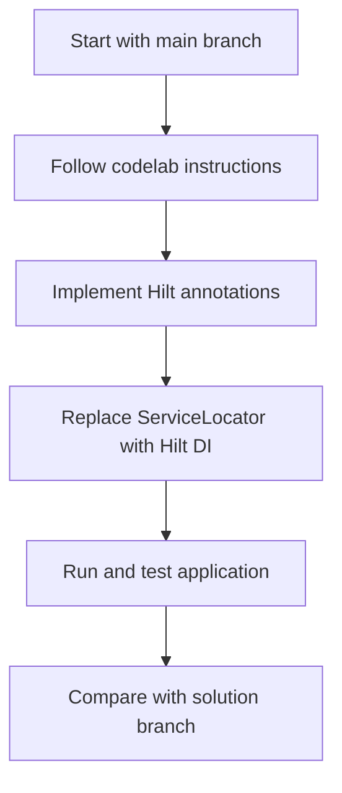
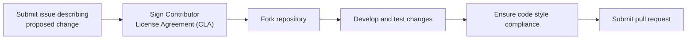

<!-- source: DeepWiki mcp.deepwiki.com · repo android/codelab-android-hilt · page 5 Project Setup and Development · fetched 2026-10-23 -->

# Project Setup and Development

<details>
<summary>Relevant source files</summary>

The following files were used as context for generating this wiki page:

- [.gitignore](.gitignore)
- [CONTRIBUTING.md](CONTRIBUTING.md)
- [LICENSE](LICENSE)
- [README.md](README.md)
- [app/.gitignore](app/.gitignore)

</details>


This page provides detailed instructions for setting up, building, and contributing to the Android Hilt codelab project. It covers the initial environment setup, project structure, build process, and development workflows. For information about the application architecture, see [Application Architecture](#3).

## 1. Prerequisites

Before starting development with this codelab, ensure you have the following:

- Experience with Kotlin syntax
- Understanding of Dependency Injection concepts
- Android Studio (latest stable version recommended)
- Git for version control

Sources: [README.md:21-23]()

## 2. Project Structure

The Android Hilt codelab is organized into multiple branches to facilitate the learning process:



The project demonstrates the migration from manual dependency injection using the ServiceLocator pattern to automated dependency injection with Hilt. This structure allows you to:

1. Start with the initial implementation in the `main` branch
2. Work through the codelab steps to implement Hilt
3. Compare your implementation with the `solution` branch

Sources: [README.md:5-7](), [README.md:32-33]()

## 3. Development Environment Setup

Setting up your development environment requires the following steps:



### 3.1 Installing Android Studio

1. Download and install the latest stable version of Android Studio from the [official website](https://developer.android.com/studio)
2. During installation, ensure the Android SDK, platform tools, and emulator components are selected

### 3.2 Downloading the Codelab Repository

Clone the repository using Git:

```
git clone https://github.com/android/codelab-android-hilt.git
```

Alternatively, download the ZIP file directly from GitHub and extract it to your preferred location.

### 3.3 Importing the Project

1. Start Android Studio
2. Select "Open an Existing Project"
3. Navigate to the cloned/downloaded repository folder
4. Select the root folder and click "OK"
5. Wait for the project to be indexed and Gradle to sync

Sources: [README.md:25-29]()

## 4. Building and Running the Project

Once you've imported the project, you can build and run it using these steps:

### 4.1 Building the Project

1. In Android Studio, select Build > Build Project from the menu
2. Wait for the build process to complete
3. Check the Build output panel for any errors or warnings

### 4.2 Running on an Emulator or Device

1. Connect a physical device or set up an emulator
2. Select the appropriate device from the target device dropdown
3. Click the Run button (green triangle) in the toolbar
4. Wait for the application to install and launch

### 4.3 Switching Between Branches

To work with different stages of the codelab:



1. Open the Terminal in Android Studio
2. Use `git checkout main` to switch to the starting point
3. Use `git checkout solution` to view the completed implementation
4. After switching branches, wait for Gradle to sync

Sources: [README.md:25-29]()

## 5. Project Structure and Key Files

The project follows a standard Android application structure with specific components related to dependency injection:



Key directories and files include:

| Directory/File | Purpose |
|----------------|---------|
| `data/` | Contains database entities, DAOs, and data sources |
| `di/` | Contains Hilt modules and component definitions (in solution branch) |
| `ui/` | Contains activities, fragments, and UI-related code |
| `LogApplication.kt` | Application class, entry point for the app |
| `ServiceLocator.kt` | Manual dependency injection implementation (main branch) |
| `build.gradle` | Build configuration with dependencies and plugins |

Sources: [README.md:10-18]()

## 6. Development Workflow

When developing or modifying this project, follow these recommended workflows:

### 6.1 Codelab Completion Workflow



### 6.2 Contribution Workflow

If you want to contribute improvements or fixes to the codelab:



1. Submit an issue describing your proposed change
2. Sign the appropriate Contributor License Agreement (CLA)
3. Fork the repository and develop your changes
4. Ensure your code follows the Android Code Style Guide
5. Include appropriate tests for your changes
6. Submit a pull request with your changes

Sources: [CONTRIBUTING.md:3-34]()

## 7. Testing

Testing is an important part of the development process. The project includes instrumentation tests that can be run:

### 7.1 Running Tests

1. In Android Studio, right-click on the `app/src/androidTest` directory
2. Select "Run Tests in android"
3. View test results in the Run tool window

### 7.2 Writing Tests

When contributing new features, ensure:

1. Tests are present for new functionality
2. All tests pass with your changes
3. Tests follow the existing style and patterns in the codelab

For more detailed information about testing the application with Hilt, see [Testing the Application](#4).

Sources: [CONTRIBUTING.md:27-33]()

## 8. License and Legal Information

This project is licensed under the Apache License, Version 2.0. Key points:

- You can freely use, modify, and distribute the code
- You must include the original license and copyright notice
- Changes to files should be marked with prominent notices
- Contributions are submitted under the same license terms

For the full license text, see the LICENSE file in the repository.

Sources: [LICENSE:1-199](), [README.md:36-51]()

## 9. Troubleshooting Common Issues

| Issue | Resolution |
|-------|------------|
| Gradle sync fails | Ensure you have the latest Android Gradle Plugin and Kotlin plugin versions |
| Build errors with Hilt | Verify that Hilt dependencies and plugins are correctly configured in build.gradle files |
| Run-time dependency errors | Check that all components are properly annotated with Hilt annotations |
| Missing generated code | Run "Make Project" to trigger annotation processing |
| Test failures | Ensure Hilt test dependencies are included and test components are properly annotated |

Sources: [README.md:25-29]()