# Page: Android Hilt Codelab Overview

# Android Hilt Codelab Overview

<details>
<summary>Relevant source files</summary>

The following files were used as context for generating this wiki page:

- [README.md](README.md)
- [app/build.gradle](app/build.gradle)
- [build.gradle](build.gradle)

</details>


## Purpose and Scope

This document provides an overview of the Android Hilt Codelab repository located at [https://github.com/android/codelab-android-hilt](). The codelab demonstrates how to implement dependency injection in Android applications using Hilt, Google's recommended dependency injection library for Android. It covers the transition from manual dependency management to automated dependency injection with Hilt, highlighting the benefits and implementation details.

For specific information about the build system configuration, see [Build System Configuration](#2). For detailed application architecture, see [Application Architecture](#3).

Sources: [README.md:1-29]()

## Repository Structure

The codelab is structured across multiple branches:
- `main` branch: Starting point of the codelab with a functional application using manual dependency management
- `solution` branch: Completed implementation demonstrating proper Hilt integration

This structure allows developers to compare the application before and after implementing Hilt, providing a clear view of the changes required.

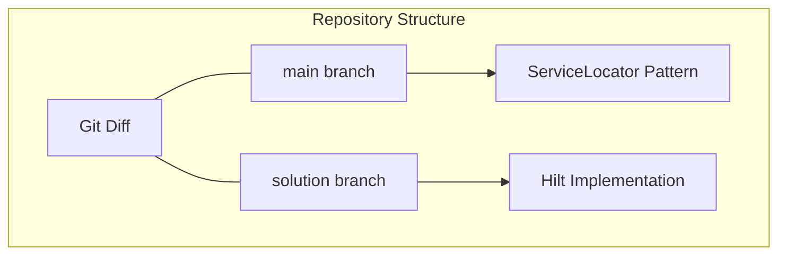

Sources: [README.md:5-7]()

## Educational Goals

The primary educational goals of this codelab are:

1. Demonstrate the benefits of dependency injection in Android app architecture:
   - Reusability of code
   - Ease of refactoring
   - Improved testability

2. Provide a practical implementation of Hilt in an Android application

3. Show the migration process from manual dependency management to Hilt

Sources: [README.md:10-18]()

## System Architecture Overview

The application follows a modern Android architecture with clear separation of concerns between different layers. It implements a logging system that allows users to create, view, and delete logs.

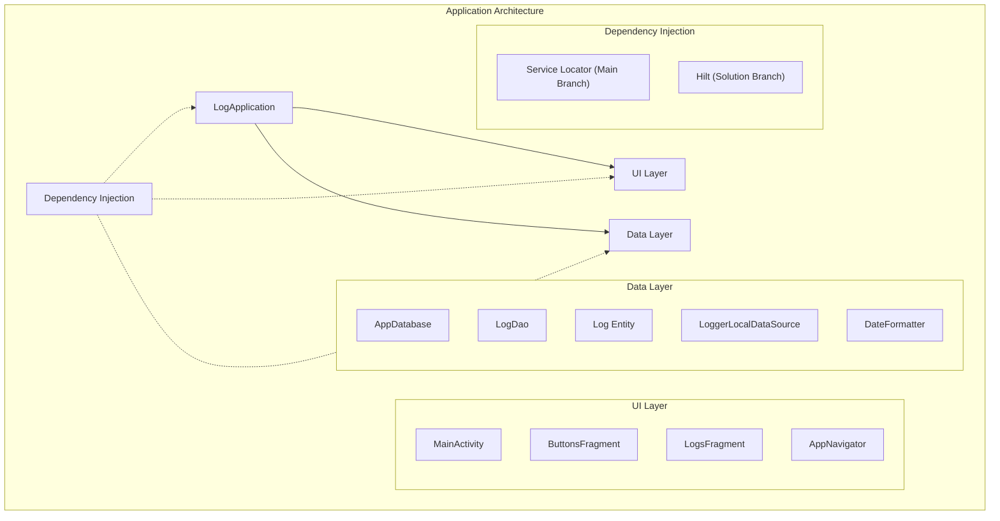

The architecture consists of:
- **Application Layer**: Entry point for the application
- **UI Layer**: Activities and fragments that display data and handle user interactions
- **Data Layer**: Database, entities, and data access objects for log storage and retrieval
- **Dependency Injection Layer**: Either ServiceLocator (main branch) or Hilt (solution branch)

Sources: [README.md:10-18](), [app/build.gradle:52-71]()

## Technology Stack

The codelab utilizes the following technologies:

| Component | Technology | Purpose |
|-----------|------------|---------|
| Language | Kotlin 1.7.20 | Primary programming language |
| Dependency Injection | Hilt 2.40.1 | Automated dependency injection |
| Database | Room 2.4.3 | Local data persistence |
| UI | AndroidX components | UI components and RecyclerView |
| Testing | JUnit, Espresso | Unit and UI testing |

Sources: [build.gradle:17-29](), [app/build.gradle:51-71]()

## Dependency Injection Evolution

One of the core educational aspects of this codelab is demonstrating the evolution from manual dependency management to Hilt-based dependency injection.

### Before: Service Locator Pattern

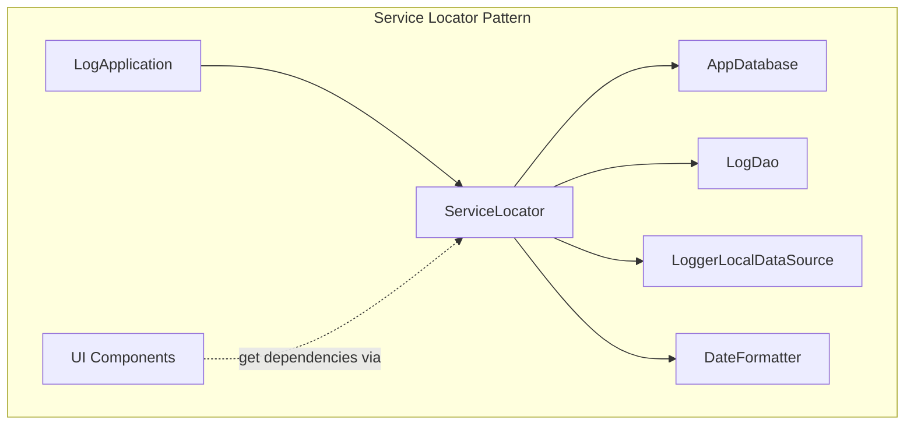

### After: Hilt Dependency Injection

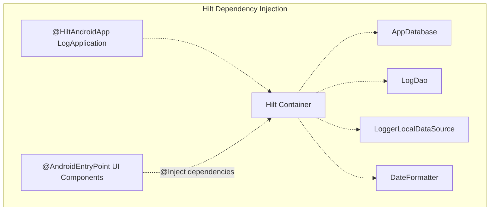

The transition to Hilt eliminates the need for manually maintaining a ServiceLocator, reducing boilerplate code and improving testability by allowing for easier dependency substitution.

Sources: [app/build.gradle:69-71]()

## Application Functionality

The sample application provides a simple logging system with the following features:

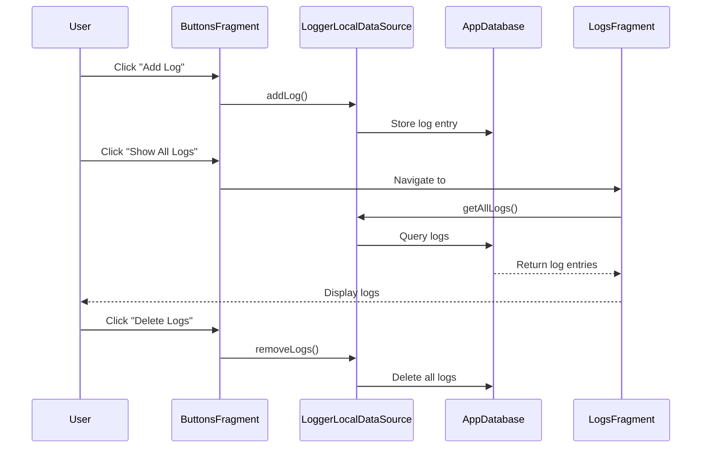

Sources: [app/build.gradle:52-60]()

## Prerequisites and Setup

### Prerequisites
- Kotlin programming experience
- Understanding of dependency injection concepts

### Development Setup
1. Install Android Studio
2. Clone the repository
3. Import the project into Android Studio
4. Build and run the application

Sources: [README.md:21-29]()

## Conclusion

The Android Hilt Codelab repository serves as an educational resource for implementing dependency injection in Android applications using Hilt. By comparing the main branch (ServiceLocator pattern) with the solution branch (Hilt implementation), developers can gain a practical understanding of how to incorporate Hilt into their applications and benefit from improved code reusability, refactorability, and testability.

For more detailed information on specific aspects of the codelab:
- Build system configuration: [Build System Configuration](#2)
- Application architecture: [Application Architecture](#3)
- Hilt implementation details: [Dependency Injection with Hilt](#3.1)
- Data layer: [Data Layer](#3.2)
- UI components: [UI Components](#3.3)

Sources: [README.md:1-52](), [build.gradle:1-41](), [app/build.gradle:1-72]()

---

# Page: Build System Configuration

# Build System Configuration

<details>
<summary>Relevant source files</summary>

The following files were used as context for generating this wiki page:

- [app/build.gradle](app/build.gradle)
- [build.gradle](build.gradle)
- [gradle.properties](gradle.properties)
- [gradle/wrapper/gradle-wrapper.properties](gradle/wrapper/gradle-wrapper.properties)

</details>


## Purpose and Scope

This document describes the Gradle build system configuration for the Android Hilt Codelab project. It covers the project-level and module-level Gradle files, build settings, plugins, and dependencies required to support Hilt dependency injection and other project features. For information about how Hilt is implemented in the application architecture, see [Dependency Injection with Hilt](#3.1).

## Build System Overview

The Android Hilt Codelab uses Gradle as its build system, with specific configurations to support Hilt dependency injection, Room database, and other Android Jetpack components.

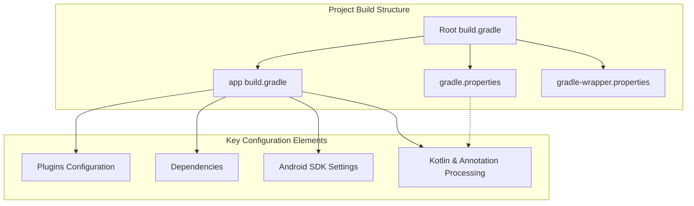

Sources: [build.gradle](), [app/build.gradle](), [gradle.properties](), [gradle/wrapper/gradle-wrapper.properties]()

## Root Gradle Configuration

The root `build.gradle` file defines global project settings including version declarations, repository configurations, and project-wide plugin dependencies.

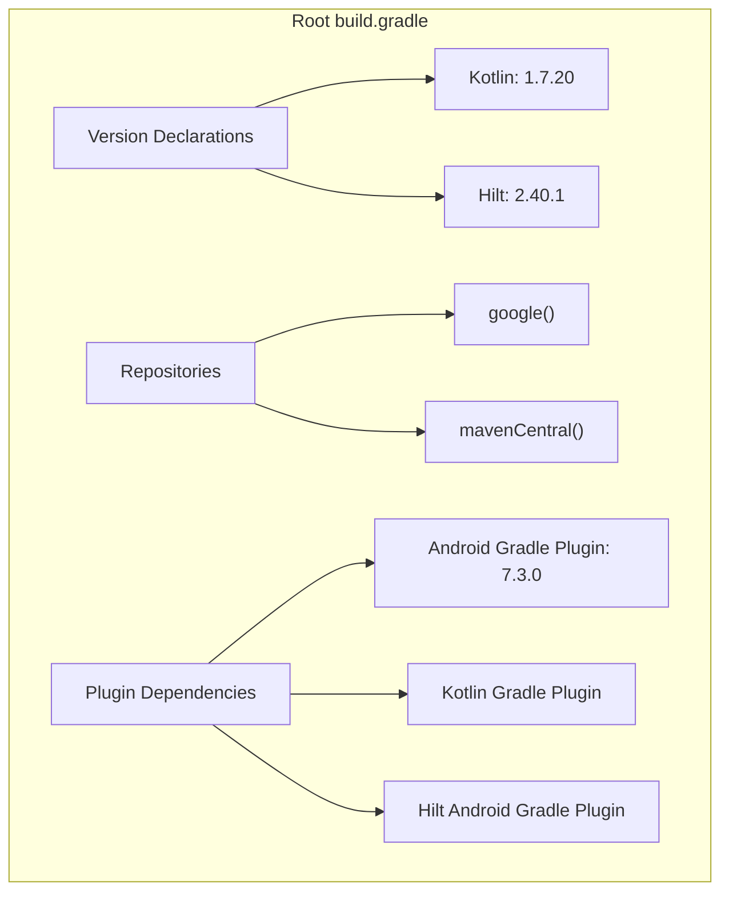

Sources: [build.gradle:17-29]()

### Version Declarations

The project declares key version numbers as global variables to ensure consistency across modules:

| Dependency | Version |
|------------|---------|
| Kotlin     | 1.7.20  |
| Hilt       | 2.40.1  |

Sources: [build.gradle:18-19]()

### Build Script Dependencies

The root build.gradle includes the following classpath dependencies:

```
classpath 'com.android.tools.build:gradle:7.3.0'
classpath "org.jetbrains.kotlin:kotlin-gradle-plugin:$kotlin_version"
classpath "com.google.dagger:hilt-android-gradle-plugin:$hilt_version"
```

Sources: [build.gradle:24-28]()

### Repository Configuration

All project modules use Google and Maven Central repositories for dependency resolution:

```
allprojects {
    repositories {
        google()
        mavenCentral()
    }
}
```

Sources: [build.gradle:31-36]()

## App Module Configuration

The `app/build.gradle` file contains module-specific settings, including Android configuration, plugin applications, and dependencies.

### Applied Plugins

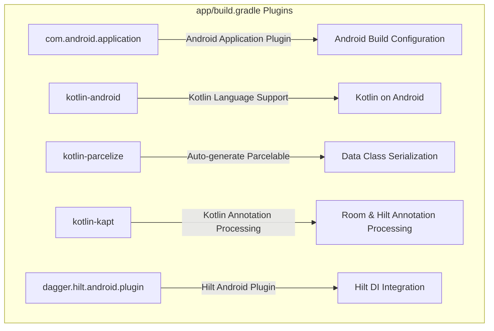

Sources: [app/build.gradle:17-23]()

The application uses the following Gradle plugins:

| Plugin                    | Purpose                                                  |
|---------------------------|----------------------------------------------------------|
| com.android.application   | Core Android application functionality                   |
| kotlin-android           | Kotlin language support for Android                       |
| kotlin-parcelize         | Automatic Parcelable implementation for data classes      |
| kotlin-kapt              | Kotlin Annotation Processing Tool for code generation     |
| dagger.hilt.android.plugin | Hilt dependency injection framework integration         |

Sources: [app/build.gradle:17-23]()

### Android Configuration

The app module defines several Android-specific configurations:

```
android {
    compileSdkVersion 33

    defaultConfig {
        applicationId "com.example.android.hilt"
        minSdkVersion 16
        targetSdkVersion 33
        versionCode 1
        versionName "1.0"
        
        testInstrumentationRunner 'androidx.test.runner.AndroidJUnitRunner'
        
        javaCompileOptions {
            annotationProcessorOptions {
                arguments["room.incremental"] = "true"
            }
        }
    }

    compileOptions {
        sourceCompatibility 1.8
        targetCompatibility 1.8
    }
}
```

Sources: [app/build.gradle:25-49]()

Key configurations include:

| Configuration                | Value                           | Purpose                                          |
|-----------------------------|----------------------------------|--------------------------------------------------|
| compileSdkVersion           | 33                               | Android API level to compile against             |
| applicationId               | com.example.android.hilt         | Unique application identifier                    |
| minSdkVersion               | 16                               | Minimum supported Android API level              |
| targetSdkVersion            | 33                               | Target Android API level                         |
| testInstrumentationRunner   | androidx.test.runner.AndroidJUnitRunner | Test runner for Android instrumentation tests |
| room.incremental            | true                             | Enable incremental processing for Room           |
| Java compatibility          | 1.8                              | Java language features level                     |

Sources: [app/build.gradle:26-48]()

## Dependencies Configuration

The app module includes several dependencies to support Android development, Hilt dependency injection, Room database, and testing.

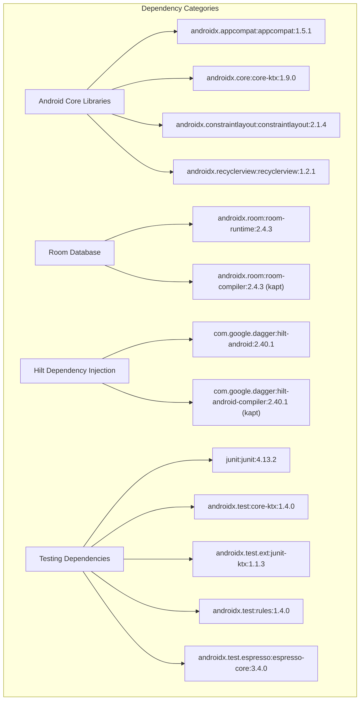

Sources: [app/build.gradle:51-72]()

### Android Core Libraries

The application uses the following core Android libraries:

| Library                      | Version | Purpose                                   |
|------------------------------|---------|-------------------------------------------|
| androidx.appcompat           | 1.5.1   | Backward compatibility support            |
| androidx.core:core-ktx       | 1.9.0   | Kotlin extensions for Android core        |
| androidx.constraintlayout    | 2.1.4   | Modern layout system                      |
| androidx.recyclerview        | 1.2.1   | List rendering component                  |

Sources: [app/build.gradle:53-56]()

### Room Database

Room is used for local database storage:

| Library                    | Version | Purpose                                   |
|----------------------------|---------|-------------------------------------------|
| androidx.room:room-runtime | 2.4.3   | Room ORM runtime                          |
| androidx.room:room-compiler| 2.4.3   | Room annotation processor (kapt)          |

Sources: [app/build.gradle:59-60]()

### Hilt Dependency Injection

Hilt is configured with the following dependencies:

| Library                               | Version  | Purpose                                   |
|---------------------------------------|----------|-------------------------------------------|
| com.google.dagger:hilt-android        | 2.40.1   | Hilt runtime for Android                  |
| com.google.dagger:hilt-android-compiler| 2.40.1  | Hilt annotation processor (kapt)          |

Sources: [app/build.gradle:70-71]()

### Testing Dependencies

The project uses several testing libraries:

| Library                              | Version | Purpose                                   |
|--------------------------------------|---------|-------------------------------------------|
| junit:junit                          | 4.13.2  | Unit testing framework                    |
| androidx.test:core-ktx               | 1.4.0   | Android test core library with Kotlin     |
| androidx.test.ext:junit-ktx          | 1.1.3   | JUnit extensions for Android              |
| androidx.test:rules                  | 1.4.0   | Android test rules                        |
| androidx.test.espresso:espresso-core | 3.4.0   | UI testing framework                      |

Sources: [app/build.gradle:63-67]()

## Gradle Properties

The project includes several Gradle properties in `gradle.properties` that configure build behavior:

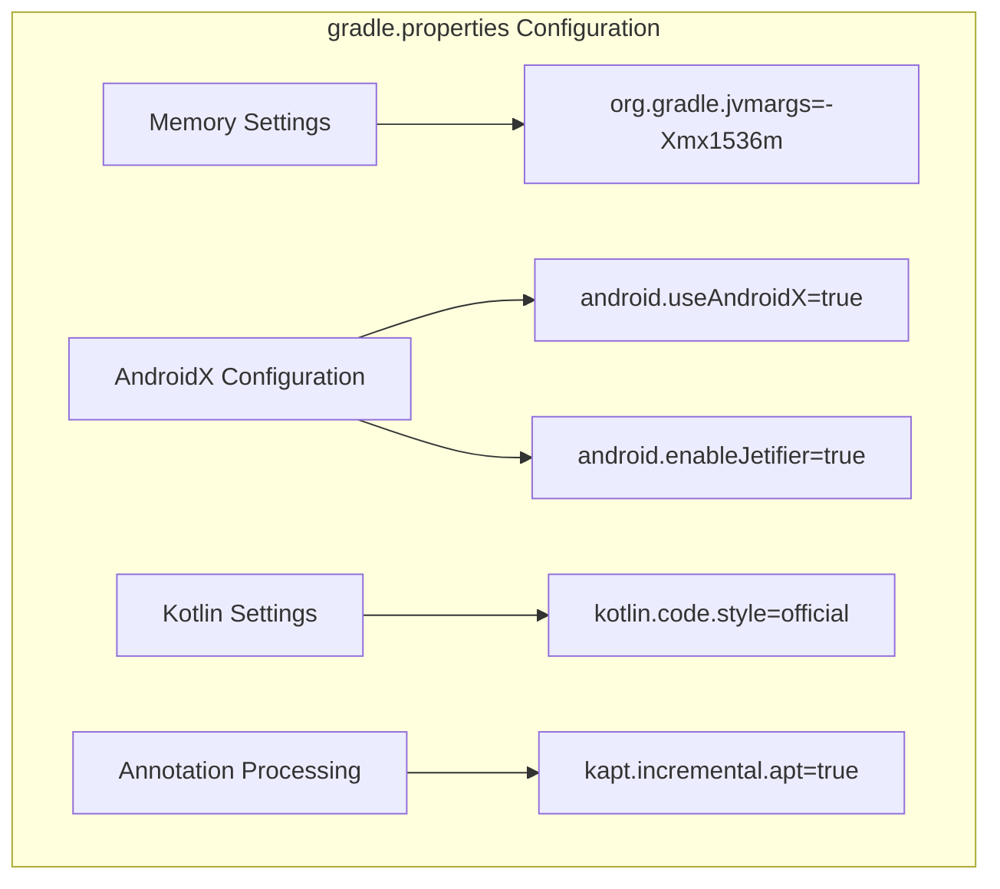

Sources: [gradle.properties]()

### Key Gradle Properties

| Property                | Value     | Purpose                                                   |
|-------------------------|-----------|-----------------------------------------------------------|
| org.gradle.jvmargs      | -Xmx1536m | Memory allocation for Gradle daemon                       |
| android.useAndroidX     | true      | Enables AndroidX libraries                                |
| android.enableJetifier  | true      | Auto-converts support libraries to AndroidX               |
| kotlin.code.style       | official  | Uses Kotlin's official code style                         |
| kapt.incremental.apt    | true      | Enables incremental annotation processing for performance |

Sources: [gradle.properties:9-23]()

## Gradle Wrapper Configuration

The project uses the Gradle Wrapper to ensure build consistency. The wrapper is configured to use Gradle version 7.4.

| Property            | Value                                                |
|---------------------|------------------------------------------------------|
| distributionUrl     | https://services.gradle.org/distributions/gradle-7.4-bin.zip |
| distributionBase    | GRADLE_USER_HOME                                     |
| distributionPath    | wrapper/dists                                        |

Sources: [gradle/wrapper/gradle-wrapper.properties]()

## Build System Integration with Hilt

The build system is specifically configured to support Hilt dependency injection:

1. The Hilt Gradle plugin is applied in the app module using `id 'dagger.hilt.android.plugin'`
2. Hilt dependencies are included with the matching version declared in the root build file
3. Kotlin annotation processing (kapt) is enabled to support Hilt's code generation
4. Incremental annotation processing is enabled to improve build performance

This configuration allows the application to leverage Hilt for automated dependency injection, which replaces the manual ServiceLocator pattern. The build system handles the code generation needed for Hilt's dependency graphs and component hierarchies.

Sources: [build.gradle:19](), [app/build.gradle:22](), [app/build.gradle:70-71]()

## Room Database Build Configuration

The build system includes specific configurations for Room database:

1. Room libraries are added as dependencies
2. Room incremental annotation processing is enabled with `room.incremental=true`
3. Kapt incremental processing is enabled for better build performance

These settings ensure that Room database code generation is optimized for faster builds.

Sources: [app/build.gradle:39-42](), [app/build.gradle:59-60](), [gradle.properties:23]()

---

# Page: Application Architecture

# Application Architecture

<details>
<summary>Relevant source files</summary>

The following files were used as context for generating this wiki page:

- [app/src/main/AndroidManifest.xml](app/src/main/AndroidManifest.xml)
- [app/src/main/java/com/example/android/hilt/LogApplication.kt](app/src/main/java/com/example/android/hilt/LogApplication.kt)
- [app/src/main/java/com/example/android/hilt/ServiceLocator.kt](app/src/main/java/com/example/android/hilt/ServiceLocator.kt)

</details>


This document provides a comprehensive overview of the Android Hilt codelab application architecture, highlighting the main components and their interactions. It covers the high-level architecture, key components, and how they work together to implement a logging application.

For detailed information about specific architectural aspects, see:
- [Dependency Injection with Hilt](#3.1) for details on the Hilt implementation
- [Data Layer](#3.2) for database and data source specifics
- [UI Components](#3.3) for user interface implementation details

## Overview

The Android Hilt codelab application implements a simple logging system that demonstrates dependency injection patterns. The architecture follows modern Android development practices with clear separation of concerns across different layers.

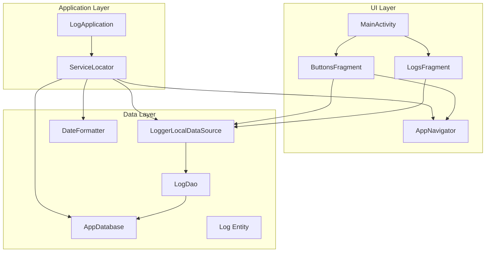

Sources: [app/src/main/AndroidManifest.xml:17-40](), [app/src/main/java/com/example/android/hilt/LogApplication.kt:17-29](), [app/src/main/java/com/example/android/hilt/ServiceLocator.kt:17-43]()

## Key Architecture Components

### Application Layer

The Application Layer serves as the entry point and provides global application state and services.

- **LogApplication**: The application subclass that initializes the ServiceLocator
- **ServiceLocator**: Manages dependency creation and providing access throughout the app

### UI Layer

The UI Layer handles user interactions and displays data to the user.

- **MainActivity**: The main entry point activity
- **ButtonsFragment**: Contains buttons for adding logs and navigating to the logs view
- **LogsFragment**: Displays stored logs
- **AppNavigator/AppNavigatorImpl**: Handles navigation between UI components

### Data Layer

The Data Layer manages data operations and persistence.

- **AppDatabase**: Room database configuration
- **LogDao**: Data Access Object for database operations
- **Log Entity**: Database entity representing a log entry
- **LoggerLocalDataSource**: Repository that interfaces with the LogDao
- **DateFormatter**: Utility for formatting timestamp data

Sources: [app/src/main/java/com/example/android/hilt/ServiceLocator.kt:28-43]()

## Dependency Management

The application demonstrates two approaches to dependency management:

1. **Service Locator Pattern** (initial implementation): Centralizes dependency creation and management through the ServiceLocator class
2. **Dependency Injection with Hilt** (target implementation): Uses annotation-based dependency injection to automatically provide dependencies

### Service Locator Implementation

The ServiceLocator class is responsible for:
- Creating the Room database instance
- Providing the LoggerLocalDataSource
- Creating DateFormatter instances
- Providing AppNavigator implementations

```mermaid
classDiagram
    class LogApplication {
        +serviceLocator: ServiceLocator
        +onCreate()
    }
    
    class ServiceLocator {
        -logsDatabase: AppDatabase
        +loggerLocalDataSource: LoggerLocalDataSource
        +provideDateFormatter()
        +provideNavigator(activity)
    }
    
    class AppDatabase {
        +logDao()
    }
    
    class LoggerLocalDataSource {
        -logDao: LogDao
        +addLog()
        +getAllLogs()
        +removeLogs()
    }
    
    LogApplication --> ServiceLocator : creates
    ServiceLocator --> AppDatabase : creates
    ServiceLocator --> LoggerLocalDataSource : creates
    AppDatabase --> "LogDao" : provides
    ServiceLocator ..> "DateFormatter" : provides
    ServiceLocator ..> "AppNavigator" : provides
```

Sources: [app/src/main/java/com/example/android/hilt/LogApplication.kt:21-29](), [app/src/main/java/com/example/android/hilt/ServiceLocator.kt:28-43]()

## Data Flow and Component Interactions

The application follows a unidirectional data flow pattern for its main operations:

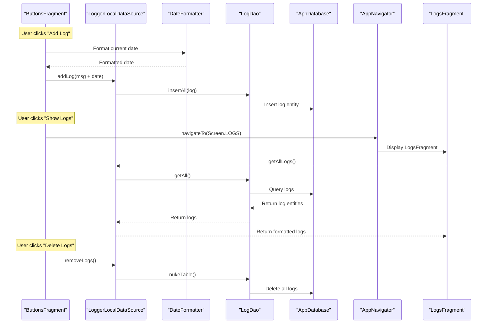

Sources: [app/src/main/java/com/example/android/hilt/ServiceLocator.kt:30-42]()

## Database Configuration

The application uses Room for data persistence, with the database set up in the ServiceLocator:

```
private val logsDatabase = Room.databaseBuilder(
    applicationContext,
    AppDatabase::class.java,
    "logging.db"
).build()
```

This creates an SQLite database named "logging.db" with tables defined by the AppDatabase class.

Sources: [app/src/main/java/com/example/android/hilt/ServiceLocator.kt:30-34]()

## Architectural Patterns

The application architecture employs several key design patterns:

1. **Repository Pattern**: LoggerLocalDataSource serves as a repository that abstracts data operations
2. **Service Locator Pattern**: The initial approach for dependency management
3. **Dependency Injection**: The target approach using Hilt (covered in detail in [Dependency Injection with Hilt](#3.1))
4. **Factory Pattern**: Used within the ServiceLocator to create various components

## Application Startup Flow

When the application starts:

1. The Android system instantiates the `LogApplication` class (specified in the AndroidManifest.xml)
2. `LogApplication.onCreate()` initializes the `ServiceLocator`
3. `ServiceLocator` creates the Room database and dependencies
4. `MainActivity` is launched as the entry point activity
5. `MainActivity` accesses dependencies through the `ServiceLocator` in the application

Sources: [app/src/main/AndroidManifest.xml:21-38](), [app/src/main/java/com/example/android/hilt/LogApplication.kt:21-29]()

## Dependency Access Pattern

Components access dependencies through the following pattern:

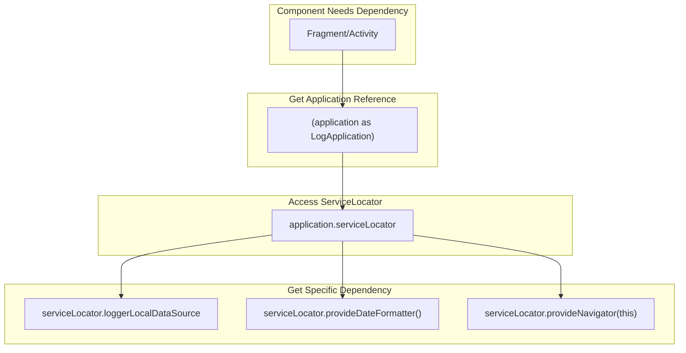

This manual dependency access pattern creates tight coupling between components and their dependencies, which is later addressed by implementing Hilt for dependency injection.

Sources: [app/src/main/java/com/example/android/hilt/LogApplication.kt:21-29](), [app/src/main/java/com/example/android/hilt/ServiceLocator.kt:28-43]()

## Architecture Benefits and Limitations

### Benefits of the Initial Architecture

1. **Clear separation of concerns**: UI, data, and application logic are separated
2. **Centralized dependency management**: ServiceLocator provides a single point for dependency creation
3. **Testability**: Components can be tested in isolation

### Limitations Addressed by Hilt

1. **Manual dependency wiring**: Requires manual coding to connect dependencies
2. **Global access to ServiceLocator**: Creates tight coupling
3. **Manual scoping of dependencies**: No built-in lifecycle management
4. **Boilerplate code**: Requires writing and maintaining ServiceLocator code

The transition to Hilt (covered in [Dependency Injection with Hilt](#3.1)) addresses these limitations while maintaining the benefits of the architecture.

## Conclusion

The application architecture demonstrates a clear separation of concerns with distinct layers for the application, UI, and data components. The initial implementation uses the ServiceLocator pattern for dependency management, which provides centralized access to dependencies but has limitations that are addressed by implementing Hilt for dependency injection.

---

# Page: Dependency Injection with Hilt

# Dependency Injection with Hilt

<details>
<summary>Relevant source files</summary>

The following files were used as context for generating this wiki page:

- [app/build.gradle](app/build.gradle)
- [app/src/main/java/com/example/android/hilt/LogApplication.kt](app/src/main/java/com/example/android/hilt/LogApplication.kt)
- [app/src/main/java/com/example/android/hilt/ServiceLocator.kt](app/src/main/java/com/example/android/hilt/ServiceLocator.kt)

</details>


## Purpose and Scope

This document explains how dependency injection is implemented in the Android Hilt codelab application, focusing on Hilt as the dependency injection framework. We compare the ServiceLocator pattern (the "before" state of the codebase) with Hilt's automated dependency injection approach, explaining the benefits and implementation details of transitioning to Hilt.

For information about the overall application architecture, see [Application Architecture](#3). For details about specific data layer components, see [Data Layer](#3.2).

## Understanding Dependency Injection

Dependency injection is a design pattern that allows classes to receive their dependencies from external sources rather than creating them internally. This improves testability, modularity, and flexibility of the codebase.

### Diagram: Dependency Injection Concept

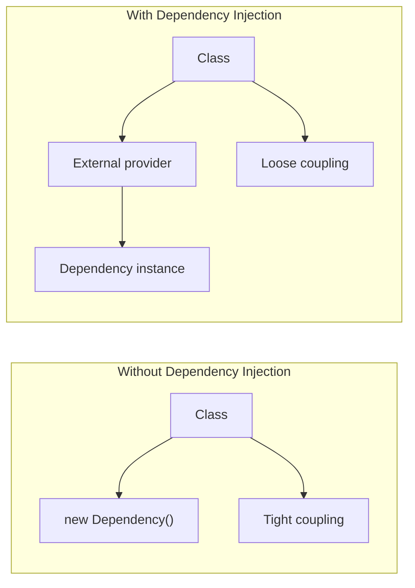

Sources: [app/src/main/java/com/example/android/hilt/ServiceLocator.kt]()

## Service Locator Pattern vs. Hilt

The codelab demonstrates the transition from manually providing dependencies through a ServiceLocator pattern to using Hilt's automated dependency injection.

### Diagram: ServiceLocator vs. Hilt Implementation

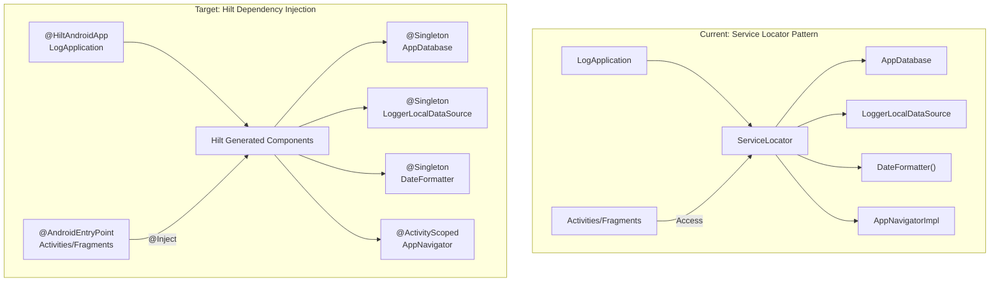

Sources: 
- [app/src/main/java/com/example/android/hilt/LogApplication.kt]()
- [app/src/main/java/com/example/android/hilt/ServiceLocator.kt]()

### Current Implementation: ServiceLocator

The ServiceLocator class centralizes dependency creation and management:

| Responsibility | Implementation |
|----------------|----------------|
| Database Creation | Creates `AppDatabase` instance via Room.databaseBuilder |
| Data Source Provision | Initializes `LoggerLocalDataSource` with the database DAO |
| Utility Provision | Provides `DateFormatter` instances |
| Navigation | Provides `AppNavigator` for fragment transactions |

The `LogApplication` class initializes the ServiceLocator in its `onCreate()` method:

```kotlin
// Current implementation in LogApplication
lateinit var serviceLocator: ServiceLocator

override fun onCreate() {
    super.onCreate()
    serviceLocator = ServiceLocator(applicationContext)
}
```

Dependencies are then accessed through the application instance:

```kotlin
// Example of accessing dependencies in a fragment
val logger = (requireActivity().application as LogApplication)
    .serviceLocator.loggerLocalDataSource
```

Sources:
- [app/src/main/java/com/example/android/hilt/LogApplication.kt]()
- [app/src/main/java/com/example/android/hilt/ServiceLocator.kt]()

## Hilt Implementation Requirements

### Diagram: Hilt Project Configuration

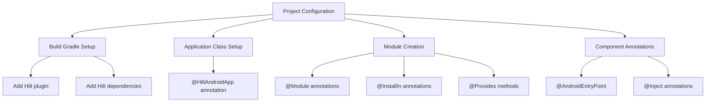

Sources:
- [app/build.gradle:17-23]()
- [app/build.gradle:69-71]()

### Build Configuration

Hilt requires specific Gradle configuration:

```kotlin
// Plugins required for Hilt
plugins {
    id 'kotlin-kapt'
    id 'dagger.hilt.android.plugin'
}

// Dependencies required for Hilt
dependencies {
    implementation "com.google.dagger:hilt-android:$hilt_version"
    kapt "com.google.dagger:hilt-android-compiler:$hilt_version"
}
```

Sources: 
- [app/build.gradle:17-23]()
- [app/build.gradle:69-71]()

### Application Modification

To implement Hilt, the `LogApplication` class needs to be annotated:

```kotlin
// Hilt implementation would modify LogApplication
@HiltAndroidApp
class LogApplication : Application() {
    // ServiceLocator no longer needed
    override fun onCreate() {
        super.onCreate()
        // Hilt handles dependency initialization
    }
}
```

## Hilt Dependency Provision

### Diagram: Hilt Module Structure

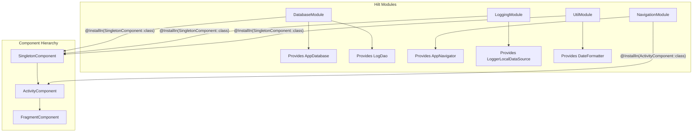

Sources:
- [app/src/main/java/com/example/android/hilt/ServiceLocator.kt:30-34]()
- [app/src/main/java/com/example/android/hilt/ServiceLocator.kt:36]()
- [app/src/main/java/com/example/android/hilt/ServiceLocator.kt:38-42]()

### Implementing Modules

Hilt uses modules to define how dependencies are created. The modules would replace the functionality in the current ServiceLocator:

#### Database Module

```kotlin
@Module
@InstallIn(SingletonComponent::class)
object DatabaseModule {
    @Provides
    @Singleton
    fun provideDatabase(@ApplicationContext context: Context): AppDatabase {
        return Room.databaseBuilder(
            context,
            AppDatabase::class.java,
            "logging.db"
        ).build()
    }
    
    @Provides
    fun provideLogDao(database: AppDatabase) = database.logDao()
}
```

#### Navigation Module

```kotlin
@Module
@InstallIn(ActivityComponent::class)
object NavigationModule {
    @Provides
    fun provideNavigator(activity: FragmentActivity): AppNavigator {
        return AppNavigatorImpl(activity)
    }
}
```

## Dependency Injection Methods

### Diagram: Injection Types in Hilt

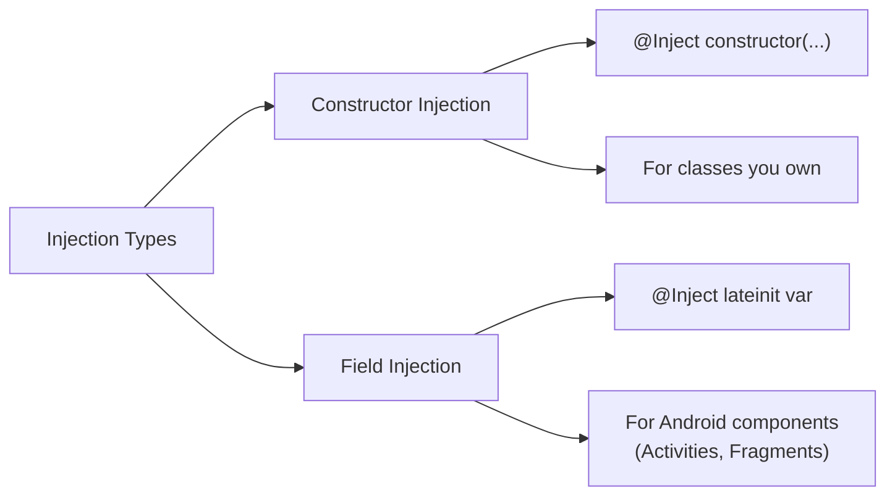

Sources:
- [app/src/main/java/com/example/android/hilt/ServiceLocator.kt]()

### Constructor Injection

Constructor injection is used for classes that you create:

```kotlin
class LoggerLocalDataSource @Inject constructor(
    private val logDao: LogDao
) {
    // Implementation
}
```

### Field Injection

Field injection is used in Android components like activities and fragments:

```kotlin
@AndroidEntryPoint
class LogsFragment : Fragment() {
    @Inject lateinit var loggerLocalDataSource: LoggerLocalDataSource
    @Inject lateinit var dateFormatter: DateFormatter
    
    // Implementation
}
```

## Hilt Component Hierarchy

### Diagram: Hilt Standard Components

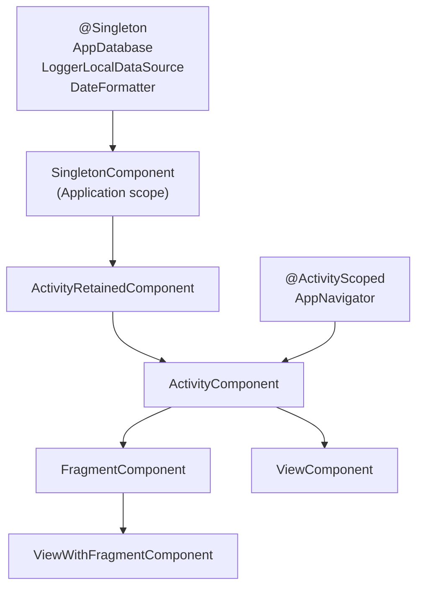

Sources:
- [app/src/main/java/com/example/android/hilt/ServiceLocator.kt]()

Hilt provides standard components that align with Android architecture components:

| Component | Scope | Lifetime | Used For |
|-----------|-------|----------|----------|
| SingletonComponent | @Singleton | Application lifetime | AppDatabase, LoggerLocalDataSource, DateFormatter |
| ActivityComponent | @ActivityScoped | Activity lifetime | AppNavigator |
| FragmentComponent | @FragmentScoped | Fragment lifetime | Fragment-specific dependencies |

## Benefits of Using Hilt

### Diagram: Advantages of Hilt Over ServiceLocator

```mermaid
flowchart TD
    A["Benefits of Hilt"] --> B["Reduced Boilerplate Code"]
    A --> C["Standardized DI Architecture"]
    A --> D["Scoped Dependencies"]
    A --> E["Automated Lifecycle Management"]
    A --> F["Compile-time Validation"]
    A --> G["Improved Testability"]
    
    B --> B1["No manual ServiceLocator implementation"]
    C --> C1["Consistent pattern across the app"]
    D --> D1["Appropriate scoping based on Android components"]
    E --> E1["Dependencies created and destroyed at proper times"]
    F --> F1["Dependency issues caught at compile time"]
    G --> G1["Easier to replace dependencies for testing"]
```

Sources:
- [app/build.gradle:69-71]()
- [app/src/main/java/com/example/android/hilt/ServiceLocator.kt]()

### Key Advantages

1. **Reduced Boilerplate**: Eliminates need for manual ServiceLocator implementation
2. **Standardized Architecture**: Follows Android's component architecture
3. **Automated Lifecycle Management**: Dependencies are automatically created and destroyed based on their scope
4. **Compile-time Validation**: Dependency graph is verified during compilation
5. **Improved Testability**: Dependencies can be easily replaced for testing

## Refactoring Considerations

When migrating from ServiceLocator to Hilt:

1. Start by adding Hilt dependencies and plugins to build.gradle
2. Annotate Application class with @HiltAndroidApp
3. Create modules to provide dependencies
4. Annotate Android components with @AndroidEntryPoint
5. Convert manual dependency retrieval to @Inject annotations
6. Remove ServiceLocator class once migration is complete

Sources:
- [app/src/main/java/com/example/android/hilt/LogApplication.kt]()
- [app/src/main/java/com/example/android/hilt/ServiceLocator.kt]()
- [app/build.gradle:69-71]()

---

# Page: Data Layer

# Data Layer

<details>
<summary>Relevant source files</summary>

The following files were used as context for generating this wiki page:

- [app/src/main/java/com/example/android/hilt/data/AppDatabase.kt](app/src/main/java/com/example/android/hilt/data/AppDatabase.kt)
- [app/src/main/java/com/example/android/hilt/data/Log.kt](app/src/main/java/com/example/android/hilt/data/Log.kt)
- [app/src/main/java/com/example/android/hilt/data/LogDao.kt](app/src/main/java/com/example/android/hilt/data/LogDao.kt)

</details>


## Purpose and Scope

This document describes the data persistence architecture in the Android Hilt codelab application. It covers the Room database implementation, including the database definition, entity structure, and data access mechanisms. For information about how this data layer integrates with Hilt dependency injection, see [Dependency Injection with Hilt](#3.1).

## Room Database Architecture

The application uses Room, a part of Android Jetpack, to provide an abstraction layer over SQLite for database operations. The data layer follows a clean architecture approach with three main components:

```mermaid
flowchart TD
    A["AppDatabase<br>(Room Database)"] --> B["LogDao<br>(Data Access Object)"]
    B --> C["Log<br>(Entity)"]
    D["LoggerLocalDataSource"] --> B
```

Sources: [app/src/main/java/com/example/android/hilt/data/AppDatabase.kt](), [app/src/main/java/com/example/android/hilt/data/LogDao.kt](), [app/src/main/java/com/example/android/hilt/data/Log.kt]()

### Database Definition

The application defines a Room database called `AppDatabase` which serves as the main access point for the underlying SQLite database.

```mermaid
classDiagram
    class AppDatabase {
        <<abstract>>
        +logDao(): LogDao
    }
    class RoomDatabase
    AppDatabase --|> RoomDatabase
```

The database is defined in [app/src/main/java/com/example/android/hilt/data/AppDatabase.kt:25-28]() and contains the following key elements:

- Extends `RoomDatabase`
- Annotated with `@Database` to specify entities and version
- Includes a single entity: `Log`
- Contains an abstract method `logDao()` that returns the DAO interface

Sources: [app/src/main/java/com/example/android/hilt/data/AppDatabase.kt]()

### Entity Structure

The application defines a single entity called `Log` that represents a log entry in the database.

```mermaid
classDiagram
    class Log {
        +String msg
        +Long timestamp
        +Long id
    }
```

The `Log` entity [app/src/main/java/com/example/android/hilt/data/Log.kt:25-30]() has the following properties:

| Property  | Type   | Description                      | Annotations              |
|-----------|--------|----------------------------------|--------------------------|
| msg       | String | The log message text             | -                        |
| timestamp | Long   | Unix timestamp of the log entry  | -                        |
| id        | Long   | Unique identifier for the entry  | @PrimaryKey(autoGenerate = true) |

The entity is annotated with `@Entity(tableName = "logs")` to define the table name in the database.

Sources: [app/src/main/java/com/example/android/hilt/data/Log.kt]()

### Data Access Object (DAO)

The Data Access Object pattern is implemented through the `LogDao` interface, which provides methods to interact with the database.

```mermaid
classDiagram
    class LogDao {
        <<interface>>
        +getAll(): List~Log~
        +insertAll(vararg logs: Log): void
        +nukeTable(): void
    }
```

The `LogDao` interface [app/src/main/java/com/example/android/hilt/data/LogDao.kt:26-37]() provides the following methods:

| Method       | Return Type | Parameters      | SQL Query                                | Description                       |
|--------------|-------------|-----------------|------------------------------------------|-----------------------------------|
| getAll()     | List\<Log\> | None            | SELECT * FROM logs ORDER BY id DESC      | Retrieves all logs in reverse chronological order |
| insertAll()  | void        | vararg logs: Log| (Handled by Room)                        | Inserts one or more log entries   |
| nukeTable()  | void        | None            | DELETE FROM logs                         | Deletes all logs from the table   |

The DAO is annotated with `@Dao` and uses Room annotations (`@Query`, `@Insert`) to define database operations.

Sources: [app/src/main/java/com/example/android/hilt/data/LogDao.kt]()

## Data Flow

The following diagram illustrates how data flows through the application's data layer:

```mermaid
sequenceDiagram
    participant UI as "UI Layer"
    participant LLDS as "LoggerLocalDataSource"
    participant DAO as "LogDao"
    participant DB as "AppDatabase"
    participant SQLite as "SQLite Database"
    
    %% Add log flow
    UI->>LLDS: addLog(msg)
    LLDS->>DAO: insertAll(log)
    DAO->>DB: Execute insert
    DB->>SQLite: SQL INSERT
    
    %% Get logs flow
    UI->>LLDS: getLogs()
    LLDS->>DAO: getAll()
    DAO->>DB: Execute query
    DB->>SQLite: SQL SELECT
    SQLite-->>DB: Results
    DB-->>DAO: List<Log>
    DAO-->>LLDS: List<Log>
    LLDS-->>UI: List<Log>
    
    %% Remove logs flow
    UI->>LLDS: removeLogs()
    LLDS->>DAO: nukeTable()
    DAO->>DB: Execute delete
    DB->>SQLite: SQL DELETE
```

Sources: [app/src/main/java/com/example/android/hilt/data/LogDao.kt]()

## Database Operations

The data layer supports three primary operations:

1. **Adding logs**: Creates new log entries with a message and timestamp
2. **Retrieving logs**: Fetches all logs from the database in reverse chronological order
3. **Clearing logs**: Removes all logs from the database

These operations are implemented through the DAO methods and are typically accessed via a repository pattern implementation.

### Data Access Pattern

The application follows a structured data access pattern:

```mermaid
flowchart TD
    A["UI Components"] --> B["LoggerLocalDataSource<br>(Repository)"]
    B --> C["LogDao<br>(Data Access Object)"]
    C --> D["AppDatabase<br>(Room Database)"]
    D --> E["SQLite Database"]
```

This layered approach provides:
- Separation of concerns
- Abstraction of data source details from UI components
- Centralized data access logic
- Improved testability

Sources: [app/src/main/java/com/example/android/hilt/data/AppDatabase.kt](), [app/src/main/java/com/example/android/hilt/data/LogDao.kt](), [app/src/main/java/com/example/android/hilt/data/Log.kt]()

## Room Database Creation

The database instance is not created directly in any of the data layer files. Instead, it would typically be created and provided through dependency injection (Hilt) or a service locator pattern. The creation would involve:

1. Building the database using `Room.databaseBuilder()`
2. Specifying the database name and migration strategies
3. Creating a singleton instance to be used throughout the application

The database instance creation is handled in the dependency injection framework, as described in [Dependency Injection with Hilt](#3.1).

Sources: [app/src/main/java/com/example/android/hilt/data/AppDatabase.kt]()

---

# Page: UI Components

# UI Components

<details>
<summary>Relevant source files</summary>

The following files were used as context for generating this wiki page:

- [app/src/main/AndroidManifest.xml](app/src/main/AndroidManifest.xml)
- [app/src/main/java/com/example/android/hilt/ui/ButtonsFragment.kt](app/src/main/java/com/example/android/hilt/ui/ButtonsFragment.kt)

</details>


This document covers the user interface components of the Android Hilt codelab application. It describes the main UI elements, their responsibilities, and the navigation flow between them. For information about the data layer that these components interact with, see [Data Layer](#3.2). For details on how dependency injection is implemented across these components, see [Dependency Injection with Hilt](#3.1).

## Overview of UI Structure

The application has a simple UI structure consisting of a main activity and two fragments. The main activity serves as the container for the fragments, while the fragments handle specific user interactions and displays.

```mermaid
flowchart TD
    A["MainActivity"] --> B["ButtonsFragment"]
    A --> C["LogsFragment"]
    D["AppNavigator"] -.- A
    
    subgraph "Navigation Control"
        D
    end
    
    subgraph "UI Components"
        A
        B
        C
    end
```

Sources: [app/src/main/AndroidManifest.xml:29-38](), [app/src/main/java/com/example/android/hilt/ui/ButtonsFragment.kt:35-83]()

## Main UI Components

### MainActivity

The MainActivity is the application's entry point and the container for all fragments. It implements the navigation mechanism using the AppNavigator.

Key responsibilities:
- Acts as the primary UI container
- Hosts fragments (ButtonsFragment and LogsFragment)
- Provides fragment transaction functionality via AppNavigator

Sources: [app/src/main/AndroidManifest.xml:29-38]()

### ButtonsFragment

The ButtonsFragment displays interactive buttons that allow users to:
- Record interactions with three different buttons (stored as logs)
- Navigate to the logs screen to view all recorded logs
- Delete all logs from the system

```mermaid
classDiagram
    class ButtonsFragment {
        -LoggerLocalDataSource logger
        -AppNavigator navigator
        +onCreateView()
        +onAttach(Context)
        +onViewCreated(View, Bundle)
        -populateFields(Context)
    }
    
    ButtonsFragment --> LoggerLocalDataSource : uses
    ButtonsFragment --> AppNavigator : uses
```

When a user clicks one of the three primary buttons, the fragment logs the interaction through the LoggerLocalDataSource. The "All Logs" button triggers navigation to the LogsFragment via the AppNavigator, while the "Delete Logs" button clears all logs from the database.

Sources: [app/src/main/java/com/example/android/hilt/ui/ButtonsFragment.kt:35-83]()

### LogsFragment

The LogsFragment displays a list of recorded logs retrieved from the database. It shows all interactions the user has had with the three buttons in ButtonsFragment, along with timestamps.

Key responsibilities:
- Retrieve logs from LoggerLocalDataSource
- Display logs in a readable format
- Update the display when logs change

## Navigation System

### AppNavigator Interface and Implementation

The navigation between fragments is managed by the AppNavigator interface and its implementation. This approach decouples the navigation logic from the fragments, enhancing maintainability and testability.

```mermaid
flowchart LR
    A["ButtonsFragment"] -->|"navigateTo(Screens.LOGS)"| B["AppNavigator"]
    B -->|"replace fragment"| C["LogsFragment"]
    
    D["Screens enum"]-.->B
```

The AppNavigator is responsible for fragment transactions within the MainActivity. The ButtonsFragment uses it to navigate to the LogsFragment when the user wants to view all logs.

The navigation is implemented using the Screens enum to define available destinations in the app.

Sources: [app/src/main/java/com/example/android/hilt/ui/ButtonsFragment.kt:76-77]()

## UI Component Interactions

The UI components interact with each other and with the data layer in a well-defined flow:

```mermaid
sequenceDiagram
    participant User
    participant BF as "ButtonsFragment"
    participant Nav as "AppNavigator"
    participant LF as "LogsFragment"
    participant Logger as "LoggerLocalDataSource"
    
    User->>BF: Click button 1, 2, or 3
    BF->>Logger: addLog("Interaction with 'Button X'")
    
    User->>BF: Click "All Logs"
    BF->>Nav: navigateTo(Screens.LOGS)
    Nav->>LF: Display LogsFragment
    LF->>Logger: getLogs()
    Logger-->>LF: Return logs
    LF-->>User: Display logs list
    
    User->>BF: Click "Delete Logs"
    BF->>Logger: removeLogs()
    Logger-->>BF: Logs deleted
```

Sources: [app/src/main/java/com/example/android/hilt/ui/ButtonsFragment.kt:62-82]()

## Dependency Acquisition

In the current implementation, UI components obtain their dependencies through the ServiceLocator pattern. When using ButtonsFragment as an example:

```mermaid
flowchart TD
    BF["ButtonsFragment"] -->|"onAttach()"| PF["populateFields()"]
    PF -->|"context.applicationContext"| LA["LogApplication"]
    LA -->|"serviceLocator"| SL["ServiceLocator"]
    SL -->|"loggerLocalDataSource"| LLD["LoggerLocalDataSource"]
    SL -->|"provideNavigator()"| AN["AppNavigator"]
    
    BF -.->|"uses"| LLD
    BF -.->|"uses"| AN
```

When the ButtonsFragment is attached to its context, it retrieves the required dependencies:
1. It obtains the LoggerLocalDataSource from the application's ServiceLocator
2. It obtains the AppNavigator from the ServiceLocator, passing the activity as a parameter

This approach will be replaced with Hilt dependency injection in the final implementation, where dependencies will be injected directly into the UI components using annotations.

Sources: [app/src/main/java/com/example/android/hilt/ui/ButtonsFragment.kt:48-60]()

## UI Layout Structure

The ButtonsFragment uses a layout defined in `fragment_buttons.xml` which contains:
- Three interactive buttons that log interactions
- A button to view all logs
- A button to delete all logs

The LogsFragment likely uses a layout that includes a RecyclerView or similar component to display the list of logs retrieved from the database.

Sources: [app/src/main/java/com/example/android/hilt/ui/ButtonsFragment.kt:40-46](), [app/src/main/java/com/example/android/hilt/ui/ButtonsFragment.kt:62-82]()

## Summary

The UI layer of the application consists of:

| Component | Purpose |
|-----------|---------|
| MainActivity | Main container for fragments and entry point for the application |
| ButtonsFragment | Provides interactive buttons that record user interactions and controls navigation |
| LogsFragment | Displays the history of user interactions with the buttons |
| AppNavigator | Manages navigation between fragments |

This simple UI structure demonstrates common patterns in Android development while providing a foundation for implementing Hilt dependency injection to replace the ServiceLocator pattern.

---

# Page: Testing the Application

# Testing the Application

<details>
<summary>Relevant source files</summary>

The following files were used as context for generating this wiki page:

- [app/build.gradle](app/build.gradle)
- [app/src/androidTest/java/com/example/android/hilt/AppTest.kt](app/src/androidTest/java/com/example/android/hilt/AppTest.kt)

</details>


## Purpose and Scope

This document details the testing approach for the Android Hilt Codelab application. It focuses on instrumentation tests using Hilt for dependency injection, explaining how tests are structured, configured, and executed. This page covers testing configuration, test implementation patterns, and how Hilt facilitates testing through dependency injection.

For information about the application architecture and components being tested, see [Application Architecture](#3).

## Testing Configuration

The application uses standard Android testing libraries configured in the build.gradle file. The test instrumentation runner is set to the default `AndroidJUnitRunner`.

```mermaid
graph TD
    subgraph "Test Configuration"
        A["app/build.gradle"] --> B["testInstrumentationRunner: 
        AndroidJUnitRunner"]
        A --> C["Testing Dependencies"]
        C --> D["JUnit"]
        C --> E["AndroidX Test"]
        C --> F["Espresso"]
    end
```

Sources: [app/build.gradle:36-36](), [app/build.gradle:62-67]()

### Test Dependencies

The application uses the following testing dependencies:

| Dependency | Purpose |
|------------|---------|
| JUnit | Core testing framework |
| AndroidX Test Core-KTX | Android-specific testing utilities |
| AndroidX Test JUnit Extensions | JUnit extensions for Android testing |
| AndroidX Test Rules | Test rules for instrumentation tests |
| Espresso | UI testing framework |

Sources: [app/build.gradle:62-67]()

## Test Implementation

### Current Testing Approach

The application includes an instrumentation test that validates the basic user flow through the application. This test currently uses the ServiceLocator pattern for managing dependencies during testing.

```mermaid
flowchart TD
    subgraph "Test Execution Flow"
        A["AppTest"] --> B["Launch MainActivity"]
        B --> C["Verify Buttons Fragment displayed"]
        C --> D["Click Button 1"]
        D --> E["Navigate to Logs screen"]
        E --> F["Verify log entry displayed"]
    end

    subgraph "Dependency Management"
        G["ServiceLocator"] --> H["loggerLocalDataSource"]
        H --> I["removeLogs()"]
    end

    A --> G
```

Sources: [app/src/androidTest/java/com/example/android/hilt/AppTest.kt:34-60]()

### Key Test Components

The main test class `AppTest` includes:

1. **Test Setup/Teardown**: 
   - Teardown method that cleans up logs after each test using ServiceLocator
   - This ensures test isolation by preventing data from one test affecting others

2. **Happy Path Test**:
   - Launches the main activity
   - Performs UI interactions using Espresso
   - Verifies expected UI states using view matchers

Sources: [app/src/androidTest/java/com/example/android/hilt/AppTest.kt:37-59]()

## Transitioning to Hilt for Testing

While the current test uses the ServiceLocator pattern, the application is designed to use Hilt for dependency injection. Here's how testing can be transitioned to use Hilt:

```mermaid
flowchart TD
    subgraph "Before: ServiceLocator in Testing"
        A1["AppTest"] --> A2["ServiceLocator instance"]
        A2 --> A3["loggerLocalDataSource.removeLogs()"]
    end

    subgraph "After: Hilt in Testing"
        B1["@HiltAndroidTest\nAppTest"] --> B2["HiltTestApplication"]
        B2 --> B3["@Inject\nloggerLocalDataSource"]
        B1 --> B4["@UninstallModules"]
        B4 --> B5["Custom Test Modules"]
    end
```

### Implementing Hilt in Tests

To transition tests to use Hilt for dependency injection, the following changes would be needed:

1. **Test Annotations**:
   - Add `@HiltAndroidTest` annotation to test classes
   - Use `@UninstallModules` to replace production modules with test modules when needed

2. **Custom Test Rule**:
   - Use `HiltAndroidRule` to manage the Hilt component's lifecycle in tests

3. **Test Modules**:
   - Create test-specific modules that provide test doubles (mocks, fakes, etc.)

4. **Test Application**:
   - Use `HiltTestApplication` as the application class for tests

### Test Doubles with Hilt

```mermaid
graph TD
    subgraph "Hilt Test Architecture"
        A["@HiltAndroidTest\nAppTest"] --> B["HiltAndroidRule"]
        A --> C["Test Modules"]
        C --> D["FakeLoggerLocalDataSource"]
        C --> E["TestNavigator"]
        C --> F["TestDatabase"]
        A --> G["@Inject\nTest Dependencies"]
    end
```

## Espresso UI Testing Integration

The application uses Espresso for UI testing, which integrates well with Hilt for dependency injection in tests.

```mermaid
sequenceDiagram
    participant Test as "AppTest"
    participant Activity as "MainActivity"
    participant Button as "Button Fragment"
    participant Logs as "Logs Fragment"
    participant DataSource as "LoggerLocalDataSource"
    
    Test->>Activity: launch()
    Test->>Button: verify displayed
    Test->>Button: click "Button 1"
    Button->>DataSource: addLog()
    Test->>Button: click "All Logs"
    Button->>Logs: navigate
    Test->>Logs: verify log entry
    Test->>DataSource: removeLogs()
```

Sources: [app/src/androidTest/java/com/example/android/hilt/AppTest.kt:43-59]()

## Best Practices for Testing with Hilt

1. **Separate Test Modules**: Create dedicated modules for testing to provide test doubles.

2. **Targeted Module Replacement**: Use `@UninstallModules` to replace only the necessary modules, keeping the rest of the dependency graph intact.

3. **Consistent Teardown**: Ensure proper cleanup after tests using `@After` methods to maintain test isolation.

4. **Test Hierarchies**: Structure tests to match the application's component hierarchy (Application, Activity, Fragment).

5. **Custom Test Application**: When needed, create a custom test application class to control application-level dependencies.

Sources: [app/src/androidTest/java/com/example/android/hilt/AppTest.kt:37-40]()

## Test Execution

The application's tests can be executed through:

1. Android Studio's test runner
2. Gradle command line: `./gradlew connectedAndroidTest`
3. Continuous integration systems

Test results provide information about test success/failure and execution time, helping identify issues in the application's functionality.

---

# Page: Project Setup and Development

# Project Setup and Development

<details>
<summary>Relevant source files</summary>

The following files were used as context for generating this wiki page:

- [.gitignore](.gitignore)
- [CONTRIBUTING.md](CONTRIBUTING.md)
- [LICENSE](LICENSE)
- [README.md](README.md)
- [app/.gitignore](app/.gitignore)

</details>


This page provides detailed instructions for setting up, building, and contributing to the Android Hilt codelab project. It covers the initial environment setup, project structure, build process, and development workflows. For information about the application architecture, see [Application Architecture](#3).

## 1. Prerequisites

Before starting development with this codelab, ensure you have the following:

- Experience with Kotlin syntax
- Understanding of Dependency Injection concepts
- Android Studio (latest stable version recommended)
- Git for version control

Sources: [README.md:21-23]()

## 2. Project Structure

The Android Hilt codelab is organized into multiple branches to facilitate the learning process:

```mermaid
graph TD
    A["GitHub Repository:
    android/codelab-android-hilt"] --> B["main branch
    (Starting point)"]
    A --> C["solution branch
    (Completed implementation)"]
    
    B --> D["ServiceLocator implementation
    (Manual dependency injection)"]
    C --> E["Hilt implementation
    (Automated dependency injection)"]
```

The project demonstrates the migration from manual dependency injection using the ServiceLocator pattern to automated dependency injection with Hilt. This structure allows you to:

1. Start with the initial implementation in the `main` branch
2. Work through the codelab steps to implement Hilt
3. Compare your implementation with the `solution` branch

Sources: [README.md:5-7](), [README.md:32-33]()

## 3. Development Environment Setup

Setting up your development environment requires the following steps:

```mermaid
flowchart LR
    A["Install Android Studio"] --> B["Download Repository"]
    B --> C["Import Project"]
    C --> D["Sync Gradle"]
    D --> E["Build Project"]
    E --> F["Run on Emulator/Device"]
```

### 3.1 Installing Android Studio

1. Download and install the latest stable version of Android Studio from the [official website](https://developer.android.com/studio)
2. During installation, ensure the Android SDK, platform tools, and emulator components are selected

### 3.2 Downloading the Codelab Repository

Clone the repository using Git:

```
git clone https://github.com/android/codelab-android-hilt.git
```

Alternatively, download the ZIP file directly from GitHub and extract it to your preferred location.

### 3.3 Importing the Project

1. Start Android Studio
2. Select "Open an Existing Project"
3. Navigate to the cloned/downloaded repository folder
4. Select the root folder and click "OK"
5. Wait for the project to be indexed and Gradle to sync

Sources: [README.md:25-29]()

## 4. Building and Running the Project

Once you've imported the project, you can build and run it using these steps:

### 4.1 Building the Project

1. In Android Studio, select Build > Build Project from the menu
2. Wait for the build process to complete
3. Check the Build output panel for any errors or warnings

### 4.2 Running on an Emulator or Device

1. Connect a physical device or set up an emulator
2. Select the appropriate device from the target device dropdown
3. Click the Run button (green triangle) in the toolbar
4. Wait for the application to install and launch

### 4.3 Switching Between Branches

To work with different stages of the codelab:

```mermaid
sequenceDiagram
    participant D as "Developer"
    participant G as "Git"
    participant A as "Android Studio"
    
    D->>G: git checkout main
    Note over D,G: Start with initial implementation
    D->>A: Make changes following codelab
    D->>G: git checkout solution
    Note over D,G: Compare with completed implementation
    D->>A: Review solution code
```

1. Open the Terminal in Android Studio
2. Use `git checkout main` to switch to the starting point
3. Use `git checkout solution` to view the completed implementation
4. After switching branches, wait for Gradle to sync

Sources: [README.md:25-29]()

## 5. Project Structure and Key Files

The project follows a standard Android application structure with specific components related to dependency injection:

```mermaid
graph TD
    A["Project Root"] --> B["app module"]
    A --> C["build.gradle (project)"]
    A --> D["gradle.properties"]
    
    B --> E["src/main/java"]
    B --> F["src/androidTest"]
    B --> G["build.gradle (app)"]
    
    E --> H["com.example.android.hilt"]
    
    H --> I["data (Data Layer)"]
    H --> J["di (Dependency Injection)"]
    H --> K["ui (User Interface)"]
    H --> L["LogApplication.kt"]
    H --> M["ServiceLocator.kt"]
```

Key directories and files include:

| Directory/File | Purpose |
|----------------|---------|
| `data/` | Contains database entities, DAOs, and data sources |
| `di/` | Contains Hilt modules and component definitions (in solution branch) |
| `ui/` | Contains activities, fragments, and UI-related code |
| `LogApplication.kt` | Application class, entry point for the app |
| `ServiceLocator.kt` | Manual dependency injection implementation (main branch) |
| `build.gradle` | Build configuration with dependencies and plugins |

Sources: [README.md:10-18]()

## 6. Development Workflow

When developing or modifying this project, follow these recommended workflows:

### 6.1 Codelab Completion Workflow

```mermaid
flowchart TD
    A["Start with main branch"] --> B["Follow codelab instructions"]
    B --> C["Implement Hilt annotations"]
    C --> D["Replace ServiceLocator with Hilt DI"]
    D --> E["Run and test application"]
    E --> F["Compare with solution branch"]
```

### 6.2 Contribution Workflow

If you want to contribute improvements or fixes to the codelab:

```mermaid
flowchart LR
    A["Submit issue describing
    proposed change"] --> B["Sign Contributor
    License Agreement (CLA)"]
    B --> C["Fork repository"]
    C --> D["Develop and test changes"]
    D --> E["Ensure code style compliance"]
    E --> F["Submit pull request"]
```

1. Submit an issue describing your proposed change
2. Sign the appropriate Contributor License Agreement (CLA)
3. Fork the repository and develop your changes
4. Ensure your code follows the Android Code Style Guide
5. Include appropriate tests for your changes
6. Submit a pull request with your changes

Sources: [CONTRIBUTING.md:3-34]()

## 7. Testing

Testing is an important part of the development process. The project includes instrumentation tests that can be run:

### 7.1 Running Tests

1. In Android Studio, right-click on the `app/src/androidTest` directory
2. Select "Run Tests in android"
3. View test results in the Run tool window

### 7.2 Writing Tests

When contributing new features, ensure:

1. Tests are present for new functionality
2. All tests pass with your changes
3. Tests follow the existing style and patterns in the codelab

For more detailed information about testing the application with Hilt, see [Testing the Application](#4).

Sources: [CONTRIBUTING.md:27-33]()

## 8. License and Legal Information

This project is licensed under the Apache License, Version 2.0. Key points:

- You can freely use, modify, and distribute the code
- You must include the original license and copyright notice
- Changes to files should be marked with prominent notices
- Contributions are submitted under the same license terms

For the full license text, see the LICENSE file in the repository.

Sources: [LICENSE:1-199](), [README.md:36-51]()

## 9. Troubleshooting Common Issues

| Issue | Resolution |
|-------|------------|
| Gradle sync fails | Ensure you have the latest Android Gradle Plugin and Kotlin plugin versions |
| Build errors with Hilt | Verify that Hilt dependencies and plugins are correctly configured in build.gradle files |
| Run-time dependency errors | Check that all components are properly annotated with Hilt annotations |
| Missing generated code | Run "Make Project" to trigger annotation processing |
| Test failures | Ensure Hilt test dependencies are included and test components are properly annotated |

Sources: [README.md:25-29]()