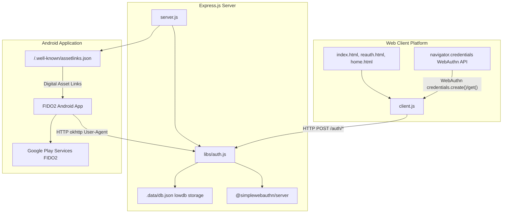
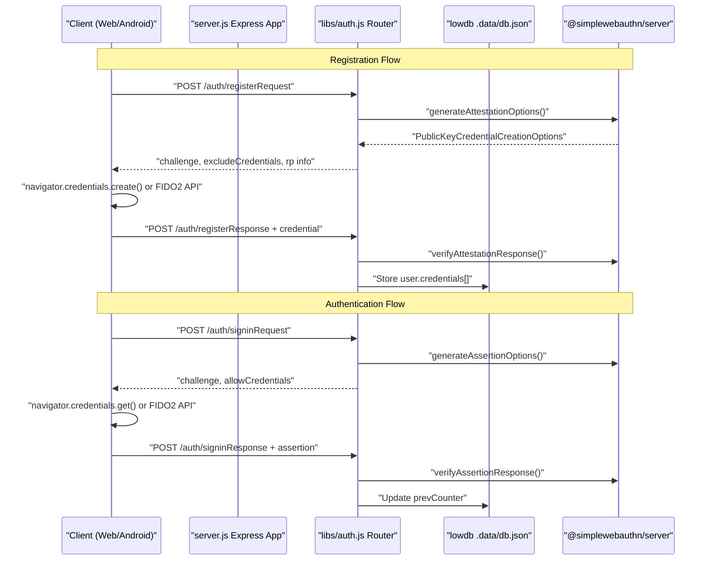
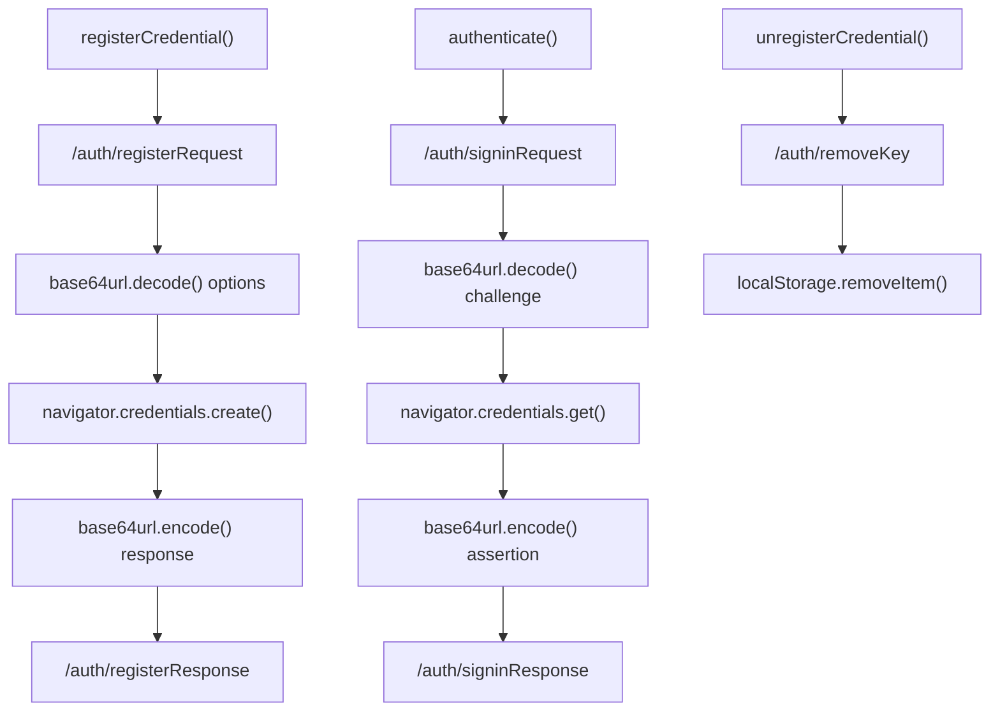
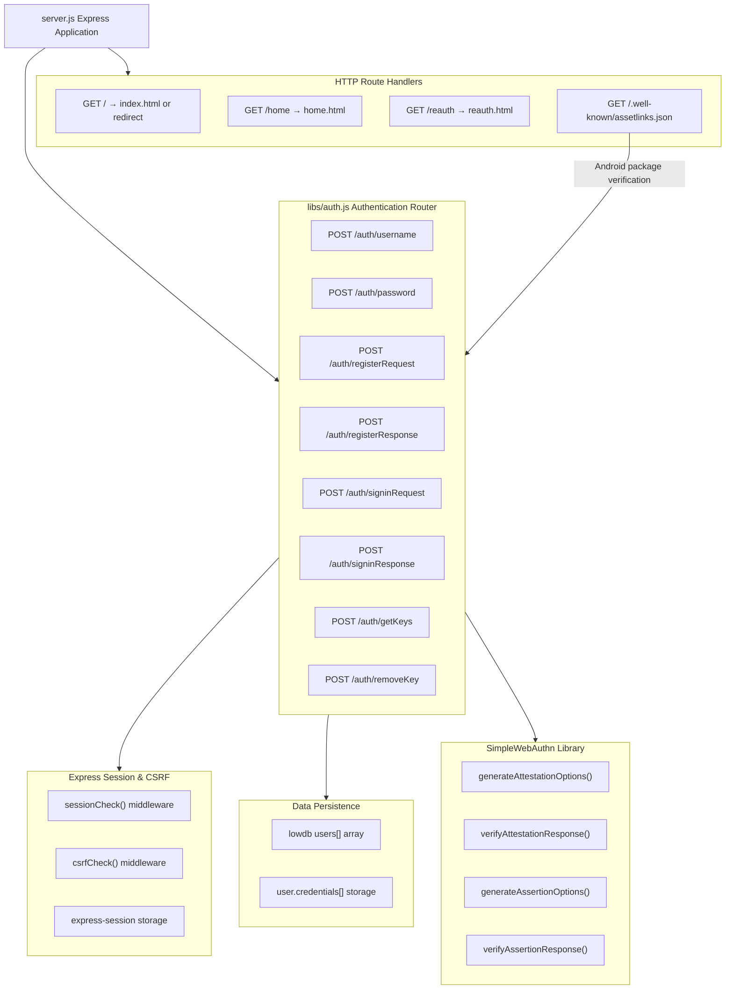
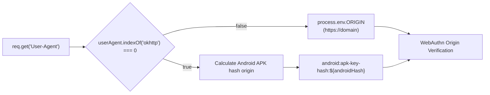

<!-- source: DeepWiki mcp.deepwiki.com · repo android/codelab-fido2 · page 1 WebAuthn Codelab Overview · fetched 2026-10-23 -->

# WebAuthn Codelab Overview

Relevant source files

The following files were used as context for generating this wiki page:

- [libs/auth.js](libs/auth.js)
- [package.json](package.json)
- [public/client.js](public/client.js)
- [server.js](server.js)

## Purpose and Scope

This document provides an architectural overview of the WebAuthn Codelab, a comprehensive educational repository that demonstrates FIDO2/WebAuthn authentication across three platforms: web client, web server, and Android application. The codelab implements passwordless authentication using platform authenticators and cross-platform credential sharing.

For detailed implementation of specific components, see [Web Application](#2) for browser and server implementations, [Android Application](#3) for mobile client details, and [WebAuthn and FIDO2 Implementation](#4) for authentication protocol specifics.

## System Architecture

The WebAuthn Codelab consists of three interconnected systems that demonstrate modern passwordless authentication:

### Three-Platform Authentication System

Sources: [server.js:1-128](), [libs/auth.js:1-483](), [public/client.js:1-162](), [package.json:1-45]()

### Core Authentication Flow

The system implements a complete WebAuthn authentication cycle with credential registration, authentication, and management:

#### Registration and Authentication Endpoints

Sources: [libs/auth.js:186-291](), [libs/auth.js:308-361](), [libs/auth.js:377-422](), [libs/auth.js:439-480]()

## Platform-Specific Implementations

### Web Client Implementation

The web client uses standard WebAuthn APIs with base64url encoding utilities and HTTP communication:

| Component | File | Key Functions |
|-----------|------|---------------|
| WebAuthn Integration | `client.js` | `registerCredential()`, `authenticate()` |
| Base64URL Utilities | `client.js` | `base64url.encode()`, `base64url.decode()` |
| HTTP Communication | `client.js` | `_fetch()` utility |
| UI Templates | `views/*.html` | Login, reauth, credential management |

The client implementation handles WebAuthn credential creation and authentication through browser APIs:

Sources: [public/client.js:62-105](), [public/client.js:107-156](), [public/client.js:158-161]()

### Server Architecture

The Express.js server provides WebAuthn endpoints, session management, and cross-platform origin handling:

| Component | Purpose | Implementation |
|-----------|---------|----------------|
| `server.js` | Main application, routing, session config | Express app with `express-session` |
| `libs/auth.js` | Authentication router and WebAuthn logic | SimpleWebAuthn integration |
| `lowdb` storage | User and credential persistence | JSON file database |
| Asset links | Android app verification | Digital Asset Links endpoint |

The server handles both web and Android clients through origin detection:

Sources: [server.js:18-128](), [libs/auth.js:17-48](), [libs/auth.js:266-277](), [libs/auth.js:406-415]()

## Cross-Platform Origin Handling

The server supports both web and Android clients through dynamic origin detection:

Sources: [libs/auth.js:62-74](), [server.js:95-119]()

## Database Schema and Storage

The codelab uses `lowdb` for simple JSON-based storage with the following structure:

| Entity | Schema | Purpose |
|--------|--------|---------|
| `users[]` | Array of user objects | Main user storage |
| `user.username` | String | User identifier |
| `user.id` | Base64URL string | WebAuthn user ID |
| `user.credentials[]` | Array of credential objects | Stored authenticators |
| `credential.credId` | Base64URL string | Credential identifier |
| `credential.publicKey` | Base64URL string | Public key for verification |
| `credential.prevCounter` | Integer | Signature counter |

Sources: [libs/auth.js:25-41](), [libs/auth.js:88-103](), [libs/auth.js:341-349]()

## Technology Stack

The codelab demonstrates WebAuthn across multiple technology stacks:

### Dependencies and Build System

| Platform | Core Dependencies | Purpose |
|----------|-------------------|---------|
| Web Server | `express`, `express-session`, `@simplewebauthn/server`, `lowdb` | HTTP server and WebAuthn |
| Web Client | `@material/mwc-*` components, `webpack`, `babel` | UI and build tooling |
| Android | Google Play Services FIDO2 API | Platform authentication |

Sources: [package.json:10-31]()

This codelab provides a complete educational foundation for implementing WebAuthn authentication across web and mobile platforms, with shared credential storage and cross-platform compatibility.

---

