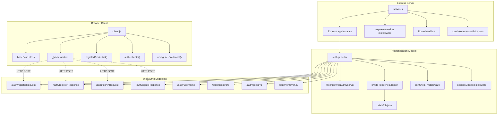
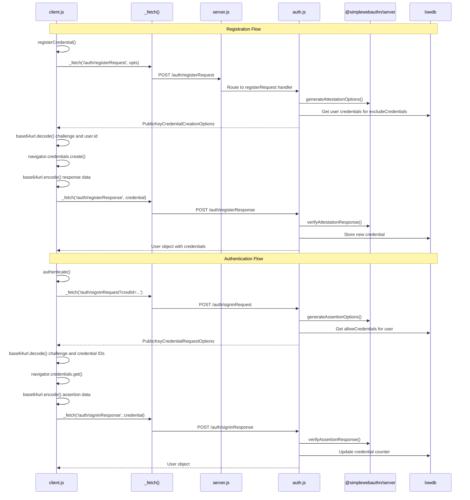
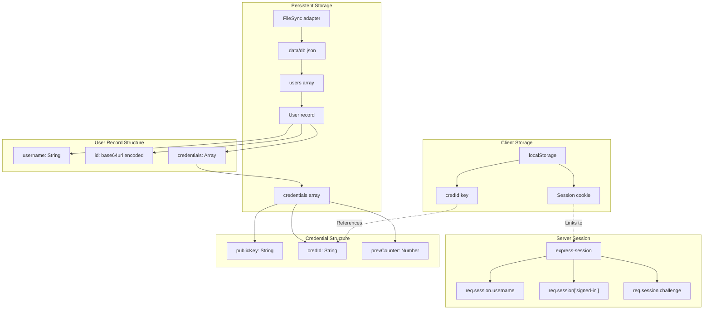

<!-- source: DeepWiki mcp.deepwiki.com · repo android/codelab-fido2 · page 2 Web Application · fetched 2026-10-23 -->

# Web Application

Relevant source files

The following files were used as context for generating this wiki page:

- [libs/auth.js](libs/auth.js)
- [public/client.js](public/client.js)
- [server.js](server.js)

## Purpose and Scope

This document provides an overview of the web application components in the WebAuthn/FIDO2 codelab, covering both the browser-based client implementation and the Node.js server infrastructure. The web application demonstrates WebAuthn authentication flows through a complete full-stack implementation.

For detailed client-side implementation details, see [Client-Side Architecture](#2.1). For server-side implementation specifics, see [Server-Side Architecture](#2.2). For step-by-step authentication flows, see [Web Authentication Flow](#2.3).

## System Architecture

The web application consists of three main components: a browser client with WebAuthn integration, an Express.js server, and a JSON-based data persistence layer.

### Web Application Component Overview

Sources: [public/client.js:1-162](), [server.js:1-128](), [libs/auth.js:1-483]()

### HTTP Route Structure

The server implements a clear separation between public routes and authentication-specific endpoints:

| Route Pattern | Handler Location | Purpose |
|---------------|------------------|---------|
| `/` | [server.js:62-71]() | Main entry point, redirects based on session state |
| `/home` | [server.js:73-81]() | Authenticated user dashboard |
| `/reauth` | [server.js:83-93]() | Re-authentication page for existing sessions |
| `/.well-known/assetlinks.json` | [server.js:95-119]() | Digital Asset Links for Android integration |
| `/auth/*` | [libs/auth.js:17-483]() | All WebAuthn authentication endpoints |

Sources: [server.js:62-119](), [libs/auth.js:17-18]()

## Client-Server Communication Flow

The web application implements a structured request/response pattern for WebAuthn operations, with specific data transformations at each step.

### WebAuthn Registration and Authentication Flow

Sources: [public/client.js:62-156](), [libs/auth.js:218-480]()

## Data Management and Session Handling

The web application maintains both client-side and server-side state for WebAuthn operations.

### Session and Data Storage Architecture

Sources: [public/client.js:102-103](), [server.js:31-41](), [libs/auth.js:25-41](), [libs/auth.js:344-348]()

## Security Implementation

The web application implements multiple layers of security controls for WebAuthn operations and general request handling.

### Security Middleware and Protection Mechanisms

| Security Control | Implementation | Location |
|------------------|----------------|----------|
| CSRF Protection | `X-Requested-With` header validation | [libs/auth.js:42-48]() |
| Session Validation | `sessionCheck` middleware | [libs/auth.js:54-60]() |
| Origin Validation | User-Agent based origin detection | [libs/auth.js:62-74]() |
| Secure Cookies | `httpOnly`, `secure`, `sameSite` flags | [server.js:36-40]() |
| HTTPS Enforcement | Redirect non-HTTPS requests | [server.js:51-56]() |

The `getOrigin()` function [libs/auth.js:62-74]() dynamically determines the expected origin based on the User-Agent, supporting both web browsers and Android applications through different origin formats.

Sources: [libs/auth.js:42-74](), [server.js:31-58]()

## Integration Points

The web application provides integration capabilities for Android applications through Digital Asset Links and supports cross-platform credential sharing.

### Android Integration Configuration

The server generates Dynamic Asset Links at `/.well-known/assetlinks.json` [server.js:95-119]() based on environment variables:

- `ANDROID_PACKAGENAME`: Android app package identifier
- `ANDROID_SHA256HASH`: App signing certificate fingerprint
- `ORIGIN`: Web application origin URL

This enables the Android application to authenticate against the same backend and share credentials with the web client through the common `lowdb` storage layer.

Sources: [server.js:95-119](), [libs/auth.js:64-69]()

---

