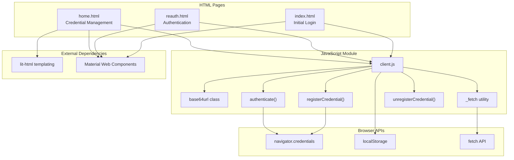
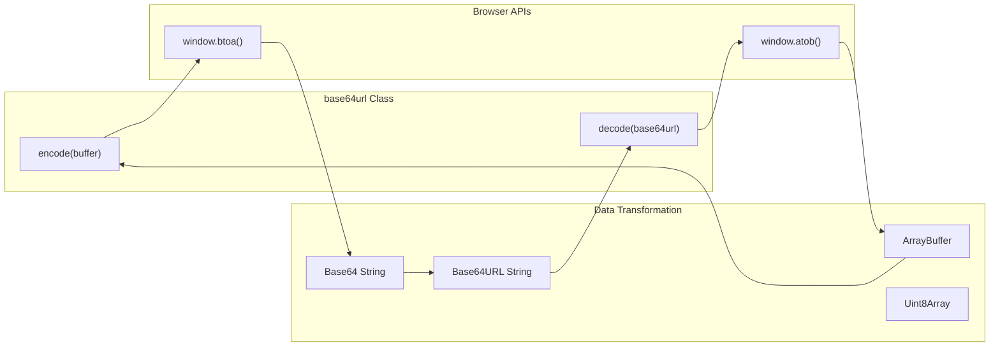
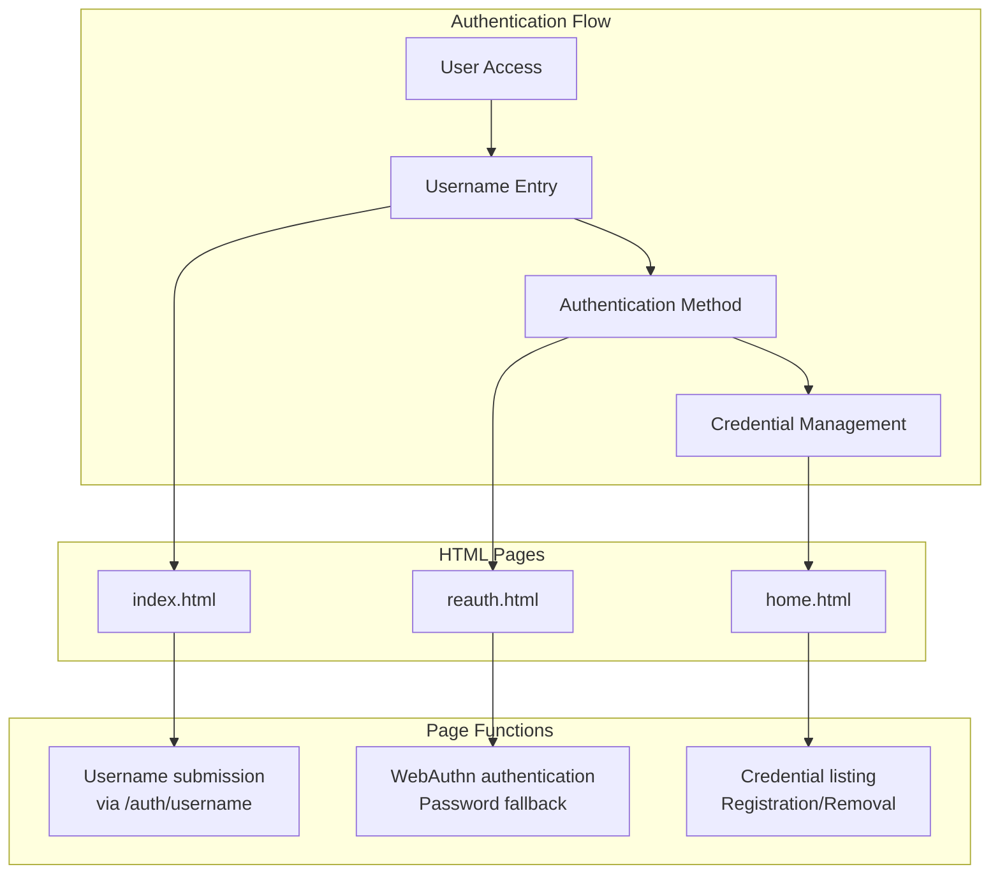
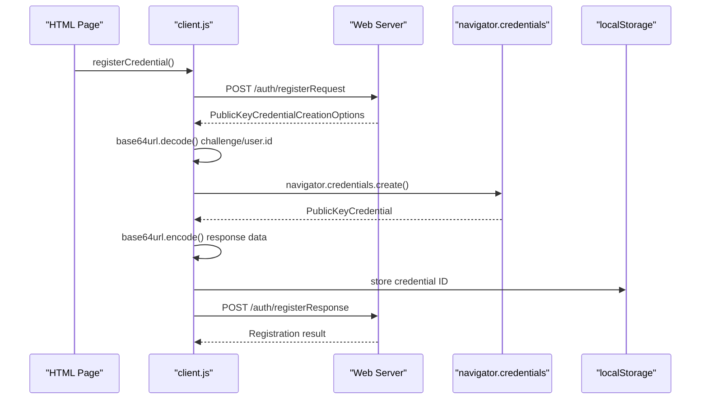
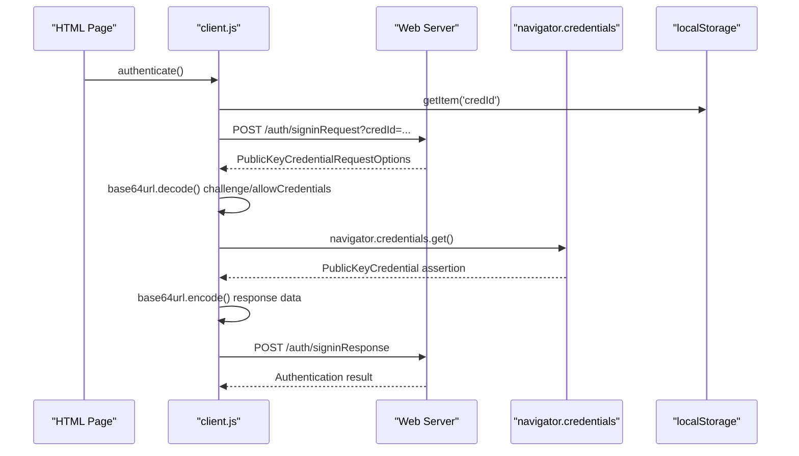
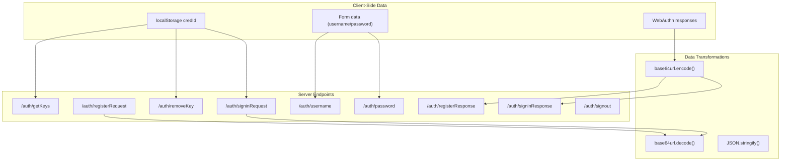

<!-- source: DeepWiki mcp.deepwiki.com · repo android/codelab-fido2 · page 2.1 Client-Side Architecture · fetched 2026-10-23 -->

# Client-Side Architecture

<details>
<summary>Relevant source files</summary>

The following files were used as context for generating this wiki page:

- [public/client.js](public/client.js)
- [views/home.html](views/home.html)
- [views/index.html](views/index.html)
- [views/reauth.html](views/reauth.html)

</details>


## Purpose and Scope

This document explains the browser-based client-side architecture for the WebAuthn codelab web application. It covers the JavaScript modules, HTML templates, WebAuthn API integration, and client-side data management that enable passwordless authentication in the browser.

For server-side authentication processing, see [Server-Side Architecture](#2.2). For Android client implementation, see [Android Application](#3).

## Architecture Overview

The client-side architecture consists of three main HTML pages that work together with a shared JavaScript module to provide WebAuthn functionality. Each page serves a specific purpose in the authentication flow.

### Client-Side Component Structure



**Sources:** [public/client.js:1-162](), [views/index.html:1-67](), [views/reauth.html:1-118](), [views/home.html:1-112]()

## Core JavaScript Module

The `client.js` file serves as the central JavaScript module that provides WebAuthn functionality and utility functions shared across all HTML pages.

### Module Structure and Exports

| Export | Purpose | Usage |
|--------|---------|--------|
| `base64url` | Base64URL encoding/decoding utility class | WebAuthn data format conversion |
| `_fetch` | HTTP request utility function | Server communication |
| `registerCredential` | WebAuthn credential registration | New credential creation |
| `authenticate` | WebAuthn authentication | User verification |
| `unregisterCredential` | Credential removal | Credential management |

### Base64URL Utility Class

The `base64url` class handles the encoding and decoding requirements for WebAuthn data formats, which use Base64URL encoding instead of standard Base64.



**Sources:** [public/client.js:21-36]()

### HTTP Communication Utility

The `_fetch` function provides a standardized way to communicate with the server, handling JSON serialization, CSRF protection, and error handling.

**Key features:**
- Sets `X-Requested-With` header for CSRF protection
- Handles both JSON and FormData payloads
- Includes credentials for session management
- Provides consistent error handling

**Sources:** [public/client.js:38-60]()

## HTML Pages and User Interface

Each HTML page serves a distinct role in the authentication workflow and incorporates Material Design components for consistent UI presentation.

### Page Responsibilities



**Sources:** [views/index.html:37-45](), [views/reauth.html:34-58](), [views/home.html:47-52]()

### Material Design Integration

All pages use Material Web Components for consistent UI elements:

- **Top App Bar:** `mwc-top-app-bar-fixed` for page headers
- **Buttons:** `mwc-button` with various styles (raised, outlined)
- **Text Fields:** Material Design text input components
- **Cards:** `mdc-card` for credential display in home page

**Sources:** [views/index.html:30-44](), [views/reauth.html:30-56](), [views/home.html:33-52]()

## WebAuthn API Integration

The client-side WebAuthn integration handles the browser's native authentication APIs for both credential registration and authentication.

### Credential Registration Flow



**Sources:** [public/client.js:62-105]()

### Authentication Flow

The authentication process retrieves existing credentials and performs user verification:



**Sources:** [public/client.js:107-156]()

### Platform Authenticator Detection

The client-side code checks for User Verifying Platform Authenticator (UVPA) availability before showing WebAuthn options:

```javascript
PublicKeyCredential.isUserVerifyingPlatformAuthenticatorAvailable()
```

This check is performed on both the reauth and home pages to conditionally display WebAuthn functionality.

**Sources:** [views/reauth.html:77-90](), [views/home.html:60-75]()

## Data Flow and State Management

### Local Storage Management

The client uses `localStorage` to maintain minimal state about registered credentials:

| Key | Value | Purpose |
|-----|-------|---------|
| `credId` | Credential ID string | Track user's primary credential |

**Storage operations:**
- **Set:** During credential registration [public/client.js:102]()
- **Get:** During authentication [public/client.js:111]()
- **Remove:** During credential removal [public/client.js:159]()

### Client-Server Data Exchange



**Sources:** [public/client.js:38-161](), [views/index.html:49-62](), [views/reauth.html:63-115](), [views/home.html:77-108]()

### Dynamic UI Updates

The home page uses `lit-html` for dynamic credential list rendering, updating the UI based on server responses without full page reloads.

**Template rendering pattern:**
- Fetch credentials from server via `/auth/getKeys`
- Render credential list using `lit-html` templates
- Bind event handlers for credential removal

**Sources:** [views/home.html:55-102]()

---

