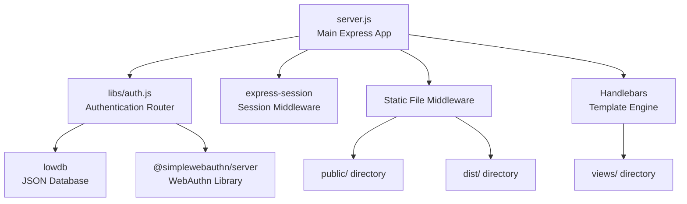
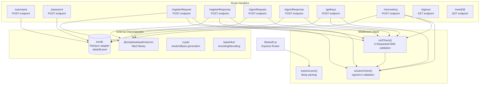
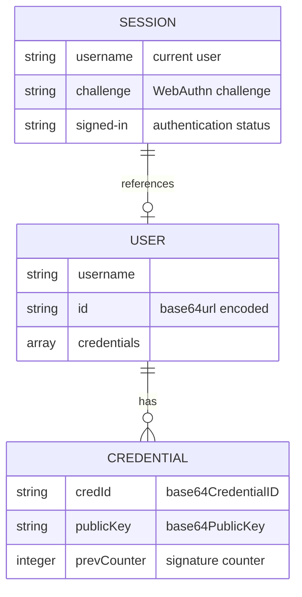
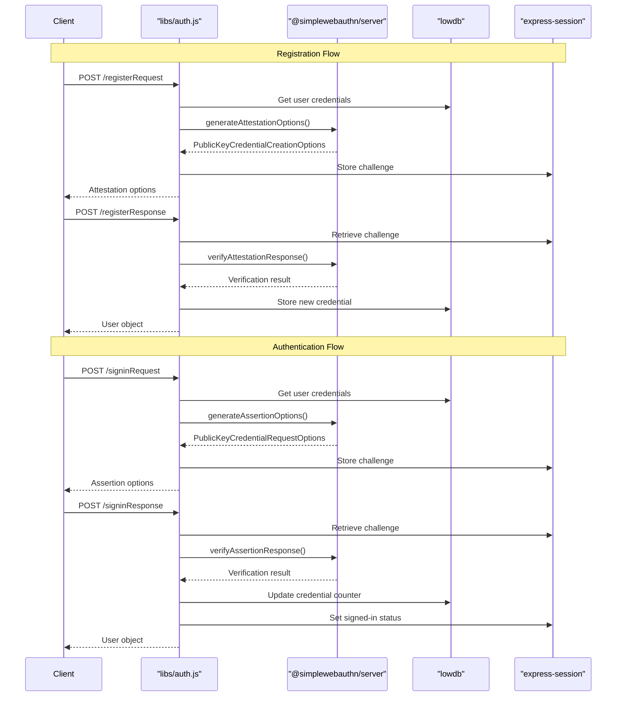
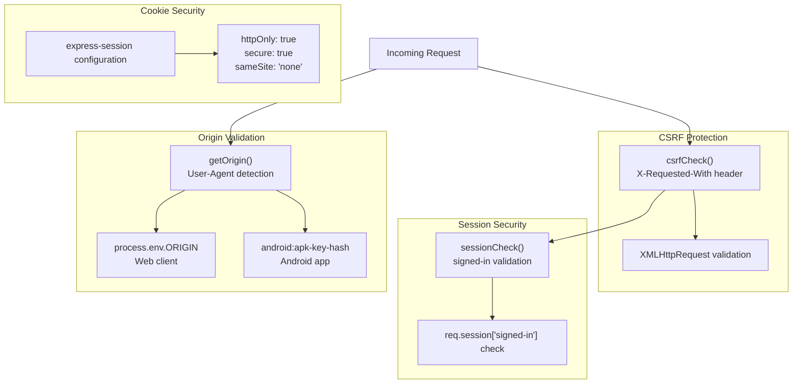
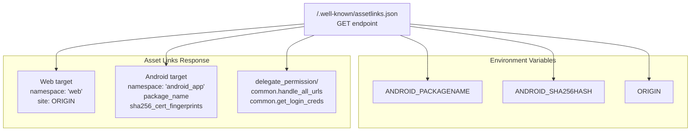

<!-- source: DeepWiki mcp.deepwiki.com · repo android/codelab-fido2 · page 2.2 Server-Side Architecture · fetched 2026-10-23 -->

# Server-Side Architecture

Relevant source files

The following files were used as context for generating this wiki page:

- [libs/auth.js](libs/auth.js)
- [package.json](package.json)
- [server.js](server.js)

This document covers the Express.js server implementation that handles WebAuthn authentication, user management, and serves the web client. The server provides REST endpoints for credential registration, authentication, and management while maintaining session state and integrating with the SimpleWebAuthn library.

For information about the client-side web components that interact with this server, see [Client-Side Architecture](#2.1). For details on the Android app's server communication, see [Android Application](#3).

## Core Server Components

The server architecture is built around Express.js with modular routing and middleware components. The main application bootstraps the web server and delegates authentication logic to a dedicated router module.

### Express Application Structure

**Core Server Components**
Sources: [server.js:1-127](), [package.json:10-31]()

The main `server.js` file configures the Express application with essential middleware and routing. The application uses Handlebars for server-side templating, express-session for session management, and delegates all authentication logic to the `auth` router mounted at `/auth`.

### Authentication Router Architecture

**Authentication Routing System**
Sources: [libs/auth.js:17-482]()

## Database and Session Management

The server uses LowDB for persistent user data storage and express-session for managing user sessions. The database schema and session handling provide the foundation for user account management and authentication state.

### Data Storage Schema

| Component | Technology | Purpose | Configuration |
|-----------|------------|---------|---------------|
| User Database | LowDB with FileSync | Persistent user and credential storage | `.data/db.json` |
| Session Store | express-session | HTTP session management | In-memory with secure cookies |
| Challenge Storage | Session-based | Temporary WebAuthn challenge storage | `req.session.challenge` |

**Database Structure and Session Management**
Sources: [libs/auth.js:23-40](), [server.js:31-41]()

The database initializes with a default structure containing a `users` array. Each user object contains a username, unique ID, and an array of registered credentials:

**User Data Model and Session Schema**
Sources: [libs/auth.js:88-96](), [libs/auth.js:344-348]()

## WebAuthn Integration

The server implements WebAuthn registration and authentication flows using the SimpleWebAuthn library. The integration handles challenge generation, credential verification, and response validation according to WebAuthn specifications.

### WebAuthn Endpoint Flow

**WebAuthn Protocol Implementation**
Sources: [libs/auth.js:218-291](), [libs/auth.js:308-361](), [libs/auth.js:377-422](), [libs/auth.js:439-480]()

### WebAuthn Configuration Parameters

The server configures WebAuthn options based on environment variables and request parameters:

| Parameter | Source | Purpose |
|-----------|--------|---------|
| `RP_NAME` | Constant: 'WebAuthn Codelab' | Relying Party display name |
| `TIMEOUT` | Constant: 30 minutes | Challenge timeout duration |
| `expectedRPID` | `process.env.HOSTNAME` | Relying Party identifier |
| `expectedOrigin` | `getOrigin()` function | Origin validation (web/Android) |
| `pubKeyCredParams` | Hardcoded algorithms | Supported crypto algorithms (-7, -257) |

**WebAuthn Configuration and Parameters**
Sources: [libs/auth.js:35-36](), [libs/auth.js:62-74](), [libs/auth.js:266-277](), [libs/auth.js:406-415]()

## Security Mechanisms

The server implements multiple layers of security including CSRF protection, session validation, and origin verification. These mechanisms protect against common web vulnerabilities while ensuring WebAuthn protocol compliance.

### Security Middleware and Validation

**Security Implementation Details**
Sources: [libs/auth.js:42-60](), [libs/auth.js:62-74](), [server.js:31-41]()

## Android Integration Support

The server provides specific support for Android FIDO2 clients through Digital Asset Links and origin validation. This enables seamless cross-platform credential sharing between web and Android applications.

### Digital Asset Links Configuration

**Android Digital Asset Links Support**
Sources: [server.js:95-119](), [libs/auth.js:62-74]()

The server dynamically generates Digital Asset Links responses to establish trust relationships between the web domain and Android application. This enables Android apps to authenticate users using credentials registered on the web platform, supporting the cross-platform nature of WebAuthn.

---

