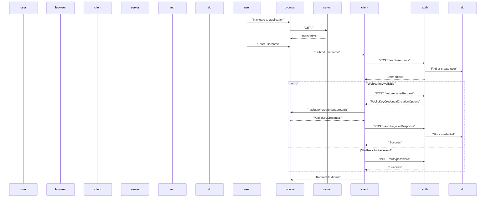
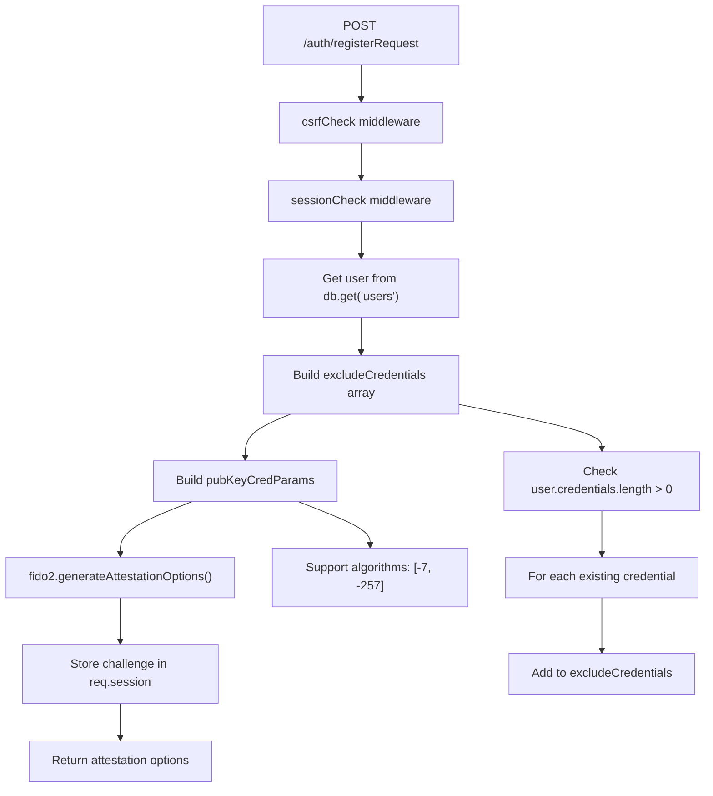
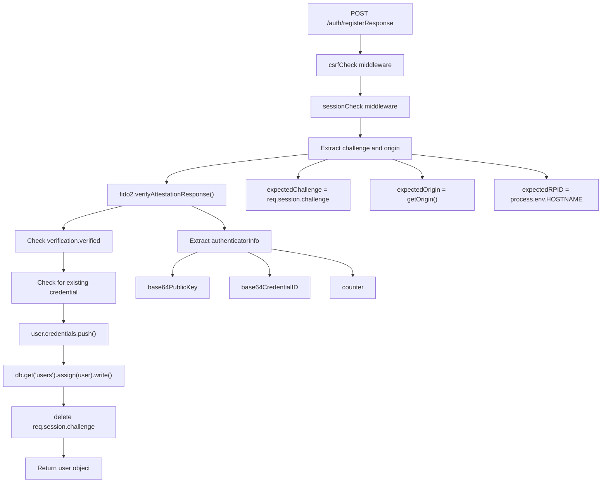
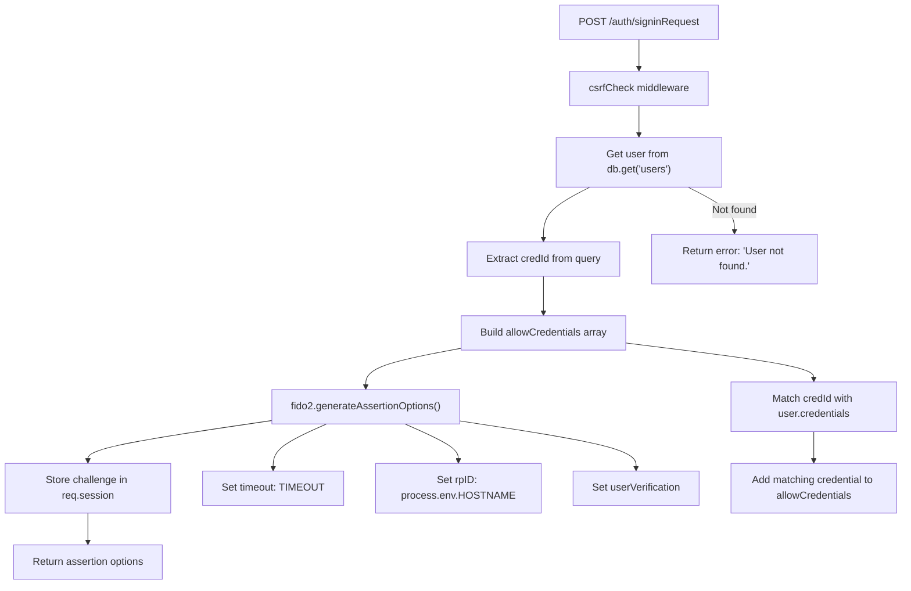
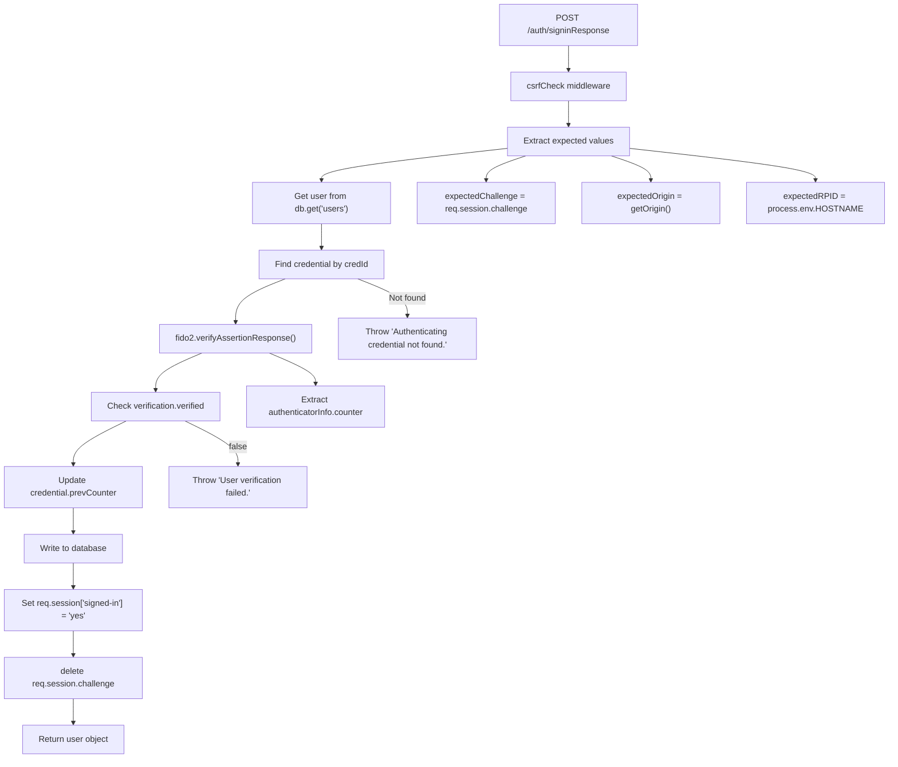
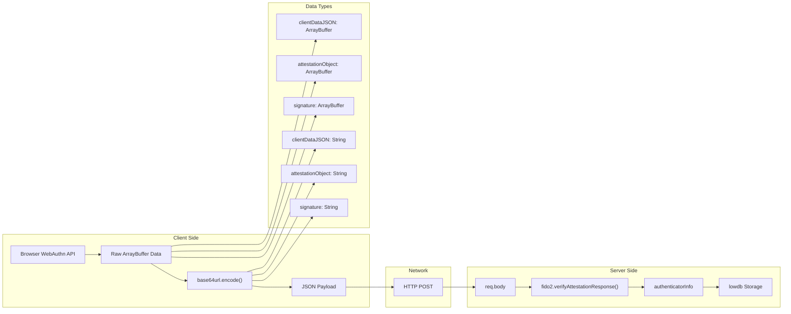
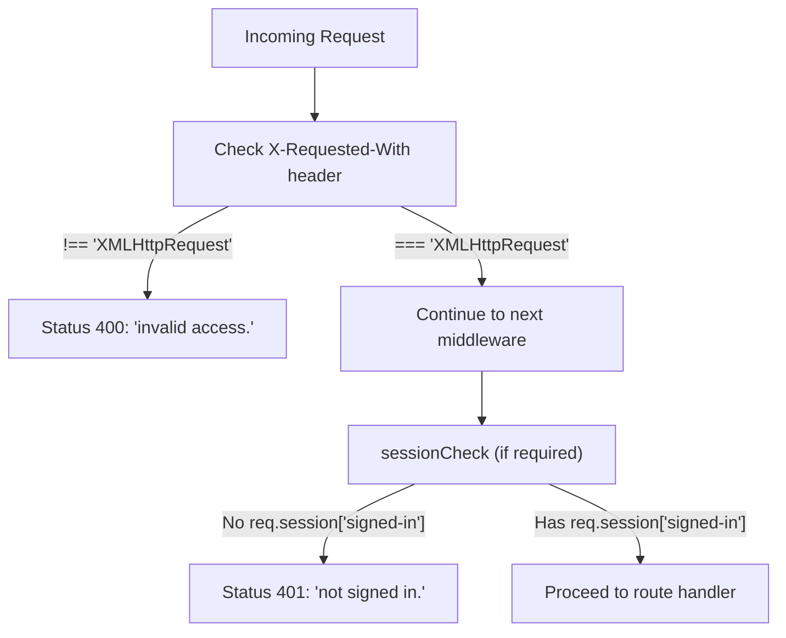
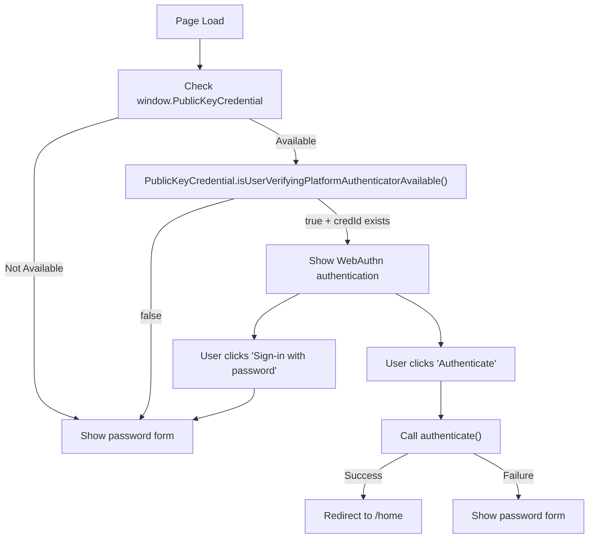

<!-- source: DeepWiki mcp.deepwiki.com · repo android/codelab-fido2 · page 2.3 Web Authentication Flow · fetched 2026-10-23 -->

# Web Authentication Flow

<details>
<summary>Relevant source files</summary>

The following files were used as context for generating this wiki page:

- [libs/auth.js](libs/auth.js)
- [public/client.js](public/client.js)
- [views/reauth.html](views/reauth.html)

</details>


## Purpose and Scope

This document describes the WebAuthn authentication flow implementation in the web application portion of the codelab. It covers the complete credential lifecycle from registration through authentication, including client-server interactions, data transformations, and session management. The flow demonstrates FIDO2/WebAuthn standards implementation using browser APIs and server-side verification.

For Android FIDO2 implementation details, see [Android FIDO2 Integration](#4.3). For server-side WebAuthn processing specifics, see [Server-Side WebAuthn Processing](#4.2).

## Authentication Flow Overview

The web authentication system implements a two-phase approach: credential registration followed by authentication. The flow supports both WebAuthn-based passwordless authentication and traditional password fallback.

### High-Level Authentication Sequence



Sources: [public/client.js:62-105](), [libs/auth.js:80-103](), [libs/auth.js:218-291](), [libs/auth.js:308-361]()

## Registration Flow

### Client-Side Registration Process

The `registerCredential` function orchestrates the credential creation process, handling data encoding and server communication.

```mermaid
flowchart TD
    start["registerCredential() called"] --> options["Build attestation options"]
    options --> request["_fetch('/auth/registerRequest', opts)"]
    request --> decode["Decode base64url fields"]
    decode --> create["navigator.credentials.create()"]
    create --> encode["Encode response fields"]
    encode --> store["localStorage.setItem('credId')"]
    store --> submit["_fetch('/auth/registerResponse')"]
    submit --> end["Return user object"]
    
    decode --> decode1["options.user.id = base64url.decode()"]
    decode --> decode2["options.challenge = base64url.decode()"]
    decode --> decode3["excludeCredentials[].id = base64url.decode()"]
    
    encode --> encode1["credential.rawId = base64url.encode()"]
    encode --> encode2["credential.response.clientDataJSON = base64url.encode()"]
    encode --> encode3["credential.response.attestationObject = base64url.encode()"]
```

Sources: [public/client.js:62-105]()

### Server-Side Registration Handling

The server processes registration through two endpoints: `/auth/registerRequest` and `/auth/registerResponse`.

#### Registration Request (`/auth/registerRequest`)



Sources: [libs/auth.js:218-291]()

#### Registration Response (`/auth/registerResponse`)



Sources: [libs/auth.js:308-361]()

## Authentication Flow

### Client-Side Authentication Process

The `authenticate` function handles credential-based sign-in, retrieving stored credential IDs and managing the authentication ceremony.

```mermaid
flowchart TD
    start["authenticate() called"] --> credid["Get credId from localStorage"]
    credid --> url["Build URL with credId parameter"]
    url --> request["_fetch('/auth/signinRequest')"]
    request --> check["Check allowCredentials.length"]
    check --> decode["Decode challenge and credential IDs"]
    decode --> get["navigator.credentials.get()"]
    get --> encode["Encode response fields"]
    encode --> submit["_fetch('/auth/signinResponse')"]
    submit --> end["Return user object"]
    
    check -->|"=== 0"| empty["Return Promise.resolve(null)"]
    
    decode --> decode1["options.challenge = base64url.decode()"]
    decode --> decode2["cred.id = base64url.decode()"]
    
    encode --> encode1["credential.rawId = base64url.encode()"]
    encode --> encode2["clientDataJSON = base64url.encode()"]
    encode --> encode3["authenticatorData = base64url.encode()"]
    encode --> encode4["signature = base64url.encode()"]
    encode --> encode5["userHandle = base64url.encode()"]
```

Sources: [public/client.js:107-156]()

### Server-Side Authentication Handling

Authentication processing involves generating assertion options and verifying the response.

#### Signin Request (`/auth/signinRequest`)



Sources: [libs/auth.js:377-422]()

#### Signin Response (`/auth/signinResponse`)



Sources: [libs/auth.js:439-480]()

## Data Structures and Encoding

### Base64URL Encoding Utility

The client-side implementation includes a `base64url` class for proper WebAuthn data encoding.

| Method | Purpose | Implementation |
|--------|---------|----------------|
| `encode(buffer)` | Convert ArrayBuffer to base64url string | Uses `btoa()` with character replacements |
| `decode(base64url)` | Convert base64url string to ArrayBuffer | Uses `atob()` with character restoration |

Sources: [public/client.js:21-36]()

### Credential Data Flow



Sources: [public/client.js:21-36](), [public/client.js:86-104](), [libs/auth.js:316-325]()

## Session Management and CSRF Protection

### Session State Management

The authentication system maintains session state across the registration and authentication flows.

| Session Key | Purpose | Set During | Cleared During |
|-------------|---------|------------|----------------|
| `username` | User identification | `/auth/username` | `/auth/signout` |
| `signed-in` | Authentication status | `/auth/password`, `/auth/signinResponse` | `/auth/signout` |
| `challenge` | WebAuthn challenge storage | `/auth/registerRequest`, `/auth/signinRequest` | After verification |

Sources: [libs/auth.js:99](), [libs/auth.js:122](), [libs/auth.js:279](), [libs/auth.js:416](), [libs/auth.js:474]()

### CSRF Protection



Sources: [libs/auth.js:42-48](), [libs/auth.js:54-60]()

## Error Handling and Fallback Authentication

### WebAuthn Availability Detection

The reauthentication page implements progressive enhancement with WebAuthn detection and password fallback.



Sources: [views/reauth.html:77-90](), [views/reauth.html:92-114]()

### Error Response Handling

Both client and server implement comprehensive error handling for authentication failures.

| Error Source | Error Type | Client Handling | Server Response |
|--------------|------------|-----------------|-----------------|
| Missing credential | Authentication | Promise resolve(null) | Empty allowCredentials array |
| Verification failure | Server validation | Alert and fallback | Status 400 with error message |
| Network issues | HTTP request | Catch and alert | Standard HTTP error codes |
| Session issues | State management | Redirect to login | Status 401 unauthorized |

Sources: [public/client.js:118-121](), [libs/auth.js:328-330](), [libs/auth.js:465-467](), [views/reauth.html:108-113]()

---

