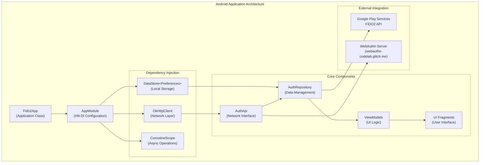
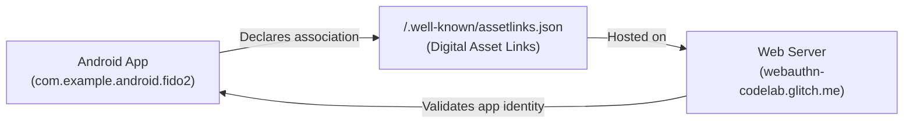
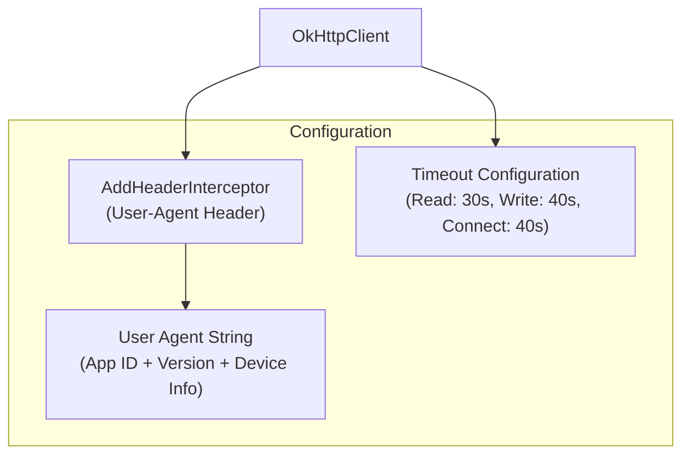
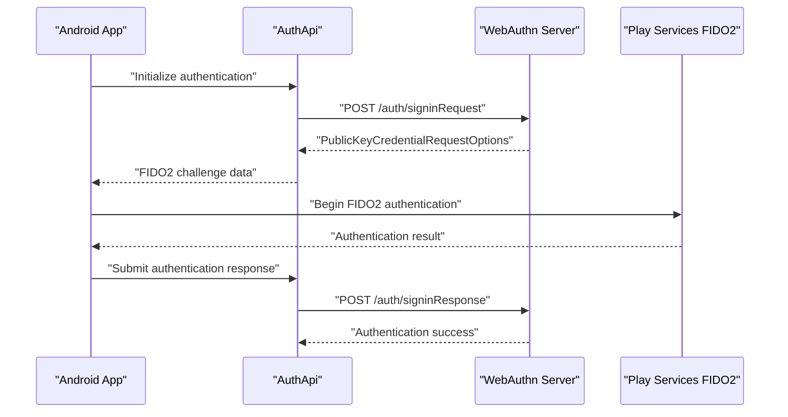

<!-- source: DeepWiki mcp.deepwiki.com · repo android/codelab-fido2 · page 3 Android Application · fetched 2026-10-23 -->

# Android Application

Relevant source files

The following files were used as context for generating this wiki page:

- [android/app-start/build.gradle](android/app-start/build.gradle)
- [android/app-start/src/main/java/com/example/android/fido2/Fido2App.kt](android/app-start/src/main/java/com/example/android/fido2/Fido2App.kt)
- [android/app/build.gradle](android/app/build.gradle)
- [android/app/src/main/java/com/example/android/fido2/Fido2App.kt](android/app/src/main/java/com/example/android/fido2/Fido2App.kt)

The Android application demonstrates FIDO2 authentication using Google Play Services, providing a native mobile implementation that works alongside the web-based components of the WebAuthn codelab. This application showcases how to integrate passwordless authentication into Android apps using modern Android development patterns including Hilt dependency injection, Kotlin coroutines, and MVVM architecture.

For information about the web-based authentication flow, see [Web Application](#2). For details about the underlying WebAuthn implementation, see [WebAuthn and FIDO2 Implementation](#4).

## Application Overview

The Android application is built as a modern Android app using Kotlin and follows the recommended Android architecture patterns. It communicates with the same web server used by the web client, demonstrating cross-platform credential sharing in WebAuthn/FIDO2 implementations.

**Sources:** [android/app/src/main/java/com/example/android/fido2/Fido2App.kt:1-69](), [android/app/build.gradle:1-115]()

## Application Configuration

The Android application is configured with specific settings that enable FIDO2 authentication and integration with the web server.

### Build Configuration

| Configuration | Value | Purpose |
|---------------|--------|---------|
| `applicationId` | `com.example.android.fido2` | Unique app identifier |
| `compileSdk` | 33 | Target Android API level |
| `minSdk` | 21 | Minimum supported Android version |
| `API_BASE_URL` | `https://webauthn-codelab.glitch.me/auth` | Server endpoint for authentication |

### Digital Asset Links Integration

The application includes configuration for Digital Asset Links, which enables app-to-website association for WebAuthn:

**Sources:** [android/app/build.gradle:33-39]()

## Dependency Injection Setup

The application uses Hilt for dependency injection, with the main configuration in `AppModule`. The `Fido2App` class serves as the application entry point and enables Hilt integration.

### Core Dependencies

The `AppModule` provides three key singleton dependencies:

| Dependency | Type | Purpose |
|------------|------|---------|
| `OkHttpClient` | Network Client | HTTP communication with authentication server |
| `CoroutineScope` | Concurrency | Managing asynchronous operations |
| `DataStore<Preferences>` | Local Storage | Persisting authentication state and credentials |

### OkHttpClient Configuration

The HTTP client is configured with custom headers and timeouts for reliable communication:

**Sources:** [android/app/src/main/java/com/example/android/fido2/Fido2App.kt:44-55]()

## Key Dependencies and Libraries

The Android application leverages several important libraries to implement FIDO2 authentication:

### FIDO2 and Authentication
- `com.google.android.gms:play-services-fido:20.0.1` - Google Play Services FIDO2 API
- `androidx.datastore:datastore-preferences:1.0.0` - Local data persistence

### Networking and Async Operations
- `com.squareup.okhttp3:okhttp:4.11.0` - HTTP client library
- `org.jetbrains.kotlinx:kotlinx-coroutines-android:1.7.1` - Kotlin coroutines for Android
- `ru.gildor.coroutines:kotlin-coroutines-okhttp:1.0` - Coroutines integration with OkHttp

### Dependency Injection
- `com.google.dagger:hilt-android:2.47` - Hilt dependency injection framework

### Android Architecture Components
- `androidx.lifecycle:lifecycle-viewmodel-ktx:2.6.1` - ViewModel for UI logic
- `androidx.lifecycle:lifecycle-livedata-ktx:2.6.1` - LiveData for reactive UI updates
- `androidx.fragment:fragment-ktx:1.6.0` - Modern fragment APIs

**Sources:** [android/app/build.gradle:69-114]()

## Integration with Web Server

The Android application integrates with the same web server used by the web client, enabling cross-platform credential management. The server endpoint configuration demonstrates how the Android app connects to the WebAuthn service.

The `API_BASE_URL` build configuration field points to `https://webauthn-codelab.glitch.me/auth`, establishing the connection between the Android client and the shared authentication server.

**Sources:** [android/app/build.gradle:33-34]()

---

