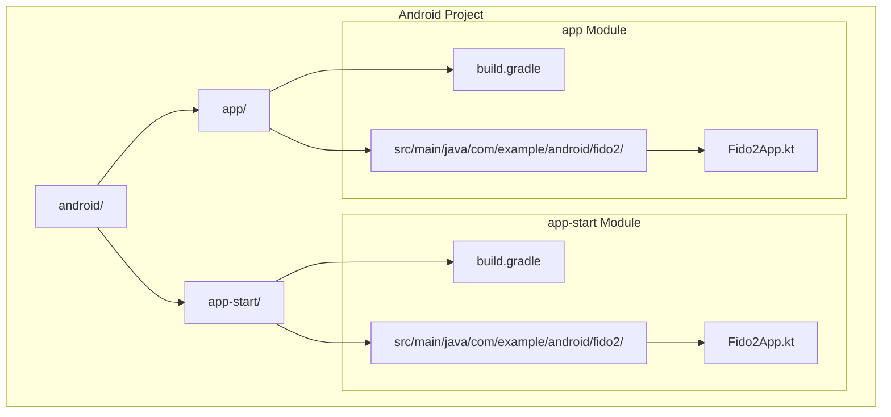
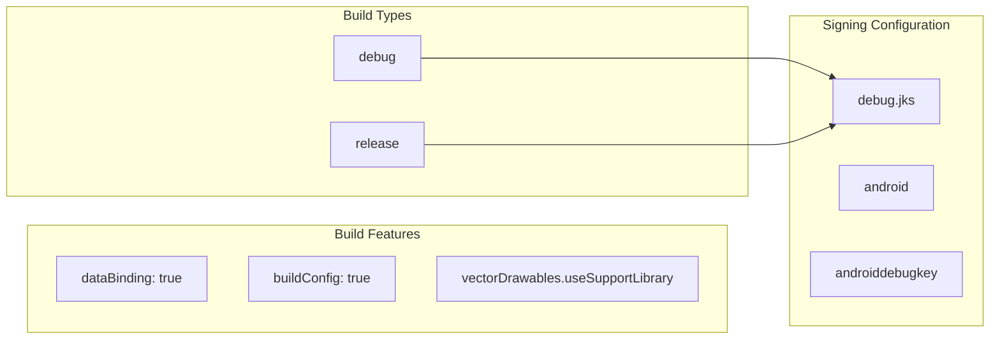
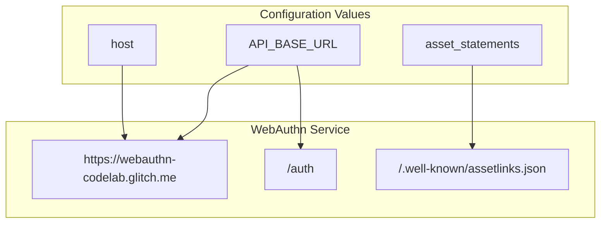
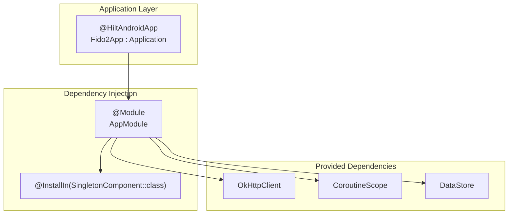
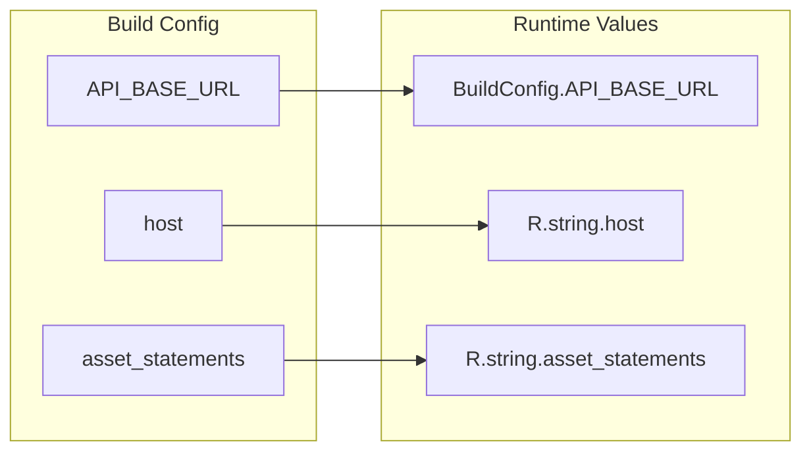

<!-- source: DeepWiki mcp.deepwiki.com · repo android/codelab-fido2 · page 3.1 Application Structure and Configuration · fetched 2026-10-23 -->

# Application Structure and Configuration

Relevant source files

The following files were used as context for generating this wiki page:

- [android/.idea/compiler.xml](android/.idea/compiler.xml)
- [android/.idea/gradle.xml](android/.idea/gradle.xml)
- [android/app-start/build.gradle](android/app-start/build.gradle)
- [android/app-start/src/main/java/com/example/android/fido2/Fido2App.kt](android/app-start/src/main/java/com/example/android/fido2/Fido2App.kt)
- [android/app/build.gradle](android/app/build.gradle)
- [android/app/src/main/java/com/example/android/fido2/Fido2App.kt](android/app/src/main/java/com/example/android/fido2/Fido2App.kt)

This document covers the Android application's project structure, build configuration, dependency injection setup, and main application components. The Android app demonstrates FIDO2 authentication using Google Play Services and follows modern Android development practices with Hilt dependency injection and coroutines.

For detailed information about the authentication logic and API integration, see [Authentication Components](#3.2). For UI implementation details, see [User Interface Components](#3.3).

## Project Structure

The Android portion of the codelab consists of two modules that demonstrate a progressive learning approach:

**Module Breakdown**:
- **app-start**: Starting point for the codelab with basic configuration
- **app**: Complete implementation with full FIDO2 functionality

Sources: [android/.idea/gradle.xml:9-14]()

## Build Configuration

The application uses standard Android Gradle configuration with specific settings for FIDO2 integration:

### Core Build Settings

| Configuration | Value |
|---------------|-------|
| Application ID | `com.example.android.fido2` |
| Namespace | `com.example.android.fido2` |
| Minimum SDK | 21 |
| Target SDK | 33 |
| Compile SDK | 33 |
| Java Version | 17 |

### Build Features and Signing

The build configuration enables several key features:

Sources: [android/app/build.gradle:22-66](), [android/app-start/build.gradle:22-66]()

### WebAuthn Service Configuration

The build configuration includes specific values for connecting to the WebAuthn service:

Sources: [android/app/build.gradle:33-39](), [android/app-start/build.gradle:33-39]()

## Application Architecture

### Main Application Class

The `Fido2App` class serves as the application entry point and is configured for Hilt dependency injection:

Sources: [android/app/src/main/java/com/example/android/fido2/Fido2App.kt:37-38](), [android/app-start/src/main/java/com/example/android/fido2/Fido2App.kt:37-38]()

### Dependency Injection Configuration

The `AppModule` provides three singleton dependencies:

**OkHttpClient Configuration**:
- Custom User-Agent header with app version and device information
- Timeout configurations: 30s read, 40s write/connect
- Custom interceptor for adding headers

**CoroutineScope**:
- Application-level scope with `SupervisorJob`
- Used for background operations throughout the app

**DataStore**:
- Preferences-based data storage named "auth"
- Used for persisting authentication state and user preferences

Sources: [android/app/src/main/java/com/example/android/fido2/Fido2App.kt:42-68](), [android/app-start/src/main/java/com/example/android/fido2/Fido2App.kt:42-68]()

## Key Dependencies

The application relies on several major dependency categories:

### FIDO2 and Authentication
| Dependency | Version | Purpose |
|------------|---------|---------|
| `com.google.android.gms:play-services-fido` | 20.0.1 | Google Play Services FIDO2 API |

### Android Architecture Components
| Dependency | Version | Purpose |
|------------|---------|---------|
| `androidx.fragment:fragment-ktx` | 1.6.0 | Fragment extensions |
| `androidx.lifecycle:lifecycle-*` | 2.6.1 | ViewModel, LiveData, Runtime |
| `androidx.datastore:datastore-preferences` | 1.0.0 | Data persistence |

### Dependency Injection and Coroutines
| Dependency | Version | Purpose |
|------------|---------|---------|
| `com.google.dagger:hilt-android` | 2.47 | Dependency injection |
| `org.jetbrains.kotlinx:kotlinx-coroutines-*` | 1.7.1 | Asynchronous programming |

### Networking
| Dependency | Version | Purpose |
|------------|---------|---------|
| `com.squareup.okhttp3:okhttp` | 4.11.0 | HTTP client |
| `com.squareup.okhttp3:logging-interceptor` | 4.11.0 | Request/response logging |

Sources: [android/app/build.gradle:69-114](), [android/app-start/build.gradle:69-114]()

## Configuration Values and Digital Asset Links

The application includes specific configuration for WebAuthn integration:

### Build Configuration Fields

### Digital Asset Links Integration

The `asset_statements` resource value configures the app for Digital Asset Links verification, enabling the app to be associated with the WebAuthn service domain. This is crucial for FIDO2 authentication to work properly between the Android app and the web service.

Sources: [android/app/build.gradle:33-39](), [android/app-start/build.gradle:33-39]()

---

