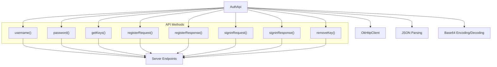
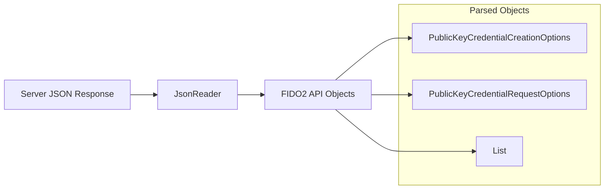
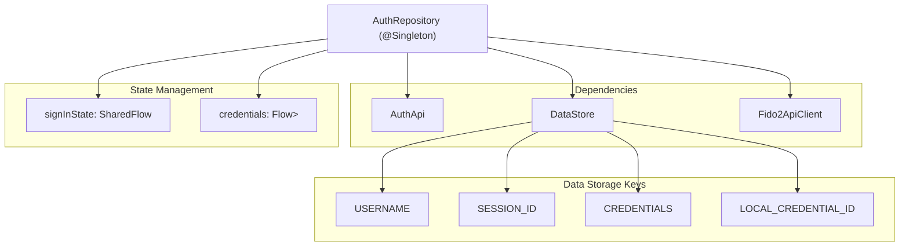
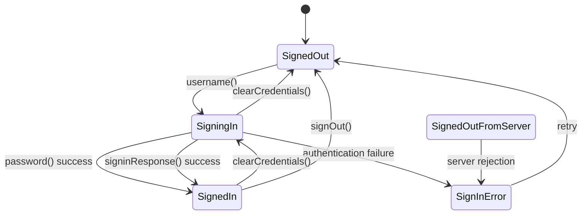
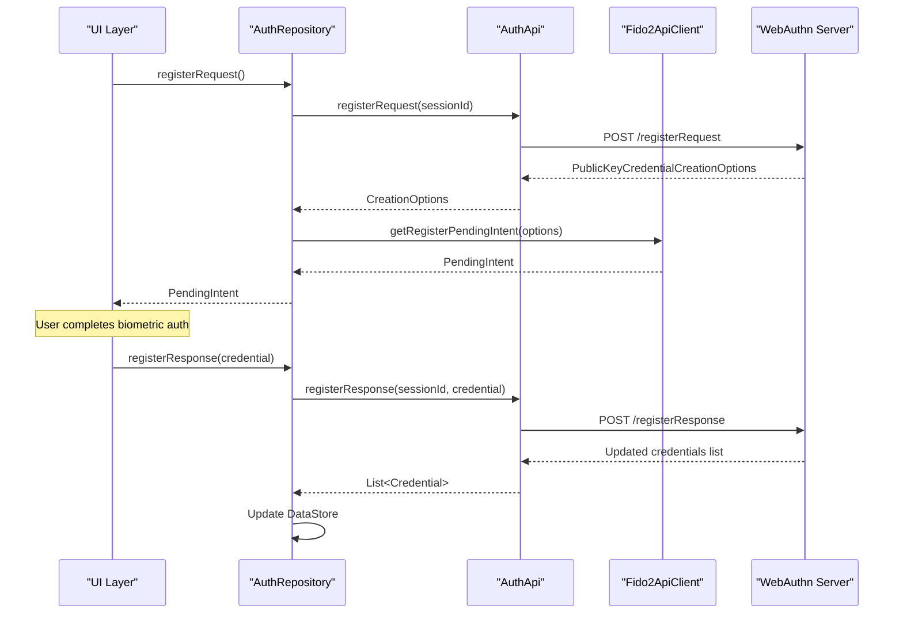
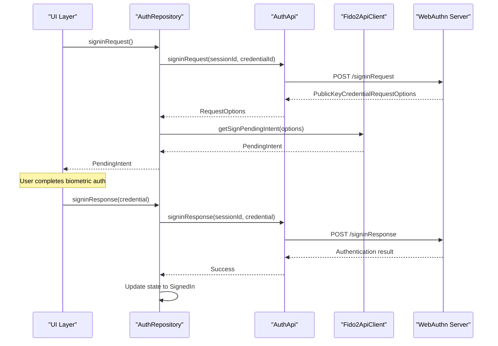

<!-- source: DeepWiki mcp.deepwiki.com · repo android/codelab-fido2 · page 3.2 Authentication Components · fetched 2026-10-23 -->

# Authentication Components

Relevant source files

The following files were used as context for generating this wiki page:

- [android/app-start/src/main/java/com/example/android/fido2/repository/AuthRepository.kt](android/app-start/src/main/java/com/example/android/fido2/repository/AuthRepository.kt)
- [android/app/src/main/java/com/example/android/fido2/api/AuthApi.kt](android/app/src/main/java/com/example/android/fido2/api/AuthApi.kt)
- [android/app/src/main/java/com/example/android/fido2/repository/AuthRepository.kt](android/app/src/main/java/com/example/android/fido2/repository/AuthRepository.kt)

This document covers the core authentication logic components of the Android FIDO2 application, specifically the `AuthApi` and `AuthRepository` classes that handle server communication, local data persistence, and FIDO2 operations integration. For user interface components that interact with these authentication services, see [User Interface Components](#3.3).

## Overview

The authentication system in the Android application consists of two primary components that work together to implement FIDO2 authentication:

- **AuthApi**: HTTP client responsible for server communication and WebAuthn protocol handling
- **AuthRepository**: Central coordinator that manages authentication state, local data persistence, and FIDO2 API integration

## AuthApi - Server Communication Layer

The `AuthApi` class serves as the HTTP client layer, handling all server communication for the FIDO2 authentication flow. It encapsulates the WebAuthn protocol implementation and provides a clean interface for authentication operations.

### Core API Operations

The `AuthApi` provides methods that correspond directly to the WebAuthn authentication flow:

| Method | Endpoint | Purpose |
|--------|----------|---------|
| `username()` | `/username` | Initialize session with username |
| `password()` | `/password` | Authenticate with password |
| `getKeys()` | `/getKeys` | Retrieve user's registered credentials |
| `registerRequest()` | `/registerRequest` | Get credential creation options |
| `registerResponse()` | `/registerResponse` | Submit new credential to server |
| `signinRequest()` | `/signinRequest` | Get credential request options |
| `signinResponse()` | `/signinResponse` | Submit authentication assertion |
| `removeKey()` | `/removeKey` | Remove credential from server |

### JSON Processing and FIDO2 Integration

The `AuthApi` handles complex JSON parsing to convert server responses into Google Play Services FIDO2 API objects:

The parsing methods include specialized handlers for WebAuthn data structures:
- `parsePublicKeyCredentialCreationOptions()` at [android/app/src/main/java/com/example/android/fido2/api/AuthApi.kt:300-326]()
- `parsePublicKeyCredentialRequestOptions()` at [android/app/src/main/java/com/example/android/fido2/api/AuthApi.kt:279-298]()
- `parseUserCredentials()` at [android/app/src/main/java/com/example/android/fido2/api/AuthApi.kt:441-477]()

Sources: [android/app/src/main/java/com/example/android/fido2/api/AuthApi.kt:1-547]()

## AuthRepository - Authentication Coordinator

The `AuthRepository` serves as the central coordinator for authentication operations, managing the interaction between the API layer, local data persistence, and FIDO2 operations.

### Authentication State Flow

The repository manages authentication state through a reactive flow system:

### FIDO2 Registration Flow

The repository coordinates the two-phase FIDO2 registration process:

### FIDO2 Authentication Flow

Similarly, the repository manages the authentication assertion process:

Sources: [android/app/src/main/java/com/example/android/fido2/repository/AuthRepository.kt:1-329]()

## Data Persistence Layer

The authentication components use Android DataStore for persistent storage of authentication state and credentials:

| Key | Type | Purpose |
|-----|------|---------|
| `USERNAME` | String | Current user's username |
| `SESSION_ID` | String | Server session identifier |
| `CREDENTIALS` | StringSet | Serialized credential data |
| `LOCAL_CREDENTIAL_ID` | String | Device's credential identifier |

The repository implements custom serialization for credential data at [android/app/src/main/java/com/example/android/fido2/repository/AuthRepository.kt:171-186](), converting between `List<Credential>` objects and string sets for DataStore persistence.

## Error Handling and Session Management

Both components implement comprehensive error handling:

- **AuthApi**: Uses `ApiResult` sealed class to handle success/failure states and server session management
- **AuthRepository**: Implements automatic sign-out on server authentication failures and state recovery

The session management system tracks server-issued session cookies and automatically includes them in subsequent requests at [android/app/src/main/java/com/example/android/fido2/api/AuthApi.kt:533-545]().

Sources: [android/app/src/main/java/com/example/android/fido2/api/AuthApi.kt:53-62](), [android/app/src/main/java/com/example/android/fido2/repository/AuthRepository.kt:54-66]()

---

