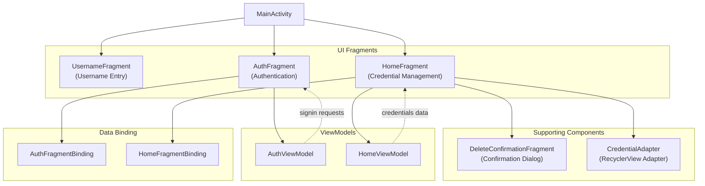
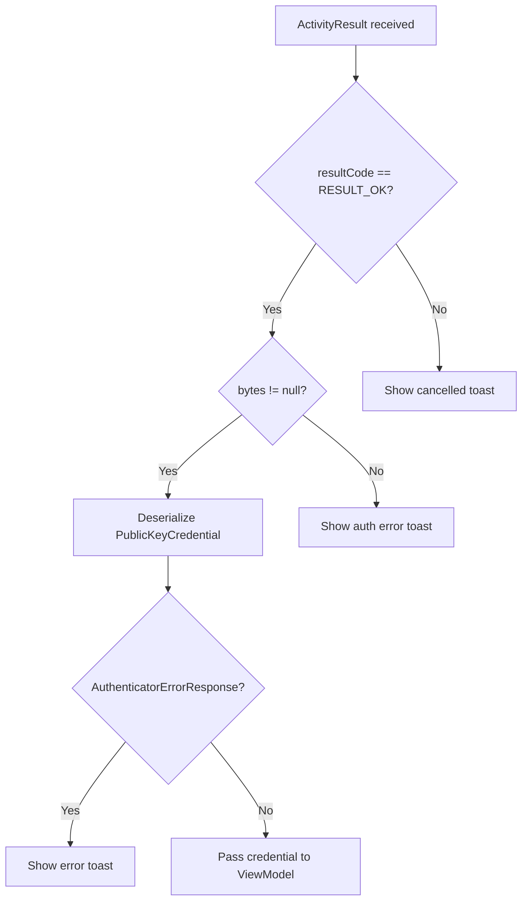
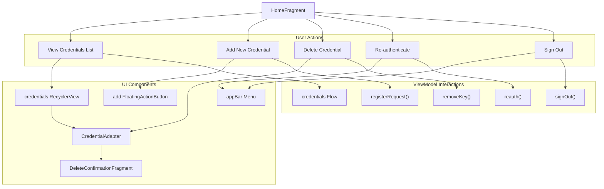
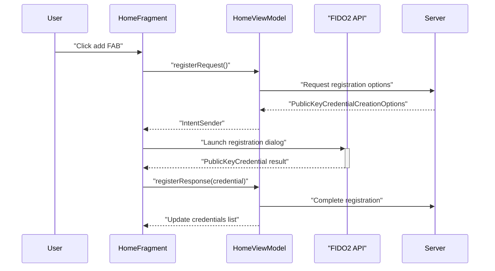
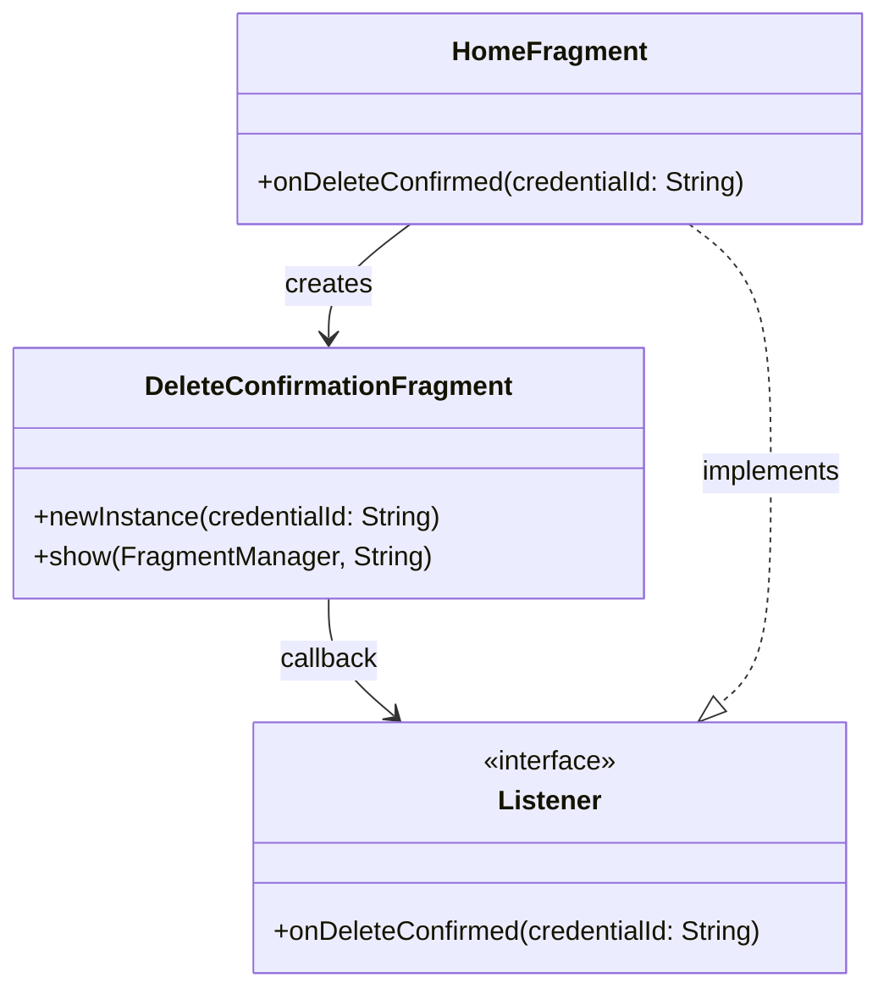
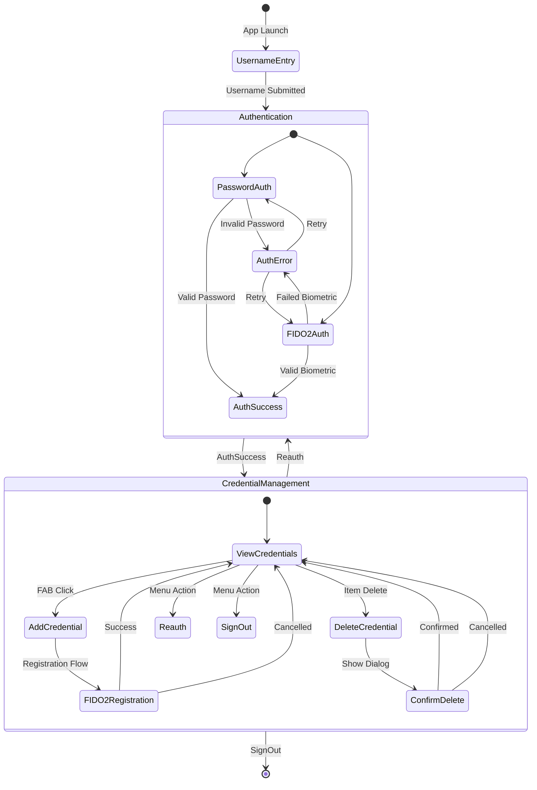

<!-- source: DeepWiki mcp.deepwiki.com · repo android/codelab-fido2 · page 3.3 User Interface Components · fetched 2026-10-23 -->

# User Interface Components

<details>
<summary>Relevant source files</summary>

The following files were used as context for generating this wiki page:

- [android/app-start/src/main/java/com/example/android/fido2/ui/auth/AuthFragment.kt](android/app-start/src/main/java/com/example/android/fido2/ui/auth/AuthFragment.kt)
- [android/app-start/src/main/java/com/example/android/fido2/ui/home/HomeFragment.kt](android/app-start/src/main/java/com/example/android/fido2/ui/home/HomeFragment.kt)
- [android/app/src/main/java/com/example/android/fido2/ui/auth/AuthFragment.kt](android/app/src/main/java/com/example/android/fido2/ui/auth/AuthFragment.kt)
- [android/app/src/main/java/com/example/android/fido2/ui/home/HomeFragment.kt](android/app/src/main/java/com/example/android/fido2/ui/home/HomeFragment.kt)

</details>


## Purpose and Scope

This document covers the Android user interface implementation for the FIDO2 codelab application, including fragments, user interaction flows, and UI state management for authentication and credential management. The UI components are built using Android's modern architecture patterns with data binding and ViewModels.

For the underlying business logic and data management that powers these UI components, see [Authentication Components](#3.2). For the ViewModel implementations and MVVM architecture details, see [ViewModels and Data Binding](#3.4).

## Fragment Architecture Overview

The Android application uses a single-activity architecture with three main fragments that handle different aspects of the FIDO2 authentication flow:



Sources: [android/app/src/main/java/com/example/android/fido2/ui/auth/AuthFragment.kt:42-50](), [android/app/src/main/java/com/example/android/fido2/ui/home/HomeFragment.kt:42-55]()

## Authentication UI (AuthFragment)

The `AuthFragment` handles both password-based and FIDO2 biometric authentication. It provides a dual-mode interface where users can either enter a password or use their biometric authenticator.

### Fragment Structure and Binding

The fragment uses Android Data Binding to connect the UI elements with the `AuthViewModel`:

| Component | Purpose | Key Features |
|-----------|---------|--------------|
| `AuthFragmentBinding` | Data binding connection | Two-way binding with ViewModel |
| `inputPassword` | Password input field | IME action handling for "Go" button |
| `processing` | Progress indicator | Shows/hides during API calls |
| `signIntentLauncher` | Activity result launcher | Handles FIDO2 authentication results |

### FIDO2 Authentication Flow

```mermaid
sequenceDiagram
    participant User
    participant AuthFragment
    participant AuthViewModel
    participant "FIDO2 API"
    participant "Activity Result"
    
    User->>AuthFragment: "Trigger FIDO2 auth"
    AuthFragment->>AuthViewModel: "Request signin intent"
    AuthViewModel-->>AuthFragment: "IntentSender (signinRequests flow)"
    AuthFragment->>+signIntentLauncher: "launch(IntentSenderRequest)"
    signIntentLauncher->>+"FIDO2 API": "Start biometric dialog"
    "FIDO2 API"-->>-"Activity Result": "PublicKeyCredential bytes"
    "Activity Result"-->>-AuthFragment: "handleSignResult(ActivityResult)"
    AuthFragment->>AuthFragment: "deserialize credential"
    AuthFragment->>AuthViewModel: "signinResponse(credential)"
```

### Input Handling and User Experience

The fragment implements several UX patterns for smooth user interaction:

```kotlin
// Password input with IME action handling
binding.inputPassword.setOnEditorActionListener { _, actionId, _ ->
    if (actionId == EditorInfo.IME_ACTION_GO) {
        viewModel.submitPassword()
        true
    } else {
        false
    }
}
```

Sources: [android/app/src/main/java/com/example/android/fido2/ui/auth/AuthFragment.kt:64-71]()

### Activity Result Processing

The fragment handles FIDO2 authentication results through a structured error handling approach:



Sources: [android/app/src/main/java/com/example/android/fido2/ui/auth/AuthFragment.kt:91-109]()

## Home Screen UI (HomeFragment)

The `HomeFragment` serves as the main credential management interface, allowing users to view, add, and remove FIDO2 credentials after successful authentication.

### Layout Structure and Components

| UI Component | Purpose | Implementation |
|--------------|---------|----------------|
| App Bar with Menu | Navigation and actions | Reauth and Sign Out options |
| Credentials RecyclerView | Display credential list | Uses `CredentialAdapter` |
| Empty State View | Show when no credentials | Toggles visibility based on data |
| Floating Action Button | Add new credentials | Triggers FIDO2 registration |
| Progress Indicator | Show loading states | During API operations |

### credential Management Workflow



### Credential List Management

The fragment uses a `CredentialAdapter` to display the list of user credentials in a RecyclerView. The list updates reactively based on the ViewModel's credential flow:

```kotlin
// Reactive credential list updates
viewLifecycleOwner.lifecycleScope.launchWhenStarted {
    viewModel.credentials.collect { credentials ->
        credentialAdapter.submitList(credentials)
        binding.emptyCredentials.isVisible = credentials.isEmpty()
        binding.credentialsCaption.isVisible = credentials.isNotEmpty()
    }
}
```

Sources: [android/app/src/main/java/com/example/android/fido2/ui/home/HomeFragment.kt:74-80]()

### FIDO2 Registration Flow

The home screen handles credential registration through the same activity result pattern as authentication:



Sources: [android/app/src/main/java/com/example/android/fido2/ui/home/HomeFragment.kt:109-118](), [android/app/src/main/java/com/example/android/fido2/ui/home/HomeFragment.kt:125-144]()

## Supporting UI Components

### DeleteConfirmationFragment

A dialog fragment that handles credential deletion confirmation. It implements a listener pattern to communicate back to the `HomeFragment`:



### CredentialAdapter

A RecyclerView adapter that displays individual credentials and handles delete actions:

| Responsibility | Implementation |
|----------------|----------------|
| Display credential items | Binds credential data to list items |
| Handle delete clicks | Triggers delete confirmation dialog |
| List diff calculations | Uses `submitList()` for efficient updates |

Sources: [android/app/src/main/java/com/example/android/fido2/ui/home/HomeFragment.kt:64-71](), [android/app/src/main/java/com/example/android/fido2/ui/home/HomeFragment.kt:118-122]()

## User Interaction Flows

### Complete Authentication Journey



## Data Binding and Lifecycle Management

### Fragment Lifecycle Integration

Both main fragments follow consistent patterns for lifecycle-aware data binding and coroutine management:

| Lifecycle Phase | Operations |
|-----------------|------------|
| `onCreateView` | Initialize data binding, set lifecycle owner |
| `onViewCreated` | Set up UI listeners, launch coroutines |
| `launchWhenStarted` | Collect ViewModel flows safely |

### Coroutine Flow Collection

The fragments use structured concurrency to handle multiple data streams from ViewModels:

```kotlin
viewLifecycleOwner.lifecycleScope.launchWhenStarted {
    launch {
        viewModel.signinRequests.collect { intent ->
            // Handle FIDO2 signin requests
        }
    }
    launch {
        viewModel.processing.collect { processing ->
            // Update loading UI state
        }
    }
}
```

### Processing State Management

Both fragments implement consistent loading state management through their respective ViewModels' `processing` flows, showing/hiding progress indicators during network operations and FIDO2 API calls.

Sources: [android/app/src/main/java/com/example/android/fido2/ui/auth/AuthFragment.kt:73-88](), [android/app/src/main/java/com/example/android/fido2/ui/home/HomeFragment.kt:98-106]()

---

