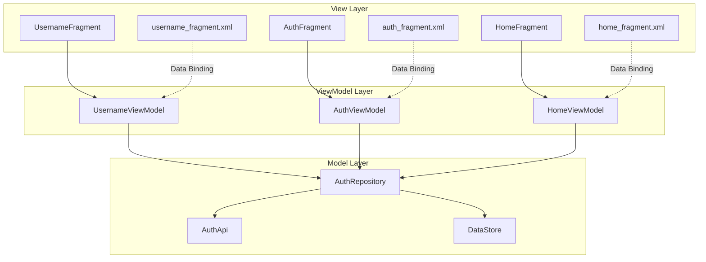
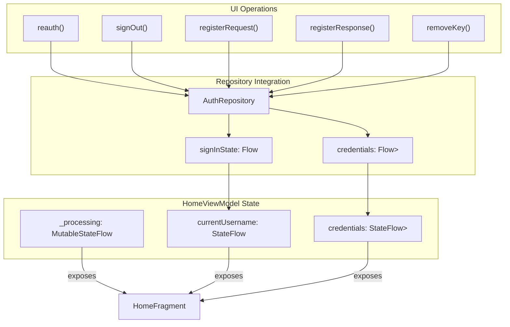
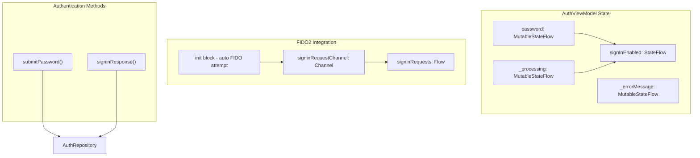
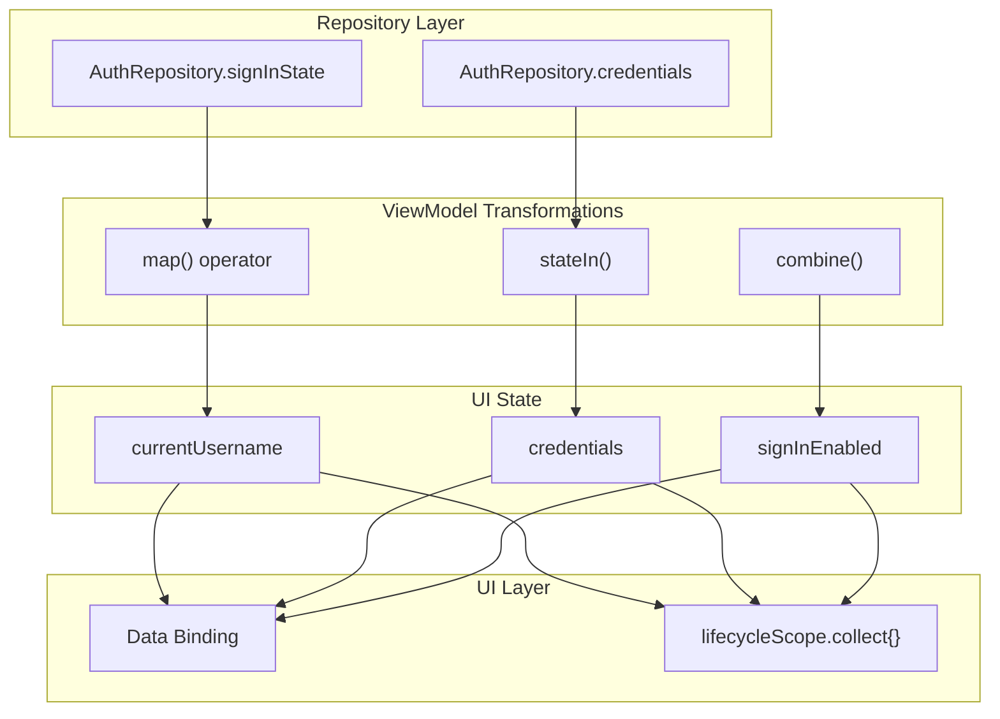
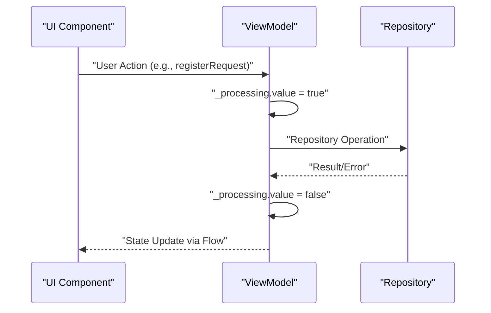

<!-- source: DeepWiki mcp.deepwiki.com · repo android/codelab-fido2 · page 3.4 ViewModels and Data Binding · fetched 2026-10-23 -->

# ViewModels and Data Binding

<details>
<summary>Relevant source files</summary>

The following files were used as context for generating this wiki page:

- [android/app-start/src/main/java/com/example/android/fido2/ui/username/UsernameFragment.kt](android/app-start/src/main/java/com/example/android/fido2/ui/username/UsernameFragment.kt)
- [android/app-start/src/main/res/layout/auth_fragment.xml](android/app-start/src/main/res/layout/auth_fragment.xml)
- [android/app-start/src/main/res/layout/home_fragment.xml](android/app-start/src/main/res/layout/home_fragment.xml)
- [android/app-start/src/main/res/layout/username_fragment.xml](android/app-start/src/main/res/layout/username_fragment.xml)
- [android/app/src/main/java/com/example/android/fido2/ui/auth/AuthViewModel.kt](android/app/src/main/java/com/example/android/fido2/ui/auth/AuthViewModel.kt)
- [android/app/src/main/java/com/example/android/fido2/ui/home/HomeViewModel.kt](android/app/src/main/java/com/example/android/fido2/ui/home/HomeViewModel.kt)
- [android/app/src/main/java/com/example/android/fido2/ui/username/UsernameFragment.kt](android/app/src/main/java/com/example/android/fido2/ui/username/UsernameFragment.kt)
- [android/app/src/main/res/layout/auth_fragment.xml](android/app/src/main/res/layout/auth_fragment.xml)
- [android/app/src/main/res/layout/home_fragment.xml](android/app/src/main/res/layout/home_fragment.xml)
- [android/app/src/main/res/layout/username_fragment.xml](android/app/src/main/res/layout/username_fragment.xml)

</details>


This document covers the Android app's MVVM (Model-View-ViewModel) architecture implementation, focusing on the ViewModel classes that manage UI state and business logic, and how they integrate with Android's Data Binding framework. The ViewModels serve as intermediaries between the UI components and the authentication repository, managing reactive state flows and coordinating FIDO2 authentication operations.

For information about the Fragment implementations that consume these ViewModels, see [User Interface Components](#3.3). For details about the underlying authentication logic, see [Authentication Components](#3.2).

## MVVM Architecture Overview

The Android app implements a clean MVVM architecture where ViewModels manage UI state and business logic while remaining independent of Android UI frameworks. Each major screen has its own ViewModel that coordinates with the shared `AuthRepository`.



**Sources:** [android/app/src/main/java/com/example/android/fido2/ui/home/HomeViewModel.kt:1-97](), [android/app/src/main/java/com/example/android/fido2/ui/auth/AuthViewModel.kt:1-97](), [android/app/src/main/res/layout/home_fragment.xml:22-28]()

## ViewModel Implementation Details

### HomeViewModel Architecture

The `HomeViewModel` manages the authenticated user's home screen state, including credential management and user information display.



Key implementation details from `HomeViewModel`:
- Uses `@HiltViewModel` annotation for dependency injection at [android/app/src/main/java/com/example/android/fido2/ui/home/HomeViewModel.kt:34]()
- Manages processing state with `MutableStateFlow<Boolean>` at [android/app/src/main/java/com/example/android/fido2/ui/home/HomeViewModel.kt:39-40]()
- Transforms repository state flows using `map` operator at [android/app/src/main/java/com/example/android/fido2/ui/home/HomeViewModel.kt:42-48]()
- Exposes credentials list with `stateIn` for lifecycle-aware collection at [android/app/src/main/java/com/example/android/fido2/ui/home/HomeViewModel.kt:50-52]()

**Sources:** [android/app/src/main/java/com/example/android/fido2/ui/home/HomeViewModel.kt:34-97]()

### AuthViewModel Architecture 

The `AuthViewModel` manages authentication flow state, including both password-based and FIDO2 authentication methods.



Key implementation details:
- Combines multiple flows to compute `signInEnabled` state at [android/app/src/main/java/com/example/android/fido2/ui/auth/AuthViewModel.kt:50-52]()
- Uses `Channel` for one-time events like FIDO2 sign-in requests at [android/app/src/main/java/com/example/android/fido2/ui/auth/AuthViewModel.kt:54-55]()
- Automatically attempts FIDO2 authentication in init block at [android/app/src/main/java/com/example/android/fido2/ui/auth/AuthViewModel.kt:57-65]()

**Sources:** [android/app/src/main/java/com/example/android/fido2/ui/auth/AuthViewModel.kt:34-97]()

## Data Binding Integration

The app uses Android Data Binding to connect ViewModels directly to XML layouts, enabling declarative UI updates and reducing boilerplate code.

### Data Binding Configuration

Each layout file declares its ViewModel dependency in a `<data>` section:

| Layout File | ViewModel Type | Binding Variable |
|-------------|----------------|------------------|
| `home_fragment.xml` | `HomeViewModel` | `viewModel` |
| `auth_fragment.xml` | `AuthViewModel` | `viewModel` |
| `username_fragment.xml` | `UsernameViewModel` | `viewModel` |

### Binding Expression Patterns

The layouts use several data binding expression types:

**One-way data binding** for displaying state:
- Welcome text: `android:text="@{@string/welcome(viewModel.currentUsername)}"` at [android/app/src/main/res/layout/home_fragment.xml:46]()
- Button enabled state: `android:enabled="@{viewModel.signInEnabled}"` at [android/app/src/main/res/layout/auth_fragment.xml:108]()

**Two-way data binding** for input fields:
- Password input: `android:text="@={viewModel.password}"` at [android/app/src/main/res/layout/auth_fragment.xml:70]()
- Username input: `android:text="@={viewModel.username}"` at [android/app/src/main/res/layout/username_fragment.xml:69]()

**Click handlers** for user actions:
- Sign in button: `android:onClick="@{() -> viewModel.submitPassword()}"` at [android/app/src/main/res/layout/auth_fragment.xml:109]()

**Sources:** [android/app/src/main/res/layout/home_fragment.xml:22-28](), [android/app/src/main/res/layout/auth_fragment.xml:22-28](), [android/app/src/main/res/layout/username_fragment.xml:22-28]()

## State Management Patterns

### Reactive State Flow Architecture

The ViewModels implement reactive state management using Kotlin coroutines and flows:



### Processing State Management

Both ViewModels use a consistent pattern for managing async operation states:



This pattern appears in methods like:
- `HomeViewModel.registerRequest()` at [android/app/src/main/java/com/example/android/fido2/ui/home/HomeViewModel.kt:66-73]()
- `AuthViewModel.submitPassword()` at [android/app/src/main/java/com/example/android/fido2/ui/auth/AuthViewModel.kt:75-84]()

**Sources:** [android/app/src/main/java/com/example/android/fido2/ui/home/HomeViewModel.kt:39-40](), [android/app/src/main/java/com/example/android/fido2/ui/auth/AuthViewModel.kt:44-45]()

## Fragment Integration Patterns

### Data Binding Setup

Fragments connect to their ViewModels through a standardized data binding setup pattern:

1. **ViewModel acquisition**: `private val viewModel: HomeViewModel by viewModels()` at [android/app/src/main/java/com/example/android/fido2/ui/username/UsernameFragment.kt:34]()
2. **Binding inflation**: `binding = UsernameFragmentBinding.inflate(inflater, container, false)` at [android/app/src/main/java/com/example/android/fido2/ui/username/UsernameFragment.kt:41]()
3. **Lifecycle owner assignment**: `binding.lifecycleOwner = viewLifecycleOwner` at [android/app/src/main/java/com/example/android/fido2/ui/username/UsernameFragment.kt:42]()
4. **ViewModel binding**: `binding.viewModel = viewModel` at [android/app/src/main/java/com/example/android/fido2/ui/username/UsernameFragment.kt:43]()

### Flow Collection Patterns

Fragments manually collect specific flows that require imperative handling (like showing/hiding progress indicators):

```kotlin
viewLifecycleOwner.lifecycleScope.launchWhenStarted {
    viewModel.sending.collect { sending ->
        if (sending) {
            binding.sending.show()
        } else {
            binding.sending.hide()
        }
    }
}
```

This pattern appears at [android/app/src/main/java/com/example/android/fido2/ui/username/UsernameFragment.kt:48-56]().

**Sources:** [android/app/src/main/java/com/example/android/fido2/ui/username/UsernameFragment.kt:34-66](), [android/app/src/main/res/layout/home_fragment.xml:94-104]()

---

